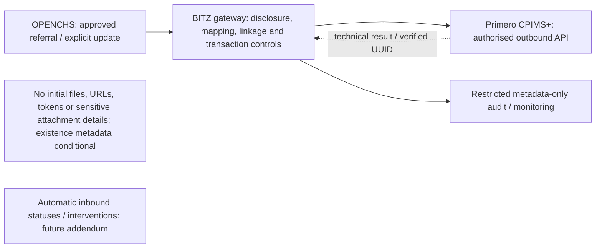

# Former Annex K.2 — Detailed data safeguards (archived 9 November 2026)

This is the former Annex K.2 of the D1 v2.8 inception report. It duplicated the pre-revision Section 7 and contained superseded wording (audit finding CON-017). It is retained unchanged for traceability only; Section 7 is the current position.

### K.2 Detailed data safeguards

#### K.2.1 Data requirements and mapping approach

D-012 historically included attachments in the requested information set. The initial exchange is limited to approved child details, category / narrative, necessary authorised reporter information, alleged-perpetrator details and explicit outbound follow-up. ABR remains optional; the helpline case plan and all electronic attachment transfer are excluded. Files, file URLs, access tokens and sensitive attachment details must not be transmitted. Only non-sensitive supporting-material-existence metadata may be included after all five SCOPE-003 conditions in section 4.4 are evidenced; otherwise omit it. Configured fields, emergency minimums, code lists and consent / disclosure mapping remain pending. Annex C records the mapping boundary; Annex J.3 retains the original history and current requirements.

The received September 2019 SOP supplies Form 4 and confidentiality guidance for review. It does not establish current legal authority or the deployed CPIMS+ configuration. Ministry confirmation of applicability and approved disclosure/exception rules remains required. Section 3.5 records the evidence and its implications.

#### K.2.2 Legal and policy position

The Data Protection Act, 2011 (Act No. 5 of 2012) [DPA1] has been received and is the instrument identified for this integration; the 2011 and 2012 references in the Session 3 record and the annotated checklist describe the same Act. The draft Data Management Policy [DMP1] records that the Data Protection Commission had not yet been established, and the policy itself awaits Cabinet approval. **Determining how the law applies is outside the scope of this report.** The responsible Ministry and UNICEF advisers must confirm the Act’s current status, any amendments, regulations or codes of conduct, and any child-protection legislation that applies alongside it; under section 5, sector legislation with stronger safeguards prevails. BITZ will complete the desk research (A-022). Section 7.2 summarises the provisions relevant to the integration.

#### K.2.3 Control framework

| **Control area** | **Requirement** | **Status** | **Owner** |
|----|----|----|----|
| Lawful basis | Authorised purposes for sharing child-protection data between the helpline and CPIMS+; a ground under section 15 of the Act and, for children’s and sensitive information, a condition under sections 29–36 [DPA1] | Dependency (A-022; Ministry confirmation) | Ministry / UNICEF |
| Consent and disclosure | Upstream consent checks remain deployment-dependent. [M4] discussed call-time capture / withdrawal; [RV3] specifies consent states. Ministry must approve lawful disclosure, exceptions and withdrawal effects; Primero must verify field / override configuration | Pending Confirmation (R-011, DATA-012) | Ministry; Primero to confirm configuration |
| Anonymous reporters | Reporter recorded as anonymous in CPIMS+; anonymity preserved in payloads, logs and return updates | Confirmed (D-010); mapping Pending | BITZ, Primero |
| Child-sensitive data | Only agreed fields sent; no fictitious names, dates or identifiers created to satisfy validation | Confirmed field set (D-012); rule Proposed | BITZ |
| Access control | Integration account permitted to set only approved fields; OPENCHS role controls for initial outbound operations; returned-data controls are future addendum scope | Proposed (SEC-003) | Primero; BITZ |
| Authentication | Bearer JWT [CT2 item 70]; 60-minute expiry [TR1 section 3]; renewed automatically on a 401 response (proposed); SSO preferred for users; credentials for the unattended connection pending | Pending Confirmation (API-002) | Primero; BITZ |
| Secure transport | Proposed minimum HTTPS with TLS 1.2+; certificate verification proposed; Primero confirmed that network/security controls apply without specifying them | Proposed; controls Pending Confirmation | Primero; infrastructure |
| Credential management | Secret store; separate test and production credentials; rotation; custody | Pending Confirmation (API-008) | BITZ; Primero |
| Audit logs | Transaction metadata logged; tokens and full payloads not logged by default; retention and access approved | Pending Confirmation (OPS-004, OPS-005) | Security owner |
| Data minimisation | Case plan / initial attachment transfer excluded; future return updates limited to linked cases and approved fields after addendum | Initial exclusion validated; future SEC-008 Pending Validation — Contract Addendum | Ministry; BITZ |
| Retention | Retention of queued payloads and logs; attachment retention is future addendum scope; no periods are prescribed under section 19 of the Act, so the Ministry must set them | Pending Confirmation | Data protection owner |
| Incident handling | Contacts, escalation and notification duties for data incidents and outages; statutory notification to the Commission and affected data subjects under section 23 of the Act, and who receives notices while the Commission is not established | Pending Confirmation (OPS-007) | Ministry; UNICEF |
| Processing contracts | Written contract with confidentiality and security terms for each party processing personal information for a data controller (BITZ as gateway operator, hosting provider) [DPA1 sections 21–22]; data controller named for each system | Pending Confirmation (section 7.5; R-017) | Ministry; UNICEF |
| Hosting and transfers | Where production OPENCHS, CPIMS+ and any integration platform are hosted, and whether support staff access data from outside Lesotho; conditions of section 52 of the Act and government hosting direction [DMP1 section 5.6.3] | Pending Confirmation (section 7.5; R-017) | Ministry; Primero; BITZ |
| Notification to the Commission | How the data controller notifies processing under sections 25(5) and 53 of the Act while the Commission is not established | Pending Confirmation (section 7.5; R-017) | Ministry |
| Secure test data | Approved synthetic child-journey dataset; no real child records copied into test environments | Proposed (SEC-007); approval Pending | UAT lead; privacy owner |
| Attachments | No initial file / media transfer, URLs, tokens or sensitive attachment details; only conditional non-sensitive existence metadata under section 4.4. Future file controls require addendum | Pending Validation — Contract Addendum (DATA-010) | Ministry; Primero; BITZ |
| Return updates | Future inbound authenticated channel, minimised fields and access controls only after addendum; no initial automatic status retrieval | Pending Validation — Contract Addendum (RT-007) | Primero; BITZ |

#### K.2.4 Data flow and classification

**Technical reference — Data flow and classification.** Sources: D-007, D-010, D-012, OPS-004. Automatic returned case information is future addendum scope; initial technical responses do not imply human acceptance (RT-007; SCOPE-002).

[Historical pre-scope-validation diagram](assets/d1-v2.8/media/image20.png) retained for evidence only; it does not define initial delivery.

| **Data** | **Direction** | **Sensitivity (proposed)** | **Control** |
|----|----|----|----|
| Child identity, location, contact | OPENCHS → CPIMS+ | High (child-identifying); child’s information under DPA section 29(a) | Agreed fields only; TLS; least-privilege account |
| Narrative, case category, perpetrator details | OPENCHS → CPIMS+ | High (child-protection detail); sensitive under DPA section 29(b) | Not written to logs; role-based access |
| Reporter contact | OPENCHS → CPIMS+ when given | High | Anonymous flag respected (D-010) |
| Attachments | No initial transfer; future addendum only | High | No contents, URLs, tokens or sensitive file details (DATA-010; SCOPE-003) |
| Supporting-material-existence metadata | Conditional outbound only | Must be non-sensitive | Omit unless Ministry approval, necessity, supported field, non-sensitive content and validated mapping / controls are evidenced |
| ABR ID | OPENCHS → CPIMS+ when available | High (national identifier) | Structural validation; stored as text |
| Referral status and interventions | Future automatic inbound only after addendum | High | Initial display only of decisions actually received / reliably recorded through an authorised process; never infer from API receipt |
| Audit metadata | Both systems | Medium | Retention and access approval (OPS-004, OPS-005) |
| Helpline case plan | Not transferred | — | Excluded from payload (D-012) |

#### K.2.5 Matters requiring UNICEF or Ministry confirmation

1.  Current status of the Data Protection Act 2011 [DPA1], any amendments, regulations or codes of conduct, and any child-protection legislation that applies alongside it.

2.  Lawful basis and authorised purposes for each direction of exchange.

3.  Consent capture and override authority.

4.  Retention periods for integration data, logs and attachments.

5.  Incident notification obligations and contacts.

6.  Approval of the synthetic test dataset and prohibition of real records in test.

7.  Named data protection/security approver.

8.  Data controller for OPENCHS and for CPIMS+, and written processing contracts with confidentiality and security terms for BITZ, hosting providers and any integration platform (DPA sections 21–22).

9.  Hosting location of production data for both systems and any integration platform, and whether support access from outside Lesotho is permitted (DPA section 52; DMP sections 5.6.3 and 5.6.7).

10. How processing is notified (DPA sections 25(5) and 53) and to whom security compromises are reported (section 23) while the Data Protection Commission is not established.

11. Applicable classification under the national Data Classification and Access Control Policy, and the security documentation required for government information systems (DMP sections 5.6.4 and 5.6.8). UNICEF is asked to supply the classification policy.

#### K.2.6 Safeguarding requirements

Reporter anonymity must be preserved in initial outbound data and any future approved inbound exchange. Initial safeguards include restricted permissions, secure transport / credentials, metadata-only audit and synthetic test data by default. Returned-field controls remain addendum-dependent. Annex J.5 and Annex A retain the detailed requirements; Ministry legal approval remains a production prerequisite.
