**DELIVERABLE D1 · INCEPTION, REQUIREMENTS & ENVIRONMENT SETUP**

# Inception Report

Lesotho Child Helpline 116 — OPENCHS and Primero CPIMS+ Integration

|  |  |
|----|----|
| **PREPARED FOR** | UNICEF Lesotho, Ministry of Gender, Youth and Social Development (MGYSD), Child Helpline 116 stakeholders, Primero technical team |
| **PREPARED BY** | BITZ IT Consulting Ltd — OPENCHS project team |
| **CONTRACT** | 43427866 Amendment 3 (TICAD integration) — Workstream 1, contract item 50 |
| **VERSION** | 2.8 — Post-Validation Revision |
| **DATE** | 9 November 2026 |
| **STATUS** | Revised draft incorporating D1 validation meeting outcomes — pending formal approval |

|  |  |
|----|---:|
| **BITZ IT Consulting Ltd** | Version 2.8 — Post-Validation Revision · 9 November 2026 |

## Document control

| **Item** | **Detail** |
|----|----|
| Project | Lesotho Child Helpline 116 / OPENCHS integration with Primero CPIMS+ |
| Contract | Contract 43427866, Amendment 3 [CT2], signed by UNICEF and BITZ on 15 September 2026, adds the integration as items 50–80 . It is the single contractual source for this report |
| Deliverable | D1 — Inception, Requirements & Environment Setup (Workstream 1; contract item 50 [CT2]) |
| Prepared for | UNICEF Lesotho, Ministry of Gender, Youth and Social Development (MGYSD), Child Helpline 116 stakeholders, Primero technical team |
| Prepared by | BITZ IT Consulting Ltd, OPENCHS project team |
| Document status | Revised draft incorporating D1 validation meeting outcomes — pending formal approval |
| Version | 2.8 — Post-Validation Revision |
| Date | 9 November 2026 |
| Supersedes | Version 2.7 dated 30 October 2026 |
| Recorded circulation target | Initial draft by 28 October 2026, close of business (A-025; exact time and time zone not recorded) |
| Controlled registers | [Inception Completion Inventory](INCEPTION_COMPLETION_INVENTORY.md) (requirement status); [Session 3 action tracker](../03_meetings/session_3/SESSION_3_ACTION_TRACKER_2026-10-26.xlsx) (actions); [Contract-Aligned Delivery Plan](../02_project_management/CONTRACT_ALIGNED_DELIVERY_PLAN.md) (commercial dates) |

### Reading this report

The main report presents the inception findings, the proposed approach, responsibilities and the decisions required. The annexes contain the detailed requirements, specifications and supporting evidence for specialist reviewers.

OPENCHS is the Child Helpline’s case-recording system. Primero CPIMS+ is the child-protection case-management system used by the receiving Ministry teams. **ABR ID** means the birth-registration identifier discussed during inception. **SOPs** are standard operating procedures: the written instructions for handling cases. **UAT** means user acceptance testing: testing by staff to confirm that the systems support their work. **API** (application programming interface) means the software interface through which the two systems exchange information. **D1–D4** identify the four contracted deliverables. Other codes, such as A-014 or R-011, let readers find the related action or risk; they are not technical instructions. Technical terms are used in their standard sense: authentication (how one system proves it is authorised to connect to another), retry (an automatic further attempt to deliver a referral), regression testing (testing that existing functions still work after a change), webhook (an automatic notification sent from one system to another) and go-live (the start of live operational use).

“Confirmed” means a decision was recorded in a meeting. “Proposed” means it still needs agreement. “Pending” means more information or a decision is needed. None of these terms means this report has been formally approved. For the reconciled Section 3 and Annexes A / J, use the six current classifications defined in section 3.6; user-confirmed requirements validation is explicitly distinguished from meeting evidence and formal Ministry approval.

### Status classifications used in this report

| **Classification** | **Meaning in this report** | **Equivalent in the completion inventory** |
|----|----|----|
| Confirmed | Agreed and recorded in session minutes (principally Session 3, 26 October 2026). A confirmed business decision is not formal approval of this report or a contract variation. | Resolved |
| Approved | Formally approved in writing by a named, authorised approver. No item in this report is currently Approved. | — |
| Completed | An action or output for which completion evidence has been received. | — |
| Proposed | A BITZ technical, planning or governance proposal awaiting review. | Proposed |
| Pending Confirmation | Identified requirement or decision awaiting confirmation from a named party. | Pending |
| Dependency | An external input that must be received before dependent work can proceed or be accepted. | Pending |

Earlier sections use **Excluded (Confirmed)** for session-supported exclusions and **Proposed exclusion** for BITZ proposals. Section 4 now records the SCOPE-001–SCOPE-010 validated initial boundaries, without implying a signed variation; Annex J retains original classifications as history beside the current classifications.

### Version history

| **Version** | **Date** | **Change** |
|----|----|----|
| 0.4 | 26 Oct 2026 | Sessions 1–2 and the Primero technical response [TR1]; archived |
| 0.5 | 26 Oct 2026 | Session 3 decisions incorporated; archived |
| 0.6 | 27 Oct 2026 | Contract context, requirement evolution, Primero v2.16.0 API findings, risks R-009–R-012 |
| 0.7 | 27 Oct 2026 | Full restructure into a formal inception report: executive summary, methodology, categorised requirements, architecture diagrams, implementation methodology, work plan, governance and RACI, scope-change section, security framework, UAT plan, D1 completion matrix and annexes. No Session 3 decision changed. See the [Improvement Log](INCEPTION_REPORT_IMPROVEMENT_LOG.md). |
| 0.8 | 28 Oct 2026 | Reorganised into the agreed 12-section order; detailed requirement records moved to Annex J; evidence corrections retained; references updated. No business decision or approval status changed. |
| 0.9 | 28 Oct 2026 | Plain-language main report for programme and Ministry readers; exact twelve-section order retained; detailed design and safeguards preserved in Annex K. |
| 1.0 | 28 Oct 2026 | Aligned planning with owner-supplied TICAD-2026-001: detailed monthly timetable, January user-testing approval, February deployment and handover, reporting and support obligations; contract discrepancies retained for confirmation. |
| 2.0 | 28 Oct 2026 | Re-issued under the BITZ IT Consulting Ltd corporate identity: branded cover page, BITZ Blue headings and table styling, logo header and page-numbered footer, unified Arial typography and an automatic table of contents. No content, decision or approval status changed from version 1.0. |
| 2.1 | 28 Oct 2026 | Editorial review for a formal inception-report register: standard technical terminology restored (authentication, retry, regression testing, configuration, go-live, webhook, data mapping); internal workspace and evidence-filing language replaced; attendance reconciliation detail condensed; section 5 to 10 headings formalised; citations standardised to the source register; duplicate diagram labels removed; figures renumbered in order of appearance; section 5 expanded with the agreed referral lifecycle, business rules and pending matters drawn from Annexes A and D. No decision, requirement, risk or approval status changed. |
| 2.2 | 29 Oct 2026 | Reviewed against the full TICAD-2026-001 contract text [CT1] and the Session 1–3 minutes. Contract technical requirements (encrypted transport, token authentication, retry schedule, offline queue, unique referral reference, operator alerts, field names in a configuration file, interim ABR rule) restated as contract requirements rather than proposals; contract week references anchored to the 14-week plan recorded in Session 1; status of UNICEF-facilitated dependencies recorded from the minutes (section 8.5); UNICEF and the Primero team added to user testing; discrepancies CD-13 and CD-14 and risk R-016 added; data-sharing agreement request, HMIS/EMIS validation source and reporting record added; earlier contract 43332327 recorded; misspelling of “go-live” corrected. No session decision changed; no approval asserted. |
| 2.3 | 30 Oct 2026 | Reviewed against the Data Protection Act, 2011 (Act No. 5 of 2012) [DPA1] and the draft Data Management Policy [DMP1], received 29 October 2026 under A-017. Legal position (section 7.2) rewritten with the provisions relevant to the integration; security controls, data classification and matters for confirmation extended (hosting location, processing contracts, notification to the Data Protection Commission, breach notification); new risk R-017 and decision 8; A-017 recorded as partly received. No session decision, requirement status or approval status changed. |
| 2.4 | 30 Oct 2026 | Section 3.2 consultation record checked against the Session 1–3 minutes and the Session 3 attendance export [ATT3]. Participant entries restated to show only what the records support, including the absence of Child Helpline agents from Session 3 and the differences between the Session 3 minutes and the attendance export; draft status of the Session 1–2 minutes shown; limitation added to section 3.4. No decision, requirement or approval status changed. |
| 2.5 | 30 Oct 2026 | Reviewed against the signed Amendment 3 to contract 43427866 [CT2], executed 15 September 2026, which adds the integration as items 50–80. Governing-contract position, item numbers, discrepancies (CD-02, CD-10, new CD-15 to CD-17) and decisions updated. Section 8 restructured around a key-dates table, a deliverable timeline and a dated recovery timetable proposed for approval. No session decision, requirement status or approval status changed. |
| 2.6 | 30 Oct 2026 | Signed Amendment 3 to contract 43427866 [CT2] adopted as the only contractual source; references to the unsigned TICAD-2026-001 text removed. Technical parameters not stated in the signed contract (retry intervals, minimum encryption standard, configuration file, operator alerts) are now BITZ proposals. Discrepancies that depended on the TICAD text withdrawn; Figure 7 replaced with the proposed timetable; review process for 2–3 November added to section 8.7. No session decision or approval status changed. |
| 2.7 | 30 Oct 2026 | Reissued for review by the Session 3 participants; replaces version 2.6. “Go-live” corrected to “Go-live” wherever it appeared. No change to content, decisions or approval status. |
| 2.8 | 9 November 2026 | Incorporated the outcomes of the D1 Validation Meeting held on 4 November 2026. Updated the Executive Summary to reflect validated requirements, amended scope boundaries, technical dependencies, data-governance matters, implementation readiness, outstanding decisions and revised actions. Updated document control and source references. Formal approval remains pending. Section 2 subsequently incorporates Product Owner decisions PO-01–PO-07, the explicit outbound referral workflow, conditional milestones, existing support provisions and the unresolved expiry date. Section 3 / Annexes A and J were subsequently reconciled against the supplied validation decisions; Section 4 now incorporates SCOPE-001–SCOPE-010 with targeted workflow, mapping, architecture, dependency and acceptance cross-references. No formal approval or contract variation is asserted. |

### Diagrams and figures

| **Ref.** | **Title** | **Section** |
|----|----|----|
| Figure 1 | Current practice and initial outbound referral workflow | 2.1 |
| Figure 2 | Inception timeline | 3.2 |
| Figure 3 | Requirement baseline by status | 3.6 |
| Figure 4 | Scope boundary | 4.1 |
| Diagrams A–D | System context, referral sequence, technical integration, environments | Annex K.1 |
| Figure 5 | Data flow and classification | 7.4 |
| Figure 6 | Implementation and dependency flow | 8.2 |
| Figure 7 | Proposed timetable (Gantt) | 8.3 |
| Figure 8 | Proposed governance structure | 9.1 |
| Figure 9 | Proposed escalation path | 9.5 |
| Figure 10 | Proposed change control flow | 9.6 |
| Figure 11 | Proposed UAT process | 10.2 |
| Figure 12 | Position against delivery gates | 10.7 |
| Figure 13 | Risk heat map | 11.1 |
| Figure 14 | ABR ID structure | Annex C.2 |
| Figure 15 | Proposed helpline referral states | Annex D.3 |

## Contents

- [1 Executive summary](#1-executive-summary)
  - [1.1 Purpose of this report](#11-purpose-of-this-report)
  - [1.2 Basis of the report](#12-basis-of-the-report)
  - [1.3 Agreed requirements](#13-agreed-requirements)
  - [1.4 Matters remaining open](#14-matters-remaining-open)
  - [1.5 Proposed implementation approach](#15-proposed-implementation-approach)
  - [1.6 Current readiness position](#16-current-readiness-position)
  - [1.7 Principal risks and dependencies](#17-principal-risks-and-dependencies)
  - [1.8 Decisions required from UNICEF and the Ministry](#18-decisions-required-from-unicef-and-the-ministry)
  - [1.9 Immediate next steps](#19-immediate-next-steps)
- [2 Background and contract context](#2-background-and-contract-context)
  - [2.1 Operational context](#21-operational-context)
  - [2.2 Roles of the two systems](#22-roles-of-the-two-systems)
  - [2.3 Justification and intended outcomes](#23-justification-and-intended-outcomes)
  - [2.4 Overall objective](#24-overall-objective)
  - [2.5 Specific objectives of the inception phase (D1)](#25-specific-objectives-of-the-inception-phase-d1)
  - [2.6 Expected results by deliverable](#26-expected-results-by-deliverable)
  - [2.7 Contractual scope](#27-contractual-scope)
  - [2.8 Contractual discrepancies identified](#28-contractual-discrepancies-identified)
- [3 Inception activities and findings](#3-inception-activities-and-findings)
  - [3.1 Approach](#31-approach)
  - [3.2 Consultations conducted](#32-consultations-conducted)
  - [3.3 Evolution of positions during inception](#33-evolution-of-positions-during-inception)
  - [3.4 Limitations of the inception evidence](#34-limitations-of-the-inception-evidence)
  - [3.5 Findings from documents received after Session 3](#35-findings-from-documents-received-after-session-3)
  - [3.6 Requirements baseline and remaining gaps](#36-requirements-baseline-and-remaining-gaps)
- [4 Scope and boundaries](#4-scope-and-boundaries)
  - [4.1 Scope classification](#41-scope-classification)
  - [4.2 Two-way integration](#42-two-way-integration)
  - [4.3 Initial implementation scope and deliverables](#43-initial-implementation-scope-and-deliverables)
  - [4.4 Exclusions and deferred functionality](#44-exclusions-and-deferred-functionality)
  - [4.5 Integration responsibilities and dependencies](#45-integration-responsibilities-and-dependencies)
  - [4.6 Change control and contractual variations](#46-change-control-and-contractual-variations)
  - [4.7 Delivery acceptance and scope governance](#47-delivery-acceptance-and-scope-governance)
- [5 Business requirements and workflow](#5-business-requirements-and-workflow)
  - [5.1 Referral initiation and intake rules](#51-referral-initiation-and-intake-rules)
  - [5.2 Case distribution and status tracking](#52-case-distribution-and-status-tracking)
  - [5.3 OPENCHS interface and scope limits](#53-openchs-interface-and-scope-limits)
  - [5.4 Detailed requirements](#54-detailed-requirements)
- [6 Proposed technical approach](#6-proposed-technical-approach)
  - [6.1 Design principles](#61-design-principles)
  - [6.2 Integration architecture overview](#62-integration-architecture-overview)
  - [6.3 Referral transaction flow](#63-referral-transaction-flow)
  - [6.4 Error handling and recovery](#64-error-handling-and-recovery)
  - [6.5 Integration responsibilities](#65-integration-responsibilities)
  - [6.6 Development and test environments](#66-development-and-test-environments)
  - [6.7 Reliability and audit logging](#67-reliability-and-audit-logging)
- [7 Data and safeguarding requirements](#7-data-and-safeguarding-requirements)
  - [7.1 Data requirements and mapping approach](#71-data-requirements-and-mapping-approach)
  - [7.2 Legal and policy position](#72-legal-and-policy-position)
  - [7.3 Information security controls](#73-information-security-controls)
  - [7.4 Data flows and classification](#74-data-flows-and-classification)
  - [7.5 Matters requiring UNICEF or Ministry confirmation](#75-matters-requiring-unicef-or-ministry-confirmation)
  - [7.6 Safeguarding requirements](#76-safeguarding-requirements)
- [8 Implementation plan](#8-implementation-plan)
  - [8.1 Work plan and delivery phases](#81-work-plan-and-delivery-phases)
  - [8.2 Implementation and dependency flow](#82-implementation-and-dependency-flow)
  - [8.3 Contract dates and timeline](#83-contract-dates-and-timeline)
  - [8.4 Current status against the baseline](#84-current-status-against-the-baseline)
  - [8.5 Outstanding work and critical dependencies](#85-outstanding-work-and-critical-dependencies)
  - [ 8.6 Work that can proceed while test system access is pending](#86-work-that-can-proceed-while-test-system-access-is-pending)
  - [8.7 Proposed recovery timetable](#87-proposed-recovery-timetable)
  - [8.8 Decisions required to approve the revised schedule](#88-decisions-required-to-approve-the-revised-schedule)
- [9 Governance and coordination](#9-governance-and-coordination)
  - [9.1 Roles](#91-roles)
  - [9.2 Responsibility assignment (RACI) matrix](#92-responsibility-assignment-raci-matrix)
  - [9.3 Approval mechanisms](#93-approval-mechanisms)
  - [9.4 Meetings, submissions and progress reporting](#94-meetings-submissions-and-progress-reporting)
  - [9.5 Escalation path](#95-escalation-path)
  - [9.6 Change control procedure (Proposed)](#96-change-control-procedure-proposed)
  - [9.7 Change log](#97-change-log)
- [10 Testing and acceptance](#10-testing-and-acceptance)
  - [10.1 Test levels and scope](#101-test-levels-and-scope)
  - [10.2 User acceptance testing approach (Proposed)](#102-user-acceptance-testing-approach-proposed)
  - [10.3 Defect classification (Proposed)](#103-defect-classification-proposed)
  - [10.4 Proposed acceptance criteria](#104-proposed-acceptance-criteria)
  - [10.5 Training and handover (D4)](#105-training-and-handover-d4)
  - [10.6 Acceptance requirements and evidence](#106-acceptance-requirements-and-evidence)
  - [10.7 D1 deliverable completion and acceptance readiness](#107-d1-deliverable-completion-and-acceptance-readiness)
- [11 Risks and outstanding decisions](#11-risks-and-outstanding-decisions)
  - [11.1 Priority risks](#111-priority-risks)
  - [11.2 Risk review and escalation (Proposed)](#112-risk-review-and-escalation-proposed)
  - [11.3 Issues](#113-issues)
  - [11.4 Decisions required before detailed design can be approved](#114-decisions-required-before-detailed-design-can-be-approved)
  - [11.5 Decisions required before integration testing can be approved](#115-decisions-required-before-integration-testing-can-be-approved)
- [12 Approval and next steps](#12-approval-and-next-steps)
  - [12.1 Review and approval record](#121-review-and-approval-record)
  - [12.2 Immediate actions](#122-immediate-actions)
- [Annexes](#annexes)
- [Annex A — Detailed requirements matrix](#annex-a--detailed-requirements-matrix)
  - [A.6 Operational and reliability](#a6-operational-and-reliability)
  - [A.7 Existing Annex J requirements added to traceability](#a7-existing-annex-j-requirements-added-to-traceability)
- [Annex B — API operations and authentication](#annex-b--api-operations-and-authentication)
  - [B.1 Specification and version](#b1-specification-and-version)
  - [B.2 Operations relevant to the integration (upstream v2.16.0)](#b2-operations-relevant-to-the-integration-upstream-v2160)
  - [B.3 Case creation and duplicate protection](#b3-case-creation-and-duplicate-protection)
  - [B.4 Authentication](#b4-authentication)
  - [B.5 Return-update options](#b5-return-update-options)
  - [B.6 Consent check at referral](#b6-consent-check-at-referral)
  - [B.7 API contract still required for Lesotho](#b7-api-contract-still-required-for-lesotho)
  - [B.8 Configuration dependencies](#b8-configuration-dependencies)
- [Annex C — Field mapping and data dictionary status](#annex-c--field-mapping-and-data-dictionary-status)
  - [C.1 Confirmed information set (D-012) and mapping status](#c1-confirmed-information-set-d-012-and-mapping-status)
  - [C.2 ABR identifier rules (D-005, D-014)](#c2-abr-identifier-rules-d-005-d-014)
  - [C.3 Mapping attributes required per field](#c3-mapping-attributes-required-per-field)
  - [C.4 Candidate field names](#c4-candidate-field-names)
  - [C.5 Data dictionary status](#c5-data-dictionary-status)
- [Annex D — Referral workflow, sequence detail and status vocabulary](#annex-d--referral-workflow-sequence-detail-and-status-vocabulary)
  - [D.1 Agreed referral lifecycle](#d1-agreed-referral-lifecycle)
  - [D.2 Native CPIMS+ referral mechanism (Session 2 demonstration)](#d2-native-cpims-referral-mechanism-session-2-demonstration)
  - [D.3 Status vocabulary](#d3-status-vocabulary)
  - [D.4 Reliability design (Proposed)](#d4-reliability-design-proposed)
- [Annex E — Decision register](#annex-e--decision-register)
  - [E.1 Current decisions](#e1-current-decisions)
  - [E.2 Session 1 numbered decisions](#e2-session-1-numbered-decisions)
  - [E.3 Subsequent scope-validation decisions — SCOPE-001–SCOPE-010](#e3-subsequent-scope-validation-decisions--scope-001scope-010)
- [Annex F — Action register](#annex-f--action-register)
  - [F.1 Session 3 actions](#f1-session-3-actions)
  - [F.2 Earlier actions (Sessions 1–2)](#f2-earlier-actions-sessions-12)
  - [F.3 Scope dependency control — current validation view](#f3-scope-dependency-control--current-validation-view)
- [Annex G — Detailed risk register](#annex-g--detailed-risk-register)
- [Annex H — UAT scenario matrix](#annex-h--uat-scenario-matrix)
  - [H.1 Business process (B)](#h1-business-process-b)
  - [H.2 Functional (F)](#h2-functional-f)
  - [H.3 Security and privacy (S)](#h3-security-and-privacy-s)
  - [H.4 Recovery and reliability (RC)](#h4-recovery-and-reliability-rc)
  - [H.5 Audit and regression](#h5-audit-and-regression)
  - [H.6 Coverage of Session 3 decisions](#h6-coverage-of-session-3-decisions)
- [Annex I — Source documents and references](#annex-i--source-documents-and-references)
  - [I.1 Source register](#i1-source-register)
  - [I.2 Sources referenced but not yet available](#i2-sources-referenced-but-not-yet-available)
  - [I.3 Acronyms retained from sources](#i3-acronyms-retained-from-sources)
- [Annex J — Categorised requirement baseline and status](#annex-j--categorised-requirement-baseline-and-status)
  - [J.1 Business and workflow requirements](#j1-business-and-workflow-requirements)
  - [J.2 Functional requirements](#j2-functional-requirements)
  - [J.3 Data and field requirements](#j3-data-and-field-requirements)
  - [J.4 Integration and interoperability requirements](#j4-integration-and-interoperability-requirements)
  - [J.5 Security and privacy requirements](#j5-security-and-privacy-requirements)
  - [J.6 Operational and reliability requirements](#j6-operational-and-reliability-requirements)
  - [J.7 Reporting, audit and monitoring requirements](#j7-reporting-audit-and-monitoring-requirements)
  - [J.8 UAT and acceptance requirements](#j8-uat-and-acceptance-requirements)
  - [J.9 Additional traceability records (from former Annex A)](#j9-additional-traceability-records-from-former-annex-a)
- [Annex K — Detailed connection design and security specifications](#annex-k--detailed-connection-design-and-security-specifications)
  - [K.1 Detailed connection design](#k1-detailed-connection-design)
  - [K.2 Detailed data safeguards](#k2-detailed-data-safeguards)
- [Annex L — Historical record](#annex-l--historical-record)
  - [L.1 Delivery status as at 30 October 2026 (from section 8.4)](#l1-delivery-status-as-at-30-october-2026-from-section-84)
  - [L.2 Inputs needed before development, as recorded in the minutes (from section 8.5)](#l2-inputs-needed-before-development-as-recorded-in-the-minutes-from-section-85)
  - [L.3 Approval areas as at the source report (from section 9.3)](#l3-approval-areas-as-at-the-source-report-from-section-93)
  - [L.4 Change log as at the source report (from section 9.7)](#l4-change-log-as-at-the-source-report-from-section-97)
  - [L.5 D1 readiness assessment, 27 October 2026, and Figure 12 (from section 10.7)](#l5-d1-readiness-assessment-27-october-2026-and-figure-12-from-section-107)
  - [L.6 Table 11.1a — Risk register, source assessment (October 2026) (from section 11.1)](#l6-table-111a--risk-register-source-assessment-october-2026-from-section-111)
  - [L.7 Approval record as at the source report (from section 12.1)](#l7-approval-record-as-at-the-source-report-from-section-121)
  - [L.8 Immediate actions, status as at 28 October 2026 (from section 12.2)](#l8-immediate-actions-status-as-at-28-october-2026-from-section-122)

## 1 Executive summary

This executive summary applies the Section 1 validation instructions supplied for this revision, cited as **[RV1]**. Like [RV3]–[RV12], [RV1] is an editorial validation input. It is not a stakeholder approval, a contract variation or formal D1 acceptance. The summary introduces no requirement that is not in the body of the report.

**Precedence of the 9 November 2026 revisions.** The [M4] minutes are a draft record of a facilitated validation discussion. The section revisions made on 9 November 2026 under [RV1]–[RV12] update the positions recorded there. Where the two differ, the revised sections state the current report position and [M4] is retained as the historical record of the discussion. The revised positions are the report owner's (BITZ's) positions for stakeholder review. They are not stakeholder approvals, and every formal approval listed in this report remains outstanding.

### 1.1 Purpose of this report

This inception report constitutes Deliverable D1 (Inception, Requirements and Environment Setup), item 50 of contract 43427866, as amended by Amendment 3, signed on 15 September 2026 [CT2]. It presents the requirements, proposed technical approach, implementation plan and governance arrangements for integrating Lesotho Child Helpline 116 / OPENCHS with Primero CPIMS+, together with the decisions and dependencies that remain outstanding.

The report establishes:

- the inception findings (Section 3);
- the requirements baseline (Sections 3.6 and 5; Annexes A and J);
- the proposed integration approach (Section 6; Annex K);
- the implementation and testing framework (Sections 8 and 10);
- safeguarding and security considerations (Section 7);
- the delivery plan (Section 8);
- the governance arrangements (Section 9);
- the risks and dependencies (Section 11; Annex G);
- the outstanding decisions (Sections 1.8, 11.4, 11.5 and 12).

D1 does not itself establish completion of development, integration testing, user acceptance testing (UAT) or production deployment. Those are later deliverables (D2–D4, items 60–80) with their own evidence and acceptance requirements (sections 2.6, 2.7 and 10.6).

The contractual deliverable titles in [CT2] are distinct from the detailed technical requirements developed during inception. Where the report title of a deliverable differs from the signed activity wording, section 2.7 reproduces the signed wording; the report does not rename or amend the contractual activity. No contractual due date is inferred from an internal planning document: the signed amendment states no due dates for items 50–80 (CD-15).

Version 2.8 incorporates the D1 Validation Meeting held on 4 November 2026 [M4]. The meeting reviewed the requirements, clarified delivery sequencing and consent capture, supported Ministry-led user testing, and agreed the timetable as the working planning baseline. Technical proposals, institutional decisions and formal contractual approvals are distinguished from requirements validated during the discussion.

The signed contract remains the contractual source. Session minutes, technical references and received country documents establish the evidence for this report. The Session 4 minutes remain Draft. Meeting agreement does not establish technical verification, an approved contract variation or formal D1 acceptance. Source identifiers are retained for traceability.

**Version control.** This Markdown file is the controlled source of version 2.8. The Word edition is generated from it on the version 2.7 template, and both carry the same label: **Version 2.8 — Post-Validation Revision, pending formal approval**. The earlier v2.8 Word drafts have been withdrawn. Historical version statements are not changed (Table 12.5).

### 1.2 Basis of the report

The source register below is retained, with each source's type and use stated. All identifiers match Annex I.1, except where noted.

| **Record** | **Ref.** | **Source type** | **Relevance to this report** |
|----|----|----|----|
| Contract 43427866, Amendment 3 (revised scope, cost and time), signed 15 September 2026 | [CT2] | Contractual | Governing contract: integration items 50–80, contract validity, effective date, late-submission clause, data ownership and general terms |
| Technical Scope / TOR Brief, prepared for the inception meeting of 24 September 2026 | [TB] | Contractual context | Contractual scope, workstreams and inception questions. It does not override [CT2] |
| Session 1 Minutes — Business and Workflow, 8 October 2026 | [M1] | Stakeholder business decisions | Helpline workflow and referral data |
| Session 2 Minutes — Technical Architecture, 9 October 2026 | [M2] | Stakeholder decisions; technical demonstration | CPIMS+ referral mechanism; decisions D-001–D-004 |
| Session 3 Minutes — Closing Requirements, 26 October 2026 | [M3] | Stakeholder business decisions (governing requirements baseline) | Decisions D-005–D-018; actions A-013–A-025 |
| D1 Validation Meeting Minutes — 4 November 2026 (Draft) | [M4] | Stakeholder validation (draft record) | Validation outcomes, amended requirements, implementation approach, scope clarifications, action ownership, revised timetable and outstanding approvals |
| Session 3 Action Tracker, 26 October 2026 | [AT3] | Stakeholder action record | Action owners, due dates and status |
| Primero Technical Response to the BITZ inception questionnaire of 2 October 2026 | [TR1] | Technical documentation | Environment, authentication, error handling and test data |
| Annotated Requirements Checklist (Session 3) | [RC1] | Stakeholder input | ABR format, UAT participants and sign-off, data-protection reference |
| Primero API v2 documentation and source, release v2.16.0 | [PA] | Technical documentation (generic; not the Lesotho deployment) | API operations and capabilities (Annex B) |
| Data Protection Act, 2011 (Act No. 5 of 2012) | [DPA1] | Regulatory reference | Legal position, lawful grounds, children's and sensitive information, processing contracts, notification, transfers (section 7.2) |
| Draft Data Management Policy, version 1.0 (Cabinet approval pending) | [DMP1] | Regulatory reference (draft) | Hosting, classification, cross-border and security direction (section 7.2) |
| Contract-Aligned Delivery Plan v0.3 | [DP] | Planning assumption (internal) | Milestone months and approval checkpoints. Not a source of contractual due dates |

[RV1]–[RV12] denote the validation instructions supplied for this revision, section by section. They are editorial validation inputs, not stakeholder approvals, and are not yet listed in Annex I.1. [SOP1] (the 2019 case-management SOP) is cited in the body but is also not yet in Annex I.1. Both gaps are recorded in the Section 1 revision record.

### 1.3 Agreed requirements

Session 3 decisions D-005–D-018 remain the business requirements baseline. Session 4 clarified the initial delivery priority and the conditions attached to later functionality [M3; M4]. Table 1.3a preserves the requirement position as recorded at the end of the validation meeting. Table 1.3b sets out the current validated design baseline beside it, with the subsequent design disposition and the approval that remains outstanding. Historical decisions are not replaced.

**Table 1.3a — Recorded inception position (historical, as recorded at [M4])**

| **Area** | **Position adopted** | **Recorded in** |
|----|----|----|
| Referral initiation | Manual, by the handling agent through an explicit referral action. Saving a case does not send it. | D-006; [M3 section 3]; [M4 sections 2, 5; C1] |
| Routing | Ministry-led distribution is the initial workflow. Service selection is retained; the service list and receiving configuration remain outstanding. | D-008; [M3 section 13]; [M4 sections 3, 5] |
| Integration direction | Outbound referral submission is the initial delivery priority. Two-way updates remain a business requirement; inbound synchronisation requires contractual scope confirmation. | D-007; [M3 section 11]; [M4 section 4; C1 decision 1] |
| Reporter and child identification | Anonymous reporters are permitted. Child-identifying information is required; precise emergency exceptions remain to be confirmed. | D-010, D-011, D-003; [M3 section 6]; [M4 section 5] |
| Referral information set | The agreed field set is retained. Narrative is required for referral, subject to agreed emergency exceptions. Attachment exchange requires scope confirmation. Case plans and call recordings are excluded from the initial exchange. | D-012, D-013; [M3 section 5]; [M4 sections 4, 5; C1] |
| ABR ID | Optional; a blank value must not block referral. Apply the supplied NICR format when entered. The label “ABR ID” is retained; further official validation guidance remains outstanding. | D-005, D-014; [M3 sections 5, 9]; [RC1] item 6; [M4 sections 3, 8] |
| System connection | Direct API versus OpenFN requires technical review with Primero and Ministry IT. X-Road remains separate from the OPENCHS–CPIMS+ referral connection. | D-015; [M3 section 9]; [M4 section 6; C1 decision 6] |
| Acknowledgement, API and UAT | Technical receipt is distinct from human acceptance or rejection. The supplied API specification remains the technical reference. Ministry users lead UAT and define operational scenarios, supported by BITZ and the technical teams. | D-016, D-017, D-009; [M3 section 10]; [M4 sections 4, 5, 10] |
| Test environment | The global demonstration system may be used to start work while the Lesotho environment is prepared. Its acceptability as formal integration-test evidence remains undecided. | D-018; [M3 section 8]; [M4 section 10; C1 decision 7] |
| Consent capture | The agent explains the proposed sharing during the call and records the caller’s response. Transmission of consent status to CPIMS+ is proposed. Withdrawal is recorded with an audit trail; lawful basis, override authority and downstream handling remain to be confirmed. | [M4 sections 1, 7; C1 decision 4]; DATA-012; R-011 |

**Table 1.3b — Current validated design baseline and disposition**

| **Area** | **Current validated design baseline** | **Disposition of the historical position** | **Outstanding approval or verification** |
|----|----|----|----|
| Referral initiation | An authorised OPENCHS agent initiates each referral manually through an explicit "Refer to CPIMS+" action, with confirmation. Saving or updating a case never transmits it. | Unchanged from D-006 | Ministry confirmation of supervisor-consultation rules (WF-003) |
| Referral routing | The agent selects the applicable Ministry-approved CPIMS+ service. The Ministry controls downstream distribution, assignment and case handling within CPIMS+. | Unchanged from D-008 | Approved service list, identifiers and receiving configuration (A-018; R-003) |
| Integration direction | Explicit outbound **Create Referral**, then explicit outbound **Send Update** against the persisted Primero UUID. Automatic inbound status or intervention synchronisation and general two-way synchronisation are excluded from the selected initial architecture (TECH-001; SCOPE-002). | D-007 recorded two-way integration as a business requirement. It is preserved as history. The outbound-only initial design is a technical disposition, not an amendment of D-007 | Written contractual disposition of D-007 and P-01 by UNICEF, with Ministry confirmation of business needs (CD-01; R-010; decision 8 in section 1.8) |
| Reporter and child identification | Anonymous reporters are permitted; the child record is identifiable. The minimum referral information is the child's details and the narrative [M4 section 5]. In an emergency the referral carries the child's details and a narrative, limited to the minimum emergency information; other fields are optional and may follow by Send Update. Urgent cases are still telephoned in parallel. | Consistent with D-003, D-010 and D-011 | Primero mandatory-field confirmation (DSR-06, DSR-07) |
| Referral information | The agreed D-012 field set and narrative are sent, limited to the minimum necessary. Attachments, call recordings and the case plan are not transferred in the initial design. | D-012 listed attachments within the field set and D-013 excluded the case plan. Attachments are now excluded from the initial design and preserved as history | Written scope disposition for attachments (CD-04; R-010) |
| ABR ID | Optional. A blank value never blocks a referral. The supplied NICR format is applied when a value is entered; no further rule is invented. | Unchanged from D-005 and D-014 | Official ABR verification rules (A-007; CD-05; R-005) |
| System connection | **OPENCHS → BITZ Integration Gateway → Primero CPIMS+ API.** The gateway calls the Primero API directly. OpenFN is not used. X-Road is not part of the referral path. Neither is implemented or planned as middleware (TECH-001). | D-015 recorded "direct API or OpenFN", with the choice pending. It is preserved as history; the choice is now settled in favour of the BITZ gateway | Confirmed by Primero (Isaiah Amutavi Osotsi) ([M4] decision 6; AP-02) |
| Acknowledgement and UAT | API receipt, technical acknowledgement, successful record creation (UUID returned), human acceptance in CPIMS+, UAT approval and contractual acceptance are six different events. None implies another. UAT is Ministry-led. | Consistent with D-016, D-017 and D-009 | UAT signatory: Tiisetso Mohlabi proposed, to be confirmed (CD-09) |
| Test environment | The global demonstration system supports preliminary work only. Passing tests there is not evidence of integration with the configured Lesotho environment. Neither a mock nor the demonstration system is used for contractual acceptance testing. | D-018 is preserved; its evidential use is restricted | UNICEF decision on any acceptance use of non-Lesotho evidence ([M4] decision 7; R-016) |
| Consent capture | The agent explains the sharing, records the caller's response and the consent status travels with the referral. Withdrawal is recorded with an audit trail, not by deletion [M4 section 1]. Where consent cannot be obtained or is refused, a referral may proceed on the child-protection (vital interest) basis with supervisor authorisation. Withdrawal stops further updates but does not recall referrals already sent. | Consistent with [M4] | — (DSR-02, DSR-03 confirmed) |

These are recorded business requirements, meeting clarifications and a validated design baseline. Inbound synchronisation and attachment exchange do not become contractual obligations, and are not removed from the contract, without the required written scope decision [M4 section 4; C1 decision 1].

**Positions updated since [M4].** Two positions in the revised body replace those recorded in the facilitated [M4] discussion:

1. **Status labels.** [M4] discussed the single list Queued, Received, Accepted, Rejected, In progress, Completed, Withdrawn and Needs action. The current position (section 5.2) separates gateway technical states (Queued, Sending, Delivered, Failed, Needs Action) from Ministry business states (Pending, Accepted, Rejected, Ongoing, Closed), so that a technical delivery is never shown as acceptance. The [M4] list is retained as history.
2. **Rejection feedback.** [M4] recorded that "a rejection in CPIMS+ must reach the helpline". Under the outbound-only design, OPENCHS shows a business status, including a rejection, only where it comes from an authorised, verified source, and otherwise shows that the status is not confirmed (section 5.2). No automatic inbound feed is built. How the Ministry communicates a rejection to the helpline operationally remains for Ministry confirmation (Table 1.4, integration scope).

### 1.4 Matters remaining open

No matter below is resolved merely because a technical proposal exists. "Verified status" records only what is evidenced in this report.

| **Matter** | **Required clarification** | **Reference** | **Responsible party** | **Required evidence** | **Delivery impact** | **Verified status** |
|----|----|----|----|----|----|----|
| Primero environment | Access to and configuration of the Lesotho test environment, confirmed by Primero (Isaiah Amutavi Osotsi); delivery by 13 November 2026 (G2) | A-015, A-016; DSR-15; R-001; [M4 C3, C6] | Primero (Isaiah); UNICEF (Rantsala) | One authorised test exchange | G2; D3 Level 3 evidence | Confirmed; first test exchange to follow access |
| Authentication | Integration credentials, roles, token issue and renewal, API access. Integration authentication is confirmed as JWT with a dedicated service account; credentials still to be issued | A-023; API-002; DSR-14; R-013; [CT2 item 70]; [TR1 section 3] | Primero; BITZ (Peter, Marlon) | Authenticated test call | G2 | Mechanism confirmed (JWT); credentials awaiting A-016 |
| Service configuration | CPIMS+ service identifiers and receiving configuration, confirmed by Primero (Isaiah Amutavi Osotsi) | A-018; RT-001, RT-003; R-003 | Primero (Isaiah); Ministry | Service list and codes (A-018) | G2; D2 dropdown content | Confirmed; list delivered under A-018 |
| Field mapping | Mandatory fields verified against the configured Lesotho schema and lookups | P-02; CD-06; Annex C | Primero; Ministry; BITZ | Agreed mapping verified on the Lesotho environment | G2; D3 | Proposed — not verified |
| ABR verification | Official rules and examples beyond the NICR structure | A-007 (after A-019, A-020); CD-05; R-005 | Ministry / relevant authority | Official specification | D2 acceptance of checks | Dependency — not received |
| Data protection | Retention schedule; incident notification; status of the Act and other applicable law | DSR-01, DSR-08, DSR-10; A-017, A-022; R-007 | Ministry, with UNICEF advice | Written decisions (Table 7.4) | Production go/no-go | Lawful basis, controllers and approver confirmed; retention proposed at 24 months, Ministry to confirm |
| Child identification | Primero mandatory-field confirmation | DSR-06, DSR-07; WF-004; [M4 C1 decision 5] | Primero | Configured mandatory fields | D2 validation rules; UAT | Confirmed: child's details and narrative, with minimum emergency information (DSR-06) |
| Integration scope | Reconciliation of the historical two-way requirement (D-007) and attachments with the outbound-only initial design; route for rejection feedback | CD-01, CD-04; P-01; R-010; SCOPE-002 | UNICEF (contract); Ministry (business need); BITZ (impact assessment) | Written scope disposition | D3 and D4 acceptance basis | Pending — no written disposition |
| Service interruptions | Primero-side downtime behaviour, rate limits, reconciliation of uncertain outcomes, escalation after retries are exhausted | A-021; OPS-003; R-004; [M4 C3] | BITZ (Nelson, Peter); Primero (Isaiah) | RC-01 to RC-04 results | G4 | Proposal recorded; not validated with Primero |
| Testing | Lesotho environment, approved synthetic dataset, approved scenarios and acceptance evidence | DSR-11; UAT-003; Annex H; R-016 | Ministry (test data); UNICEF (evidence basis); BITZ | Approved dataset and scenarios; Lesotho test results | G4; G5 | Test data confirmed: BITZ prepares and Tiisetso Mohlabi approves before use (DSR-11); Lesotho test execution follows G2 |
| Governance | UAT signatory and Ministry UAT endorsement | AP-01 to AP-08; CD-09; R-014; [M4 C2] | Ministry; Primero; UNICEF | Written nominations | G1 (D1 approval); G5 | Rantsala Sanaha (UNICEF), Nelson Adagi (OPENCHS) and Isaiah Amutavi Osotsi (Primero) confirmed (Table 12.2); Ministry approvers and UAT signatory pending |
| Contractual schedule | Delivery against the agreed dates; application of the late-submission clause | CD-07, CD-15, CD-17; R-009 | UNICEF | Submission and acceptance records against the agreed dates | All deliverables | Delivery dates agreed: D1 13 November 2026, D2 20 November 2026, D3 11 December 2026 and D4 26 February 2027 (CD-15). Contract end date 7 July 2027 (CD-16, resolved) |

A-020 was removed from the outstanding referral-integration actions in Session 4 because X-Road is not the route between OPENCHS and CPIMS+. Official ABR validation guidance remains separate project work [M4 sections 8, 12; C1, C3].

### 1.5 Proposed implementation approach

The selected architecture is **OPENCHS → BITZ Integration Gateway → Primero CPIMS+ API** (TECH-001; section 6.2). OpenFN and X-Road are not used. Primero (Isaiah Amutavi Osotsi) has confirmed the interface, JWT authentication and operation sequence; integration testing on the Lesotho environment verifies it (section 6.7 register).

**Referral lifecycle**

1. An authorised agent prepares a referral in OPENCHS and selects the applicable CPIMS+ service.
2. The agent explicitly initiates transmission and confirms it. Saving the case does not.
3. OPENCHS passes the authorised transaction to the BITZ Integration Gateway.
4. The gateway validates the request, maps it to the approved fields, persists it in the outbound queue and submits it to Primero (Create Referral).
5. Primero returns its technical response.
6. The gateway persists the Primero UUID and the transaction outcome against the OPENCHS referral.
7. Any later authorised update is sent as an explicit Send Update against the persisted UUID. A failed update never creates a new case.
8. Errors and uncertain outcomes follow controlled recovery: reconciliation before any resend, then escalation.

The Ministry then handles the referral inside CPIMS+: receipt, acceptance or rejection, distribution, assignment and case management. A technical acknowledgement from Primero is never shown as Ministry acceptance (D-016).

**Gateway responsibilities.** Authentication management; data transformation to the approved mapping; transaction correlation (OPENCHS reference to Primero UUID); persistent queueing; idempotency and duplicate prevention; bounded retry management; reconciliation of uncertain outcomes; error reporting and operator alerts; and metadata-only audit evidence (sections 6.3, 6.4 and 6.7).

**Retries.** The proposed intervals are **1, 5, 30 and 120 minutes after successive failures**, followed by manual escalation once retries are exhausted. They are validated as design parameters (TECH-004 [RV6]), configurable and subject to Primero validation (A-021). They are not formally approved operating settings and are not a contractual service level. The contract requires retry logic, an offline queue, idempotency, JWT authentication and audit logging [CT2 item 70].

**Security.** BITZ proposes HTTPS with TLS 1.2 or higher, a stable OPENCHS reference, centrally configured field mappings and minimum-necessary data transfer (sections 6.1 and 7.3).

**Not included.** Automatic inbound status or intervention synchronisation, general bidirectional synchronisation, attachments and call recordings, case-plan exchange, direct routing to external providers, OpenFN and X-Road are excluded from the initial design (TECH-001; section 4.4). Any of these would require a separately approved scope decision; the report does not plan them as subsequent phases.

### 1.6 Current readiness position

Readiness is assessed only from evidence in this report. The status terms are those defined in the document control: Confirmed, Approved, Completed, Proposed, Pending Confirmation, Dependency and Excluded. No percentage-complete estimate is used. D1 documentary readiness is not production readiness.

| **Dimension** | **Position** | **Status** |
|----|----|----|
| Business readiness | Requirements are documented (Section 5; Annex J). The 2019 SOP was received and is confirmed as the applicable SOP (A-014; DSR-16). National pathways, correction and re-referral rules, and the operational route for communicating rejections remain for Ministry decision | Confirmed (D-005–D-018); remaining items Pending Confirmation |
| Technical readiness | The architecture is defined (Section 6). JWT authentication, the operation sequence, the deployed API behaviour, test-environment access and the service list are confirmed by Primero (Isaiah Amutavi Osotsi). Credentials, the service list and configured field identifiers are delivered under A-016, A-018 and A-023 | Confirmed (design and Primero position); delivery in progress |
| Safeguarding readiness | Lawful basis, consent handling, emergency minimum data, controller and processor roles and hosting are confirmed (DSR-02 to DSR-06, DSR-09). Retention, incident notification and final production authorisation remain (DSR-08, DSR-10, DSR-18); real child-case data is exchanged only after production authorisation | Largely confirmed; production authorisation outstanding |
| Testing readiness | The test approach, UAT framework, defect rules and acceptance criteria are documented (Section 10). Execution depends on the Lesotho environment, mapping, credentials, an approved synthetic dataset and approved scenarios | Proposed; Dependency |
| Governance readiness | Review roles are identified (Section 9.3). UNICEF (Rantsala Sanaha), OPENCHS (Nelson Adagi), Primero (Isaiah Amutavi Osotsi) and Ministry business and data-protection (Tiisetso Mohlabi) approvers are confirmed; the UAT signatory and Ministry UAT endorsement are outstanding (Table 12.2) | Largely confirmed |
| Contractual readiness | The original 14-week baseline and the working timetable are distinguished (sections 8.3 and 8.7). The deliverable dates are agreed (D1 13 November 2026, D2 20 November 2026, D3 11 December 2026 and D4 26 February 2027; CD-15), and the contract end date is 7 July 2027 under the signed amendment (CD-16) | Confirmed |

Independent development against mocks, simulation and test preparation can proceed while external dependencies are resolved (section 8.6). That is not evidence that those activities are complete. D1 has not received formal approval. Review and sign-off were targeted for 13 November 2026 [M4 C6]. **The report is ready for stakeholder review; it is not yet ready for formal D1 acceptance** (Table 12.5).

### 1.7 Principal risks and dependencies

The detailed register in Section 11 (Table 11.1a) and Annex G retains all 17 risks with their historical ratings, owners and statuses. All remain **Open — not reverified** (Table 11.1b). No risk is closed and no rating is changed here. The most consequential are:

| **Risk area** | **Summary** | **Risks** | **Actions / decisions** |
|----|----|----|----|
| Primero environment access | Usable access, credentials and token renewal outstanding; the 13 November target is not committed by Primero | R-001, R-012, R-013 | A-015, A-016, A-023 |
| Unverified API configuration | Deployed version, operations, permissions and UUID retrieval are not evidenced on the Lesotho instance | R-001, R-006, R-013 | DSR-14; API-002–API-004 |
| Service and field mapping | Service list, receiving configuration and verified mapping incomplete | R-003 | A-018; P-02 |
| Safeguarding and data protection | Lawful basis, override, controllers, hosting and approvers are confirmed; retention, incident notification and production authorisation remain | R-007, R-011, R-014, R-017 | A-017, A-022; DSR-01 to DSR-12 |
| ABR verification | Official rules not received; ABR remains optional and non-blocking | R-005 | A-007, A-019 |
| Scope and contractual interpretation | Historical two-way and attachment requirements against the outbound-only design; D2 and D4 wording | R-010, R-015 | CD-01, CD-03, CD-04; P-01 |
| Integration reliability | Duplicate prevention, uncertain-outcome reconciliation and Primero-side downtime behaviour not yet validated | R-004, R-006 | A-021; OPS-003 |
| Testing and acceptance prerequisites | Global demonstration evidence may not be accepted; test data and scenarios not approved | R-016 | DSR-11; [M4] decision 7 |
| Schedule and contractual decisions | The agreed delivery dates depend on access, configuration and scope decisions; late submission is assessed against the agreed dates under the contract clause | R-009, R-014 | CD-15, CD-17 |

**Realised issues are recorded separately** (Table 11.3, IS-01 to IS-05). Among them: the D1 target month passed without approval; the test-system checklist made no progress between Sessions 2 and 3; country-document and privacy actions due on 26 October were outstanding. Dependency delays require an impact assessment and governance confirmation of any revised dates (section 8.7, scheduling controls).

### 1.8 Decisions required from UNICEF and the Ministry

The nine original decisions recorded at [M4 C1] are retained and mapped below (original decision numbers in brackets). The matrix is prioritised by the gate each decision unblocks. BITZ provides recommendations, design documentation and coordination; contractual and institutional decisions remain with the responsible authorities. Meeting discussion and review comments are not formal acceptance. Decision 6 (architecture) is no longer a decision required from UNICEF or the Ministry: the BITZ gateway is the report's final architecture position, and the remaining step is the technical confirmation listed in row 7.

| **#** | **Decision required** | **Existing reference** | **Responsible authority** | **Prerequisite evidence** | **Consequence if unresolved** |
|----|----|----|----|----|----|
| 1 | **Approvers confirmed:** Rantsala Sanaha (UNICEF), Nelson Adagi (OPENCHS), Isaiah Amutavi Osotsi (Primero) and Tiisetso Mohlabi (Ministry business owner and data-protection authority). The UAT signatory remains to be confirmed (row 10) (original 3) | AP-01, AP-02; R-014; [M4 C2] | — | Recorded confirmations (Table 12.2) | — |
| 2 | Confirm the referral and service-routing rules, the service list, and the rules for supervisor consultation, correction, cancellation and re-referral | WF-003–WF-006; A-018; RT-001 | Ministry; Primero (configuration) | Approved service list and routing rules | D2 dropdown and G2 cannot be completed |
| 3 | **Settled.** Child's details and narrative; in an emergency, minimum emergency information only (original 5) | DSR-06; D-003, D-011, D-013 | Ministry and Child Helpline; Primero confirms configured validation | Configured validation | — |
| 4 | **Settled.** Consent captured during the call; otherwise the child-protection (vital interest) basis with supervisor authorisation; withdrawal stops further updates without recalling sent referrals (original 4) | DSR-02, DSR-03; R-011 | Ministry, with UNICEF advice | — | — |
| 5 | **Settled.** Ministry is data controller; BITZ is processor under the existing contract (part of original 8) | DSR-04, DSR-05; R-017 | Ministry; UNICEF | Existing contract | — |
| 6 | **Settled.** Existing hosting unchanged; remote support under the existing support contract (part of original 8) | DSR-09; R-017 | Ministry; Primero and BITZ inform | — | — |
| 7 | **Confirmed by Primero (Isaiah Amutavi Osotsi):** JWT authentication, the operation sequence, deployed API behaviour, test-environment access and the service list for the BITZ gateway interface. Credentials and configured field identifiers are delivered by 13 November 2026 (original 6) | A-015, A-016, A-023; AP-02; [M4] decision 6 | Primero technical team; Ministry IT | Authorised test exchange | Delivery delays affect D3 (G2, G3) |
| 8 | Decide the contractual treatment of the historical two-way requirement and attachments against the outbound-only initial design, and confirm the operational route by which a Ministry rejection reaches the helpline (original 1) | CD-01, CD-04; P-01; R-010 | UNICEF (contract); Ministry (business need); BITZ (impact assessment) | Written scope disposition | D3 and D4 acceptance basis remains disputed |
| 9 | Decide whether any global demonstration evidence is acceptable and which Lesotho tests are mandatory (original 7) | D-018; R-016 | UNICEF with Primero; Ministry (UAT requirements) | Written acceptance basis | G4 evidence may be rejected |
| 10 | Confirm the UAT signatory and Ministry endorsement arrangements, and reconcile proposed fault thresholds with UNICEF's acceptance authority | CD-09, CD-12; AP-05 | Ministry (signatory); UNICEF (thresholds) | Written nomination; approved thresholds | G5 cannot be signed; D4 acceptance unclear |
| 11 | **Settled.** Delivery dates agreed: D1 13 November 2026, D2 20 November 2026, D3 11 December 2026 and D4 26 February 2027. Contract end date: 7 July 2027, the validity date and operative "not later than" date in the signed amendment (original 9) | CD-15, CD-16, CD-17 | UNICEF as contracting party | Signed Amendment 3; agreed timetable | — |
| 12 | Approve the proposed recovery timetable, or any necessary variation (original 2) | CD-07; AP-06; R-009 | UNICEF; Ministry consulted | Written approval or amendment | Dates remain proposals; slippage cannot be governed |

The working timetable retains user-testing sign-off by 5 February 2027, go-live by 12 February and D4 acceptance by 26 February. D4 acceptance by 26 February 2027 is an agreed delivery date; the intermediate dates remain dependent on access and scope decisions (section 8.7). The contract ends on 7 July 2027 [CT2]; post-go-live support runs under the existing support provisions until then [M4 sections 2, 8; C1 decisions 2, 9].

### 1.9 Immediate next steps

The actions below are those recorded at [M4 C3, C6], with their actual owners and agreed dates. Past targets are retained; completion is not inferred from the passage of time or the preparation of this revision. The 28 October 2026 action snapshot in section 12.2 is unchanged, and no recovery schedule is approved by this subsection.

| **Action** | **Responsible** | **Target and recorded position** |
|----|----|----|
| Incorporate validation comments into revised D1 | BITZ / Nelson | Completed: revised D1 issued as v2.8 final on 9 November 2026. |
| Technical validation meeting with Primero, including the report on OpenFN | UNICEF, BITZ and Primero; Hopolang and Rantsala to set up | 10 November 2026. Scheduled; completion to be recorded. |
| Confirm Primero test-environment access | Primero / Isaiah | Target 13 November 2026. Access outstanding; date not guaranteed. |
| Confirm Ministry business and data-protection approvers | Ministry | 13 November 2026. Tiisetso Mohlabi confirmed for both roles (9 November 2026). |
| Complete D1 review and seek formal approval | Rantsala, Lerato Mokuena and the named approvers [M4 C3 N-15] | Target 13 November 2026. Formal approval remains pending. |
| Next full-group coordination meeting | UNICEF, Ministry and BITZ; Hopolang and Rantsala to set up | 17 November 2026. |

**Dependency chains to prioritise** (section 12.2):

- **A-015 → A-016 → A-023:** test-system checklist, then environment access, then API authentication and first test calls.
- **A-016 + A-018 → P-02:** environment and service configuration, then mapping verification.
- **A-017 → A-022:** privacy materials, then data-protection desk research. Research is not Ministry approval.
- **A-019 + A-020 → A-007:** inputs to the outstanding ABR rules. A-020 was removed from this integration at [M4]; the official rules are still required.

**Other follow-ups, as proposed next steps** (owners and dates not set in [M4] remain to be confirmed):

- national referral pathways (A-013): Hopolang Mosena responsible;
- Child Helpline focal person and leave cover (A-002, A-024): Hopolang Mosena responsible;
- CPIMS+ service and protection-concern lists (A-018): confirmed by Primero; Isaiah Amutavi Osotsi to deliver;
- progress the scope decision on the historical two-way requirement and attachments, and the Ministry's operational route for rejections (P-01; R-010);
- confirm the Primero approver and the proposed UAT signatory (CD-09);
- circulate the D1 review package (section 12.2) to the named approval authorities;
- then proceed through the later gates in order: detailed design, integration testing (G4), Ministry-led UAT (G5), UNICEF acceptance and the production go/no-go, each under its own approval.

Technical meetings will be weekly, with additional working sessions as needed. Wider-group coordination will be every two weeks [M4 sections 9, 12; C6].

#### Section 1 revision change log

| **[RV1] area** | **Change** | **Preserved** |
|----|----|----|
| 1.1 | Report contents listed; D1 distinguished from D2–D4 completion; contractual titles distinguished from technical requirements; no inferred due dates; version-label inconsistency flagged | Original purpose, contract framing and [M4] paragraphs |
| 1.2 | Source-type column; [DPA1] and [DMP1] added; [RV1]–[RV12] and [SOP1] gaps in Annex I flagged | All original source rows |
| 1.3 | Table 1.3b current baseline with dispositions; precedence of the 9 November revisions over [M4] stated; status labels and rejection handling given as updated positions | Table 1.3a: historical requirement position kept as at [M4] |
| 1.4 | Twelve-matter table with references, owners, evidence, impact and verified status | All original open matters, including A-020 removal |
| 1.5 | Eight-step lifecycle; gateway responsibilities; retries as proposed parameters; exclusions | [CT2 item 70] obligations; BITZ security proposals |
| 1.6 | Six readiness dimensions with status categories | Readiness facts recorded at [M4]; 13 November target |
| 1.7 | Nine risk areas mapped to Section 11 IDs; realised issues separated | All 17 risks, ratings and statuses (unchanged in Section 11) |
| 1.8 | Twelve-decision matrix mapped to the nine original decisions; decision 6 narrowed to technical confirmation | Original decision references; CD-09, CD-12, CD-15, CD-16, CD-17; proposed dates |
| 1.9 | Dependency chains and proposed next steps added; Lerato Mokuena added as recorded sign-off party | [M4] action table and dates; 28 October snapshot in 12.2 |

#### Section 1 quality assurance and unresolved questions

The revised summary has been checked against Sections 2–12 and Annexes E, F, G, H, I, J and K. Remaining discrepancies are recorded in the Section 1 revision record. The principal open questions are the Ministry's operational route for communicating rejections, the formal scope disposition of D-007 and attachments, and the version label. The report remains **Version 2.8 — Post-Validation Revision, pending formal approval**.

## 2 Background and contract context

This section applies Contract 43427866, Amendment 3 [CT2], the Session 4 validation record [M4] and the BITZ Product Owner's implementation confirmations for this revision. PO-01 establishes the outbound baseline and requires formal variation for inbound updates; PO-02 establishes Ministry-controlled routing initially; PO-03 makes milestone dates conditional planning targets; PO-04 applies existing OPENCHS support provisions; PO-05 requires the exact UNICEF-confirmed expiry date; PO-06 requires explicit referral initiation; and PO-07 preserves D2's report title while implementing an explicit “Refer to CPIMS+” action. These BITZ implementation decisions do not themselves constitute UNICEF approval, a signed variation or a change to signed contractual descriptions.

### 2.1 Operational context

Child Helpline 116 operates a single call centre in Lesotho; any satellite site is a VPN-connected extension of it [M2 section 6]. Helpline agents receive calls, record contacts and cases in OPENCHS, and determine whether referral is required. Child-protection case management is the Ministry's responsibility and is carried out in Primero CPIMS+. Current referrals rely on manual channels, with the helpline generally seeing only “referred” and “closed” [M2 section 5].

The initial electronic workflow is:

1. The handling agent receives a call and records the contact or case in OPENCHS.
2. The agent determines whether a referral is required.
3. The agent explicitly selects **“Refer to CPIMS+”**.
4. The agent selects the appropriate referral service or category from the configured options.
5. OPENCHS validates the applicable referral-time requirements, including the approved emergency rules.
6. The integration service submits the outbound referral to CPIMS+.
7. The referral enters the Ministry-controlled receiving and distribution workflow.
8. Technical submission and receipt outcomes are recorded for operational monitoring.
9. Return of human acceptance, rejection and case-progress updates to OPENCHS remains subject to approved scope and technical arrangements.

**Saving or updating an OPENCHS case must never automatically initiate a referral.** Service or category selection describes the referral need; it does not establish direct routing to an individual provider or caseworker [M3 section 3; D-006, D-008; M4 sections 2, 3, 5; PO-02, PO-06, PO-07].

For urgent cases, including active abuse or an abandoned child, agents continue to telephone police or first responders independently of the electronic referral workflow. Electronic submission does not replace or delay that emergency route [M1 section 8; WF-007].

**Figure 1 — Current practice and initial outbound referral workflow.** Sources: [M1 section 8; M2 section 5; M3 sections 3, 13; M4 sections 2–6]; PO-01, PO-02, PO-06, PO-07. Dashed links identify conditional future functionality, not approved Phase 1 delivery. The technical design remains subject to confirmation with Primero.

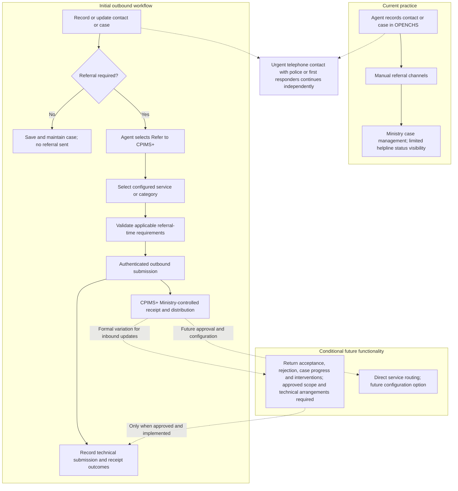

| Aspect | Current practice | Initial target and conditional extensions | Reference |
|---|---|---|---|
| Referral channel | Manual channels; no system link | Electronic outbound submission through the BITZ Integration Gateway to the Primero API (TECH-001) | D-015, D-017; PO-01; [M4 section 6] |
| Who initiates | Handling agent | Explicit “Refer to CPIMS+” action; saving or updating a case does not send it | D-006, D-013; PO-06, PO-07 |
| Destination | Ministry referral arrangements | Ministry-controlled receiving and distribution initially; configured service/category selection does not imply direct provider routing | D-008; PO-02; [M4 sections 3, 5] |
| Acknowledgement | Manual follow-up | Technical submission and receipt outcomes recorded; human acceptance/rejection remains distinct | D-016; [M4 section 5] |
| Status visibility | Generally referred and closed | Technical delivery tracking initially; returned human decisions, progress and interventions require approved scope and technical arrangements | [M2 section 5]; D-007; PO-01 |
| Direct service routing | Not established as an electronic route | Future configuration option, not the initial baseline | PO-02; [M4 section 3] |
| Urgent cases | Direct telephone contact | Telephone route continues independently of electronic referral | [M1 section 8]; WF-007 |

### 2.2 Roles of the two systems

| System | Owner / operator | Role in the integration |
|---|---|---|
| **OPENCHS — Child Helpline 116** | Child Helpline 116; maintained by BITZ under the existing support-and-maintenance contract | Records contacts and cases; captures the agreed referral information and optional ABR ID; provides the explicit agent-initiated referral control; records submission and technical delivery outcomes. Subsequent case updates are displayed only where formally approved and implemented. |
| **Primero CPIMS+ — Ministry** | Ministry; Primero technical coordination by Isaiah Amutavi Osotsi | Receives electronic referrals and remains the receiving case-management system. Authorised Ministry users distribute and manage referred cases within the Ministry workflow. Direct routing to individual service providers is not the initial baseline. |
| **OPENCHS integration service / connection gateway — BITZ** | BITZ; technical coordination by Marlon Amunga and Peter Rogendo | Handles authenticated outbound API communication, referral transmission, retry and offline queue management, duplicate prevention, technical acknowledgement processing, error monitoring and audit logging. Inbound retrieval, webhook processing and reverse synchronisation require formal scope variation and technical approval. |

The OPENCHS–Primero referral connection is separate from Home Affairs identifier-verification work. X-Road is not a required intermediary for the initial integration. The referral connection uses BITZ's own integration gateway; OpenFN is not used (TECH-001). The earlier direct API versus OpenFN question [M3 section 9; D-015; M4 section 6] is closed in favour of the gateway. BITZ supplies the design documentation, and Primero and Ministry IT verify the deployed interface [A-019; PO-01, PO-02].

### 2.3 Justification and intended outcomes

The outcomes below distinguish initial contractual capabilities from future or conditional benefits. They are intended outcomes, not demonstrated results. Measuring achievement requires baseline data, which was not collected during inception; no quantitative performance target is introduced.

| Intended outcome | Treatment |
|---|---|
| Consistent electronic referral submission, aligned with applicable national pathways and SOPs | Initial contractual baseline; pathway receipt and configuration remain dependencies |
| Reduced duplicate referral-data entry | Initial contractual baseline: agreed referral information is transmitted electronically rather than re-keyed |
| Technical delivery tracking and auditability | Initial contractual baseline: submission, technical acknowledgement, attempts, errors and outcomes are traceable |
| Ministry-controlled referral distribution | Initial operational approach, subject to configuration confirmation |
| Human acceptance and rejection feedback returned to OPENCHS | Future functionality requiring approved scope and technical arrangements; inbound implementation requires formal variation |
| Case-progress and intervention updates | Future functionality requiring formal contract variation |
| Subsequent case-information synchronisation, including later corrections or a prank determination | Future functionality requiring formal contract variation; the earlier business need is retained [M1 section 7; D-007] |
| Attachment exchange | Subject to formal scope confirmation and variation where required |
| Direct service routing | Future configuration option, subject to approval and configuration |

Session 3's two-way business requirement remains traceable under D-007. It is not treated as an unconditional contractual commitment for the initial outbound delivery [M3 section 11; M4 section 4; PO-01, PO-02].

### 2.4 Overall objective

To strengthen referral coordination for Lesotho Child Helpline 116 by establishing electronic outbound referral exchange between OPENCHS and Primero CPIMS+, improving technical reliability and traceability, and supporting testing, Ministry-led user acceptance, training, deployment and handover under Contract 43427866, Amendment 3 [CT2; TB section 1]. Requested two-way functionality remains subject to formal contractual variation; it is not automatically included in the initial outbound baseline [PO-01].

### 2.5 Specific objectives of the inception phase (D1)

1. **Referral lifecycle:** document and validate the initial outbound lifecycle and Ministry-controlled distribution, identifying inbound feedback and synchronisation as requirements requiring separate contractual treatment [D-006–D-008; PO-01, PO-02, PO-06].
2. **Referral information and mapping:** retain the agreed business information set and distinguish it from technically verified CPIMS+ field identifiers, requiredness, lookup values and mappings [D-010–D-013; M4 sections 5, 8].
3. **ABR ID:** retain optional entry and initial validation against the supplied NICR format; identify the complete official validation specification as an outstanding dependency [D-005, D-014; A-007].
4. **Technical environment:** establish authentication, connectivity, security and environment requirements, with matters awaiting Primero confirmation explicitly identified [API-002; A-015, A-016; M4 sections 6, 11].
5. **Reliability:** define retry, offline queueing, duplicate prevention, error handling and audit expectations, distinguishing contractual capabilities from proposed operating parameters [CT2 item 70; A-021; M4 section 6].
6. **UAT:** record Ministry-led testing, participants and scenario preparation, while identifying the authorised Ministry UAT signatory and endorsement arrangements as pending confirmation [D-009; CD-09; M4 section 10].
7. **Planning and registers:** maintain the conditional implementation plan, risk register, action register and decision register, preserving owners, evidence requirements and unresolved approvals [M4 sections 8–12; PO-03].

### 2.6 Expected results by deliverable

| Deliverable | Expected result |
|---|---|
| **D1 — Inception, Requirements & Environment Setup** | A validated inception baseline containing requirements, proposed technical design, mapping status, environment-readiness assessment, work plan, registers and outstanding dependencies. Validation is distinct from formal acceptance by the authorised approvers. |
| **D2 — ABR ID Field, Checks & Referral Checkbox UI** | Optional ABR entry with applicable checks and an explicit agent-controlled “Refer to CPIMS+” action enforcing referral-time rules. The agent can save and maintain a case without submission and must initiate referral separately and intentionally. Retain the existing referral-status display within the approved scope. The report title is preserved; the signed activity wording is reproduced in section 2.7. |
| **D3 — Outbound REST API Client** | A working, documented outbound client with JWT authentication, retry logic, offline queue, idempotency and audit logging. Inbound synchronisation and attachment exchange are not unconditional D3 obligations. |
| **D4 — Testing, UAT, Training & Go-Live** | Technical and regression testing, Ministry-led UAT, training, deployment and handover, with acceptance evidence aligned to the approved contractual scope. |

References: [CT2 items 50–80; M4 sections 2, 4, 10]; PO-01, PO-06, PO-07. The descriptions explain implementation and expected evidence; they do not amend the signed deliverables.

### 2.7 Contractual scope

Contract 43427866, Amendment 3, signed on 15 September 2026, is the sole governing contractual instrument for these integration deliverables [CT2]. The underlying OPENCHS support-and-maintenance contract began on 10 March 2025. Amendment 3 adds integration items 50–80 and their contractual amounts. This revision does not change those amounts or the signed activity descriptions. The amendment takes effect on UNICEF's receipt of the countersigned copy [CT2 contractual provisions, clause 2.1].

The D1–D4 report titles below are retained. For source fidelity, the scope column reproduces the signed activity wording. In particular, item 60 uses **“ABR ID Field + Validation Rules & Referral Checkbox UI”** in the signed amendment; the instructed report title **“ABR ID Field, Checks & Referral Checkbox UI”** is retained under PO-07. This distinction does not rename or amend the contractual activity.

| Deliverable and contract item | Signed activity description [CT2] | Agreed delivery date | Evidence for acceptance |
|---|---|---|---|
| D1 — Inception, Requirements & Environment Setup — item 50 | Inception, Requirements & Environment Setup (incl. in-country Trip 1: Inception Workshop, Maseru) | 13 November 2026 | Approved inception report and agreed treatment of technical design, mapping and environment evidence; meeting validation alone is not formal acceptance |
| D2 — ABR ID Field, Checks & Referral Checkbox UI — item 60 | ABR ID Field + Validation Rules & Referral Checkbox UI | 20 November 2026 | Demonstrated ABR field and checks, explicit referral control, and unit-test evidence; case saving remains independent of referral submission |
| D3 — Outbound REST API Client — item 70 | Outbound REST API Client (JWT auth, retry logic, offline queue, idempotency, audit logging) | 11 December 2026 | Evidence that the outbound connection follows the agreed specification; any simulation evidence identified separately from live integration evidence |
| D4 — Testing, UAT, Training & Go-Live — item 80 | Testing, UAT, In-Country Operator Training & Go-Live (incl. in-country Trip 2: Training & Handover, Maseru) | 26 February 2027 | Signed UAT, training and handover evidence, and go-live approval against the approved scope |

**Milestone status.** The four delivery dates in the table are the agreed dates for items 50–80: D1 13 November 2026, D2 20 November 2026, D3 11 December 2026 and D4 26 February 2027. They were agreed as the delivery baseline at the D1 validation meeting, replacing the earlier 14-week plan [M4 section 8; PO-03]. The signed activity descriptions themselves state no due dates, and the agreement does not amend the contract. Delivery depends on timely Primero environment and API access, configuration, technical inputs and stakeholder decisions; any change to these dates follows the change-control procedure (section 9.6) (CD-15, CD-17).

**Post-go-live support.** Integration support will be governed by the applicable provisions of the existing OPENCHS support-and-maintenance contract [CT2; PO-04]. Existing support includes troubleshooting and remote support, applicable minor updates and bug fixing, dependency maintenance, quality assurance, IT personnel training and system stability; the contract records a response to support calls within 24 hours [CT2 sections 2.2–2.4; TB section 7]. These existing provisions are retained within their contractual applicability. This report introduces no separate warranty, maintenance duration, stabilisation period or SLA and does not extend support beyond the contract. Regression testing must establish that the integration changes do not adversely affect existing OPENCHS functions.

**Contract expiry: 7 July 2027.** The signed amendment sets the contract validity period as 10 March 2025 to 7 July 2027, and its operative clause states that the agreement expires on satisfactory completion of the services "but not later than 07 Jul 2027"; the same date appears on the signature page [CT2]. The 10 July 2027 date (the heading of the Amendment 03 justification) and 10 June 2027 (the justification's recommendation) appear only in the supporting justification text and are not operative. CD-16 is resolved.

### 2.8 Contractual discrepancies identified

Existing identifiers are retained. An agreed BITZ implementation interpretation is distinguished from a formal contractual decision; neither the Product Owner confirmations nor meeting discussion substitutes for UNICEF's written approval where required.

| Ref | Discrepancy | Sources | Treatment |
|---|---|---|---|
| CD-01 | The initial contract baseline is outbound; Session 3 recorded a two-way business requirement | [TB sections 2, 9]; [CT2 item 70]; D-007; [M4 section 4]; PO-01 | **BITZ implementation decision:** outbound first. **Formal contract variation required:** inbound updates, with agreed effort, delivery phase and acceptance evidence. Contractual issue remains open; R-010 retained. |
| CD-02 | Governing contractual instrument | [TB]; [CT2] | **Resolved:** Contract 43427866, Amendment 3 is the governing instrument for items 50–80. The contract end date is 7 July 2027 (CD-16). |
| CD-03 | Earlier planning used a save-event trigger, while manual referral is required. The report's D2 title and the signed activity wording also differ as recorded in section 2.7 | [CT2 item 60]; delivery plan; D-006, D-013; [M4 section 2]; PO-06, PO-07 | **Implementation interpretation confirmed:** retain “ABR ID Field, Checks & Referral Checkbox UI” as the report title and implement an explicit “Refer to CPIMS+” action. Saving/updating never submits a referral. Preserve the signed activity wording; formal acceptance wording remains subject to the contract and authorised confirmation. |
| CD-04 | Earlier design descriptions combine outbound case/referral operations with inbound updates and attachments | [CT2 item 70]; delivery plan; Annex B; [M4 sections 4, 6]; PO-01 | Confirm the outbound API sequence and Ministry receiving configuration with Primero. Inbound mechanisms require formal variation; attachment exchange requires scope confirmation and variation where required. Neither is an unconditional D3 obligation. |
| CD-05 | The complete official ABR validation specification remains unavailable; the recorded NICR structure alone does not supply all validation rules | [CT2 item 60]; D-014; A-007; [M4 sections 3, 8] | **Pending dependency:** obtain the official rules and examples. Retain optional entry and the initial format check; optional entry does not waive applicable validation requirements. |
| CD-06 | The brief envisages inception, requirements, design/mapping and action-register outputs; configured mappings remain incomplete | [TB section 11]; [M4 sections 3, 8] | Retain the consolidated report approach and the configured field-mapping dependency. General API documentation does not establish Lesotho field identifiers, mandatory rules or lookup values. |
| CD-07 | The earlier 14-week plan differs from the revised timetable | [M1 section 10]; section 8.7; [M4 section 8]; PO-03 | **Planning principle agreed:** revised timetable replaces the 14-week plan. Dates remain conditional on dependencies and approvals; this does not constitute a contract amendment. |
| CD-09 | The authorised Ministry UAT signatory and endorsement arrangements are not confirmed | [RC1]; D-009; [M4 section 10; C2] | **Pending confirmation:** Ministry leads UAT; Tiisetso Mohlabi is proposed, subject to confirmation. Record the authorised signatory and Ministry endorsement separately from UNICEF's contractual acceptance. |
| CD-12 | Proposed fault thresholds must be reconciled with UNICEF's contractual acceptance authority | [CT2 section 4]; section 10; [M4 sections 2, 10] | Retain UNICEF's authority regarding unsatisfactory or incomplete work. Meeting agreement on thresholds and BITZ's internal review do not authorise acceptance of unresolved faults without the required written agreement. |
| CD-15 | The signed activity descriptions for items 50–80 state no due dates | [CT2]; [M4 section 8]; PO-03 | **Resolved:** delivery dates agreed at the D1 validation meeting: D1 13 November 2026, D2 20 November 2026, D3 11 December 2026 and D4 26 February 2027. The agreement does not amend the contract; changes follow change control (section 9.6). |
| CD-16 | Three dates appear in the amendment documents: 7 July, 10 July and 10 June 2027 | [CT2]; [M4 section 2; C1 decision 9]; PO-05 | **Resolved:** 7 July 2027 is the contract validity end date and the operative "not later than" date in the signed amendment. 10 July and 10 June 2027 appear only in the supporting justification text. |
| CD-17 | The late-submission clause specifies reductions of 10% at 20 days, 20% at one month, 30% at two months and withholding beyond two months, and applies to the agreed delivery dates | [CT2 section 4]; [M4 section 8]; PO-03 | **Resolved:** the clause applies as written to the agreed delivery dates in CD-15. Dependency delays attributable to others are recorded under section 8.5 and handled through change control (section 9.6). |

## 3 Inception activities and findings

### 3.1 Approach

The inception exercise combined contractual review, consultation, workflow analysis and requirements validation. This revision reconciles the original 68-item Annex J baseline against the 4 November 2026 stakeholder review [M4] and the **consolidated requirements-validation decisions supplied by the report commissioning user for this revision [RV3]**. [RV3] denotes those instructions, not a new meeting, attendance record, signed approval or separately issued Ministry instrument. Where [RV3] refines earlier discussions, the historical wording and evidence remain visible in Annex J. The resulting requirements position is suitable for stakeholder review; it is not evidence of completed implementation.

The signed Contract 43427866, Amendment 3 [CT2], and any formally approved amendments govern obligations. Supporting scope / TOR material [TB], recorded business discussions and BITZ implementation interpretations do not independently vary that contract. Ministry approval remains necessary for business rules, lawful disclosure, consent exceptions, field sharing and production use. Primero capabilities require deployed documentation or demonstration. The 4 November review did not itself establish formal D1 acceptance.

| Method | Work undertaken and current finding | Evidence / limitation |
|---|---|---|
| Contract and document review | Reviewed governing contract, scope brief, delivery plan, Sessions 1–3, technical response, checklist and post-Session 3 materials; reconciled outbound scope with later two-way requests | [CT2], [TB], [M1–M4], [TR1], [RC1], Annex I; supporting briefs do not supersede the signed contract |
| Business workflow validation | Reviewed intake, manual referral, service selection, Ministry distribution, emergency phone escalation, partial referrals and explicit outbound follow-up | [M1–M4], D-006, D-008, [RV3]; institutional rules still needing approval are identified individually |
| Functional and mapping review | Reconciled ABR structure, anonymity, narrative, emergency minimums, consent, protection concerns and gateway UUID linkage | D-005, D-010–D-014, [SOP1], [RV3]; field definitions and lawful sharing remain dependencies |
| Architecture and security review | Distinguished direct API via BITZ gateway preference from confirmed deployed capability; assessed account restrictions, credentials, transport, data minimisation and audit | [TR1], D-015–D-017, [M4], generic API documentation; no environment or implementation verification implied |
| Reliability and monitoring review | Defined durable transaction state, operation-level idempotency, duplicate reconciliation, controlled retries, notifications and shared support responsibilities | [CT2 item 70], [TB section 5], [RV3]; retry parameters validated (TECH-004); operational owner Hopolang Mosena (DSR-17) |
| UAT and acceptance review | Consolidated Ministry-led UAT, synthetic data, requirements-to-test coverage, defect rules and separate acceptance gates | D-009, [M4], [RV3]; named signatories, environment readiness and executed evidence remain pending |
| Evidence and decision consolidation | Preserved earlier positions and original Annex J fields; assigned each requirement one principal current classification with separate dependencies | Annexes A and J; historical decisions in Annex E remain traceable |
| Dependency review | Separated technical verification, Ministry business / legal approval, operational governance and contractual addenda | Section 3.6 outstanding decisions; Annexes F and G retain earlier registers pending separate alignment |

**Governance stages remain distinct:** business requirement confirmed → technical capability verified → UAT accepted → contractual deliverable approved → production go-live authorised. A record at one stage does not establish completion of the next.

### 3.2 Consultations conducted

| Date | Event | Objective | Participants / stakeholder groups | Key outcomes | Evidence |
|----|----|----|----|----|----|
| 24 Sep 2026 | Inception meeting | Present technical scope, workstreams and decisions to close | Not recorded | Scope brief prepared; no minutes or attendance record available | Technical scope brief |
| 2 Oct 2026 | Written questions to Primero | Obtain API, environment, authentication, test and UAT information | Nelson Adagi to Isaiah Amutavi Osotsi | API reference link; SSO preferred; 60-minute tokens; API credentials set up by Primero; no rate limits; child-journey test data suggested | [TR1] (reply date not supplied) |
| 8 Oct 2026 | Session 1 — Business and workflow | Confirm workflow and referral data | BITZ (Nelson Adagi, Peter Rogendo, Marlon Amunga); Primero (Isaiah Amutavi Osotsi); Ministry IT (Hopolang Mosena, host); CPIMS focal person (Tiisetso Mohlabi); Helpline Supervisor (Tampose Mapetja); five social workers, an auxiliary social worker, a Social Development Officer (social worker supervisor), a research analyst and a senior project officer, whose organisations are not recorded; one unidentified Ministry/CPIMS representative. Mary Damposi and Silepo are recorded as speaking but are not in the attendee list. UNICEF absent [M1] | Manual trigger; perpetrator details included; ABR optional; prank and follow-up updates pushed to CPIMS+; emergency phone path retained (Session 1 decisions 1–8; Annex E.2) | [M1] (draft for review and correction) |
| 9 Oct 2026 | Session 2 — Technical architecture | Technical deep dive and CPIMS+ demonstration | BITZ (Nelson Adagi, Peter Rogendo, Marlon Amunga); Primero (Isaiah Amutavi Osotsi); Ministry IT (Hopolang Mosena, host); Ministry focal person (Tiisetso Mohlabi). No Child Helpline attendee or absences are recorded, although the minutes attribute the status gap to the Child Helpline and discuss Mary Damposi as a possible testing contact [M2] | Service-based routing revision; case plan not shared; status gap identified; audit modelled on CPIMS+ log; field-mapping started; D-001 – D-004 | [M2] (draft for review and correction) |
| 14 Oct 2026 | Technical follow-up call | Review outstanding requirements checklist | Planned smaller technical group | No minutes or outcome recorded | Meeting invitation |
| 26 Oct 2026 | Session 3 — Closing requirements | Close open business and technical items | UNICEF (Rantsala Sanaha, chair; Ramoletane Lekhanya; “Daniel”, Technology for Development Specialist, per minutes); Ministry (Hopolang Mosena; Tiisetso Mohlabi; Lucy Mosesane; Likeleli Ramolapong; Melusi, IT, per minutes); Primero (Isaiah Amutavi Osotsi); BITZ (Nelson Adagi, Peter Rogendo, Marlon Amunga, James Kaminju). No Child Helpline agent or social worker attended; a Child Protection Services representative spoke for the helpline. Virtual, about 2.5 hours. Roles, and the “Daniel” and Melusi entries, to be confirmed [M3; ATT3] | D-005 – D-018; actions A-013 – A-025 | [M3]; [AT3]; [ATT3]; [TX3] |
| 4 Nov 2026 | D1 stakeholder validation meeting (planned for 3 Nov) | Review D1 v2.7, amendments and dependencies | UNICEF: Rantsala Sanaha (chair / named approver in the record); Ministry IT: Hopolang Mosena and Lucy Mosesane; Ministry child protection: Tiisetso Mohlabi (proposed user-testing signatory, confirmation pending); Lerato Mokuena (department / role to confirm); Tampose Phororo (Child Helpline affiliation and name to confirm against Session 1); BITZ: Nelson Adagi, Peter Rogendo and Marlon Amunga. Primero did not attend | Outbound-first approach; Ministry distribution; consent capture discussion; SOP receipt and A-014 closure recorded; A-017 treated as partly received and closed without resolving legal decisions; inbound / attachments subject to variation; technical access, architecture and approvals outstanding | [M4], draft meeting record; no separate formal D1 acceptance evidence |

Participant entries follow the available records, not inferred attendance. The Session 3 attendance export [ATT3] supports names but not roles or signatory authority; Session 1–2 minutes remain drafts for review and correction. Session 4 names and unresolved affiliations are reported as recorded. [TR1] is evidence of statements: its reported token lifetime, absence of rate limits and environment options are not verified operating characteristics of the deployed Lesotho instance.

**Planned follow-up, not a completed consultation:** a technical validation meeting with UNICEF, BITZ and Primero was scheduled for 10 November [M4]. Its outcome is not evidenced in this revision. Primero access was targeted for 13 November; this is not proof that a sandbox or credentials are available. No Primero technical approval is inferred from the 4 November meeting, which Primero did not attend.

**Figure 2 — Inception timeline.** Solid chronology labels record available evidence; planned events are explicitly marked.

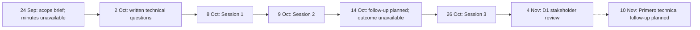

### 3.3 Evolution of positions during inception

The table preserves what was discussed at each stage. Session 3's two-way exchange and attachment positions remain part of the historical business record. The current initial-scope boundary reflects [CT2], the outbound-first clarification in [M4] and the subsequent user-confirmed decisions [RV3]; it does not erase those discussions or establish a signed variation.

| Topic | Earlier evidence / position | Current requirements position and remaining authority |
|---|---|---|
| Referral initiation and routing | Session 1 discussed referral to a district supervisor; D-006 retained manual initiation; Session 2 and D-008 moved to service selection and Ministry distribution | Explicit Refer to CPIMS+ action and confirmation; saving / updating never submits. Agent selects an approved service, Ministry assigns. Direct external-provider routing is future configuration [M4; RV3; WF-002, FN-003, RT-002–RT-004] |
| ABR | Optional in Session 1; D-005 / D-014 recorded initial structure: 12 digits, first 0 or 1, seventh 1 male / 2 female | Optionality and structural checks retained; sex mismatch warning permits authorised audited override [RV3]. Official NICR checksum, uniqueness and live verification remain unconfirmed; separate Home Affairs work is not part of the referral path |
| Reporter anonymity | Session 2 stated anonymous reports could not be referred; D-010 / D-011 distinguished anonymous reporter from child identification | Preserve anonymity and disclose only necessary authorised reporter details under approved consent or another lawful basis. Ministry legal endorsement and mapping remain pending [RV3; DATA-008, SEC-001–SEC-002] |
| Consent and withdrawal | Earlier integration rules remained unresolved; [SOP1] provides procedural guidance; [M4] discussed capture during the call, transmission of consent status, withdrawal and audit | [RV3] specifies given, declined, withdrawn, not obtainable or approved alternative lawful basis. Ministry must approve disclosure / exception rules and withdrawal effects; Primero must verify mapping. Call recordings remain outside exchange |
| Emergency, partial referrals and narrative | D-003 and Session 2 raised reduced / partial information; D-013 required narrative at referral, not first save; emergency phone path retained | Approved reduced dataset and explicit later completion; narrative and child-identification exceptions require documented Ministry rules. No inferred technical or legal exemption [RV3; WF-004–WF-005, FN-004–FN-005] |
| Acknowledgement versus acceptance | D-016 separated system receipt from human response | Technical delivery does not mean Ministry acceptance. Acceptance, rejection and assignment remain Ministry-controlled; OPENCHS displays only decisions reliably received or recorded [RV3; RT-003, FN-008] |
| Agent-facing statuses | Session 2 identified a visibility gap; earlier Annex D proposed a wider mixed vocabulary | [RV3] uses Pending, Accepted, Rejected, Ongoing and Closed for business status; queue / delivery / failure states remain separate. This vocabulary does not authorise automatic inbound retrieval [FN-007–FN-008] |
| Outbound follow-up and corrections | Session 1 included prank findings and later information pushed to CPIMS+; D-012 retained follow-up needs | Explicit authorised Send Update to CPIMS+ uses verified stored UUID linkage. Corrections, withdrawals, cancellations and re-referrals depend on API support and Ministry rules; false-report notification never automatically closes a CPIMS+ case [RV3] |
| Automatic inbound exchange | D-007 and [TX3] support the historical two-way business request | [M4] clarifies outbound first; [RV3] retains automatic inbound statuses, interventions, polling, webhooks and synchronisation as addendum-dependent future requirements [FN-010, RT-007, SEC-008, AUD-003] |
| Attachments | Session 3 facilitation material deferred attachments unless approved; D-012 included them in the requested information set | Historical inclusion retained; electronic attachment transfer requires a formal contract addendum and verified controls, and is excluded from initial UAT [M4; RV3; DATA-010] |
| Architecture | D-015 excluded X-Road from the OPENCHS–CPIMS+ path; direct API versus OpenFN remained unresolved at [M4] | [RV3] made direct API through the BITZ gateway the preferred baseline, with OpenFN only if verified and approved. **Final position:** BITZ Integration Gateway; OpenFN is not used (TECH-001). Primero and Ministry IT technical confirmation of the deployed interface is still to be recorded |
| Data-sharing restrictions and linkage | D-012 excluded the case plan; mapping and access controls remained open | Gateway transforms approved data, enforces disclosure rules, records transaction state and UUID linkage, and reconciles ambiguous creation. No case plans, call recordings, unapproved fields or full payloads in operational logs [RV3] |
| Reliability | Contractual retry / offline queue / idempotency / audit capabilities; [M4] proposed queueing and gradual resend | [RV3] defines four configurable retries after the first attempt: 1, 5, 30 and 120 minutes after the preceding failure; Primero must validate parameters and recovery. No new SLA or platform capability is inferred |
| UAT and approval | D-009 records Ministry-led UAT; UNICEF attended / chaired Session 3 after absence in Sessions 1–2; earlier signatory authority was unresolved | Ministry appoints coordinator and UAT signatory; helpline endorses business results, Primero verifies its platform, BITZ supplies evidence. UAT, UNICEF contractual acceptance and production authorisation remain separate; D1 approval is pending [M4; RV3] |

### 3.4 Limitations of the inception evidence

- No minutes or completed-call outcomes are available in the reviewed evidence for the 24 September inception meeting or 14 October follow-up. This is an evidence gap, not a claim that no record exists elsewhere.
- Session 3 minutes omit four attendance-export names (Tiisetso Mohlabi, Lucy Mosesane, Likeleli Ramolapong and Ramoletane Lekhanya) and include “Daniel” and Melusi, who are not listed under those names in the export. Session 1 records Mary Damposi and Silepo speaking without attendee-list entries; Session 2 attributes a point to the helpline without listing a helpline attendee. Session 4 retains name / affiliation uncertainties. P-03 was removed at [M4]; this revision preserves the evidence limitation without reinstating it as an active action or inferring signatory authority.
- The 2019 SOP has been received and is confirmed as the applicable SOP for the referral workflow (A-014; DSR-16). Separate national referral pathways and the configured service / protection-concern lists remain outstanding. A-020 was removed from this integration; Home Affairs / X-Road materials are not prerequisites for the referral transport path.
- Form 4 is the unified national referral form referenced under A-004. Its fields are reconciled with the approved exchange and the configured mapping during mapping verification (P-02).
- The deployed Primero release, environment configuration and sandbox access have not been demonstrated. API operations, permissions, response schemas, UUID retrieval, update semantics and duplicate reconciliation remain unverified. Generic upstream documentation is discovery evidence, not proof of the Lesotho instance. In particular, documentation includes a no-content creation response for one mode; the design must verify how UUID linkage is established rather than assume every response returns a UUID.
- [TR1] identifies potential authentication and test arrangements but does not establish credentials, role configuration or permission to use real child records. No OPENCHS application-code or live-deployment audit was performed for this report.
- Formal legal disclosure, consent exceptions, field sharing, retention and production-use approval remain outstanding despite meeting-recorded A-017 closure. The earlier Ministry data-protection work and classification policy have not been evidenced as supplied; draft policy is not enacted law.
- Approvers are confirmed (Table 12.2) and Hopolang Mosena is responsible for operational support and escalation (DSR-17). The UAT signatory and the named UAT coordinator remain to be confirmed.
- [RC1] has no recorded author or date; [TX3] is an automated transcript. Neither establishes approval. [RV3] records user-confirmed design decisions, not formal Ministry endorsement or completed technical verification.
- The five excluded inbound / attachment requirements require a formal contract addendum. No signed addendum or formal D1 acceptance is evidenced. Sections and annexes outside this revision still contain earlier positions; section 3.6 records the follow-up alignment needed before whole-report approval.

### 3.5 Findings from documents received after Session 3

The September 2019 *HIV-Sensitive Case Management Manual — Standard Operating Procedures for Ministry of Social Development* [SOP1] establishes receipt. The 4 November meeting [M4] recorded A-014 as closed following provision by Hopolang; It is confirmed as the applicable SOP; BITZ documents the resulting workflow and mapping review. The separate national referral pathways (A-013) remain outstanding. [M4] recorded A-017 as partly received and closed; that administrative closure does not settle legal approval or establish receipt of every requested privacy material.

Form 4 contains the Child Protection Referral Form and a return receipt. It supplies candidate mapping inputs for child identity, file number, referral date, referring and receiving organisations, service needs, referral reason, accompanying documents, expected results, receiving person and response actions. These must be compared with the agreed D-012 field set and configured CPIMS+ definitions; they do not automatically add fields to the approved scope or establish CPIMS+ service codes. The receipt supports review of human acknowledgement and follow-up under D-016, separately from API delivery acknowledgement. It does not itself define technical acceptance/rejection states. Form 4 is the unified national referral form referenced under A-004.

The SOP guiding principles address informed consent/assent and confidentiality; its confidentiality guidance also describes exceptions including emergencies. This provides country procedural evidence for DATA-012 and R-011. Ministry, advised by UNICEF, must approve the applicable disclosure basis, purposes, authorised exceptions, withdrawal effects and necessary fields; Primero must confirm configured consent and override controls. The 2019 manual is procedural guidance rather than a statement of current law. [M4] discussed consent capture during the call, proposed transmission and audited withdrawal; [RV3] specifies the consent-state design. Neither settles lawful bases or override authority. Future return sharing is addendum-dependent.

UAT preparation must include a Form 4 mapping review, separation of technical receipt from human decisions, and Ministry-approved consent / exception scenarios. Electronic return-status and attachment scenarios remain future addendum tests, not initial UAT gates. Business response times in the SOP must be reviewed separately from technical retry and delivery targets; no API service-level target is inferred from the manual.

The Session 3 transcript [TX3] corroborates the recorded decisions on manual referral, two-way updates, anonymous reporters, identifiable child details, the optional ABR ID and the requirement for a narrative at referral. It preserves the historical context of D-005 to D-018; the current contractual boundary is clarified in section 3.3. As an automated transcript, it is read alongside [M3]; formal approval of those minutes is not established by the transcript.

The attendance export [ATT3] records 12 participant entries. Attendance records do not confirm job roles or signatory authority. [M4] removed P-03, but named approval authority and frontline UAT representation must still be evidenced through nominations; this revision does not reinstate the removed action.

The Lesotho Data Protection Act [DPA1] and the draft Data Management Policy [DMP1] were received on 29 October 2026 under A-017. The gazetted text is the Data Protection Act, 2011, enacted as Act No. 5 of 2012 (Government Gazette Vol. 57 No. 19, 22 February 2012), which came into operation on publication. The 2011 reference in the Session 3 action register and the 2012 reference in the annotated checklist therefore describe the same Act. The earlier Ministry data-protection work for another system, the third item under A-017, is not evidenced as received. [M4] nevertheless recorded partial receipt and closure; outstanding legal decisions remain separate.

The Data Management Policy is marked as a draft prepared for UNDP and the Ministry of Information, Communications, Science, Technology and Innovation (MICSTI), and requires Cabinet approval [DMP1 section 5.6.11]. It records that the Data Protection Commission established by the Act had not yet been set up [DMP1 section 4.1.2], which is consistent with UNICEF’s Session 3 remark that data-protection arrangements are still being developed. This is a statement in the draft policy, not a verified current institutional status. The policy is treated as draft policy direction, not enacted law or a binding project approval.

Sections 7.2 and 7.5 retain the earlier legal planning summaries and matters for confirmation; they require separate alignment with the current disclosure decisions. These summaries are BITZ’s reading of the texts for planning purposes, not a legal opinion. The scanned copy of the Act is partly illegible, including parts of sections 34 and 35, so section references should be checked against the official text before they are quoted in agreements.

| **Reference** | **Source** |
|----|----|
| [SOP1] | [September 2019 case-management SOP and tools](../03_meetings/session_3/Lesotho%20Case%20Managment%20SOP%20%20Tools%20(Final).docx) |
| [TX3] | [Session 3 meeting transcript](../03_meetings/session_3/Final%20Inception%20Meeting.docx) |
| [ATT3] | [Session 3 attendance export](../03_meetings/session_3/Final%20Inception%20Meeting%20-%20Attendance%20report%2010-26-26%20(1).csv) |
| [DPA1] | Data Protection Act, 2011 (Act No. 5 of 2012), Government Gazette Vol. 57 No. 19, 22 February 2012 |
| [DMP1] | Draft Data Management Policy, version 1.0 (MICSTI / UNDP; Cabinet approval pending) |

### 3.6 Requirements baseline and remaining gaps

**Scope reconciliation:** Section 4 (SCOPE-001–SCOPE-010) further qualifies the validated initial baseline: particular outbound update operations need written contractual confirmation where [CT2] is not explicit; limited attachment-existence metadata needs all five SCOPE-003 approvals / checks, while file transfer remains addendum-dependent. These are scope clarifications, not new Annex J requirements.

**Initial design baseline:** OPENCHS → BITZ Integration Gateway → Primero CPIMS+. The gateway is responsible for approved-data transformation, durable transaction state, audit, operation-level idempotency, duplicate reconciliation and case linkage. The agent selects a Ministry-approved service and deliberately submits a referral; saving or updating a case never initiates referral or follow-up transmission. After verified creation / linkage, authorised later information is sent using an explicit **Send Update to CPIMS+** action against the stored CPIMS+ UUID. Exact operations, endpoint paths, schemas, permissions and UUID retrieval remain subject to Primero verification.

Initial scope covers referral creation, approved validation / transformation, authorised outbound submission and follow-up, UUID linkage, technical tracking, persistent queueing / recovery, administrative monitoring / failure notifications, and UAT, security and regression testing. Ministry distribution and caseworker assignment remain separate from technical delivery. Business statuses are **Pending, Accepted, Rejected, Ongoing and Closed**; OPENCHS must not show a Ministry decision that has not actually been received or reliably recorded. Technical queue, sending, receipt and failure indicators are separate. Specifying a business vocabulary does not add automatic inbound synchronisation.

The integration runs through the BITZ Integration Gateway, which is the final architecture position of this report [RV3; TECH-001]. OpenFN is not used; X-Road is excluded from this path. Existing contract provisions govern support. No new warranty, SLA, support duration or contractual milestone is created by this validation.

**Reliability parameters:** persist before transmission; after an initial failed attempt allow four automatic retries, at delays of **1 minute, 5 minutes, 30 minutes and 2 hours after the preceding failed attempt**. Intervals are configurable and require Primero technical validation. After exhaustion mark transmission failed, alert authorised administrators and permit controlled manual retry after duplicate checks. Permanent failures require correction; ambiguous creation requires reconciliation before a potentially duplicate submission. Manual retry records actor, reason, time and result. Audit and monitoring use restricted metadata without full child-protection payloads, ABR values, credentials or access tokens; Ministry must approve retention.

**UAT baseline:** use a verified dedicated non-production OPENCHS–gateway–Primero environment and synthetic data by default. The requirements-to-test matrix must record prerequisites, steps, expected / actual results, evidence, defects and outcomes. It must cover workflow, mapping / consent, anonymity / emergencies, UUID linkage / explicit updates, reliability, duplicates, security / access, administration and regression. Initial-scope Critical / High defects must be corrected and retested before go-live; Medium / Low defects require mitigation, owner, resolution plan and explicit Ministry approval. Mandatory child-safety, privacy and security controls cannot be waived by routine conditional acceptance. These are user-confirmed validation rules pending formal governance endorsement, not evidence of UAT completion.

#### Current classification and counting method

All **68 original Annex J IDs** have been reconciled individually. Original requirement wording, sources, proposed priorities and statuses remain in paired historical tables. Each current record has one principal classification, an initial / future designation, remaining dependency, validating party and required verification evidence. SCOPE-001 and SCOPE-003 qualifications in the current decisions apply to both Annex A and Annex J; principal classifications and totals are unchanged. A confirmed design may still have legal or technical dependencies; the principal status is not a readiness score. No row claims delivered functionality or received acceptance evidence merely by specifying a criterion.

| Code | Principal classification | Meaning in this revision |
|---|---|---|
| V | Confirmed — Requirements Validation | Requirement / design position confirmed in the supplied validation; formal Ministry endorsement and technical dependencies may remain |
| C | Confirmed — Existing Contractual Obligation | Existing capability grounded in [CT2] and its supporting scope; detailed parameters / mechanisms are not thereby contractually approved |
| T | Pending Primero Technical Validation | Deployed API, mapping or environment evidence is the principal unresolved dependency |
| M | Pending Ministry Business or Legal Approval | Required business, disclosure, safeguarding or governance rule needs formal Ministry approval |
| A | Pending Validation — Contract Addendum | Excluded functionality retained for traceability; formal addendum and subsequent verification required |
| O | Pending Operational or UAT Governance Confirmation | Named ownership, test governance or acceptance arrangements require confirmation |

The previous aggregate (26 Confirmed, 4 Contractual, 7 Proposed, 30 Pending Confirmation and 1 Dependency) is retained here only as a **historical total of 68**, not the current post-validation result. The table and Figure 3 below are recalculated from the current Annex J rows; each ID counts once irrespective of multiple dependencies. Annex A has 79 IDs because it also preserves eleven earlier records outside the Annex J baseline.

| Annex J category | V | C | T | M | A | O | Total |
|---|---|---|---|---|---|---|---|
| J.1 Business and workflow requirements | 9 | 0 | 1 | 2 | 0 | 0 | 12 |
| J.2 Functional requirements | 7 | 1 | 1 | 2 | 1 | 0 | 12 |
| J.3 Data and field requirements | 5 | 0 | 4 | 3 | 1 | 0 | 13 |
| J.4 Integration and interoperability requirements | 1 | 1 | 5 | 0 | 1 | 0 | 8 |
| J.5 Security and privacy requirements | 5 | 0 | 0 | 2 | 1 | 0 | 8 |
| J.6 Operational and reliability requirements | 0 | 3 | 0 | 0 | 0 | 2 | 5 |
| J.7 Reporting, audit and monitoring requirements | 1 | 2 | 0 | 0 | 1 | 0 | 4 |
| J.8 UAT and acceptance requirements | 2 | 0 | 1 | 0 | 0 | 3 | 6 |
| **Total** | **30** | **7** | **12** | **9** | **5** | **5** | **68** |

**Figure 3 — Requirement baseline by current principal classification (68 unique requirements).** Codes match the table above; counts do not represent implementation completion.

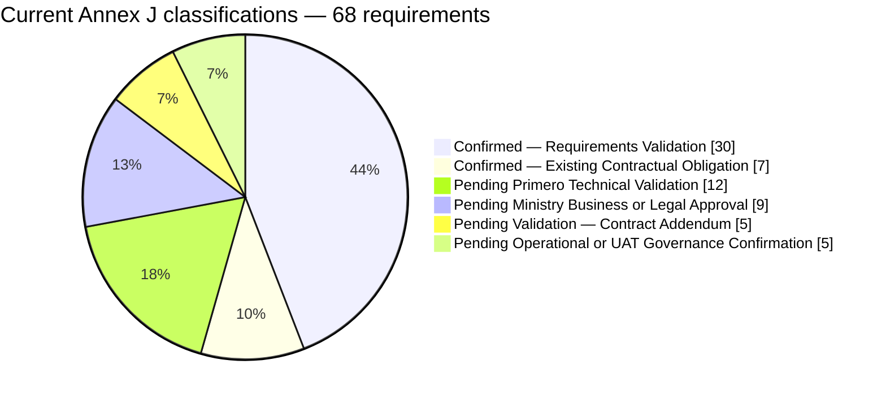

#### Addendum-dependent requirements

| ID | Retained historical request | Current boundary / evidence needed |
|---|---|---|
| FN-010 | Returned CPIMS+ statuses and interventions | Automatic inbound updates excluded initially; UNICEF-approved addendum and verified mechanism required |
| RT-007 | Return events, ordering and reconciliation | Inbound polling, webhooks and synchronisation require addendum; explicit outbound follow-up remains under FN-009 / API-003 |
| SEC-008 | Bounded return updates | Linked-case and approved-field restrictions must be designed and verified with the future inbound scope |
| AUD-003 | Helpline review of returned statuses / interventions | Electronic review depends on approved inbound scope and access arrangements |
| DATA-010 | Attachments included in D-012 requested field set | Electronic transfer requires addendum, approved controls and verified API support |

These five records retain their original sources and priorities. They are neither delivered nor technically confirmed and are not initial UAT gates. RT-004 additionally retains direct external-provider routing as a future configuration option; the current confirmed decision is Ministry-controlled routing.

#### Outstanding decisions and required evidence

No new due dates are assigned. Targets recorded in [M4] remain planning targets, not proof of completion. Written evidence is required before an unresolved dependency is closed.

| Decision / affected IDs | Responsible party | Required decision or evidence |
|---|---|---|
| Applicable pathways, SOP edition and emergency / partial-referral rules — WF-001, WF-003–WF-006, FN-004–FN-005, DATA-005 | Ministry; Primero confirms feasible field constraints | Applicable SOP / amendments, national pathways, approved minimums and exception / correction authorities; Form 4 reconciliation |
| Approved services, protection concerns and receiving roles — RT-002–RT-004, FN-006, DATA-007 | Ministry; Primero supplies deployed configuration | Versioned approved lists, codes, ownership, permissions and Ministry-controlled distribution configuration |
| ABR official rules and mismatch override — FN-002, DATA-003–DATA-004 | Ministry / NICR; Primero for updates; BITZ implements agreed checks | Authoritative complete specification, approved override roles and verified correction support; no inferred checksum or live verification |
| Disclosure, consent, anonymity, withdrawal, allegations and retention — DATA-008–DATA-009, DATA-012, SEC-001, SEC-006 | Ministry legal / safeguarding / business approvers; UNICEF supports coordination | Written lawful basis and purpose / field matrix, exception authority, withdrawal effects, retention and production-use approval; classification policy / missing materials |
| Environment, architecture and authentication — GOV-004, API-001–API-003, API-009, SEC-003–SEC-005, UAT-003 | Primero; BITZ documents and verifies; Ministry approves arrangements | Deployed version, securely issued restricted access, network rules, direct API / any justified OpenFN decision, schemas and authenticated sandbox evidence; no secrets in report |
| UUID linkage, permitted outbound operations and duplicate recovery — WF-006, FN-009, DATA-004, DATA-013, API-003–API-004, OPS-003 | Primero; BITZ; Ministry approves permitted actions | Verified create / UUID retrieval / update semantics, permissions, reconciliation and failure-response evidence, including ambiguous outcomes |
| Retry / outage handling and monitoring — OPS-001–OPS-002, OPS-004, AUD-001–AUD-002 | Primero and BITZ; Ministry / Child Helpline confirms operational rules | Technical confirmation of four-retry parameters and controlled recovery; tested exhaustion alerts, redaction, access and authorised manual retry |
| Support ownership and incident runbook — OPS-006–OPS-007 | BITZ, Child Helpline supervisors, Ministry and Primero | Named contacts, responsibilities, escalation and tested recovery runbook under existing contractual support; no additional SLA |
| UAT appointments, test plan, defect rules and sign-off — UAT-001–UAT-004, UAT-007, UAT-010 | Ministry; Child Helpline; Primero; BITZ | Written coordinator / signatory nominations, synthetic-data readiness, scoped test matrix, endorsed defect policy and separate UAT evidence / acceptance |
| Inbound and attachment addendum — FN-010, RT-007, SEC-008, AUD-003, DATA-010 | UNICEF for contractual approval; Ministry and Primero for design / governance | Signed addendum before treating these as delivery obligations; approved fields, controls, mechanisms and later acceptance criteria |
| Contract interpretation, dates and D1 acceptance — CD-01, CD-04, CD-12, CD-15–CD-17 | UNICEF; BITZ supplies scope / dependency evidence | Written contractual dates and exact expiry, late-submission clarification where required, formal D1 acceptance; validation does not alter the contract or resolve the existing expiry discrepancy |
| Whole-report consistency and production gate | BITZ prepares authorised later revisions; Ministry / UNICEF / Primero approve within their mandates | Resolve the follow-ups below, verify evidence and document UAT acceptance, contractual acceptance and production authorisation separately |

#### Revision change log and consequential follow-ups

**Historical revision record:** this table records the Section 3 revision before the subsequent Section 4 reconciliation. Section 4.7 now records which of these follow-ups have been addressed and which remain outstanding; the earlier “left unchanged” statements describe that earlier editing stage.

| Section / requirement IDs | Previous position | Revised position | Reason / supporting evidence | Remaining dependency / follow-up |
|---|---|---|---|---|
| 3.1 | Sessions 1–3 methods and decision consolidation | Contract / business / technical / legal / approval hierarchy; [RV3] explicitly attributed | [CT2], [M1–M4], user consolidation | Institutional endorsement and deployed verification remain separate |
| 3.2; Figure 2 | Chronology ended at Session 3 | Added 4 November meeting and separately marked planned 10 November follow-up; participant uncertainty preserved | [M4], [ATT3], [TR1] | No invented attendance, completed technical meeting or D1 approval |
| 3.3 | Session 3 two-way / attachments described as current | Historical positions retained; outbound-first scope, explicit follow-up and addendum boundary separated | [CT2], [M1–M4], [RV3] | Formal addendum and API / Ministry decisions |
| 3.4–3.5 | Some missing records described as nonexistent; consent unsettled; A-014 / A-017 awaiting documents | Evidence-limited wording, meeting-recorded closures, continuing applicability / legal gaps and consent validation distinguished | [M4], [SOP1], [TX3], [ATT3], [DPA1], [DMP1] | Official applicability, legal approval, missing materials and nominated authority |
| 3.6; Figure 3; Annex J | Historical mixed-status totals | Individually reconciled 68 records, six principal classes, original tables preserved and counts recalculated | Original register and [RV3] | Classification is not implementation or acceptance evidence |
| WF-001–WF-010; RT-002–RT-004 | Open escalation, emergency, corrections and distribution rules | Optional escalation; Ministry routing; reduced / partial referrals; explicit audited updates subject to rules / API | [M1–M4], [RV3] | Approved minimums, roles, lists and update support |
| FN-001–FN-009; DATA-001–DATA-009, DATA-011–DATA-013 | Optional ABR / field baseline with mapping gaps and proposed linkage | Structural checks / mismatch override; explicit actions; five business statuses; approved-data mapping and authoritative UUID linkage | D-005–D-016, [RV3] | NICR specification, Ministry disclosure and deployed mappings |
| FN-010; RT-007; SEC-008; AUD-003; DATA-010 | Earlier business confirmation or pending mechanism | Five future addendum requirements excluded from initial delivery / UAT | [CT2], [M3–M4], [RV3] | UNICEF addendum and subsequent Ministry / Primero validation |
| API-001–API-004, API-009, GOV-004; SEC-001–SEC-007 | Generic references, unverified architecture / account and safeguards | Direct gateway preference; deployed verification gate; least privilege, TLS verification, synthetic default and lawful disclosure | [TR1], [M4], [RV3] | Primero evidence and Ministry approval; generic documentation remains non-deployment evidence |
| OPS-001–OPS-004, OPS-006–OPS-008; AUD-001–AUD-002 | Proposed retry parameters, log fields and ownership | Four retries after initial attempt; reconcile ambiguous creation; metadata-only audit / queue dashboard; existing support and regression | [CT2], [TB], [RV3] | Technical parameters, retention, contacts and runbook endorsement |
| UAT-001–UAT-004, UAT-007, UAT-010 | Ministry lead but unnamed signatory and proposed scenarios / defect rules | Detailed matrix, synthetic environment, mandatory initial Critical / High correction and separate acceptance gates | D-009, [M4], [RV3] | Named authorities, endorsed policy and executed evidence |
| Annex A | 69 records, including 11 outside Annex J; 10 Annex J IDs missing | 79 records: retained wider register plus missing existing IDs; shared classifications aligned; legacy test references qualified | Annexes A / J comparison | Annex H test-case revision and actual verification remain outstanding |
| Sections 1–2 | Earlier direct API / OpenFN open position, broader references to later synchronisation and pending attachments scope | No substantive edit here; current Section 3 distinguishes preferred gateway architecture, explicit outbound follow-up and five addendum items | [RV3] refines prior implementation decisions | In a separately authorised revision, clarify outbound follow-up versus inbound synchronisation and harmonise architecture / attachment wording |
| Sections 4–7; Annexes B–E and K | Earlier two-way / attachment scope, mixed status vocabulary, consent / mapping and architecture assumptions | Left unchanged; use current Section 3 and Annexes A / J for this validation position | Scope restriction for this revision | Reconcile direction, UUID linkage, five statuses, consent, retry semantics and metadata-only audit; preserve historical decisions in Annex E |
| Sections 8–12; Annexes F–H; front-matter status definitions / registers | Earlier readiness / action dates, action statuses, test gates and conditional defect language | Left substantively unchanged; current dependencies and UAT rules identified here | [M4], [RV3]; no authority to rewrite unrelated sections | Update action closure / targets, risk mitigations, excluded inbound / attachment tests, Critical / High no-go rule, approvals and controlled-register references before whole-report approval |

#### Document quality assurance

The revised register retains the original 68 Annex J IDs and category sizes (12, 12, 13, 8, 8, 5, 4 and 6), with original wording, sources, priorities and statuses preserved in historical tables. Current counts are generated from the 68 individually classified records. Annex A includes every Annex J ID and retains its eleven additional IDs; matching records use the same decisions and principal classifications. Historical acceptance references remain visible but do not override the current scope or claim executed tests.

Section 3 retains headings 3.1–3.6, updates Figures 2 and 3 as editable Markdown diagrams, and preserves the consultation and source trail. The report remains **Version 2.8 — Post-Validation Revision, pending formal approval**. This revision changes only Section 3, Annexes A / J and directly affected navigation / explanatory cross-references in the existing Markdown report. Whole-report consistency is not claimed: the explicitly listed follow-ups require separately authorised revisions. No Word document, implementation, UAT result or approval record is created by this edit.

## 4 Scope and boundaries

This section applies the user-supplied validation decisions **SCOPE-001–SCOPE-010 [RV4]** to the existing project. [RV4] means the Section 4 scope-validation instructions supplied for this revision; it is not a signed contract amendment, Ministry approval record or evidence of deployed functionality. The decisions are recorded in Annex E.3 and do not add requirements to the 68-item Annex J baseline.

Authority is applied in this order: the signed Contract 43427866, Amendment 3 [CT2] and formally approved amendments; documented Ministry / stakeholder decisions within their authority; the supplied scope-validation baseline [RV4]; and technical designs or assumptions awaiting verification. The technical brief [TB] supports interpretation but does not replace [CT2]. Formal approval of D1 remains pending.

**Initial scope statement — SCOPE-001:** The initial implementation is limited to secure outbound referral creation and authorised outbound follow-up operations from OPENCHS to Primero CPIMS+, together with the necessary integration controls, testing and operational handover. Automatic inbound CPIMS+ case-management synchronisation and electronic attachment transfer are excluded unless separately authorised through formal contractual variation. Outbound follow-up is part of the validated implementation position; where the signed contract does not explicitly establish a particular update operation, its contractual treatment must be confirmed before it is treated as an unconditional delivery obligation or acceptance gate.

### 4.1 Scope classification

| Classification | Boundary / included work | Authority and remaining condition |
|---|---|---|
| Original contractual scope | D1 inception / requirements / environment setup; D2 ABR field, checks and referral control; D3 outbound REST API client with JWT authentication, retry logic, offline queue, idempotency and audit logging; D4 testing, UAT, training and go-live / handover | [CT2 items 50–80]; exact signed descriptions and amounts remain unchanged in section 2.7. Supporting [TB] elaborates implementation, not a separate variation |
| Validated initial implementation scope | Manual referral, approved service selection and data mapping, outbound submission, technical acknowledgement, CPIMS+ UUID linkage, explicit authorised outbound follow-up, recovery, security / privacy, monitoring and acceptance evidence | SCOPE-001; Sections 3 and 4.3; specific update operations require contractual confirmation where wording is not explicit and Primero capability verification |
| Confirmed business requirements | Manual trigger; Ministry distribution / assignment; optional ABR; reporter anonymity; required narrative and child information with approved emergency exceptions; separate technical receipt and human acceptance; Ministry-led UAT | D-005–D-006, D-008–D-011, D-013–D-016, [M4], [RV3]; recorded requirement agreement is not formal Ministry approval of unresolved rules |
| Historical business requirements deferred to future contractual variation | D-007 two-way statuses / interventions; D-012 electronic attachment transfer; related inbound mechanisms, access restrictions and tests | SCOPE-002–SCOPE-003; FN-010, RT-007, DATA-010, SEC-008 and AUD-003 remain **Pending Validation — Contract Addendum** |
| Validated implementation architecture baseline, subject to technical verification | OPENCHS → BITZ Integration Gateway → Primero CPIMS+ API (final architecture position); OpenFN is not used (TECH-001); no X-Road referral intermediary | SCOPE-006; validated for this draft, not formally approved by Ministry / Primero or demonstrated as deployed; see section 6 and Annex K |
| Explicit initial exclusions | Case-plan transfer; files and media; advanced lookup administration; generic marketplace; major workflow redesign; non-essential analytics; automated production deployment pipeline; separate Home Affairs verification implementation | SCOPE-003–SCOPE-005; exclusions table below. Necessary referral controls and contractually required production readiness remain included |
| External dependencies and coordination | Primero version / access / permissions / schemas; Ministry services / mapping / SOPs / disclosure; named UAT and support authority; contractual decisions | SCOPE-007, SCOPE-010; Annex F.3 extends the existing action register. Coordination is not an external-system implementation commitment |
| Initial acceptance boundaries | Evidence for the contractually applicable outbound baseline, safeguarding, reliability, testing, Ministry UAT, training / handover and production readiness | SCOPE-009; four separate governance stages in section 4.7. Deferred functionality is not an initial gate; signed obligations are not waived |

| Existing reference | Explicit exclusion from initial implementation | Necessary work that remains within the agreed baseline |
|---|---|---|
| D-012 | Helpline case-plan transfer | Approved referral narrative and mapping; exclusion verified by payload tests |
| DEF-002; DATA-010 | Call recordings and large media; all electronic document, photograph, audio, video, scanned-record and other binary attachment transfer | Only approved non-sensitive supporting-material-existence metadata under section 4.4; no files, URLs, tokens or sensitive file details |
| DEF-004 | Advanced Primero lookup administration | Consume Ministry-approved services / protection concerns and maintain the gateway mapping |
| DEF-005 | Generic integration marketplace | The specific OPENCHS–gateway–Primero connection and restricted administration needed for it |
| DEF-006 | Major OPENCHS workflow redesign | Referral initiation / confirmation, validation, service selection, explicit outbound updates, technical failure visibility and secure gateway integration |
| DEF-007 | Non-essential analytics | Required transaction audit, restricted queue monitoring and acceptance evidence |
| DEF-008 | Automated production deployment pipeline | Secure deployment, backup, rollback, configuration management and other contractually required production-readiness activities |
| DEF-009 | Implementation of the separate Home Affairs verification connection | Optional ABR structural checks and relevant technical coordination, without responsibility to build or operate NICR / Home Affairs / X-Road verification |

These existing references are retained from the report / completion inventory [CI]. [RV4] makes their initial-scope treatment explicit; it does not amend [CT2]. Any material expansion uses section 4.6.

**Figure 4 — Initial scope boundary.** Sources: [CT2], D-007, D-012, [M4], SCOPE-001–SCOPE-006. Arrows describe intended operations, not verified API endpoints.

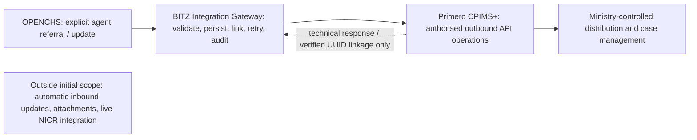

### 4.2 Two-way integration

Session 3 **D-007** records a confirmed business need for CPIMS+ status and intervention information about referred cases to return to OPENCHS [M3; TX3]. This historical request remains in Annexes E and J. It did not itself approve a contractual variation. [M4] clarified outbound-first delivery; **SCOPE-002** now defines automatic inbound integration as a future phase requiring a formal contract addendum, Ministry data-sharing approval and Primero technical validation.

| Aspect | Current scope treatment | Traceability / approval needed |
|---|---|---|
| Outbound creation and explicit follow-up | Initial validated baseline through the gateway; persist CPIMS+ UUID and use verified linkage | FN-009, API-003, DATA-013; contractual confirmation of particular update operations where not explicit in [CT2] |
| Automatic returned statuses / interventions | Deferred; no initial automatic retrieval or synchronisation commitment | D-007; FN-010, AUD-003; addendum plus approved fields and verified behaviour |
| Inbound endpoints, CPIMS+ webhooks and automated polling | Deferred even where polling uses an outbound network request: its business purpose remains inbound case-data synchronisation | RT-007; Annex B.5 is future technical reference, not initial build scope |
| Inbound event ordering, conflict resolution and return-data reconciliation | Deferred with inbound functionality; not initial acceptance dependencies | RT-007; future ownership / sequencing rules and technical evidence |
| Inbound case-level / field-level access and related UAT | Deferred controls required before any future inbound use | SEC-008; Annex H future scenarios; Ministry disclosure approval and Primero permissions |
| Technical response and human decision | Initial system records technical transaction states and Ministry decisions actually received or reliably recorded through an authorised process | D-016; FN-007–FN-008; successful API acknowledgement never means Ministry acceptance; no automated case-status retrieval is inferred |

The initial implementation does not depend on future inbound components for acceptance. This restriction does not remove gateway reconciliation needed to establish the result of an outbound operation or its UUID: any necessary reconciliation query must be narrowly authorised and technically verified, and must not become unrestricted case reading or automatic status synchronisation. Business statuses remain Pending, Accepted, Rejected, Ongoing and Closed, separate from transmission states (Annex D.3).

### 4.3 Initial implementation scope and deliverables

Under **SCOPE-001, SCOPE-005 and SCOPE-006**, the validated initial delivery comprises:

1. Manual agent-initiated referral creation with explicit confirmation; saving or updating a case never initiates transmission.
2. Selection from a Ministry-approved CPIMS+ service list, with Ministry-controlled distribution and assignment.
3. Validation and transformation of authorised referral data using approved mappings, anonymity / disclosure rules and documented emergency exceptions.
4. Secure outbound submission to the authorised Primero API and separate technical acknowledgement / transaction-state recording.
5. Receipt or verified retrieval and persistence of the CPIMS+ case UUID; a response body containing the UUID is not assumed.
6. Explicit authorised outbound follow-up using the linked UUID, subject to confirmed operation semantics, permissions and contractual treatment.
7. Persistent gateway transaction storage, durable queueing, controlled retries, operation-level idempotency, duplicate prevention, error handling and reconciliation.
8. Security and privacy controls, secure credentials, metadata-only operational audit, restricted administrative monitoring and failure escalation.
9. Integration testing, security verification, regression testing and Ministry-led UAT against the applicable initial scope.
10. Contractually required training, handover and go-live preparation under existing support provisions.

| Deliverable / signed item | Initial implementation contribution | Scope qualification |
|---|---|---|
| D1 / item 50 | Requirements and scope baseline, design / mapping status, environment assessment, plan and dependencies | Validation is separate from formal D1 acceptance |
| D2 / item 60 | Optional ABR and structural checks; explicit Refer to CPIMS+ control, confirmation and validation / status UI | Preserve the contractual title; checkbox wording does not authorise save-triggered submission. Specific additional UI work follows confirmed scope |
| D3 / item 70 | Outbound REST API client through the BITZ gateway: JWT, retries, offline queue, idempotency and audit | Explicit follow-up is validated implementation scope; do not infer that every correction, withdrawal or cancellation operation is unconditionally contracted or supported |
| D4 / item 80 | Testing, Ministry-led UAT, training, deployment preparation and handover | Initial-scope evidence only, without waiving signed requirements or inventing new support / warranty terms |

**ABR boundary:** blank values never block saving or an otherwise valid referral. Entered values use the agreed 12-digit structure, first digit 0 or 1 and seventh digit 1 (male) or 2 (female). A sex-digit mismatch warns and permits an authorised, audited override under approved roles. These checks do not verify registry existence, uniqueness or identity. Official NICR checksum / registry rules require authoritative specifications; live NICR, Home Affairs API, X-Road verification service and operation of an external identity platform are outside the initial implementation (SCOPE-005; DATA-003; A-007; DEF-009).

**Gateway boundary:** BITZ implements mapping, persistent transaction state, queue / retry controls, per-operation idempotency, duplicate reconciliation, UUID linkage, secure API access, metadata-only audit, restricted monitoring and error escalation. The BITZ gateway calls the Primero API directly; this is the final architecture position. OpenFN is not used (TECH-001); X-Road is excluded from this referral path. Deployed version, operations, account permissions, authentication / token handling, responses / UUID retrieval, connectivity and environment details remain unverified until evidenced (GOV-004, API-002–API-004; Annex F.3). Section 6 and Annex K describe the design without claiming implementation.

### 4.4 Exclusions and deferred functionality

**SCOPE-002–SCOPE-005** distinguish historical business requests from delivery commitments. The five Annex J requirements FN-010, RT-007, DATA-010, SEC-008 and AUD-003 remain **Pending Validation — Contract Addendum**. Their original priorities and D-007 / D-012 sources remain traceable; they are not initial UAT gates.

Electronic attachment transfer excludes documents, photographs, audio recordings, video files, scanned records and all other binary / media attachments. Initial integration must not transmit attachment contents, file URLs, access tokens or sensitive attachment details. D-012's historical inclusion remains recorded; actual transfer requires a formal addendum (DATA-010).

**Limited metadata exception — SCOPE-003:** a non-sensitive indication that supporting material exists may be sent only if (1) the Ministry approves disclosure, (2) it is necessary for the referral purpose, (3) Primero supports the corresponding field, (4) it exposes no sensitive file details, and (5) mapping and security controls have been validated. Until all five conditions are evidenced, the field is omitted. This does not authorise file transfer, URLs, tokens or access to files. Annex C.1 records the mapping boundary; Annex H records the negative-transfer test.

The explicit exclusions in section 4.1 do not prohibit necessary changes for referral initiation, confirmation / validation screens, approved service selection, explicit updates, technical status / failure visibility, gateway security, queue monitoring, audit, regression testing or operational handover. Excluding an automated deployment pipeline does not exclude secure deployment, backup, rollback, configuration management or contractually required readiness. Technical coordination on Home Affairs does not create a build or platform-operation obligation. Material expansion requires section 4.6 change control.

### 4.5 Integration responsibilities and dependencies

**SCOPE-007** assigns technical ownership separately from business decision authority. Named contacts, escalation routes and incident ownership must be confirmed before go-live; these allocations introduce no new SLA or response-time commitment.

| Workstream | Primary responsibility | Boundary / evidence needed |
|---|---|---|
| OPENCHS referral functionality | BITZ | Explicit controls, validation and regression protection within confirmed scope |
| Integration gateway | BITZ | Gateway design, implementation and defect correction; Primero is not responsible for gateway defects |
| Outbound mapping and transaction processing | BITZ, subject to approved definitions | Ministry approves business / disclosure definitions; Primero verifies deployed fields and capabilities |
| Gateway reliability, monitoring and technical support | BITZ within existing contractual support provisions | Queue, retry, reconciliation, audit and technical fault response; no additional support term or SLA |
| Primero API and platform technical support | Primero technical team | Its platform, APIs, permissions, environments and technical faults |
| Referral service definitions | Ministry | Approved list and business meaning; Primero verifies configuration |
| Routing and caseworker assignment | Ministry-authorised users | Internal CPIMS+ case-management authority; not BITZ's assignment responsibility |
| Referral acceptance and rejection | Ministry-authorised users | Human business decision, not an API delivery result |
| Operational referral monitoring | Child Helpline supervisors | Monitor outcomes and route technical / business issues to their respective owners |
| Ministry business decisions and escalation | Ministry | Safeguarding, lawful disclosure and operational rules; technical teams do not substitute for this authority |
| UAT coordination and formal UAT sign-off | Ministry | Named coordinator, testers and authorised signatory; helpline validates workflows, BITZ supplies evidence, Primero verifies platform behaviour |
| Contract variation and contractual acceptance | Authorised contracting parties in accordance with [CT2] | UNICEF contractual acceptance authority retained; any required amendment uses authorised contract signatories, whose names are not inferred |

**Dependency control — SCOPE-010:** Annex F.3 is the scope dependency view of the existing action register, keyed by existing action / requirement references and linked to Annex G risks. It records required input, responsible party, evidence, target, affected activity, status, impact, escalation owner and contractual treatment. It is not a separate requirement inventory. “Pending” means evidence is absent; “Received” does not mean verified or approved; “Blocked” requires an identified affected activity; “Verified” requires recorded verification evidence.

BITZ records blockers, links them to affected work and escalates through agreed project governance. Impacts on design, development, testing, UAT, go-live, schedule, cost and acceptance must be assessed. An external delay does **not** automatically entitle BITZ to extra time, additional payment or an acceptance waiver. Any consequence must be assessed under [CT2] and approved through the applicable process. Safe, contractually appropriate provisional development may use documented assumptions, mocks and synthetic data; it is not completed end-to-end verification. Annex F.3 retains the 13 November access target from [M4] without claiming access or inventing other dates.

### 4.6 Change control and contractual variations

**SCOPE-008** applies to work beyond the initial baseline, including future inbound synchronisation, attachment transfer and additional identity-verification integration. Each proposed change request must record:

| Required field | Content |
|---|---|
| Change-request reference | Unique traceable reference assigned through the existing change register; no fictional approved request is created here |
| Requested functionality and business justification | What is requested, by whom and why |
| Existing and proposed scope | Explicit difference from the baseline and affected requirement / decision IDs |
| Contractual implications | Applicable provisions, deliverables and whether an addendum is required |
| Technical dependencies | Platforms, operations, permissions, configuration and external inputs |
| Security and privacy implications | Data flows, lawful disclosure, access, safeguarding and retention |
| Implementation effort | Assessed design, build, testing and operational work |
| Cost implications | Documented assessment, not an assumed entitlement or approved price |
| Schedule implications | Dependency and milestone effects requiring review |
| Acceptance criteria | Verifiable outcomes and affected tests / handover evidence |
| Required approvals | Business, technical, legal and contractual authorities applicable to the change |

The Ministry validates the business need. Primero verifies relevant technical dependencies. BITZ prepares the technical and delivery impact assessment. Authorised contracting parties approve any required addendum **before out-of-scope implementation**. [CT2 general terms, article 11.9] requires contractual changes to be recorded in a written amendment signed by an authorised UNICEF official; no signatory names or additional approval procedure are assumed here.

Stakeholder discussion, a demonstration, an observed UAT need or requirements validation does not automatically authorise extra contractual work. The initial baseline remains unchanged until the applicable variation is formally approved. Section 9.6 remains the wider governance reference; any earlier proposed treatment inconsistent with this boundary requires reconciliation before approval.

### 4.7 Delivery acceptance and scope governance

**SCOPE-009** confines initial acceptance evidence to the agreed initial scope as applicable under the contract: working outbound creation; approved validation / mapping; verified UUID linkage; authorised explicit follow-up operations whose contractual treatment is established; queue persistence / recovery; idempotency and duplicate prevention; error handling / reconciliation; security / privacy verification; audit / restricted administration; regression results; Ministry-led UAT; and required training, handover, support and go-live readiness documentation.

| Stage | Decision / evidence | Authority and boundary |
|---|---|---|
| 1 — Technical verification | Demonstrated initial operations and controls in verified environments; captured test results and defects | BITZ verifies its gateway / OPENCHS components; Primero verifies its platform / APIs. Mocks alone do not establish end-to-end operation |
| 2 — Ministry-led UAT | Business workflows, safeguarding and initial acceptance scenarios tested with synthetic data by default | Ministry-appointed coordinator and authorised signatory; helpline endorses business results; BITZ and Primero provide their evidence |
| 3 — Contractual acceptance | Acceptance against signed deliverables and applicable contractual conditions | Authorised contracting party under [CT2]; Ministry UAT is supporting evidence, not a substitute for UNICEF contractual acceptance |
| 4 — Production go-live authorisation | Operational, security, institutional and lawful-disclosure approvals; readiness / support / recovery evidence | Required authorised institutional owners; names and approval records must be confirmed, not inferred from attendance or UAT |

UAT-002, UAT-003, UAT-004, UAT-007 and UAT-010 govern nominations, environment readiness, test coverage, defect treatment and sign-off. Initial-scope Critical / High defects must be corrected and retested before go-live. Medium / Low exceptions require documented mitigation, ownership, plan and explicit Ministry approval; mandatory child-safety, privacy and security controls are not routine waiver candidates. Formal governance endorsement of these validation rules remains pending.

Initial delivery must not be rejected solely for lacking expressly deferred automatic inbound updates, electronic attachments, live NICR verification or unrelated external integrations. This scope boundary does **not** waive a signed contractual obligation, remove a required initial security control or permit an unverified outbound capability to be accepted. Specific outbound-operation ambiguity must be resolved in writing before acceptance criteria are finalised.

#### Scope revision change log and cross-reference reconciliation

| Section / reference | Original position | Validated position / edit | Reason and evidence | Remaining approval / dependency |
|---|---|---|---|---|
| 4.1, 4.3; SCOPE-001 | Contract scope, business requests and proposals mixed | Separated contractual wording, validated initial operations and selected design; explicit outbound-update qualification | [CT2], [TB], [M1], [M4], [RV3–RV4] | Written interpretation of specific update operations where contract wording is not explicit; verified API support |
| 4.2; D-007; SCOPE-002 | Unresolved options to absorb, amend or phase two-way work | Preserve historical business agreement; automatic inbound and its components require addendum and are not initial gates | [M3–M4], SCOPE-002 | Contract addendum, Ministry sharing approval, Primero verification |
| 4.4; D-012; DATA-010; SCOPE-003 | Attachment field set historically included | Files, URLs, tokens and sensitive details excluded; only conditional non-sensitive existence metadata | SCOPE-003; historical D-012 retained | All five metadata conditions evidenced; actual transfer requires addendum |
| 4.1 exclusions; SCOPE-004–SCOPE-005 | Several exclusions remained proposals; Home Affairs coordination risked implying build work | Explicit initial exclusions with essential implementation / secure-deployment exception; optional structural ABR only | Existing DEF references, [CI], [RV4] | Official NICR rules, authorised overrides; any new verification integration through change control |
| 4.3, 4.5; SCOPE-006–SCOPE-007 | Architecture choice and ownership incompletely separated | Gateway / direct API baseline; conditional OpenFN; no X-Road; technical and Ministry responsibilities distinct | [M4], [RV3–RV4] | Primero capability evidence, named contacts and approvals; no new SLA |
| 4.5–4.7; SCOPE-008–SCOPE-010 | Variation, dependency and acceptance controls dispersed | Existing-register dependency view, documented impact assessment, formal change process and four separate acceptance stages | [CT2], [RV4] | No automatic extension, payment or waiver; authority and written decisions pending |
| Section 3; Annexes A / J | Outbound follow-up validated; attachment exclusion did not state metadata conditions | Added specific-operation contractual qualification and SCOPE-003 metadata boundary; counts / original histories unchanged | SCOPE-001, SCOPE-003 | Technical / contractual / Ministry approvals remain separate |
| Sections 5–6; Annex D | Return updates described as initial, mixed status vocabulary, generic integration service | Explicit agent referral / update, gateway UUID linkage, five business statuses separate from technical states; inbound deferred | SCOPE-001–SCOPE-002, SCOPE-006 | Service configuration, update support and reliable decision provenance |
| Section 7; Annexes B / C / K | Attachments and returned information shown in active flows; generic API options treated as build candidates | Initial outbound mapping / diagrams corrected; files excluded and metadata conditional; future mechanisms labelled; historical API material retained | SCOPE-002–SCOPE-003, SCOPE-006 | Legal approval, field mapping and deployed evidence; legal analysis itself not re-determined |
| Annex E | D-007 / D-012 historical confirmation appeared to establish current delivery scope | Preserve historical wording, append current treatment and ten validation-decision references | [M3–M4], [RV4] | No signed variation or Ministry endorsement inferred; Annex J remains 68 |
| Annexes F / G | Earlier dates / status and integration dependencies mixed with external coordination | Preserve dated history; add current dependency view; qualify directly affected risk mitigations without closing risks | [M4], SCOPE-007, SCOPE-010 | Current access, rules, nominations and evidence pending; impact under contract |
| Annex H | Inbound / attachment tests appeared as initial Must gates | Preserve scenario IDs / historical priority; label future tests and align mixed initial tests / negative attachment checks | SCOPE-002–SCOPE-003, SCOPE-009 | Detailed execution evidence and governance approval; no test declared passed |
| Sections 1–2 | Earlier architecture / attachment wording and broad synchronisation statements | Retained pending their separately authorised refinement; Section 4 distinguishes explicit outbound updates from automatic inbound synchronisation | SCOPE-001–SCOPE-003, SCOPE-006 | Harmonise summaries and CD-01 / CD-04 treatment with written outbound-operation interpretation |
| Sections 8–12 and external completion inventory | Older timetable, governance options, action status and test / acceptance language | Not rewritten; Section 4 scope / acceptance and Annex F.3 current dependency view identify applicable position for this revision | Authorised targeted scope; [M4], [RV4] | Whole-report release needs later alignment of dates, two-way / attachment activities, defect rules and approval records; no whole-report consistency claim |

#### Scope quality assurance and unresolved questions

SCOPE-001–SCOPE-010 are traced in Annex E.3 without adding Annex J IDs. The 68-item requirement count and original historical fields are retained; the five addendum classifications remain unchanged. Directly affected workflows, mapping, architecture, responsibility, dependencies and tests now distinguish initial outbound delivery from future functionality. The existing authorised identity remains **Version 2.8 — Post-Validation Revision, revised draft pending formal approval**; no new approved version is inferred.

The revised scope and directly reconciled passages are aligned. The complete report is not yet fully harmonised: the preceding change log identifies older summaries, planning / governance material and external registers requiring later targeted revision. Outstanding questions include contractual treatment of particular outbound updates; deployed API / UUID / reconciliation behaviour; Ministry services, emergency minimums, lawful disclosure and metadata approval; applicable SOP / forms; named support and UAT authorities; formal addenda; and written contractual dates / exact expiry. None is represented as resolved by this edit.

## 5 Business requirements and workflow

This section defines the validated business workflow by which authorised Child Helpline 116 agents initiate, validate, submit, monitor and follow up referrals to the Ministry through Primero CPIMS+. It applies the ten Section 5 business-validation decisions **BR-001–BR-010 [RV5]**. [RV5] means the Section 5 business-validation instructions supplied for this revision. Like [RV3] and [RV4], it is not a meeting record, signed approval, Ministry instrument or evidence of deployed Primero functionality. The BR references are validation references, not new Annex J requirement IDs; the 68-item Annex J baseline is unchanged.

The initial integration path is **OPENCHS → BITZ Integration Gateway → Primero CPIMS+** (SCOPE-001, SCOPE-006). It supports manual referral creation by authorised agents; selection of Primero CPIMS+ as destination and of a Ministry-approved CPIMS+ service; validation and secure transmission of the approved referral dataset; technical acknowledgement, error handling and recovery; explicit, authorised outbound follow-up against an existing linked CPIMS+ case where the operation is supported and approved; and audit logging, transaction linkage, duplicate prevention and reconciliation.

The initial scope does **not** include automatic inbound retrieval of Ministry case statuses or interventions; electronic transfer of attachments; direct electronic routing to external service providers; selection of individual Ministry caseworkers by helpline agents; automatic synchronisation of OPENCHS case changes; automatic closure of CPIMS+ cases by OPENCHS; or replacement of Ministry-controlled case-management workflows. These require formal change control and, where applicable, an approved addendum (sections 4.4 and 4.6; SCOPE-002–SCOPE-004).

Each statement in this section falls into one of four categories:

- **Validated business rule** — a BR decision that governs design. It does not by itself establish Ministry endorsement or Primero technical support.
- **Ministry approval or safeguarding SOP decision required** — for example the emergency minimum dataset, any SOP-mandated supervisor approval, the service catalogue and lawful-disclosure rules.
- **Primero technical verification required** — for example supported update, correction and withdrawal operations, native status values and UUID retrieval.
- **Deferred — future addendum** — functionality outside the initial scope.

Requirement identifiers trace to Annex A, with current classifications in Annex J. Decision identifiers trace to Annex E. D-007 (two-way feedback) and D-012 (field set including attachments) are retained as historical decisions; their earlier expectations of automatic return updates and attachment transfer are not part of the initial scope (SCOPE-002, SCOPE-003).

**Core operational journey:** OPENCHS case → Select CPIMS+ → Select approved service → Validate → Review and confirm → Gateway submission → Technical acknowledgement → Ministry-controlled processing → Explicit authorised outbound follow-up when required.

**Table 5.1 — Validated referral lifecycle**

| **Stage** | **Activity and validated business rule** | **Outstanding approval or verification** | **Reference** |
|----|----|----|----|
| 1 — Helpline contact and case creation | The agent receives the call, records the contact and creates or updates the OPENCHS case. The narrative need not be complete at initial save. Saving or updating a case never initiates a referral. | None for the save rule; authorised roles to be configured | D-013; FN-004; BR-001 |
| 2 — Referral initiation and service selection | The authorised agent explicitly initiates the referral, then: (1) selects **Primero CPIMS+** as destination; (2) opens the approved-service dropdown; (3) selects the appropriate Ministry-approved CPIMS+ service; (4) reviews the referral information; (5) confirms before submission. Supervisor consultation is optional unless an approved safeguarding SOP expressly requires additional approval. The agent does not select a Ministry caseworker. | Final approved service catalogue and codes (A-018); any SOP-mandated approval cases | D-006, D-008; WF-002, WF-003; RT-001, RT-002; FN-003, FN-006; BR-001, BR-002, BR-006 |
| 3 — Referral validation | OPENCHS validates the referral against the approved data contract and business rules: case narrative required at referral; available child-identifying information; reporter anonymity; optional ABR ID; approved emergency minimum datasets; authorised partial referrals with missing information recorded; consent or approved lawful-basis controls. A missing ABR ID never blocks submission. An entered ABR ID receives the validated structural checks, with a warning and authorised, audited override for a sex-digit mismatch. Missing child identity details are not invented. | Exact mandatory fields, emergency exceptions and Primero mappings remain subject to Ministry approval and Primero verification | D-005, D-010, D-011, D-014; DATA-005; WF-004, WF-005; BR-003–BR-005 |
| 4 — Gateway submission and acknowledgement | After explicit confirmation, OPENCHS sends the validated referral to the BITZ Integration Gateway. The gateway records the OPENCHS case and referral references; creates or preserves an idempotent submission operation; validates the approved CPIMS+ service mapping; transmits securely; records the technical acknowledgement or failure; preserves the CPIMS+ UUID when confirmed; and initiates controlled recovery when necessary. An ambiguous submission outcome is reconciled before any further case-creation attempt. Technical delivery is not evidence of Ministry acceptance. | Primero UUID retrieval, duplicate-query and reconciliation semantics; retry intervals subject to Primero validation | D-016; DATA-013; OPS-002, OPS-003; BR-008 |
| 5 — Ministry receipt and business decision | The receiving Ministry user handles the referral in the native Primero CPIMS+ workflow. The Ministry controls acceptance and rejection, including rejection reasons. OPENCHS does not infer acceptance from successful API delivery. Any business status shown in OPENCHS must come from a verified, authorised source. No automatic inbound status retrieval is introduced. | Approved recipient roles and reasons; reliable decision-recording arrangement | D-016; RT-005, RT-006; BR-007, BR-008 |
| 6 — Ministry distribution and assignment | Ministry users control internal distribution, recipient routing and caseworker assignment. Helpline agents select only the approved referral service and cannot assign individual caseworkers. Internal Ministry assignment is outside the initial OPENCHS electronic workflow. | Routing configuration and permissions in CPIMS+ | D-008; RT-002, RT-003, RT-004; BR-007 |
| 7 — Explicit outbound follow-up updates | When additional information becomes available, an authorised OPENCHS user may initiate **Send Update**. The operation references the linked CPIMS+ case UUID; validates the permitted update type; preserves the original referral relationship; enforces role-based permissions; uses idempotency and audit logging; records the technical delivery result; and does not overwrite Ministry-controlled decisions. Missing information from an approved partial referral may be completed this way. Automatic inbound case-status and intervention retrieval is deferred to a future addendum. | Supported update operations and payload mapping (Primero); written contractual confirmation of specific operations where [CT2] is not explicit (SCOPE-001) | FN-009; WF-005; DATA-013; D-007 and D-012 (historical, qualified by SCOPE-001–SCOPE-003); BR-005, BR-009 |
| 8 — Corrections, withdrawal, cancellation and re-referral | Authorised users may initiate permitted correction, cancellation and withdrawal-related requests that preserve case linkage and audit history. A re-referral requires a documented business justification and a new referral reference linked to the original case. A later finding that a call was a prank is sent as corrective information against the linked case; it never automatically deletes or closes the Ministry case. The Ministry retains authority over acceptance, progression and closure. | Supported API operations, permissions and Ministry approval rules | WF-006, WF-010; BR-010 |

Emergency telephone escalation to the police or first responders continues in parallel with electronic referral processing. It does not depend on OPENCHS, gateway or Primero API availability, and an electronic referral is never a substitute for it (WF-007; BR-004). Annex D details the lifecycle, the native CPIMS+ referral mechanism and the reliability design.

### 5.1 Referral initiation and intake rules

A referral begins only when an authorised agent takes an explicit referral action on an existing OPENCHS case. Table 5.2 records each validated intake rule separately from the approval or technical dependency that remains outstanding. An exact minimum dataset is not treated as approved until the Ministry confirms it in writing.

**Table 5.2 — Business rules at referral**

| **Rule** | **Validated business rule** | **Outstanding approval or dependency** | **Status** | **Reference** |
|----|----|----|----|----|
| Manual initiation | Saving or updating an OPENCHS case never sends a referral; submission requires an explicit referral action. | Authorised agent roles; implementation tests | Business rule validated — technical verification pending | D-006; WF-002; FN-003; BR-001 |
| Destination and service | The agent first selects Primero CPIMS+ as destination, then chooses a service from the approved dropdown. | Final approved service catalogue and codes (A-018) | External configuration dependency | D-008; RT-001, RT-002; FN-006; BR-002 |
| Confirmation | The agent reviews and confirms the destination, service and referral details before submission; cancelling sends nothing. | Confirmation-summary content to align with approved mapping | Business rule validated — technical verification pending | FN-003; BR-001, BR-002 |
| Narrative | Required at referral, not at initial save, subject only to a formally approved emergency exception. | Any emergency narrative exception; Primero mandatory-field compatibility | Business rule validated — Ministry approval pending | D-013; FN-004; BR-003 |
| Child identity | Sufficient child-identifying information is required for a routine referral. The agent records the available, authorised details and never fabricates unavailable ones. | Approved minimum field combinations and Primero mapping | Business rule validated — Ministry approval pending | D-011; FN-005; DATA-005; BR-003 |
| Reporter anonymity | Anonymity is preserved when the reporter chooses not to be identified; reporter identifiers are excluded from the data sent. | Disclosure rules; mapping of anonymous representation in CPIMS+ | Business rule validated — Ministry approval pending | D-010; WF-009; DATA-008; SEC-002; BR-003 |
| ABR ID | Optional; a blank value never blocks referral. Entered values are checked structurally (12 digits; first digit 0 or 1; seventh digit 1 or 2), and a sex-digit mismatch produces a warning with an authorised, audited override. No live NICR verification. | Official NICR specification; override roles | Business rule validated — Ministry approval pending | D-005, D-014; FN-001, FN-002; SCOPE-005; BR-003 |
| Emergency referral | A Ministry-approved reduced dataset is permitted for emergencies; each exception used is documented on the referral. | Exact fields, exception authority and Primero compatibility | Business rule validated — Ministry approval pending | D-003; WF-004; BR-004 |
| Partial referral | An authorised incomplete referral is permitted; missing information is recorded and completed later through Send Update against the linked case. | Minimum fields, completion procedure and supported update operation | Business rule validated — Ministry approval pending | WF-005; FN-009; BR-005 |
| Supervisor consultation | Optional by default and recorded when used. Mandatory approval applies only where an approved safeguarding SOP expressly requires it. | Any SOP-mandated approval cases | Business rule validated — Ministry approval pending | WF-003; BR-006 |
| Emergency telephone escalation | Existing police and first-responder contact procedures continue independently of electronic submission. | Approved escalation contacts, SOP alignment and training | Business rule validated — Ministry approval pending | WF-007; BR-004 |
| Consent and lawful basis | The consent position is recorded at referral using the validated states — given, declined, withdrawn, not obtainable or approved alternative lawful basis [RV3] — with changes audited. Disclosure proceeds only where consent or an approved lawful basis permits, consistent with section 7. | Ministry approval of lawful basis, override authority and the effect of withdrawal on information already sent; Primero mapping | Business rule validated — Ministry approval pending | DATA-012; SEC-001; section 7.2 |

The Status column summarises the implementation position for this section. The controlled classification of each requirement remains the Annex J record.

### 5.2 Case distribution and status tracking

#### Referral destination and service selection

The agent workflow is:

**OPENCHS case → Refer → Select Primero CPIMS+ → Select approved CPIMS+ service → Review → Confirm → Submit**

The dropdown contains only active services approved by the Ministry for the integration. The Ministry owns the service catalogue, recipient eligibility, routing rules and internal assignment; BITZ implements the validated service mapping and makes configuration changes only under controlled change. If the selected service is unavailable, inactive or invalid, electronic submission is blocked with an actionable validation message; emergency telephone escalation remains available. Direct electronic routing to external providers is not part of the initial scope (RT-004; BR-002).

#### Technical and business statuses

OPENCHS presents two separate status categories (BR-008):

- **Gateway technical states:** **Queued** (persisted by the gateway, awaiting transmission or retry); **Sending** (attempt in progress); **Delivered** (technically acknowledged by Primero, with the CPIMS+ UUID recorded when confirmed); **Failed** (automatic retries exhausted or permanent failure, with administrators alerted); **Needs Action** (validation error, ambiguous outcome awaiting reconciliation or other condition requiring user or support intervention). These working definitions are subject to the gateway design (OPS-001–OPS-003; AUD-001).
- **Ministry business states:** **Pending**, **Accepted**, **Rejected**, **Ongoing** and **Closed** [RV3].

These are the agreed helpline-facing labels, not a claim that Primero natively uses the same names; their mapping to Primero-native statuses requires technical verification (RT-006). A Delivered technical state never produces an Accepted business state. Where a verified business status is available through an authorised source, OPENCHS shows its source and the last-confirmed timestamp where available. Where none is available, OPENCHS shows that the business status is not confirmed rather than implying progress. Automatic inbound status polling, subscriptions, webhooks and intervention synchronisation are not part of the initial scope (FN-010; RT-007; SCOPE-002).

#### Ministry business decisions

Ministry recipients accept or reject referrals, with reasons, through the Primero CPIMS+ workflow. In the Session 2 demonstration the recipient saw an incoming referral as pending and either accepted it, which opened the case file, or rejected it with a reason; assignment to a caseworker by a district manager was a separate, later step [M2 section 4]. Subsequent distribution and caseworker assignment remain internal Ministry responsibilities. OPENCHS records or displays only business information verified and available through an authorised process. A technical acknowledgement is never presented as a human decision (D-016; RT-003, RT-005; BR-007).

### 5.3 OPENCHS interface and scope limits

#### Referral initiation

The agent must be able to open an existing OPENCHS case; choose the referral action; select Primero CPIMS+ as destination; select an approved CPIMS+ service; review the referral information; resolve validation errors; and explicitly confirm submission (FN-003, FN-006, FN-012).

#### Submission feedback

After confirmation, OPENCHS displays the persistent referral reference; the technical submission state; clear validation or delivery error messages; the linked CPIMS+ UUID when confirmed and where the user is authorised to see it; and guidance when the submission requires support intervention. Successful delivery is never displayed as Ministry acceptance (FN-007, FN-008).

#### Duplicate prevention and recovery

OPENCHS and the gateway prevent repeated submissions caused by double-clicks, page refreshes, retries or uncertain API responses, using the gateway's persistent operation identity and idempotency controls (OPS-003; DATA-013). A confirmed transient failure is retried under the validated recovery policy: after the initial attempt, up to four automatic retries at 1, 5, 30 and 120 minutes after the preceding failed attempt, configurable and subject to Primero validation; thereafter the operation is marked Failed, administrators are alerted and a controlled manual retry is available after duplicate checks (OPS-002; AUD-001). Permanent validation errors are corrected, not retried blindly. An ambiguous creation outcome must be reconciled before another creation attempt; not every failed request is safe to retry without reconciliation.

#### Outbound follow-up updates

A separate **Send Update** operation is available to authorised users. It preserves the existing CPIMS+ case linkage and validates the permitted update operation. Update categories may include supplementary information, completion of missing fields, corrections and approved withdrawal or cancellation requests. No category is assumed to be supported by Primero until verified, and specific operations remain subject to written contractual confirmation where [CT2] is not explicit (FN-009; API-003; SCOPE-001; BR-009).

#### Supervisor consultation

Supervisor consultation is optional. Where it occurs, OPENCHS records the supervisor involved, the decision and timestamps. There is no universal supervisor approval gate; a mandatory safeguarding-specific approval applies only where formally approved (WF-003; BR-006).

#### Emergency and partial referrals

OPENCHS provides an approved means of recording missing information and the reason for an emergency or partial-referral exception, and tracks unresolved items for authorised follow-up. Later completion uses the existing case linkage and the explicit Send Update operation; it never automatically creates another CPIMS+ case (WF-004, WF-005; BR-004, BR-005).

#### Corrections and case-lifecycle requests

Only authorised, approved operations are supported. Transaction history is immutable and records the user, action, reason and outcome. A withdrawal or cancellation request does not itself change a Ministry-controlled business status; any resulting status is shown only when verified under section 5.2. A re-referral requires a documented reason and linkage to the earlier referral. A prank determination is a corrective update, never an automatic closure (WF-006, WF-010; BR-010).

#### Excluded functionality

The helpline case plan is never transmitted (FN-011). Automatic inbound status synchronisation, electronic attachment transfer, direct external-provider routing and internal Ministry caseworker assignment are excluded from the initial integration (FN-010; RT-004, RT-007; SCOPE-002–SCOPE-004).

**Table 5.3 — Business Decisions, Outstanding Approvals and Implementation Dependencies**

Responsibility follows the validated responsibility matrix (section 4.5; SCOPE-007). The Ministry owns safeguarding policy, business rules, the service catalogue, routing authority and business acceptance. The Primero technical team verifies API capabilities, the native workflow, permissions and platform configuration. BITZ delivers the OPENCHS interface, gateway, mapping, technical tests and integration evidence. The Child Helpline validates the operational workflow and agent procedures and takes part in business UAT. No requirement is classified as verified and approved, and no approver or completion date is assigned here. The Impact column states what each dependency blocks; deferred items do not block the initial scope.

| **Requirement ID** | **Business matter** | **Validated decision** | **Remaining dependency or verification** | **Responsible party** | **Required evidence** | **Acceptance or go-live impact** | **Classification / status** |
|----|----|----|----|----|----|----|----|
| WF-002; FN-003 | Manual initiation | Explicit confirmed action; saving never sends (BR-001) | Authorised roles; tested UI and gateway behaviour | Child Helpline (roles); BITZ | F-01 and RC-02 results | Blocks UAT and go-live | Business rule validated — technical verification pending |
| WF-003 | Supervisor consultation | Optional; recorded when used (BR-006) | Any safeguarding-SOP mandatory approval rules | Ministry; Child Helpline | Written SOP rule, or confirmation that none applies | Blocks UAT role configuration only | Business rule validated — Ministry approval pending |
| WF-004; D-003 | Emergency referral | Reduced emergency dataset permitted (BR-004) | Exact Ministry-approved fields; Primero compatibility | Ministry; Primero | Written minimum dataset; Primero mandatory-field confirmation | Blocks validation build, UAT and go-live | Business rule validated — Ministry approval pending |
| WF-005 | Partial referral | Authorised partial referral and later completion (BR-005) | Minimum fields; permitted update API; operating procedure | Ministry; Primero; BITZ | Approved procedure; verified update operation | Blocks UAT of partial-referral scenario | Business rule validated — Ministry approval pending |
| WF-006 | Corrections and lifecycle requests | Controlled correction, cancellation, withdrawal and re-referral (BR-010) | Approved operations, permissions and API support; contractual confirmation where [CT2] is not explicit | Ministry; Primero; BITZ; UNICEF (contract) | Verified operation list; written rules | Blocks UAT for each supported operation; an unsupported operation is excluded from initial acceptance only by written decision | Business rule validated — technical verification pending |
| WF-007 | Emergency telephone escalation | Parallel telephone escalation continues (BR-004) | Operational SOP alignment; evidence capture | Ministry; Child Helpline | B-02 emergency exercise | Blocks go-live | Business rule validated — Ministry approval pending |
| WF-009; DATA-008 | Reporter anonymity | Anonymity preserved (BR-003) | Disclosure rules; anonymous-reporter mapping | Ministry; Primero; BITZ | F-03 payload test | Blocks UAT | Business rule validated — Ministry approval pending |
| WF-010 | Prank finding | Corrective update; no automatic closure (BR-010) | Permitted correction operation; Ministry procedure | Ministry; Primero; BITZ | Verified operation; F-13 result | Blocks UAT of the scenario | Business rule validated — technical verification pending |
| RT-001 / A-018; FN-006 | Service selection | CPIMS+ destination and approved-service dropdown (BR-002) | Final approved service catalogue and codes | Ministry (catalogue); Primero (configuration); BITZ (mapping) | Approved, versioned service list | Blocks mapping build, UAT and go-live | External configuration dependency |
| RT-002 | Caseworker selection | Agent selects service only; never a caseworker (BR-002, BR-007) | Receiving configuration | Ministry; Primero | F-10 result | Blocks UAT | Business rule validated — technical verification pending |
| RT-003 | Routing and assignment | Ministry-controlled acceptance, routing and assignment (BR-007) | Routing configuration, permissions and test evidence | Ministry; Primero | Configured recipients and roles; F-10 / F-18 results | Blocks UAT and go-live | External configuration dependency |
| RT-004 | External-provider routing | Ministry routing only initially | Future routing approval and configuration | Ministry; Primero; UNICEF if scope changes | Approved change request | Future enhancement only | Deferred — future configuration / change control |
| RT-005; D-016; FN-008 | Technical versus human decision | Delivery never shown as acceptance (BR-007, BR-008) | Reliable decision provenance | Ministry; Primero; BITZ | F-11 result | Blocks UAT | Business rule validated — technical verification pending |
| RT-006; FN-007 | Status categories | Separate technical and business statuses (BR-008) | Verified Primero-native status mappings; Ministry endorsement of labels | Primero; Ministry; BITZ | Status-mapping table | Blocks UAT | Business rule validated — technical verification pending |
| RT-007 | Automatic inbound updates | Deferred (BR-009) | Future approved addendum | UNICEF; Ministry; Primero | Signed addendum | Future enhancement only; not an initial go-live dependency | Deferred — future addendum |
| FN-001; FN-002 | ABR ID | Optional; structural checks and audited mismatch override (BR-003) | Official NICR specification; override roles | Ministry; BITZ | F-06 to F-09 results | Blocks UAT | Business rule validated — Ministry approval pending |
| FN-004; D-013 | Narrative | Required at referral, not at save (BR-003) | Any emergency exception; Primero compatibility | Ministry; Primero | F-02 result | Blocks UAT | Business rule validated — Ministry approval pending |
| FN-005; DATA-005; D-011 | Child identity | Flexible collection; no fabricated details (BR-003) | Approved minimum fields and mapping | Ministry; Primero | Approved mapping; F-04 result | Blocks mapping build, UAT and go-live | Business rule validated — Ministry approval pending |
| DATA-012; SEC-001 | Consent and lawful basis | Validated consent states recorded and audited | Lawful basis, override authority, withdrawal effects; Primero mapping | Ministry (UNICEF advises); Primero | Written approval; mapping evidence | Blocks UAT (mapping) and go-live (lawful disclosure) | Business rule validated — Ministry approval pending |
| DATA-013; OPS-003 | Linkage and duplicate prevention | Persistent case linkage and idempotency (BR-008, BR-009) | UUID mapping; ambiguous-create reconciliation verification | BITZ; Primero | RC-01 and RC-02 results | Blocks UAT and go-live | Business rule validated — technical verification pending |
| OPS-002; AUD-001 | Retry and recovery | Four retries at 1, 5, 30 and 120 minutes, then alert and controlled manual retry | Primero validation of intervals; administrator roles | BITZ; Primero; Ministry (roles) | RC-03 and RC-04 results | Blocks UAT | Business rule validated — technical verification pending |
| FN-009; API-003 | Send Update | Explicit authorised outbound update (BR-009) | Supported update methods, permissions and payload mapping; contractual confirmation where required | Primero; BITZ; UNICEF (contract) | Verified operations; F-13 result | Blocks UAT of follow-up scenarios | Business rule validated — technical verification pending |
| FN-010 | Automatic inbound retrieval | Excluded from initial scope (BR-009) | Future addendum only | UNICEF; Ministry; Primero | Signed addendum | Future enhancement only | Deferred — future addendum |
| FN-011 | Case plan | Never transmitted | Negative payload test | BITZ | F-16 result | Blocks UAT | Business rule validated — technical verification pending |

### 5.4 Detailed requirements

The Section 5 decisions are traced as follows:

- **Annex A.1–A.2** — detailed business and functional requirements, by the requirement identifiers cited in Tables 5.1–5.3.
- **Annex D** — referral lifecycle, native Primero CPIMS+ workflow, status vocabulary and reliability design.
- **Annex J.1–J.2** — controlled classification, outstanding dependencies and technical verification for each requirement.
- **Annex E** — historical decisions D-003, D-005, D-006, D-007, D-008, D-010, D-011, D-012, D-013, D-014 and D-016, together with the SCOPE-001–SCOPE-010 validation references (E.3).
- **Section 7** — information sharing, consent and lawful basis, and safeguarding.

No identifier has been given a new historical meaning in this revision. D-007 and D-012 remain historical decisions whose initial-scope treatment is set by SCOPE-001–SCOPE-003.

#### Section 5 acceptance traceability

Section 5 supports the following UAT scenarios. Existing Annex H scenarios are cited. Scenarios marked *new* require addition to Annex H, and those marked *conditional* cannot be finalised until Primero support or Ministry approval is verified. No scenario has been executed.

1. Case saved without sending a referral — F-01.
2. Primero CPIMS+ selected as destination — *new*.
3. Approved service selected from the dropdown — F-10.
4. Referral confirmed and submitted — B-01.
5. Invalid or inactive service blocked — *new*.
6. Missing ABR accepted — F-07.
7. Anonymous reporter accepted — F-03.
8. Routine referral with missing mandatory information rejected — F-02, F-04.
9. Approved emergency reduced dataset accepted — F-05 (*conditional*: Ministry dataset).
10. Authorised partial referral submitted and later completed by Send Update — *new* (*conditional*: Ministry rules, Primero update support).
11. Optional supervisor consultation recorded — B-03 (to be reworded from escalation to consultation).
12. Emergency telephone escalation preserved — B-02.
13. Delivered technical state distinguished from Ministry acceptance — F-11.
14. Duplicate submission prevented — RC-02.
15. Ambiguous submission reconciled before retry — RC-01 (*conditional*: Primero reconciliation semantics).
16. Existing linked case updated by Send Update — F-13 (*conditional*: Primero update support).
17. Correction and withdrawal-related requests audited — F-19 (*conditional*).
18. Re-referral justified and linked to the original — F-19 (*conditional*).
19. Prank finding communicated without automatic closure — F-13 (*conditional*).
20. Automatic inbound synchronisation absent from the initial scope — *new* negative test; F-12 remains future scope.

#### Section 5 revision change log

| **BR reference [RV5]** | **Validated decision** | **Where applied** | **Related identifiers** |
|---|---|---|---|
| BR-001 | Manual, explicit and confirmed referral; saving never sends | Table 5.1 stages 1–2; Table 5.2 manual initiation, confirmation; 5.3 referral initiation; Table 5.3 | D-006; WF-002; FN-003 |
| BR-002 | Primero CPIMS+ destination, then Ministry-approved service dropdown; no caseworker selection | Table 5.1 stage 2; Table 5.2 destination and service; 5.2 destination and service selection; Table 5.3 | D-008; RT-001 / A-018, RT-002; FN-006 |
| BR-003 | Narrative at referral; flexible child identity without fabrication; reporter anonymity; optional ABR with structural checks | Table 5.1 stage 3; Table 5.2 narrative, child identity, anonymity, ABR; Table 5.3 | D-005, D-010, D-011, D-013, D-014; FN-001, FN-002, FN-004, FN-005; DATA-005, DATA-008 |
| BR-004 | Approved emergency reduced dataset; telephone escalation in parallel and independent of the API | Table 5.1 stage 3 and closing paragraph; Table 5.2 emergency rows; 5.3 emergency and partial referrals | D-003; WF-004, WF-007 |
| BR-005 | Authorised partial referrals, missing information recorded, completion by Send Update | Table 5.1 stages 3 and 7; Table 5.2 partial referral; 5.3 emergency and partial referrals | WF-005; FN-009 |
| BR-006 | Supervisor consultation optional and recorded; mandatory only under approved SOP | Table 5.1 stage 2; Table 5.2; 5.3 supervisor consultation | WF-003 |
| BR-007 | Ministry controls acceptance, rejection, distribution and assignment | Table 5.1 stages 5–6; 5.2 Ministry business decisions | D-016; RT-002–RT-005 |
| BR-008 | Separate gateway technical states and Ministry business states; delivery never implies acceptance | Table 5.1 stages 4–5; 5.2 technical and business statuses; 5.3 submission feedback | RT-005, RT-006; FN-007, FN-008; DATA-013 |
| BR-009 | Explicit authorised Send Update against linked UUID; automatic inbound retrieval deferred | Table 5.1 stage 7; 5.3 outbound follow-up updates; Table 5.3 | FN-009, FN-010; RT-007; API-003; D-007, D-012 (historical) |
| BR-010 | Controlled corrections, cancellation, withdrawal and justified, linked re-referral; prank as corrective update | Table 5.1 stage 8; 5.3 corrections and case-lifecycle requests | WF-006, WF-010 |

#### Section 5 quality assurance and unresolved questions

This revision changes only Section 5. All ten BR decisions are reflected. The initial outbound scope is preserved, and technical states are kept separate from business states. Duplicate prevention and ambiguous-outcome reconciliation are addressed, and emergency telephone escalation is preserved. No unverified Primero capability, minimum dataset, service catalogue or approval is presented as approved.

Several passages outside this section still reflect earlier wording and require minimal follow-up corrections. These include section 2.1 (Figure 1 table), Annex A RT-006 and WF-003 wording, Annex D.1 and D.3, and Annex H scenarios B-03, F-11 and F-18. [RV5] is not yet entered in the Annex I source register, and the version label differs between the header and footer. These items are listed in the separate Section 5 revision record and require separately authorised edits. The report remains **Version 2.8 — Post-Validation Revision, pending formal approval**.

## 6 Proposed technical approach

This section sets out the technical approach for exchanging child-protection referrals and authorised follow-up information between Child Helpline 116 and the Ministry through Primero CPIMS+. It applies the seven Section 6 technical-validation decisions **TECH-001–TECH-007 [RV6]**. [RV6] means the Section 6 technical-validation instructions supplied for this revision. Like [RV3]–[RV5], it is not a meeting record, signed approval, Primero confirmation or evidence of deployed functionality. The TECH references are validation references, not new Annex J requirement IDs.

The section defines the agreed architecture, design principles, responsibilities and verification requirements. It does not assert that the Lesotho Primero API contract, authentication arrangements, supported operations or Ministry approvals have been confirmed; those remain dependencies, listed in the technical verification register at the end of section 6.7. Endpoint-level specifications, mappings, security configuration and operating procedures belong in Annexes B, C and K and in the operational runbook. The approach is consistent with the validated workflow in Section 5.

**Initial-scope boundary.** The integration supports (1) outbound referral creation; (2) explicit, authorised outbound updates against an existing linked CPIMS+ case; and (3) technical acknowledgements and transaction recovery. It does not include automatic inbound case-status synchronisation, automatic intervention updates, attachment transfer, external-provider electronic routing or Ministry caseworker assignment from OPENCHS (SCOPE-002–SCOPE-004). None of these is reintroduced through the diagrams, interface descriptions, API dependencies or test scenarios in this section.

### 6.1 Design principles

The following principles govern the design (TECH-002). Each one is testable and traced to existing requirements. Detailed configuration belongs in Annex K and the relevant technical annexes.

| **Principle** | **Design requirement** | **Reference** |
|----|----|----|
| Explicit initiation | Saving or updating an OPENCHS case never automatically creates a CPIMS+ referral or update. | D-006; WF-002; FN-003 |
| Approved destination and service | Before submission, the agent selects Primero CPIMS+ and a valid, active Ministry-approved service. | D-008; RT-001, RT-002; FN-006 |
| Human confirmation | Submission requires an explicit review and confirmation action by the authorised agent. | FN-003 |
| Data minimisation | Only approved, necessary child-protection information is transmitted; the case plan, call recordings and attachments are excluded. | D-012 (historical); FN-011; SEC-001; DATA-010 |
| Secure integration | Every operation is protected by authentication, transport security, role-based permissions and securely managed credentials. | API-002; SEC-003–SEC-005 |
| Reliable delivery | The gateway keeps durable transaction records and applies controlled retries. | OPS-001, OPS-002 |
| Idempotency | Repeating the same operation does not unintentionally create a duplicate case or update. | OPS-003 |
| Persistent linkage | OPENCHS case IDs, referral references and confirmed CPIMS+ UUIDs stay associated. | DATA-013 |
| Recovery and reconciliation | An uncertain submission outcome is investigated before any further creation attempt. | OPS-003; DATA-013 |
| Auditability | Technical events are traceable without unnecessary copying of sensitive child information. | OPS-004; SEC-006 |
| Separation of responsibilities | Technical delivery status is kept distinct from Ministry acceptance or rejection. | D-016; RT-005, RT-006; FN-008 |
| Outbound-only initial scope | There is no automatic inbound status or intervention synchronisation. | FN-010; RT-007; SCOPE-002 |
| Emergency continuity | A failure in electronic referral never prevents established emergency telephone escalation. | WF-007 |

### 6.2 Integration architecture overview

The design uses a single integration architecture (TECH-001):

**OPENCHS → BITZ Integration Gateway → Primero CPIMS+ API**

Direct connectivity from the BITZ Integration Gateway to the Primero CPIMS+ API is the sole proposed integration mechanism. It has three components:

- **OPENCHS** handles helpline case creation and management; explicit referral initiation; selection of Primero CPIMS+ as destination; selection of a Ministry-approved service from a dropdown; referral validation and confirmation; display of gateway technical statuses; initiation of authorised outbound follow-up updates; and presentation of actionable technical errors to authorised users.
- **BITZ Integration Gateway** handles secure communication with the Primero APIs; enforcement of integration authentication and authorisation; payload transformation and approved field mapping; service-code validation; persistent referral and transaction references; idempotency and duplicate prevention; queuing and controlled retries; technical response processing; CPIMS+ UUID linkage; reconciliation of uncertain submissions; and monitoring, alerting and audit logging.
- **Primero CPIMS+** is the Ministry-controlled receiving platform. Its native workflow supports Ministry-authorised referral receipt, acceptance, rejection, internal distribution, caseworker assignment and subsequent case management. The Ministry retains authority over all business decisions and case progression.

**Diagram 6.2 — Validated integration architecture (subject to technical verification)**

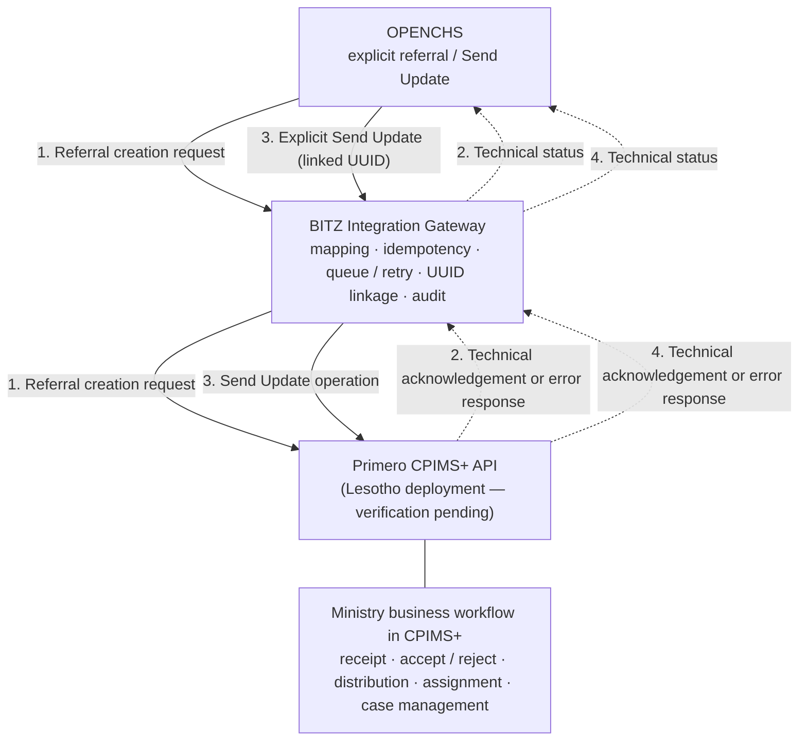

Every arrow towards OPENCHS carries only the technical response to an operation that OPENCHS initiated. No continuous or automatic inbound flow of Ministry statuses, interventions or case changes exists, and a technical API response is not business-status synchronisation. The Ministry's acceptance, rejection, distribution and assignment of referrals is a separate business workflow inside CPIMS+ (section 5.2), not a gateway function.

**Architecture exclusions and decision history.** OpenFN is not part of the proposed integration architecture. It is not a component, alternative, conditional option, deployment dependency, test environment, support responsibility or cost or schedule dependency. X-Road is not part of the OPENCHS–CPIMS+ referral exchange; it relates only to separate Home Affairs identifier-verification considerations, which carry no initial BITZ build obligation (SCOPE-005; DEF-009). D-015 (Session 3) recorded "direct API or OpenFN" with the choice left pending, and SCOPE-006 [RV4] then allowed OpenFN only as a verified and approved dependency. These records are preserved in Annex E as history. TECH-001 now sets the current design direction, which supersedes the conditional OpenFN element of SCOPE-006.

**Remaining dependencies.** The following remain unverified until evidenced, and no endpoint URL, authentication payload or platform capability is assumed: the Primero API contract for the deployed Lesotho release; the authentication method and integration credentials; supported referral and update operations; integration-account permissions; network connectivity; and gateway hosting configuration (API-001–API-003, API-009; GOV-004; the technical verification register below).

### 6.3 Referral transaction flow

The validated sequence is as follows (TECH-003).

1. **The agent initiates and confirms the referral.** The authorised OPENCHS agent opens the relevant case; selects the referral action; selects Primero CPIMS+ as destination; selects a Ministry-approved service from the dropdown; reviews the referral information; and explicitly confirms submission. Supervisor consultation is optional unless an approved safeguarding SOP requires additional approval (WF-003).
2. **OPENCHS validates and records the operation.** OPENCHS checks user permissions; the approved service selection; the applicable minimum dataset for the referral; the required narrative; the child-identity information that is available and authorised for sharing; reporter anonymity; optional ABR ID validation; approved emergency and partial-referral exceptions; and consent or other approved lawful-basis controls. It then creates or associates a persistent referral reference and operation identity. Unavailable child information is never invented (Section 5.1).
3. **The gateway submits securely to Primero.** The BITZ Integration Gateway validates the operation; applies the approved field and service mappings; authenticates to the approved Primero API; preserves the idempotency identity; sends the request securely; and records the attempt. The exact API method and payload must be confirmed against the Lesotho Primero deployment (API-003).
4. **The gateway processes the technical response.** The gateway records the technical acknowledgement or failure; the response timestamp; the technical operation status; the confirmed CPIMS+ UUID, when returned or later verified; the error classification; and any retry or reconciliation requirement. OPENCHS displays the corresponding technical status (section 6.7). A successful technical acknowledgement is never presented as Ministry acceptance.
5. **The Ministry processes the referral.** Ministry users handle the referral within Primero CPIMS+ and control acceptance, rejection, distribution, assignment and case progression. The gateway does not control these activities and does not automatically receive Ministry business-status changes.
6. **Authorised outbound follow-up.** When new information becomes available, an authorised OPENCHS user may initiate a separate **Send Update** operation. The update references the existing CPIMS+ UUID; preserves the OPENCHS case and referral linkage; validates the user's permissions and the requested update type; uses its own persistent operation ID and idempotency identity; records the technical result; and supports controlled error recovery. Possible business purposes include supplementary case information, completion of approved partial referrals, corrections and permitted lifecycle requests. No update operation is assumed to be supported by Primero until verified, and specific operations remain subject to written contractual confirmation where [CT2] is not explicit (FN-009; SCOPE-001). A failed update never automatically creates a new referral.

**Operation separation.** Referral creation and Send Update are distinct transaction types. Each has its own operation history, and both share the underlying case linkage (DATA-013). The earlier automatic return-update step has been removed from this flow. RT-007 is retained only as the historical requirement for automatic inbound retrieval, which is deferred to a future addendum.

### 6.4 Error handling and recovery

The recovery policy is as follows (TECH-004).

**Failure classification** (API-004):

- **Transient failure** — a temporary condition, such as a network interruption or service unavailability, for which a retry may be appropriate.
- **Permanent or validation failure** — invalid data, an invalid service selection, an unauthorised operation or another condition that requires correction or intervention.
- **Uncertain outcome** — the gateway cannot establish whether Primero completed the operation, for example after a timeout following submission. An uncertain outcome is not treated as a confirmed failure.

**Controlled retry schedule** (OPS-002). An eligible transient failure is retried up to four times, at 1, 5, 30 and 120 minutes. Each interval is measured from the preceding failed attempt. The schedule is configurable, and its behaviour is verified during testing. A permanent or validation failure is not retried until it has been corrected. An ambiguous case-creation outcome is not retried automatically until reconciliation shows that a retry is safe.

**Duplicate prevention** (OPS-003; FN-003). Persistent operation identities and idempotency keys prevent duplicate operations caused by repeated button clicks, browser refreshes, network interruptions, worker restarts, retry processing, manual recovery or uncertain API responses. Upstream documentation describes conflict detection for client-supplied identifiers (Annex B.3), but its behaviour in the Lesotho deployment is unverified. Where Primero provides no native idempotency support, the gateway-side controls and the remaining technical limitations will be documented. Exactly-once processing is not claimed without supporting evidence.

**Ambiguous submission reconciliation.** Where the gateway cannot confirm whether Primero created the case, it:

1. marks the transaction as unresolved;
2. preserves its original operation identity;
3. prevents an unsafe repeat creation;
4. attempts an approved reconciliation procedure;
5. uses an authorised API lookup capability, if one is verified as supported;
6. escalates to the Primero technical team or the Ministry where required;
7. records the reconciliation evidence and outcome;
8. resumes processing only when it is safe to do so.

No Primero lookup endpoint is assumed (Annex B.7).

**Manual recovery and alerting** (AUD-001, AUD-002; OPS-007). Authorised support staff have controlled recovery functions with role-based access, a recorded reason for each intervention and an audit trail of recovery actions. Technical alerts are raised for retry exhaustion and unresolved transactions, with defined escalation to the responsible operational team. Emergency telephone escalation remains available independently of electronic delivery (WF-007).

### 6.5 Integration responsibilities

Responsibilities are as follows (TECH-005). This is consistent with section 4.5 and SCOPE-007. Neither UNICEF nor BITZ has authority over Ministry-controlled case decisions.

| **Party** | **Component and operational responsibilities** |
|----|----|
| BITZ | OPENCHS referral interface; CPIMS+ destination and service selection; referral validation and confirmation; Send Update interface for explicit outbound updates; development and maintenance of the Integration Gateway; approved API mappings; idempotency and retry controls; technical transaction ledger; gateway monitoring and alerting; technical test evidence; gateway operational documentation and handover. All of this is under existing contract provisions, with no new SLA (OPS-006). |
| Ministry | Approval of the CPIMS+ service catalogue; referral business rules; safeguarding SOPs; receiving-party routing and authorisation; acceptance, rejection and caseworker assignment; data-sharing and business-governance approvals; Ministry-led business UAT and the applicable acceptance decisions. |
| Primero technical team | Approved API access; platform authentication configuration; verification of API capabilities; supported referral and update operations; verification of service codes and field mappings; platform permissions; readiness of the Lesotho test environment; platform-side troubleshooting and technical evidence. |
| Child Helpline 116 | Validation of the agent workflow; operational procedures; participation in business UAT; feedback on referral screens and error messages; first-line operational escalation under the approved support model. |
| UNICEF | Stakeholder coordination; support for the relevant technical and safeguarding approvals; participation in contractual acceptance processes where applicable. |

**Operational readiness.** The following must be confirmed before go-live: named support contacts; incident ownership for the gateway and for Primero; monitoring responsibilities; escalation routes; approved support runbooks; responsibility for credential management; handover evidence; and production access controls (OPS-006, OPS-007; API-008).

Earlier technical notes proposed sending a referral automatically when a case was saved. That conflicts with D-006 and is excluded. The former responsibility row for automatic return of progress updates has been replaced by the BITZ responsibility for explicit outbound Send Update operations, and no OpenFN responsibility or dependency remains.

### 6.6 Development and test environments

Each environment has a defined use and a defined limit on what it can evidence (TECH-006; UAT-003; SEC-007). Synthetic data is the default throughout non-production use; real-data use requires separate Ministry approval.

| **Environment** | **Intended use** | **Acceptance limitation** | **Dated baseline status** |
|----|----|----|----|
| BITZ development | Component development, unit testing, controlled integration simulations, mapping verification and reliability tests, using synthetic data | Mocks and simulations are not end-to-end evidence | Internal; not shared (27 Oct 2026) |
| OPENCHS test | Verification of referral initiation, CPIMS+ destination selection, approved-service dropdown, validation and confirmation, technical status presentation, Send Update, user permissions and error handling | OPENCHS-side behaviour only, until connected to the Lesotho CPIMS+ test environment | Being stood up; access evidence pending (API-005) |
| Lesotho CPIMS+ test | Required environment for country-specific integration verification. It must confirm the environment URL and connectivity; approved credentials; API authentication; service catalogue and codes; field mappings; referral creation; supported update operations; UUID handling; platform permissions; technical acknowledgements; error responses; and recovery and reconciliation procedures | Missing prerequisites are recorded in the dependency register (Annex F.3) | Checklist incomplete (A-015); [M4] targeted access for 13 November 2026 without guaranteeing it |
| Primero global demonstration | Preliminary technical testing where Lesotho-specific access is unavailable (D-018) | Does not substitute for verification of the Lesotho deployment; results alone cannot establish integration acceptance or production readiness | Agreed fallback; URL and access pending (A-016) |
| Joint UAT | Ministry-led business validation with Child Helpline participation, BITZ technical support and Primero platform verification. Uses approved synthetic cases, with scenarios traced to validated requirements and outcomes and defects recorded | Critical and High defects are resolved before go-live, subject to the approved acceptance criteria (UAT-007) | Not started |
| Production | Live operation, which requires: successful Lesotho-specific integration verification; the required security and data-sharing approvals; approved operational support arrangements; the required training and handover; UAT evidence and applicable sign-offs; and explicit go-live authorisation | Requires separate authorisation | Not confirmed (API-008) |

Technical verification, UAT completion, contractual acceptance and production go-live are separate milestones (section 4.7; SCOPE-009). The dated baseline above records planning status. It does not evidence access, and no environment is described as available until evidence is received.

### 6.7 Reliability and audit logging

The gateway maintains a persistent transaction ledger (TECH-007; OPS-001, OPS-004; DATA-013).

**Minimum transaction record.** Each referral creation and each Send Update operation retains the following:

- the OPENCHS case reference and OPENCHS referral reference;
- the persistent gateway operation ID, operation type and idempotency key;
- the CPIMS+ UUID, once confirmed;
- the selected approved CPIMS+ service reference, where relevant;
- the technical status, creation and update timestamps, and submission-attempt history;
- a sanitised technical response or error classification;
- the initiating authorised actor;
- the recovery and reconciliation outcome;
- relevant correlation identifiers.

The ledger supports the relationship between one OPENCHS case, its referrals and the permitted outbound updates that follow.

**Technical status vocabulary.** The gateway uses the validated technical states **Queued**, **Sending**, **Delivered**, **Failed** and **Needs Action** (section 5.2). These describe technical processing only. The Ministry business states (**Pending**, **Accepted**, **Rejected**, **Ongoing** and **Closed**) are conceptually separate and are never populated from gateway delivery outcomes. Any Ministry business information displayed in OPENCHS must come from an authorised, verified source.

**Monitoring.** The following are monitored: gateway availability; queue processing; failed operations; retry exhaustion; unresolved submissions; missing or inconsistent UUID linkage; the reconciliation backlog; technical delivery outcomes; and operational alerts. Monitoring responsibilities and escalation procedures are defined in the operational runbook (OPS-006, OPS-007). No monitoring threshold or service-level commitment is set here.

**Audit controls.** Audit records are kept for referral initiation, confirmation, submission, technical acknowledgement, failure and retry, manual intervention, reconciliation, outbound updates and relevant configuration changes. These records support accountability and troubleshooting. They do not reproduce child-protection narratives, full API payloads, access tokens, passwords or secrets, and they are protected by role-based access, redaction, approved retention and secure storage (OPS-004; SEC-006).

**Reconciliation.** A documented reconciliation process covers ambiguous case creation, missing CPIMS+ UUIDs, conflicting transaction records, unresolved failed updates and duplicate-risk incidents. It uses verified Primero API capabilities or authorised technical assistance, and it records the evidence used to resolve each case. Technical transaction reconciliation does not depend on automatic inbound case-status synchronisation.

**Retention and privacy.** Retention periods for gateway transactions, audit access and data-handling rules require Ministry approval and must align with Section 7. No retention duration is set here.

Detailed connection requirements remain in Annex B and Annex J.4, J.6 and J.7. Annex K holds the detailed architecture and security specifications.

#### Technical verification register

No dependency below is resolved; each remains open until the required evidence is received. Current dated status is tracked in Annex F.3.

| **Dependency** | **Responsible party** | **Required evidence** | **Affected requirement** | **Verification status** | **Impact** |
|----|----|----|----|----|----|
| Primero API documentation for the deployed release | Primero | Release identifier and matching API documentation | API-001; GOV-004 | Generic v2 / v2.16.0 material only | Blocks detailed design and implementation |
| Lesotho sandbox availability | Primero; UNICEF (checklist) | Working URL, access and readiness check | UAT-003; A-015 | Pending; 13 Nov 2026 target [M4] | Blocks integration verification and UAT |
| Authentication method and credentials | Primero; BITZ | Documented flow; securely issued test credentials | API-002; SEC-004 | Upstream JWT documented; Lesotho flow unverified | Blocks implementation |
| Integration-account permissions | Primero; Ministry | Role definition limited to approved operations and fields | SEC-003 | Pending | Blocks implementation and UAT |
| Approved service catalogue and codes | Ministry; Primero | Approved, versioned list with codes | RT-001 / A-018; FN-006 | Pending | Blocks mapping, UAT and go-live |
| Required referral fields | Ministry; Primero | Approved field set and Primero mandatory fields | DATA-005; WF-004; FN-005 | Pending | Blocks mapping and UAT |
| Referral creation operation and response contract | Primero | Request and response examples for Lesotho forms | API-003 | Pending | Blocks implementation |
| Confirmed UUID handling | Primero; BITZ | Verified method of returning or retrieving the UUID | DATA-013 | Pending | Blocks implementation and UAT |
| Supported outbound update operations | Primero; UNICEF (contract) | Verified operation list; written contractual confirmation where required | FN-009; WF-006; SCOPE-001 | Pending | Blocks the affected update scenarios |
| Error codes and response behaviour | Primero | Documented and tested error classes and timeouts | API-004 | Upstream codes documented; Lesotho unverified | Blocks recovery testing |
| Native idempotency capability or limitations | Primero; BITZ | Tested conflict behaviour, or documented limitation | OPS-003 | Unverified (Annex B.3) | Blocks duplicate-prevention acceptance |
| Authorised reconciliation lookup method | Primero | Verified lookup or agreed assisted procedure | OPS-003; DATA-013 | Pending | Blocks reconciliation acceptance |
| Gateway hosting and network connectivity | BITZ; Ministry; Primero | Hosting decision; allowlisting, VPN and firewall prerequisites | GOV-004; R-017 | Pending | Blocks integration verification and go-live |
| Security configuration | Primero; BITZ | TLS and certificate configuration; secret store; tests | SEC-004, SEC-005 | Pending | Blocks UAT and go-live |
| Production support and incident escalation | BITZ; Primero; Ministry; Child Helpline | Named contacts and an approved runbook | OPS-006, OPS-007 | Pending | Blocks go-live |

#### Section 6 acceptance traceability

Section 6 supports the following test scenarios. Existing Annex H IDs are cited. Scenarios marked *new* require addition to Annex H, and those marked *conditional* depend on Primero verification. No scenario has been executed.

1. Manual referral initiation — F-01, B-01.
2. CPIMS+ destination selection — *new* (also Section 5.4 scenario 2).
3. Approved-service dropdown — F-10.
4. Explicit confirmation — RC-02, *new* confirmation-cancel check.
5. Referral validation — F-02 to F-09.
6. Secure API submission — S-05 (*conditional*).
7. Successful technical acknowledgement — F-11.
8. CPIMS+ UUID persistence — RC-01 (*conditional*).
9. Technical failure classification — RC-06 (*conditional*).
10. Four-stage retry processing — RC-03, RC-04.
11. Duplicate submission prevention — RC-02.
12. Ambiguous-create reconciliation — RC-01 (*conditional*).
13. Authorised manual recovery — RC-04.
14. Explicit Send Update using the existing UUID — F-13 (*conditional*).
15. Failed update recovered without creating a new case — *new* (*conditional*).
16. Technical status display — *new* (states Queued to Needs Action).
17. Separation of delivery from Ministry acceptance — F-11.
18. Gateway audit records — Annex H.5 audit scenarios.
19. Monitoring and alerts — RC-04, *new* unresolved-transaction alert.
20. Lesotho-specific integration verification — *new* environment-readiness check (*conditional*: Lesotho access).

#### Section 6 revision change log

| **TECH reference [RV6]** | **Validated decision** | **Where applied** | **Related identifiers** |
|---|---|---|---|
| TECH-001 | Single architecture OPENCHS → BITZ Integration Gateway → Primero CPIMS+ API; no OpenFN; no X-Road referral path; outbound-only initial scope | Section 6 introduction; 6.2 and Diagram 6.2 | API-001–API-003, API-009; GOV-004; D-015 (historical); SCOPE-006 (conditional OpenFN superseded) |
| TECH-002 | Thirteen testable design principles | 6.1 | D-006, D-008, D-016; FN-003, FN-006, FN-010, FN-011; OPS-001–OPS-004; DATA-013; SEC-001–SEC-006; WF-007 |
| TECH-003 | Six-step transaction flow; creation and Send Update are distinct transaction types; automatic return step removed | 6.3 | API-003; FN-009; DATA-013; RT-007 (historical, deferred) |
| TECH-004 | Failure classes; retries at 1, 5, 30 and 120 minutes; duplicate prevention; eight-step reconciliation; controlled manual recovery and alerting | 6.4 | API-004; OPS-002, OPS-003, OPS-007; AUD-001, AUD-002 |
| TECH-005 | Responsibility matrix by party; operational-readiness confirmations | 6.5 | OPS-006, OPS-007; API-008; SCOPE-007 |
| TECH-006 | Defined environment uses and limits; global demonstration not sufficient for Lesotho acceptance; separate milestones | 6.6 | UAT-003, UAT-007; SEC-007; D-018; API-005, API-008; SCOPE-009 |
| TECH-007 | Transaction ledger, technical status vocabulary, monitoring, audit, reconciliation, retention | 6.7 | OPS-001, OPS-004; DATA-013; SEC-006; AUD-001, AUD-002 |

#### Section 6 quality assurance and unresolved questions

This revision changes only Section 6 and keeps subsections 6.1–6.7. All seven TECH decisions are reflected. The section is consistent with the Section 5 workflow and status vocabulary. It presents no Primero endpoint, authentication payload, native idempotency, lookup capability, monitoring threshold, service level or retention period as confirmed.

Architecture is now consistent across the report: Sections 1–4, Annex A and J (API-009), Annex E (D-015 current treatment, SCOPE-006) and Annex K state the BITZ Integration Gateway as the final position, with OpenFN not used (harmonised 9 November 2026 on the report owner's instruction). Section 1.6 still describes the retry intervals as proposed. Annex K.2.3 named "OpenFN if used" as a processor; that wording has been removed (the equivalent section 7.3 wording was removed by the Section 7 revision). Diagram 6.2 is not yet in the figures list. These items, the Annex K correction instructions and the version-label inconsistency are recorded in the separate Section 6 revision record and require separately authorised edits. The report remains **Version 2.8 — Post-Validation Revision, pending formal approval**.

## 7 Data and safeguarding requirements

This section sets out the data, legal, security and safeguarding requirements for the initial integration. It applies the six Section 7 validation decisions **DATA-SEC-001–DATA-SEC-006 [RV7]**. [RV7] means the Section 7 data-security and safeguarding validation instructions supplied for this revision. Like [RV3]–[RV6], it is not a legal opinion, a Ministry approval, a completed security assessment or evidence of deployed functionality. The DATA-SEC references are validation references, not new Annex J requirement IDs.

The architecture is **OPENCHS → BITZ Integration Gateway → Primero CPIMS+ API** (TECH-001). The initial information exchange comprises:

1. explicitly initiated outbound referral creation;
2. explicitly authorised outbound Send Update operations against an existing CPIMS+ UUID;
3. technical acknowledgements, errors and confirmed transaction identifiers;
4. gateway technical monitoring, reconciliation and audit information.

The following are excluded from the initial scope: automatic inbound case-status or intervention updates; transfer of attachments and recordings; transfer of the OPENCHS case plan; direct electronic routing to external service providers; OpenFN; and X-Road as a referral mechanism. None of these is reintroduced by the tables, diagrams, legal analysis or controls below. The Ministry retains ownership of CPIMS+ business processes and safeguarding decisions.

### 7.1 Data requirements and mapping approach

The outbound referral uses an approved minimum dataset with field-level mapping (DATA-SEC-001). D-012 historically included attachments in the requested information set. That history is retained, but initial delivery follows SCOPE-001–SCOPE-005.

**Table 7.1 — Referral information categories**

| **Information category** | **Required treatment** | **Reference** |
|----|----|----|
| Child identity and demographics | Approved and available fields only; nothing fabricated | D-011; FN-005; DATA-005, DATA-006 |
| Child location and contact information | Necessary, authorised fields only | DATA-006 |
| Case category and narrative | Approved minimum information; narrative required at referral, subject to approved emergency exceptions | D-013; DATA-007, DATA-011 |
| Reporter identity and contact | Optional where applicable; anonymity preserved | D-010; DATA-008; SEC-002 |
| Alleged perpetrator details | Only approved, relevant information, identified as allegations | D-004; DATA-009 |
| ABR identifier | Optional; no fabricated values | D-005, D-014; FN-001, FN-002; DATA-002, DATA-003 |
| Consent or other lawful-basis information | Represented according to Ministry-approved rules (section 7.2) | DATA-012; SEC-001 |
| CPIMS+ destination and service | Explicit destination and approved service selection | D-008; RT-001, RT-002; FN-006 |
| Referral and transaction identifiers | Required for traceability | DATA-013 |
| Follow-up information | Sent only through a separate, authorised outbound Send Update operation | FN-009; DATA-004 |
| Attachments and recordings | Excluded. No files, file URLs, access tokens or sensitive file details are sent. Non-sensitive supporting-material-existence metadata remains conditional on all five SCOPE-003 conditions (section 4.4) and is otherwise omitted | DATA-010; FN-011; SCOPE-003 |
| OPENCHS case plan | Excluded | D-012; FN-011 |
| Automatic inbound case and intervention updates | Deferred to a future addendum | D-007 (historical); FN-010; RT-007 |

**Field-level mapping.** A mapping specification is required. For each field it records: the OPENCHS source field; the Primero target field; the business purpose; the data classification; whether the field is required, optional or conditional; the validation and transformation rules; any disclosure restriction; handling when the value is unavailable; approval status; and technical verification evidence. No Primero target field, service code or API payload structure is assumed. Annex C is the mapping baseline, and Annex J.3 holds the unresolved detailed requirements.

**Child identity and ABR.** The ABR ID is optional. Where one is supplied, the agreed structural checks apply (FN-002), and leading zeros and identifier formatting are preserved by storing the value as text. A sex-digit inconsistency produces a warning subject to authorised, audited handling; it does not automatically reject the referral. Live NICR verification is not part of the initial scope (SCOPE-005). Approved partial child identification is permitted. A name, birth date or identifier is never fabricated to satisfy a technical requirement.

**Routine, partial and emergency datasets.**

- A **routine referral** uses the approved standard minimum dataset.
- A **partial referral** uses an authorised reduced dataset where some information is unavailable, and the missing information is tracked.
- An **emergency referral** uses the Ministry-approved minimum emergency dataset and the applicable safeguarding exception rules.

An incomplete record does not automatically prevent a permitted urgent referral. Authorised supplementary information is sent later through a separate Send Update operation against the existing CPIMS+ UUID (WF-004, WF-005). None of the three datasets is yet approved by the Ministry.

**Existing safeguarding reference.** The September 2019 SOP provides Form 4 and confidentiality guidance, which will inform the mapping and safeguarding design. It is confirmed as the applicable SOP (DSR-16). Section 3.5 records the evidence and its implications.

### 7.2 Legal and policy position

This subsection is a preliminary planning analysis by BITZ, not authoritative legal advice (DATA-SEC-002). The legal references below are retained from earlier versions of this report. Their status is as recorded at the dates stated, and each requires current confirmation by the appropriate legal advisers.

The Data Protection Act, 2011 (Act No. 5 of 2012) [DPA1] has been received and is the instrument identified for this integration; the 2011 and 2012 references in the Session 3 record and the annotated checklist describe the same Act. The draft Data Management Policy [DMP1], received on 29 October 2026 under A-017, records that the Data Protection Commission had not yet been established, and the policy itself awaited Cabinet approval at that date. Neither position has been confirmed since. No law, regulation, policy or institutional arrangement is asserted here to be in force without verified evidence. **Determining how the law applies is outside the scope of this report.** The responsible Ministry and UNICEF legal advisers must confirm the Act's current status; any amendments, regulations or codes of conduct; and any child-protection legislation that applies alongside it. Under section 5, sector legislation with stronger safeguards prevails. BITZ provides technical and documentary support, including the desk research under A-022, but does not issue legal interpretations.

Provisions of the Act relevant to the integration, as read by BITZ for planning purposes:

- **Children and sensitive information (sections 29, 34 and 36).** Information about a child under parental control, and about health, sexual life or criminal behaviour, may be processed only where the Act permits. Child identity, abuse narratives and perpetrator details fall within these categories. Section 34(1)(d) allows child-protection institutions to process health and sexual-life information where necessary for their legal duties; section 36 allows processing with parental consent, to establish or exercise a legal right or obligation, or with Commission authorisation.

- **Lawful grounds (section 15).** Processing must rest on a listed ground, including explicit consent, a legal obligation, the legitimate interests of the data subject, or a public-law duty of a public body. A ground is needed for each disclosure scenario and direction of exchange, including any future return updates to OPENCHS under an addendum.

- **Minimal information and compatible purpose (sections 16 and 18).** Information must be adequate, relevant and not excessive, and further use must be compatible with the purpose of collection. This supports the approved minimum dataset (section 7.1) and, for any future addendum, the limits on returned fields (SEC-008).

- **Retention (section 19).** No retention periods have been prescribed. Records must be destroyed or de-identified once retention is no longer authorised, in a way that prevents reconstruction.

- **Security safeguards (section 20).** The data controller must identify foreseeable risks, maintain safeguards, verify them regularly and update them.

- **Processing on behalf of a data controller (sections 21 and 22).** A party processing personal information for a data controller, such as a developer, hosting provider or integration platform, must do so under a written contract requiring confidentiality and security measures, with further steps where that party is outside Lesotho.

- **Security compromises (section 23).** The Commission and affected data subjects must be notified as soon as reasonably possible after a compromise is discovered.

- **Notification of processing (sections 25(5) and 53).** The data controller must notify the Commission of processing, including planned cross-border flows and a description of security measures.

- **Transfers outside Lesotho (section 52).** Personal information may be transferred to a recipient in another country only if a listed condition is met, such as a law, code or contract giving substantially similar protection, or the data subject's consent.

- **Offences (section 55).** Breaches carry a fine of up to M50,000, imprisonment for up to five years, or both.

The draft Data Management Policy adds direction relevant to deployment: government data is to be held in unified government data centres sourced through the Chief Digital Office within MICSTI [DMP1 section 5.6.3]; data collected in Lesotho is to be processed under Lesotho law, with cross-border sharing subject to agreements that comply with it [section 5.6.7]; government data is to be classified under a national Data Classification and Access Control Policy [section 5.6.4]; and security documents for government information systems are to be prepared and approved under the Government's information security requirements [section 5.6.8]. The policy also proposes a national interoperability platform [section 5.6.6]. This does not change the validated direct-API architecture (TECH-001; D-015 historical), because both systems sit within the same Ministry.

The signed contract states that data ownership belongs to UNICEF and the designated government ministries, that information provided must be used only for the contract tasks, and that confidentiality must be respected [CT2 sections 3.1–3.2].

**Lawful-basis framework.** Ministry-approved lawful grounds are required for each permitted disclosure scenario: routine referrals; urgent safeguarding referrals; partial referrals; supplementary outbound updates; and correction and other permitted lifecycle requests. Consent is not treated as the only possible lawful basis. A safeguarding emergency does not automatically authorise unrestricted disclosure; the emergency dataset and exception rules still apply (SEC-001; DATA-012).

**Consent representation.** Where consent is relevant, OPENCHS records one of four states: **Given**, **Declined**, **Withdrawn** or **Not Obtainable**. The applicable lawful basis is recorded separately where required (DATA-012). The Ministry must approve:

- who may record consent;
- who may authorise a disclosure exception;
- what evidence must be retained;
- how withdrawal is handled, including for information already sent;
- how urgent referrals proceed when consent cannot safely be obtained.

A Declined or Withdrawn status is not a final legal determination about any other possible lawful basis.

**Data-sharing arrangements.** The status of any data-sharing agreements between the ministries concerned and UNICEF, and the authority for sharing real case data, must be confirmed before real case information is exchanged in production. An agreement still in preparation is not sufficient. It must also be confirmed whether and how each institution takes part in the approved information flow. No organisation is assumed to receive data through the initial integration merely because it is named in project documents.

**Controllers, processors and hosting.** The following require formal confirmation, subject to legal confirmation of the relevant provisions [DPA1 sections 19–23, 25(5), 52–53; DMP1 sections 5.6.3, 5.6.7]:

- the responsible data controllers for OPENCHS and for CPIMS+;
- BITZ's processing role;
- hosting-provider responsibilities;
- written processing and confidentiality arrangements;
- hosting locations;
- cross-border access and support arrangements;
- data retention and secure disposal;
- security-incident notification obligations.

**Legal review.** The Ministry and UNICEF legal advisers are the appropriate parties to confirm the applicable legal requirements (A-017, A-022; R-007, R-017).

### 7.3 Information security controls

The integration has a mandatory, testable baseline of security controls (DATA-SEC-003). No particular authentication protocol beyond the contractual JWT requirement [CT2 item 70], encryption product, test result or certification is assumed. Implementation details and verification evidence belong in Annex K. Governance and legal matters previously listed in this table, such as lawful basis, processing contracts, hosting, retention and notification, are now tracked in the section 7.5 register.

**Table 7.2 — Security-control baseline**

| **Control** | **Minimum requirement** | **Existing reference** | **Status** |
|----|----|----|----|
| Transport | HTTPS / TLS with certificate validation; BITZ proposes TLS 1.2 or higher as the minimum | SEC-005 | Validated requirement; Primero network controls pending |
| API authentication | A Primero-approved authentication mechanism for the unattended integration account | API-002; [CT2 item 70]; [TR1 section 3] | Credentials and Lesotho flow pending |
| Authorisation | Least-privilege, role-based access in OPENCHS, the gateway and the Primero integration account | SEC-003 | Validated requirement; Primero permissions pending |
| Encryption at rest | Protection of sensitive gateway records and backups | DATA-SEC-003 (no existing Annex J ID) | Validated requirement; design pending |
| Secrets | Secure storage, restricted access and controlled rotation; separate credentials per environment | SEC-004; API-008 | Validated requirement; custody pending |
| Audit logging | Sanitised, access-controlled and tamper-evident records | OPS-004; SEC-006 | Validated requirement; retention and access approval pending |
| Environment separation | Separate development, test and production environments; synthetic data outside production | SEC-007; UAT-003 | Validated requirement |
| Administrative access | Restricted to approved personnel; every intervention recorded | AUD-001 | Validated requirement; roles pending |
| Monitoring | Security and operational alerts | AUD-002; OPS-006 | Validated requirement; owners pending |
| Incident response | Defined ownership, escalation and evidence handling | OPS-007 | Runbook and contacts pending |
| Verification | Documented pre-production security testing | SEC-001–SEC-007 | Not yet performed |

**OPENCHS security boundary.** Role-based controls govern referral initiation, service selection, confirmation, viewing of technical statuses, Send Update, and approved corrections and overrides. Unauthorised users cannot submit, amend or disclose sensitive referral information.

**Gateway security boundary.** The gateway requires approved machine-to-machine credentials; the minimum necessary API permissions; protected configuration and secrets; encryption of sensitive persisted records; secure transaction storage; sanitised technical errors; controlled permissions for retry and recovery; restricted administrative access; and security-event monitoring. The gateway must not become an unnecessary duplicate repository of child-protection cases (section 7.4).

**Primero security boundary.** The Primero technical team must verify integration-account permissions; authentication requirements; supported operations; permitted data fields; service access; authorisation for case creation and update; and technical response behaviour. Integration credentials are not assumed to grant access to all CPIMS+ case information.

**Testing and evidence.** Documented evidence is required for authentication; authorisation; transport security; protection of sensitive data; audit-log redaction; secrets management; environment isolation; recovery permissions; and remediation of relevant vulnerabilities. No such evidence exists yet.

### 7.4 Data flows and classification

The data flow follows the confirmed outbound architecture (DATA-SEC-004). Permitted operations are: Create Referral; Send Update; receipt of technical acknowledgements; receipt of technical errors; recording of confirmed CPIMS+ UUIDs; and authorised technical reconciliation. A technical response is not automatic synchronisation of Ministry business status.

**Figure 5 — Data flow and classification.** Sources: D-010, D-012 (historical), OPS-004, TECH-001, DATA-SEC-004. Dotted arrows carry only technical acknowledgements, errors or confirmed identifiers for operations that OPENCHS initiated. Dashed boxes are trust boundaries.

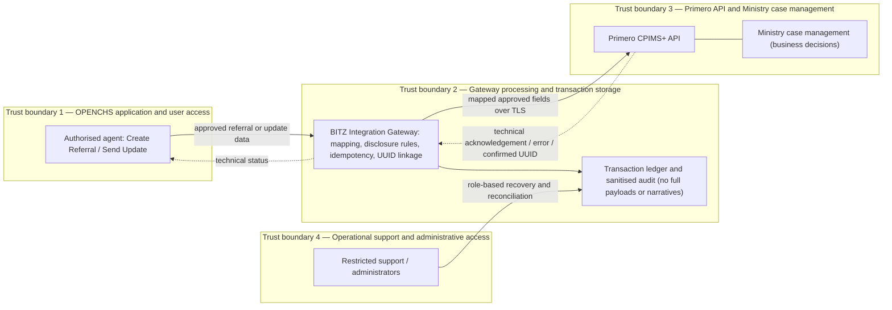

[Historical pre-scope-validation diagram](assets/d1-v2.8/media/image6.png) retained for evidence only. It shows earlier inbound and attachment flows and does not define initial delivery.

**Trust boundaries.**

| **Boundary** | **What crosses it** | **Permissions required** |
|----|----|----|
| 1 — OPENCHS application and user access | Agent-entered referral and update data, outbound to the gateway; technical statuses, inbound for display | OPENCHS role permissions for initiation, confirmation, Send Update and status viewing |
| 2 — Gateway processing and transaction storage | Approved mapped fields outbound; technical responses and UUIDs inbound; ledger records retained | Machine-to-machine credentials; protected secrets; encryption at rest; restricted ledger access |
| 3 — Primero API and Ministry case management | Approved fields for creation and update; technical responses back. Ministry business decisions stay inside CPIMS+ | Least-privilege integration account verified by Primero; Ministry roles for business decisions |
| 4 — Operational support and administrative access | Sanitised metadata for monitoring, recovery and reconciliation; no full payloads | Approved personnel, role-based access, recorded reason and audit trail |

**Table 7.3 — Proposed classification matrix**

The labels below are proposed. Final classification labels will be applied only after confirmation against the Ministry's applicable information-classification policy [DMP1 section 5.6.4].

| **Data** | **Direction** | **Proposed sensitivity** | **Control** |
|----|----|----|----|
| Child identity and demographics | OPENCHS → CPIMS+ | High: sensitive child-protection information requiring heightened protection (DPA section 29(a)) | Approved fields only; TLS; least privilege; not written to logs |
| Location and contact details | OPENCHS → CPIMS+ | High | Necessary, authorised fields only |
| Case narratives and safeguarding allegations | OPENCHS → CPIMS+ | High: heightened protection (DPA section 29(b)) | Not written to logs or the ledger; role-based access |
| Reporter information | OPENCHS → CPIMS+ only where given and permitted | High | Anonymity preserved (D-010); excluded where anonymity applies |
| Alleged perpetrator details | OPENCHS → CPIMS+ | High | Approved, relevant fields only; identified as allegations |
| ABR identifier | OPENCHS → CPIMS+ when available | High (national identifier) | Structural checks; stored as text; excluded from operational logs |
| Approved service and referral linkage | OPENCHS → gateway → CPIMS+ | Medium | Approved service codes; ledger |
| CPIMS+ UUID | CPIMS+ → gateway (technical response) | Medium | Ledger; displayed only to authorised users |
| Technical transaction metadata | Gateway (internal) | Medium | Sanitised; restricted access; approved retention (OPS-004, OPS-005) |
| Security credentials and secrets | Gateway (internal) | Restricted | Secret store; never logged; rotation (SEC-004) |
| Attachments, recordings and case plan | Not transferred | — | Excluded (DATA-010; FN-011) |
| Ministry business statuses and interventions | Not transferred initially | — | Deferred to a future addendum (RT-007) |

**Gateway data minimisation.** The gateway may persist only the technical transaction records needed for reliable delivery, idempotency, UUID linkage, retry processing, reconciliation, monitoring and auditability (section 6.7). It does not duplicate complete case narratives, attachments or sensitive API payloads in the ledger or logs. Any temporary processing data, such as queued payloads awaiting delivery, is handled under an approved retention and deletion policy (section 7.5).

### 7.5 Matters requiring UNICEF or Ministry confirmation

The register below records each approval and dependency for data protection, security and safeguarding (DATA-SEC-005). It is aligned with Annex E (decisions), Annex J (requirements) and Annex K (technical verification). Statuses are Pending Confirmation, Under Review, Confirmed or Blocked. No approver, date or confirmation has been invented. Named persons are those recorded in the action register (Annex F), and no target date has been agreed unless one is stated.

Milestone codes:

- **DEV** — preliminary development
- **TIT** — technical integration testing
- **UAT** — joint UAT
- **PROD** — production information exchange
- **GL** — final acceptance or go-live

Development and preliminary tests may proceed with approved synthetic data where this is safe and technically feasible. Pending legal approvals do not permit real child-protection records to be used in any test environment (SEC-007).

**Table 7.4 — Data-protection, security and safeguarding approval register**

| **ID** | **Description** | **Accountable organisation** | **Named person (where confirmed)** | **Required evidence** | **Status** | **Affected requirement** | **Milestone blocked** | **Acceptance impact** | **Target date** | **Related reference** |
|----|----|----|----|----|----|----|----|----|----|----|
| DSR-01 | Applicable data-protection legislation and its current status, including amendments, regulations, codes and child-protection legislation | Ministry; UNICEF legal advisers | — | Written legal confirmation | Under Review (A-022 desk research; [DPA1] received) | SEC-001 | PROD, GL | Production authorisation | — | A-017, A-022; R-007 |
| DSR-02 | Approved lawful bases and disclosure purposes for each scenario in section 7.2 | Ministry | — | Consent during the call; otherwise child-protection (vital interest) basis with supervisor authorisation | Confirmed | SEC-001; DATA-012 | UAT (rules), PROD | Mapping and UAT scenarios | — | A-022; R-007 |
| DSR-03 | Consent and safeguarding-exception authority, evidence and withdrawal handling | Ministry | — | Where consent cannot be obtained or is refused, a referral may proceed on the child-protection (vital interest) basis with supervisor authorisation. Withdrawal stops further updates but does not recall referrals already sent | Confirmed | DATA-012; WF-004 | UAT, PROD | Consent scenarios | — | R-011 |
| DSR-04 | Data-sharing agreements and the organisations taking part in the approved flow | Ministry; UNICEF | — | Ministry (controller) and BITZ (processor) under the existing contract | Confirmed | SEC-001 | PROD | Real-data exchange | — | Section 7.2; R-007 |
| DSR-05 | Data-controller and processor responsibilities and written processing contracts | Ministry; UNICEF | — | The Ministry is data controller for CPIMS+ and the helpline data; BITZ is processor for OPENCHS and the gateway under the existing contract. Existing hosting is unchanged, and remote support follows the existing support contract | Confirmed | SEC-001 | PROD | Production authorisation | — | R-017 |
| DSR-06 | Approved routine, partial and emergency minimum datasets | Ministry; Primero (feasibility) | — | Child's details and narrative; minimum emergency information in emergencies. Primero mandatory-field check remains | Confirmed | DATA-005; WF-004, WF-005; FN-005 | TIT (mapping), UAT | Validation build and UAT | — | Annex C; Table 5.3 |
| DSR-07 | Reporter anonymity and child identity rules | Ministry | — | Approved disclosure rules and anonymous representation | Pending Confirmation | DATA-008; SEC-002; D-010, D-011 | UAT | Anonymity scenarios | — | Annex C.1 |
| DSR-08 | Retention and secure deletion of ledger, logs and queued data (no periods prescribed under section 19) | Ministry | — | Proposed: metadata logs and the transaction ledger kept for 24 months; queued payloads deleted once delivery succeeds; Ministry to confirm | Proposed | SEC-006; OPS-005 | PROD | Production authorisation | — | Section 6.7 |
| DSR-09 | Hosting location and cross-border support access | Ministry; Primero; BITZ | — | Existing hosting unchanged; remote support under the existing support contract | Confirmed | GOV-004 | TIT (network), PROD | Production authorisation | — | R-017 |
| DSR-10 | Security-incident notification procedure, including recipients while the Commission is not established (section 23) | Ministry; UNICEF | — | Approved procedure and contacts | Pending Confirmation | OPS-007 | PROD | Go-live readiness | — | R-017 |
| DSR-11 | Approved synthetic test dataset | Ministry (privacy owner); BITZ prepares | Tiisetso Mohlabi (approval) | Dataset approved before use | Confirmed | SEC-007; UAT-003 | TIT, UAT | All testing | — | Annex H S-08 |
| DSR-12 | Named data-protection and security approvers | Ministry | Tiisetso Mohlabi | Written nomination | Confirmed | GOV-001 | UAT, GL | Approval of security evidence | — | R-014 |
| DSR-13 | Government information-classification and security documentation (DMP sections 5.6.4 and 5.6.8); UNICEF asked to supply the classification policy | Ministry; UNICEF | — | Classification policy; required security documents | Pending Confirmation | SEC-006 | PROD | Final classification labels | — | Table 7.3 |
| DSR-14 | Primero integration-account permissions and technical capabilities | Primero | Isaiah Amutavi Osotsi | Operations and permissions confirmed by Primero | Confirmed | SEC-003; API-002, API-003 | TIT | Implementation | — | Section 6.7 register; Annex K |
| DSR-15 | Readiness of the Lesotho test environment | Primero; UNICEF (checklist) | Isaiah Amutavi Osotsi; Rantsala Sanaha | Access confirmed by Primero | Confirmed | UAT-003 | TIT, UAT | Lesotho verification | 13 Nov 2026 target recorded at [M4]; not guaranteed | A-015, A-016 |
| DSR-16 | Approval of the safeguarding SOP, including current applicability of the 2019 SOP | Ministry | — | 2019 SOP confirmed as applicable | Confirmed | WF-001, WF-003 | UAT | Safeguarding scenarios | — | Section 3.5; A-013 |
| DSR-17 | Operational support and incident escalation | BITZ; Primero; Ministry; Child Helpline | Hopolang Mosena (responsible) | Named contacts; approved runbook | Confirmed (responsible person) | OPS-006, OPS-007 | GL | Go-live readiness | — | Section 6.5 |
| DSR-18 | Final authorisation of production data exchange | Ministry | — | Written authorisation | Blocked (depends on DSR-01 to DSR-17) | SEC-001 | PROD, GL | Go-live | — | Section 4.7 stage 4 |

Matters still unresolved and preserved from earlier versions include: the establishment of the Data Protection Commission; how processing is notified under sections 25(5) and 53 of the Act while the Commission is not established (DSR-10, DSR-18); and the security documentation required for government information systems (DSR-13).

### 7.6 Safeguarding requirements

Child safety and approved safeguarding procedures take precedence over the routine electronic workflow (DATA-SEC-006). The integration supports safeguarding decisions, but urgent intervention never depends on successful API delivery.

**Emergency escalation.** Where an immediate safeguarding risk is identified:

1. the agent follows the approved Child Helpline emergency assessment procedure;
2. the required telephone or other approved urgent escalation proceeds without waiting for electronic submission;
3. the agent prepares the electronic referral using the permitted emergency dataset;
4. the gateway submits and tracks the referral;
5. technical delivery is monitored separately from Ministry acceptance;
6. approved supplementary information may be sent later through Send Update.

The electronic referral does not replace any required emergency communication (WF-007).

**Controlled partial and emergency referrals.** Approved exceptions are supported where child identity is incomplete; reporter information is unavailable or anonymous; certain routine fields cannot be obtained safely; or delay would create an unacceptable safeguarding risk under the approved SOP. For each exception the system records:

- the exception category;
- the authorised actor;
- the reason or permitted basis;
- missing information requiring follow-up;
- relevant timestamps;
- any later authorised completion.

The safeguards cannot be bypassed without restriction.

**Confidentiality and anonymity.** Reporter anonymity is preserved throughout referral preparation, API submission, gateway processing, technical logging, support investigation and follow-up updates (SEC-002). Child and alleged-perpetrator information is restricted to authorised users and approved purposes.

**Ministry business ownership.** The Ministry retains authority over referral acceptance and rejection; caseworker assignment; internal safeguarding decisions; case progression; and closure. A Delivered gateway status is never presented as proof of Ministry acceptance or of a completed safeguarding intervention.

**Follow-up and correction.** Explicit, authorised Send Update operations support supplementary information, approved correction requests, completion of partial referrals and permitted lifecycle requests. Each update references the existing CPIMS+ UUID and does not create a replacement case unintentionally. A withdrawal or cancellation request is not presented as a confirmed Ministry action until the receiving platform or the responsible Ministry authority confirms the outcome (WF-006, WF-010).

**Safeguarding training and UAT.** Training and UAT cover the following scenarios: anonymous reporters; missing child identity; emergency referrals; consent declined or not obtainable; approved lawful-basis exceptions; sensitive allegations; failed electronic delivery; telephone escalation; duplicate prevention; supplementary updates; authorised correction and withdrawal requests; and technical acknowledgement versus business acceptance. Safeguarding procedures are validated under Ministry leadership, with Child Helpline participation and the appropriate BITZ and Primero technical evidence (UAT-001, UAT-010). Annex J.5 and Annex A retain the detailed requirements. Ministry legal approval remains a production prerequisite.

#### Section 7 acceptance traceability

Section 7 supports verification of the items below. Existing Annex H IDs are cited. Items marked *new* require addition to Annex H, and those marked *conditional* depend on Ministry approval or Primero verification. No test has been executed.

1. Approved field-level mapping — F-14, *new* mapping review (*conditional*: DSR-06).
2. Routine, partial and emergency datasets — F-04, F-05, *new* partial-referral scenario (*conditional*: DSR-06).
3. Reporter anonymity — F-03.
4. Optional ABR — F-06 to F-09.
5. Consent-state handling — S-06 (*conditional*: DSR-03).
6. Lawful-basis recording — *new* (*conditional*: DSR-02).
7. Role-based permissions — S-02, *new* OPENCHS role test.
8. Secure API authentication — S-01, RC-08 (*conditional*: DSR-14).
9. TLS and certificate validation — S-05.
10. Encryption at rest — *new*.
11. Secrets protection — *new* (SEC-004).
12. Audit-log redaction — S-03, AU-01.
13. Environment isolation — S-08, *new*.
14. Secure transaction retention — *new* (*conditional*: DSR-08).
15. Technical data-flow boundaries — *new* architecture review against Figure 5.
16. Exclusion of automatic inbound updates — *new* negative test (S-04 and S-07 remain future scope).
17. Exclusion of attachments and recordings — F-16.
18. Emergency escalation independent of API delivery — B-02.
19. Safe partial referrals — *new* (*conditional*).
20. Authorised Send Update — F-13 (*conditional*).
21. Ministry business ownership — F-11, F-18.
22. Data-sharing and safeguarding approvals — evidence of DSR-02 to DSR-05 and DSR-16 (document check).
23. Lesotho-specific technical verification — *new* (*conditional*: DSR-15).

#### Section 7 revision change log

| **DATA-SEC reference [RV7]** | **Validated decision** | **Where applied** | **Related identifiers and annexes** |
|---|---|---|---|
| DATA-SEC-001 | Approved minimum outbound dataset with field-level mapping; routine, partial and emergency datasets; optional ABR; nothing fabricated | 7.1; Table 7.1 | D-004, D-005, D-011–D-014; DATA-002–DATA-013; FN-001, FN-002, FN-005, FN-011; Annex C; Annex J.3 |
| DATA-SEC-002 | Legal references preserved, dated and qualified as planning analysis; lawful-basis framework; four consent states with lawful basis recorded separately; data-sharing, controller and processor confirmations; legal review by Ministry and UNICEF advisers | 7.2 | SEC-001; DATA-012; A-017, A-022; R-007, R-011, R-017; [DPA1]; [DMP1]; [CT2] |
| DATA-SEC-003 | Mandatory, testable security-control baseline; OPENCHS, gateway and Primero boundaries; evidence requirements | 7.3; Table 7.2 | SEC-002–SEC-007; API-002, API-008; OPS-004, OPS-006, OPS-007; AUD-001, AUD-002; Annex K.2.3 |
| DATA-SEC-004 | Outbound-only data flow; four trust boundaries; proposed classification matrix; gateway data minimisation; diagram corrected | 7.4; Figure 5; Table 7.3 | OPS-004, OPS-005; DATA-010; RT-007; TECH-001; Annex K.2.4 |
| DATA-SEC-005 | Formal approval and dependency register with milestone impact | 7.5; Table 7.4 | Annex E, F, J and K; risks R-007, R-011, R-014, R-017 |
| DATA-SEC-006 | Safeguarding-first model; emergency escalation independent of the API; controlled exceptions; anonymity; Ministry ownership; follow-up and correction; training and UAT scenarios | 7.6 | WF-004–WF-007, WF-010; SEC-002; UAT-001, UAT-010; Annex J.5 |

#### Section 7 quality assurance and unresolved questions

This revision changes only Section 7 and keeps subsections 7.1–7.6 and their titles. All six DATA-SEC decisions are reflected. The legal source identifiers ([DPA1], [DMP1], [CT2]), provisions, actions and risks are preserved, and dated status statements are qualified. Figure 5 now shows only outbound operations and their technical responses. No statutory provision, policy approval, retention period, hosting location, certification, approver or test result has been invented.

Tables 7.1–7.4 are new labels within this section. Figure 5 keeps its existing number. The brief asked to preserve a contractual reference to data-sharing agreements among named ministries. That reference came from the unsigned TICAD-2026-001 text, which version 2.6 removed, and it is not in signed Amendment 3 [CT2]. Section 7.2 therefore keeps the existing CT2-consistent wording, and the matter is flagged for the report owner.

Annex K.2 duplicates the earlier Section 7 text and is not yet aligned. Further items outside this section are also not yet aligned: Section 5 Table 5.2 lists five consent states; Section 11.4 and Annex A / J still contain wording that predates this revision; and the version label differs between the header and footer. These items are recorded in the separate Section 7 revision record and require separately authorised edits. The report remains **Version 2.8 — Post-Validation Revision, pending formal approval**.

## 8 Implementation plan

This section sets out the implementation and schedule-governance plan for the integration. It applies the eight Section 8 validation decisions **IMP-001–IMP-008 [RV8]**. [RV8] means the Section 8 implementation-plan validation instructions supplied for this revision. Like [RV3]–[RV7], it is not an approved schedule, a contract variation or evidence of progress. The plan implements the validated scope of Sections 5–7:

- architecture **OPENCHS → BITZ Integration Gateway → Primero CPIMS+ API** (TECH-001);
- outbound Create Referral and explicit, permission-controlled Send Update against an existing CPIMS+ UUID;
- approved service selection, validation and confirmation;
- secure authentication;
- persistent linkage, idempotency, controlled retries and reconciliation;
- technical acknowledgements, sanitised audit, monitoring and authorised recovery.

OpenFN, X-Road as a referral mechanism, automatic inbound status or intervention synchronisation, attachment and recording transfer, case-plan transfer and direct external-provider routing are not implementation activities. The Ministry retains ownership of CPIMS+ case management, safeguarding decisions and internal service assignment.

Development, simulated testing, Lesotho integration verification, UAT acceptance, production go-live and contractual acceptance are distinct states throughout this section. None is evidence of another.

### 8.1 Work plan and delivery phases

The work plan keeps the twelve phases and their D1–D4 mappings (IMP-001). Outputs not named in the contract are marked as proposed supporting outputs. No contractual deliverable definition is changed. Responsible (R) and approving (A) parties are roles; named approvers remain pending (GOV-001, GOV-003; CD-09).

**Table 8.1 — Work plan and delivery phases**

| **#** | **Phase** | **Objective** | **Principal activities** | **Expected outputs** | **Responsible / approving** | **Dependencies** | **Completion and acceptance criteria (evidence)** | **Deliverable** |
|----|----|----|----|----|----|----|----|----|
| 1 | Requirements confirmation, decision closure and approvals | Close the inception baseline | Receive pathways and remaining privacy material; close Section 5–7 decisions (datasets, consent and lawful basis, service list, interruption handling); record approvals | Approved D1 report; updated inventory and registers | R: BITZ. A: Ministry and UNICEF (named approvers pending) | A-013, A-014, A-017, A-021, A-022; GOV-001; Table 7.4 | Written D1 approval, or written conditional treatment listing each open item with owner, deadline and delivery effect (gate G1) | D1 |
| 2 | Detailed outbound integration and gateway design | Agree the technical interface | Create Referral and Send Update sequence design; transaction ledger and UUID linkage; idempotency and reconciliation; technical and business status separation; error classification; security design. The automatic return path is removed from the design | Integration design specification and interface agreement (proposed supporting output) | R: BITZ, Primero. A: named technical authorities (pending) | Lesotho environment (G2); GOV-004; API-002, API-003 | Design specification reviewed and signed off by the named OPENCHS and Primero technical authorities; open items listed | D1 / D3 |
| 3 | OPENCHS and Lesotho Primero test-environment preparation | Usable test environments on both sides | OPENCHS test environment with gateway; Lesotho CPIMS+ test environment; credentials package; secret storage; global demonstration access for preliminary tests only | Access package; environment matrix | R: BITZ (OPENCHS, gateway); Primero (CPIMS+); UNICEF and Ministry (checklist) | A-015, A-016, A-023 | One successful authorised test exchange recorded with the Lesotho environment (gate G2) | D1 |
| 4 | OPENCHS referral interface, validation and role controls | Build the D2 features | Explicit referral control; CPIMS+ destination and Ministry-approved services dropdown; confirmation; narrative and identity rules; optional ABR with structural checks; controlled partial and emergency referrals; technical status display; role-based Send Update permissions | Demonstrable features; unit tests | R: BITZ. A: UNICEF (contractual), with Child Helpline feedback | Datasets (WF-004, WF-005; DSR-06); service list (A-018); ABR rules (A-007) | Demonstration, screenshots, code reference and unit-test results against D2 criteria and the Section 5.4 scenarios (Level 1 evidence) | D2 |
| 5 | BITZ Gateway and Primero API integration | Build the integration module | Authentication; transaction ledger; UUID linkage; idempotency; queue; retries at 1, 5, 30 and 120 minutes after the preceding failed attempt where safe; uncertain-outcome reconciliation; technical acknowledgements; sanitised audit; monitoring | Integration module; contract tests | R: BITZ. Technical verification: Primero | Phases 2–3; G2; API-002–API-004 | Contract tests pass against mocks (Level 2); authorised Create Referral and Send Update calls evidenced against the Lesotho environment (Level 3); simulated and verified results reported separately (gate G3) | D3 |
| 6 | Security and functional verification | Verify controls | Tests from Table 7.2: authentication, authorisation, TLS, encryption at rest, secrets, audit redaction, environment isolation, recovery permissions; functional tests | Security and functional test report (proposed supporting output) | R: BITZ; Primero (platform). A: named security approver (pending, DSR-12) | SEC requirements; Table 7.2 | Documented evidence for each Table 7.2 control; no open Critical or High security defect | D3 / D4 |
| 7 | Lesotho-specific integration testing | Verify end-to-end behaviour on the Lesotho deployment | End-to-end Create Referral and Send Update; failure classes; retries; duplicates; uncertain outcomes; reconciliation; authorised update; regression testing | Integration test evidence | R: BITZ, Primero | G2; approved Annex H scenarios | Approved Annex H integration scenarios pass against the Lesotho test environment; Critical and High defects resolved (gate G4). Global demonstration results are not sufficient | D4 |
| 8 | Ministry-led user acceptance testing | Ministry-led acceptance | UAT plan; approved synthetic cases; execution; defect triage; retest; safeguarding scenarios (section 7.6) | Signed UAT report | Lead: Ministry (D-009). Participants: Child Helpline; BITZ (support, scenarios and data); Primero (platform) | UAT-002, UAT-003, UAT-007; DSR-11 | Section 10 conditions met; Ministry-authorised sign-off and Child Helpline endorsement recorded (gate G5) | D4 |
| 9 | Training and knowledge transfer | Operational and technical capability | Operator and social-worker training (referral, Send Update, technical statuses, failure handling, emergency continuity); IT and administrator training | Materials; attendance records | R: BITZ. Participants: Ministry, Child Helpline | Stable UAT build | Training report in the contract's format and attendance records submitted | D4 |
| 10 | Production deployment preparation | Production readiness | Production endpoints and credentials; rollback; monitoring and alerting; incident escalation; support ownership; release evidence | Readiness checklist; rollback plan | R: BITZ; infrastructure owners; Primero | API-008; OPS-006, OPS-007; DSR-01–DSR-18 | Production readiness checklist complete; written go/no-go decision recorded (section 8.7) | D4 |
| 11 | Go-live and hypercare | Stabilise in production | Deployment after written go-live authorisation; hypercare monitoring and incident handling | Hypercare log (proposed supporting output) | R: BITZ; Ministry support owners | Written go/no-go | Hypercare exit conditions, to be agreed, met and evidenced in the hypercare log | D4 |
| 12 | Operational handover | Transfer to operations | Technical handover report; user manual; administrator guide; support runbook | Handover pack | R: BITZ. A: named operational owner (pending) | Phases 9–11 | Handover accepted in writing by the named owner; D4 submitted for UNICEF acceptance | D4 |

### 8.2 Implementation and dependency flow

Development proceeds in two controlled parallel workstreams that converge at a mandatory Lesotho integration readiness gate (IMP-002). Simulated testing supports development progress but cannot replace Lesotho-specific integration acceptance.

**Figure 6 — Implementation and dependency model.** *This is a dependency model, not an approved calendar schedule.*

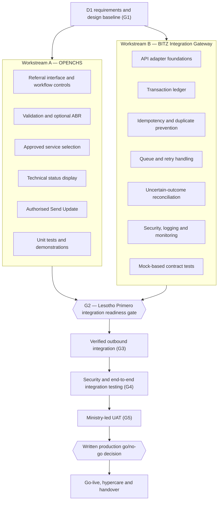

[Historical Figure 6](assets/d1-v2.8/media/image7.png) retained for traceability only.

**Table 8.2 — Dependency gates**

| **Gate** | **Accountable party** | **Required evidence** | **Downstream activities blocked** |
|----|----|----|----|
| G1 — D1 baseline | UNICEF and Ministry (approvers confirmed, Table 12.2) | Written D1 approval | Formal design sign-off and D2–D4 submissions; parallel development may continue |
| G2 — Lesotho Primero integration readiness | Primero; UNICEF (checklist) | Verified access; approved credentials; documented API capabilities; field mappings; service catalogue; authorised test connectivity | Verified outbound integration (Level 3 evidence) and all later gates; Workstreams A and B continue on mocks |
| G3 — Verified outbound integration | BITZ, with Primero technical verification | D3 development evidence, with simulated and verified results identified separately | Security and end-to-end integration testing |
| G4 — Lesotho integration verification | BITZ; Primero | Approved Annex H scenarios passed on the Lesotho environment; Critical and High defects resolved | Ministry-led UAT |
| G5 — UAT sign-off | Ministry (authorised signatory pending, CD-09) | Signed UAT report; defect disposition; Child Helpline endorsement | Production go/no-go |
| Production go/no-go | Ministry (safeguarding, operational) and UNICEF (contractual), as section 8.8 confirms | Production readiness checklist (section 8.7) | Go-live, real-data exchange and hypercare |

### 8.3 Contract dates and timeline

The signed contract states no due dates for the integration deliverables; the delivery dates for D1–D4 were agreed at the D1 validation meeting (IMP-003; CD-15). Table 8.3a records the dated history, Table 8.3b the deliverables against their signed items and agreed dates, and Table 8.3c how each type of date is to be read. The detailed timetable is in section 8.7 and Figure 7. **The four deliverable dates are agreed; the intermediate activity dates are the working plan and change only through change control (section 9.6).** The contract ends on 7 July 2027 (CD-16).

**Table 8.3a — Key contract dates**

| **Date** | **Event** | **Source** |
|----|----|----|
| 10 Mar 2025 | Contract 43427866 begins: Child Helpline support and maintenance, year 1 | [CT2] |
| 10 Apr 2026 | Year 2 of support and maintenance begins (Amendments 1 and 2) | [CT2] |
| 15 Sep 2026 | Amendment 3 signed by UNICEF and BITZ; integration added as items 50–80; effective on UNICEF's receipt of the countersigned copy | [CT2] |
| 24 Sep 2026 | Inception meeting | [TB] |
| 28 Sep 2026 | Week 1 of the 14-week plan recorded in Session 1 | [M1 section 10]; CD-07 |
| 8–9 Oct 2026 | Sessions 1 and 2 | [M1]; [M2] |
| 26 Oct 2026 | Session 3 closes requirements | [M3] |
| 28 Oct 2026 | Initial D1 draft due (A-025) | [M3] |
| 30 Oct 2026 | D1 version 2.7 circulated to Session 3 participants for review | This report |
| 2 Nov 2026 | Proposed amendments due from Session 3 participants (as proposed in v2.7) | v2.7 section 8.7 |
| 4 Nov 2026 | D1 validation meeting held (planned for 3 Nov) | [M4]; section 3.2 |
| 9 Nov 2026 | D1 version 2.8 Post-Validation Revision, pending formal approval | This report |
| 13 Nov 2026 – 26 Feb 2027 | Proposed delivery timetable, from final D1 to acceptance of D4 (proposed, subject to UNICEF approval) | Section 8.7; Figure 7 |
| 3 Jan 2027 | End of Week 14 of the original planning period (historical planning assumption) | [M1 section 10]; CD-07 |
| 7 Jul 2027 | Contract end date: the validity date in the amendment's header block and the operative "not later than" clause. (10 July 2027 appears in the Amendment 03 justification heading and 10 June 2027 in the justification narrative; neither is operative.) | [CT2]; CD-16 |

**Table 8.3b — Deliverable timeline**

| **Deliverable (signed item [CT2])** | **Due date in the signed contract [CT2]** | **Status at 30 Oct 2026 (historical)** | **Proposed date (section 8.7)** | **Approval status of proposed date** |
|----|----|----|----|----|
| D1 Inception, requirements and environment setup (item 50) | Not stated | Report in review (v2.7); mapping, environment evidence and approval outstanding | Final D1 by 13 Nov 2026 | Agreed (CD-15) |
| D2 ABR ID field, checks and referral control (item 60) | Not stated | No build or test evidence submitted | Evidence by 20 Nov 2026 | Agreed (CD-15) |
| D3 Outbound connection client and integration module (item 70) | Not stated | Blocked on test-system access, credentials and field names | Evidence by 11 Dec 2026, dependent on G2 | Agreed (CD-15); dependent on G2 |
| D4 Testing, user testing, training and go-live (item 80) | Not stated | Not started | UAT sign-off by 5 Feb 2027; go-live by 12 Feb; handover by 19 Feb; D4 acceptance by 26 Feb 2027 | Agreed (CD-15) for D4 acceptance; intermediate dates are the working plan |

**Table 8.3c — Schedule governance categories**

| **Category** | **Meaning** | **Current entries** |
|----|----|----|
| Signed contractual obligation | Stated in [CT2] | Items 50–80; contract end date 7 July 2027 (CD-16); late-submission clause (CD-17), applied to the agreed delivery dates (CD-15) |
| Historical planning assumption | Recorded plan, not binding | The 14-week plan, 28 Sep 2026 – 3 Jan 2027 (CD-07) |
| Proposed recovery milestone | BITZ proposal awaiting approval | All section 8.7 dates |
| Formally approved revised milestone | Approved in a written, dated UNICEF record | None |
| Actual verified completion date | Supported by evidence | Recorded only in section 8.4 with an evidence reference |

**Schedule governance.** A delay does not automatically extend any later milestone or the contract. A missed dependency triggers:

1. written notification;
2. a documented impact assessment;
3. a proposed mitigation;
4. proposed revised dates, where necessary;
5. formal governance or contractual approval before any agreed milestone changes (CD-07, CD-15, CD-16, CD-17).

**Figure 7 — Proposed recovery timetable.** Legend: every bar and milestone shown is **Proposed** (subject to UNICEF approval). Items marked *crit* are **Dependent** on gate G2. No milestone is **Approved** or **Achieved** at the date of this revision. The written production go/no-go checkpoint falls between G5 and production deployment; no separate date is proposed for it.

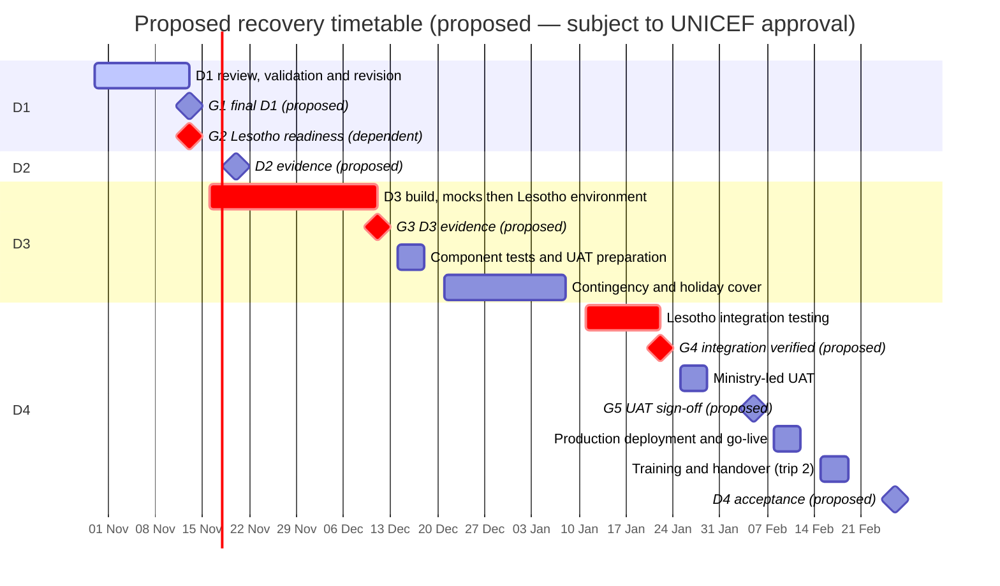

The D1 review bar is shown as in progress: v2.7 was circulated on 30 October and the validation meeting was held on 4 November [M4]. This does not indicate D1 approval. [Historical Figure 7](assets/d1-v2.8/media/image8.png) retained for traceability only.

### 8.4 Current status against the baseline

The historical delivery position as at 30 October 2026 is retained unchanged in Annex L.1 (IMP-004). The register below records the latest verified position. Where no current evidence exists, the status is **Pending Verification**.

*The historical record that stood here is retained unchanged in Annex L.1 (Delivery status as at 30 October 2026).*

The six delivery states are distinct and are not interchangeable:

- development completed;
- demonstration completed;
- simulated testing completed;
- Lesotho integration verified;
- UAT accepted;
- contractual deliverable accepted.

**Table 8.4 — Delivery status register**

| **Deliverable** | **Historical baseline (30 Oct 2026)** | **Latest verified status** | **Completed activities (verified)** | **Outstanding activities** | **Dependency** | **Accountable owner** | **Evidence reference** | **Milestone impact** | **Next action** |
|----|----|----|----|----|----|----|----|----|----|
| D1 | Report in review (v2.7) | Validation meeting held 4 Nov 2026; v2.8 Post-Validation Revision in preparation; formal approval pending | v2.7 circulated; validation meeting held | Final revision; written approval or conditional treatment | Named approvers (GOV-001, GOV-003) | BITZ (submission); UNICEF and Ministry (approval) | [M4]; this report | G1 | Submit final D1; obtain a written decision |
| D2 | No build or test evidence | Pending Verification | None evidenced | Phase 4 build and unit tests | Datasets (DSR-06); service list (A-018); ABR rules (A-007) | BITZ | — | 20 Nov 2026 proposed date | Report development and demonstration status with evidence |
| D3 | Blocked on access | Pending Verification | None evidenced | Phase 5 build; Level 2 then Level 3 evidence | G2 (A-015, A-016, A-023) | BITZ; Primero (access) | — | G3; 11 Dec 2026 proposed date | Confirm G2 status; report mock-based progress separately |
| D4 | Not started | Pending Verification | None evidenced | Phases 6–12 | G2–G5; DSR register | BITZ; Ministry (UAT); UNICEF (acceptance) | — | G4, G5, go/no-go | Prepare UAT plan and synthetic dataset (DSR-11) |

### 8.5 Outstanding work and critical dependencies

Table 8.5 is the critical dependency and escalation register (IMP-005). Each ID's definition has been checked against the action register (Annex F), the risk register (Annex G) and Annex J. Named contacts are those recorded in Annex F.

Blocking codes:

- **DEV** — development
- **TIT** — live integration
- **UAT** — user acceptance testing
- **PROD** — production
- **ACC** — contractual acceptance

The escalation path for every item is the section 9.5 route: issue owner → BITZ project manager → technical working session or steering review → UNICEF programme owner and Ministry business owner. No unresolved dependency automatically suspends unrelated safe development, and no missed dependency automatically extends a contractual or approved milestone. Material impacts are escalated through formal governance under section 8.3.

**Table 8.5 — Critical dependency and escalation register**

| **Ref.** | **Required input or decision** | **Accountable organisation (recorded contact)** | **Current status** | **Required evidence** | **Phase / deliverable** | **Blocks** | **Target date (if agreed)** | **Mitigation or permitted parallel work** | **Schedule impact** | **Closure evidence** |
|----|----|----|----|----|----|----|----|----|----|----|
| A-007 | ABR format, ownership and validation rules (check-digit method and valid examples not received) | Ministry / relevant authority | Pending; structure only received 26 Oct [M3 section 9] | Official specification and examples | 4 / D2 | ACC (D2 validation); not DEV | — | Interim structural rule (D-014); ABR optional, so a blank value never blocks a permitted referral. No check-digit algorithm is assumed | D2 validation completeness (CD-05) | Received specification; passing F-06 to F-09 |
| A-013 | National referral pathways | UNICEF (Rantsala) | Overdue — not received | Pathway documents | 1, 8 / D1, D4 | UAT | — | Proceed on the received SOP, subject to applicability | D1 completeness; UAT scenarios | Received and reviewed |
| A-014 | Case-management SOPs, including the referral section | Ministry (Hopolang Mosena) | Received [SOP1]; confirmed as applicable (DSR-16) | — | 1, 8 / D1, D4 | UAT | — | Design against [SOP1] as provisional | Safeguarding scenarios | Written confirmation |
| A-015 / A-016 | Lesotho sandbox checklist and access (global demonstration as fallback for preliminary tests only) | UNICEF (Rantsala); Primero (Isaiah) | Pending; [M4] target 13 Nov 2026, not guaranteed | Base URL; authorised environment; credentials and service-account permissions; authentication and security configuration; supported Create Referral and Send Update operations; API specifications and payload examples; field definitions, lookups and service catalogue; test data and technical support; successful authorised connectivity and contract test | 3, 5, 7 / D1, D3, D4 | TIT, UAT, PROD | 13 Nov 2026 (target recorded at [M4]) | Workstreams A and B continue with mocks (section 8.6) | G2 and every later gate | One successful authorised Lesotho test exchange |
| A-017 / A-022 | Data-protection material and legal clarification | UNICEF (Lekhanya); BITZ (Nelson, desk research) | Partly received 29 Oct 2026; desk research in progress | Legal confirmation (DSR-01 to DSR-05) | 1, 10 / D1, D4 | PROD | — | Synthetic data only; no real data in testing | Production authorisation | Written legal confirmation |
| A-018 | Approved CPIMS+ service catalogue and codes | Primero (Isaiah); Ministry (approval) | Pending | Approved, versioned list | 4, 5 / D2, D3 | TIT, UAT | — | Configurable dropdown built against a placeholder list | D3 mapping; UAT | Approved list loaded and tested |
| A-019 | Historical ABR coordination: invite BITZ to Primero / X-Road sessions | UNICEF (Lekhanya); Primero (Isaiah) | Pending (historical) | Session record, if held | — | None for referral delivery | — | X-Road is not the referral mechanism; this is retained only for ABR coordination traceability | None | Closed by governance decision or session record |
| A-021 | Handling of referrals during service interruptions | BITZ (Nelson, Peter); Primero (Isaiah) | Pending; [M4] proposed queue and gradual resend | Primero technical validation of the retry policy (section 6.4) | 5, 7 / D3, D4 | TIT | — | Build to the validated policy (1, 5, 30 and 120 minutes; configurable) | None if validated | RC-03 and RC-04 results |
| A-023 | Configure API authentication; begin test calls | BITZ (Peter, Marlon) | Awaiting A-016 | Successful authenticated test call | 5 / D3 | TIT | After A-016 | Authentication adapter built against documented behaviour | G2 / G3 | Test call record |
| R-009 | Milestone slippage | UNICEF / governance | Open | Governance decision; written rebaseline | — / D1–D4 | ACC | — | Section 8.8 decisions | All proposed dates | Written governance record |
| R-010 / RT-007 | Return-update scope: explicit outbound Send Update is included; automatic inbound synchronisation is excluded (future addendum). Open questions concern supported Primero update operations, permissions, payloads and acknowledgement behaviour | Primero (capabilities); UNICEF (contractual confirmation of specific operations where [CT2] is not explicit) | Open | Verified operation list; written contractual confirmation (SCOPE-001) | 2, 5 / D3 | TIT (Send Update scenarios) | — | Create Referral proceeds independently | D3 Send Update evidence | Verified operations; F-13 result |
| Field mapping | Configured field definitions and lookups after test-system set-up | Primero (Isaiah) | Pending | Configured field names (ABR, protection concerns, risk levels, mandatory fields) | 2, 5 / D3 | TIT | — | Draft mapping (section 8.6) | D3 | Approved mapping |
| Protection-concern list | Aligned protection-concern category list [M2 section 11] | Primero | Not held | Aligned list | 2 / D3 | TIT | — | Version-controlled mapping with flagged unmapped values (DATA-007) | D3 mapping | Approved list |
| GOV-001 / GOV-003 | Named D1 approvers | UNICEF; Ministry | Pending | Written nomination | 1 / D1 | ACC (D1) | — | — | G1 | Nomination record |

*The historical record that stood here is retained unchanged in Annex L.2 (Inputs needed before development, as recorded in the minutes).*

Real case data will not be exchanged until the necessary agreements and authorisations are in place (section 7.5). The ABR field is optional and must not block a referral when left blank, but its contractual validation functionality must still be verified and tested [CT2 item 60]. The earlier suggestion that the HMIS and EMIS teams might supply the check-digit method is retained as history; no specification has been received.

### 8.6 Work that can proceed while test system access is pending

Controlled parallel development continues while G2 is outstanding (IMP-006).

**Table 8.6 — Permitted parallel work**

| **Track** | **Permitted work** | **Constraint** |
|----|----|----|
| OPENCHS | Referral interface; validation and optional ABR; approved service-selection interface; role-based permissions; technical status display; explicit Send Update workflow; unit testing | Minimum datasets remain configurable until DSR-06 is approved |
| BITZ Integration Gateway | Transaction ledger; idempotency; retry scheduler; queue management; error classification; uncertain-outcome reconciliation; audit records; API adapter foundations; mock-based testing | Built against documented behaviour; Lesotho capabilities unverified |
| Other | Draft field mappings; synthetic test-case preparation; Annex H test design; governance and approval tracking; operator and administrator training design; deployment and support planning | Synthetic dataset needs approval (DSR-11); training content is finalised after the UAT build |

Progress is reported at three evidence levels. Levels 1 and 2 never replace Level 3 for final integration acceptance.

| **Level** | **Evidence** | **Supports** |
|----|----|----|
| 1 — Development evidence | Code, unit tests, screenshots and demonstrations | D2 progress; development completed or demonstration completed |
| 2 — Simulated integration evidence | Mock API responses, synthetic data and failure simulations | Simulated testing completed |
| 3 — Verified Lesotho integration evidence | Authorised test-environment API transactions; validated mappings; UUID linkage; end-to-end results | Lesotho integration verified (G3, G4) |

Non-production testing uses approved synthetic datasets only. No real child-case data is used without the applicable legal, security and safeguarding authorisations (section 7.5). Assumptions made during parallel work, and the items that require later verification, are recorded in the dependency register.

### 8.7 Proposed recovery timetable

The dated timetable below is the working timetable, retained from version 2.7 (IMP-007). The four deliverable dates in it are agreed (CD-15); the intermediate activity dates are the working plan and change only through change control (section 9.6). Each date assumes five working days for UNICEF review, an assumption that itself requires agreement. BITZ staffing: Nelson Adagi (project manager), with Peter Rogendo and Marlon Amunga as developers. The rows dated 30 October to 6 November record the v2.7 plan. The review meeting was held on 4 November [M4].

| **Proposed period** | **Recovery work** | **Owner** | **Condition and evidence** |
|----|----|----|----|
| Fri 30 Oct 2026 | Circulate D1 version 2.7 to Session 3 participants for review | BITZ | Submission record |
| Mon 2 Nov 2026 | Participants send proposed amendments, as tracked changes, comments or proposed wording | All Session 3 participants | Amendments received by close of business |
| Tue 3 Nov 2026 (held 4 Nov) | Review meeting to go through the proposed amendments and agree the details | All Session 3 participants; BITZ chairs | Agreed amendments recorded [M4] |
| By Fri 6 Nov 2026 | BITZ circulates the updated draft reflecting the agreed amendments; UNICEF and the Ministry confirm the decisions in writing | BITZ; UNICEF; Ministry | Updated draft circulated; decisions recorded in writing |
| By Fri 13 Nov 2026 | Gate G1: final D1 submitted. Gate G2: Lesotho test-system access, credentials, configured field names and the CPIMS+ service list supplied | BITZ (G1); Primero, UNICEF (G2) | See the gate matrix below |
| By Fri 20 Nov 2026 | Submit D2 (item 60): referral interface, service dropdown, confirmation, optional ABR with interim structural check, status display, unit tests | BITZ | Level 1 evidence: demonstration, screenshots, code reference and test results |
| Mon 16 Nov – Fri 11 Dec 2026 | Build D3 (item 70) against mocks, then the Lesotho test environment: gateway, ledger, idempotency, retries, reconciliation, Send Update, audit and alerts | BITZ; Primero | Requires G2 for Level 3 evidence. Gate G3: D3 evidence by 11 Dec |
| Mon 14 – Fri 18 Dec 2026 | Component tests and coverage report; synthetic test cases approved; UAT plan agreed | BITZ; Ministry | Test and coverage reports; approved test data (DSR-11) |
| Mon 21 Dec 2026 – Fri 8 Jan 2027 | Contingency for defect correction; no submissions scheduled. Holiday support coverage to be verified | BITZ | Confirmed coverage arrangement |
| Mon 11 – Fri 22 Jan 2027 | Lesotho integration testing, including failure, retry, duplicate, uncertain-outcome, security and authorised-update scenarios | BITZ; Primero | Gate G4 |
| Mon 25 – Fri 29 Jan 2027 | Ministry-led UAT with Child Helpline operators, the Primero team and UNICEF participation as confirmed | Ministry; Child Helpline; Primero; UNICEF; BITZ | Test results and defect register |
| By Fri 5 Feb 2027 | Gate G5: UAT sign-off | Ministry-authorised signatory (CD-09) | Signed UAT report |
| Before production deployment | Written production go/no-go decision | See section 8.8 | Production readiness checklist |
| Mon 8 – Fri 12 Feb 2027 | Production deployment, post-deployment checks and go-live confirmation | BITZ; Ministry; UNICEF | Release checks; written go-live confirmation |
| Mon 15 – Fri 19 Feb 2027 | In-country training in Maseru (trip 2), subject to confirmation; handover pack submitted on 19 Feb | BITZ; Ministry | Attendance registers; English and Sesotho materials as agreed; handover report, manuals and administrator guide |
| By Fri 26 Feb 2027 | UNICEF acceptance of D4 (item 80) | UNICEF | Written acceptance |
| After go-live | Support after go-live, subject to the contract end date (CD-16) | BITZ; UNICEF | Arrangements to be agreed |

**Table 8.7 — Milestone-gate matrix**

| **Gate** | **Requirement** | **Evidence** | **Note** |
|----|----|----|----|
| G1 — D1 requirements baseline | Written D1 approval; remaining open items owned and tracked (Table 12.3) | Dated written record | — |
| G2 — Lesotho Primero integration readiness | Usable authorised test-environment access; credentials; API specifications; field mappings; approved service catalogue; successful test connectivity | One successful authorised test exchange | Does not prevent safe mock-based development |
| G3 — D3 development evidence | Gateway implementation; unit and contract-test results; Create Referral and Send Update controls; idempotency; retries; reconciliation; audit | Test reports, with simulated and verified transactions identified separately | — |
| G4 — Lesotho integration verification | Approved Annex H scenarios pass on the Lesotho environment, including failure, duplicate, retry, uncertain-outcome, security and authorised-update scenarios | Test evidence; Critical and High defects resolved before progression to final acceptance | — |
| G5 — Ministry-led UAT sign-off | Approved UAT evidence; defect disposition; Ministry-authorised sign-off; Child Helpline endorsement; relevant UNICEF and Primero participation | Signed UAT report | UAT sign-off is not permission to exchange real case data |
| Production go/no-go | Ministry safeguarding approval; applicable data-sharing and security approvals; production credentials and configuration; monitoring and alerting; rollback arrangements; incident escalation; support ownership and coverage; deployment and release evidence | Written go/no-go record | Separate checkpoint after G5 |

**Scheduling controls.** Dates do not shift automatically. If usable access and field names are not available by 13 November 2026, BITZ will notify UNICEF in writing with a documented dependency-impact assessment, mitigation and proposed revised dates. No agreed milestone changes until that proposal is formally approved. BITZ will not reschedule testing or assume a contract extension without UNICEF's written agreement. The five-working-day review assumption, the holiday contingency period and the February training and handover activities all remain subject to confirmation.

### 8.8 Decisions required to approve the revised schedule

The eight original decisions are retained, with their references, as a formal approval register (IMP-008). The production go/no-go is added as a separate checkpoint, numbered 9, without renumbering decisions 1–8.

Approval authority is distinct for each party:

- **BITZ** is responsible for technical implementation.
- **Primero** carries out API and platform technical verification.
- **The Ministry** holds safeguarding, operational and UAT authority.
- **The Child Helpline** gives operational endorsement.
- **UNICEF** holds coordination, contractual decisions and acceptance authority, subject to the signed agreement.

No contractual approval power is assigned on the strength of technical responsibility alone. Statuses are Pending, Under Review, Approved, Conditionally Approved, Rejected or Superseded. No decision is labelled Approved without an authorised, dated record.

**Table 8.8 — Schedule and implementation approval register**

| **#** | **Original ref.** | **Decision required** | **Proposed recommendation** | **Accountable decision-maker** | **Consulted** | **Required evidence** | **Status** | **Target date** | **Actual approval date** | **Approval reference** | **Affected deliverable / gate** | **Impact if unresolved** | **Escalation** |
|----|----|----|----|----|----|----|----|----|----|----|----|----|----|
| 1 | CD-16 | Contract end date | Settled: 7 July 2027 under the signed amendment | UNICEF | BITZ | Signed Amendment 3 | Resolved | — | — | — | Post-go-live support; D4 | Support window uncertain | Section 9.5 |
| 2 | CD-15, CD-17 | Approve the proposed recovery timetable and its contractual treatment | Approve the section 8.7 dates as the submission baseline | UNICEF | Ministry; BITZ | Written approval | Pending | — | — | — | All gates | Late-submission treatment undefined | Section 9.5 |
| 3 | CD-01, CD-03, CD-04 | Confirm the validated outbound-only scope and the outstanding Primero API capability details | Confirm outbound-only scope; Send Update operations confirmed by Primero | UNICEF (scope); Primero (capabilities) | Ministry; BITZ | Written scope confirmation; verified operation list | Under Review (scope validated in this draft; formal confirmation pending) | — | — | — | D3; G3 | Send Update scope uncertain | Section 9.5 |
| 4 | CD-07; G2 | Confirm the relationship between the 14-week plan and the proposed revised baseline, including Primero access commitments | Confirm that the revised timetable replaces the 14-week plan (planning principle at [M4]); commit an access date | UNICEF; Primero (access) | Ministry; BITZ | Written confirmation; committed access date | Under Review | — | — | — | G2 | All later dates uncertain | Section 9.5 |
| 5 | DSR register; A-007 | Confirm technical readiness, mappings, ABR validation inputs and data-sharing authorisations | Close G2 inputs and DSR-02 to DSR-07 | Ministry; Primero; UNICEF | BITZ | Table 7.4 evidence | Pending | — | — | — | G2, G4, PROD | Integration and production blocked | Section 9.5 |
| 6 | CD-09 | Name the Ministry-led UAT signatory and the endorsement arrangements | Ministry names the signatory in writing | Ministry | UNICEF; Child Helpline | Written nomination | Pending | — | — | — | G5 | UAT cannot be signed | Section 9.5 |
| 7 | D-018; TECH-006 | Confirm Lesotho-specific integration testing requirements and the limited role of the global demonstration environment | Global demonstration for preliminary tests only; G4 on the Lesotho environment | Ministry; UNICEF | Primero; BITZ | Written confirmation | Pending | — | — | — | G4 | Acceptance evidence disputed | Section 9.5 |
| 8 | Item 80 | Confirm training, travel (trip 2), languages, handover and post-go-live support arrangements | February trip; English and Sesotho materials; support within the contract term | UNICEF; Ministry | Child Helpline; BITZ | Written confirmation | Pending | — | — | — | D4 | Training and handover unscheduled | Section 9.5 |
| 9 | New checkpoint | Production go/no-go | Written go/no-go after G5 against the production readiness checklist | Ministry (safeguarding, operational) and UNICEF (contractual), as confirmed by governance | Primero; Child Helpline; BITZ | Written go/no-go record | Pending | — | — | — | Go-live | No real-data exchange | Section 9.5 |

#### Section 8 revision change log

| **IMP reference [RV8]** | **Validated decision** | **Where applied** | **Preserved** |
|---|---|---|---|
| IMP-001 | Twelve phases with D1–D4 mappings; outbound Create Referral and Send Update; measurable, evidence-based criteria | 8.1; Table 8.1 | Phase numbers and deliverable mappings; proposed-supporting-output labels |
| IMP-002 | Parallel workstreams A and B converging at G2; gate accountability and evidence | 8.2; Figure 6; Table 8.2 | Original Figure 6 linked as history |
| IMP-003 | Chronology preserved; CD-16 left open with the location of each date in the amendment; proposed dates labelled; schedule categories; no automatic extension | 8.3; Tables 8.3a–8.3c; Figure 7 | Every original date and source; CD-07, CD-15, CD-16, CD-17 |
| IMP-004 | Historical 30 Oct baseline plus an evidence-based register; six distinct delivery states; Pending Verification | 8.4; Table 8.4 | 30 Oct table unchanged; R-009 |
| IMP-005 | Formal dependency and escalation register; ABR optional; return-update dependency reconciled; X-Road and OpenFN not dependencies | 8.5; Table 8.5 | Historical inputs table unchanged; action IDs as defined in Annex F |
| IMP-006 | Permitted parallel work; three evidence levels; synthetic data only | 8.6; Table 8.6 | Original tracks absorbed |
| IMP-007 | Proposed timetable and G1–G5 retained; separate production go/no-go; no automatic date-shifting | 8.7; Table 8.7 | Every proposed date; five-day review; holiday contingency; February training |
| IMP-008 | Eight decisions as a formal register, plus go/no-go checkpoint 9; approval authorities distinguished | 8.8; Table 8.8 | Decisions 1–8 and their references |

#### Section 8 quality assurance and unresolved questions

This revision changes only Section 8, and all eight subsections are revised. The twelve phases keep their D1–D4 mappings. No approval, progress, revised date, contractual term, test result or new named contact has been introduced; the only names are those already recorded in Annex F. All proposed dates remain proposed. The contract end date remains unresolved under CD-16. Sections 9 to 11 and Annexes F to H still contain wording that predates this revision. Examples are the go-live approver in section 9.3, "returned updates" in section 10.5 training, Figure 12 gates and the R-006 and R-010 mitigations. These are listed in the separate Section 8 revision record, as is the version-label inconsistency. The report remains **Version 2.8 — Post-Validation Revision, pending formal approval**.

## 9 Governance and coordination

This section sets out the governance and accountability framework for the integration. It applies the seven Section 9 governance-validation decisions **GOV-001–GOV-007 [RV9]**. [RV9] means the Section 9 governance-validation instructions supplied for this revision. Like [RV3]–[RV8], it is not a formal appointment, delegation, approval or contract variation. **Identifier note:** the completion inventory [CI] already uses GOV-001 to GOV-007 for separate governance requirements; for example, GOV-001 [CI] is "Confirm project stakeholders and decision authority" and GOV-004 [CI] is "Confirm receiving system, version and deployment". In this report, a GOV reference marked [RV9] is a Section 9 validation decision. An unmarked or [CI] reference keeps its inventory meaning, as used elsewhere in the report.

The framework governs the validated scope:

- architecture **OPENCHS → BITZ Integration Gateway → Primero CPIMS+ API** (TECH-001);
- outbound Create Referral and explicit, authorised Send Update against a persisted CPIMS+ UUID;
- Ministry-approved validation and service selection, and optional ABR;
- secure authentication; transaction identification, idempotency, controlled retries and reconciliation;
- technical acknowledgements, status display and audit.

Automatic inbound synchronisation, attachment and recording transfer, OpenFN, X-Road as a referral mechanism, case-plan transfer and direct external routing are excluded. Authority is divided as follows:

- **The Ministry** owns CPIMS+ business processes, safeguarding decisions, lawful disclosure rules and internal case management.
- **BITZ** owns implementation of OPENCHS and the gateway.
- **Primero** owns configuration and validation of its platform and API capabilities.
- **UNICEF**'s contractual authority is determined by the signed agreement [CT2].

A technically validated design decision is not, of itself, a contractual variation or a formal acceptance.

### 9.1 Roles

All five stakeholder groups and their recorded contacts are retained (GOV-001 [RV9]). Inclusion in this section does not imply a full-time delivery role, signatory authority or formal appointment. BITZ will confirm named roles, time allocation and replacement arrangements before committing to the proposed timetable. Under the signed contract, BITZ may assign only personnel accepted by UNICEF [CT2 contractual provisions, clause 8]. The Ministry is the Ministry of Gender, Youth and Social Development (MGYSD).

**Recorded responsibilities (from the action register and minutes)**

| **Party** | **Recorded responsibilities** | **Still to be confirmed** |
|----|----|----|
| UNICEF Lesotho (Rantsala Sanaha; Ramoletane Lekhanya) | Contracting party; chaired Session 3; pathways (A-013); test-system checklist with Primero (A-015); privacy materials (A-017); historical X-Road session invitation (A-019). Rantsala Sanaha confirmed as UNICEF programme / governance owner [M4 C2] | Escalation route (GOV-003 [CI]); action owners (P-03, removed at [M4]; nominations pending) |
| Ministry of Gender, Youth and Social Development (MGYSD) — IT (Hopolang Mosena; Melusi, as named in the minutes) | Host and local coordination; SOPs (A-014); Berea use cases (A-020, later removed from this integration at [M4]); helpline cover (A-024); permanent focal person (A-002); anonymity rule accepted in Session 3 | Business owner and signatory |
| Ministry — child protection (Tiisetso Mohlabi, CPIMS focal person) | Ministry-level coordination with Primero (Sessions 1–2); proposed UAT role, subject to confirmation (CD-09) | Role in approval |
| Child Helpline 116 | Workflow users; UAT participants (D-009); testing contact (Mary Damposi discussed in the historical record, not confirmed) | Focal person and leave cover; named testers |
| Primero (Isaiah Amutavi Osotsi) | Technical coordination; test environment and global demonstration access (A-016); service list (A-018); API credential set-up; field definitions after set-up | Deployed release (GOV-004 [CI]); authentication flow; supported Send Update operations. Isaiah Amutavi Osotsi confirmed as Primero technical authority |
| BITZ IT Consulting Ltd (Nelson Adagi, Peter Rogendo, Marlon Amunga; James Nganga Kaminju, CEO and Founder) | Project management and report (A-025); desk research (A-022); service interruption handling (A-021); OPENCHS development and the BITZ Integration Gateway; authentication and test calls (A-023). Nelson Adagi confirmed as OPENCHS technical authority [M4 C2] | — |

**Table 9.1 — Role and authority matrix.** "PFC" means Pending Formal Confirmation. No appointment, delegation or time allocation has been confirmed in writing unless an entry says so.

| **Organisation** | **Recorded contact** | **Proposed role** | **Decision authority** | **Delivery responsibilities** | **Focal person** | **Alternate** | **Time allocation** | **Escalation route** | **Evidence of appointment** |
|----|----|----|----|----|----|----|----|----|----|
| UNICEF Lesotho | Rantsala Sanaha; Ramoletane Lekhanya | Contract administration and programme coordination | Contractual: deliverable review and acceptance; contractual change and schedule approval, through authorised representatives under [CT2]. No recorded participant is assumed to hold signatory authority | Coordination of outstanding dependencies (A-013, A-015, A-017); escalation of material programme and contractual issues | Rantsala Sanaha (confirmed) | PFC | PFC | UNICEF programme owner (PFC) | Confirmed [M4 C2] |
| Ministry of Gender, Youth and Social Development (MGYSD) | Hopolang Mosena; Melusi; Tiisetso Mohlabi (CPIMS focal person) | Business owner; safeguarding and data-protection authority | Business: requirements, referral and safeguarding SOPs, service selection and pathways, CPIMS+ business configuration. Safeguarding and data protection: lawful disclosure, data sharing, production use of sensitive case data. UAT: Ministry-led UAT and operational endorsement (D-009). All through the appropriate confirmed authority | Local coordination; SOP provision (A-014); UAT leadership | Tiisetso Mohlabi | PFC (leave cover A-024) | PFC | Ministry business owner (PFC) | D-009 (UAT lead); Tiisetso Mohlabi confirmed as business owner and data-protection authority (9 Nov 2026) |
| Child Helpline 116 | Mary Damposi (discussed, not confirmed) | Operational user and endorser | Operational endorsement of workflows and UAT results | Workflow requirements; referral process validation; UAT participation; operator and administrator training participation; operational readiness and feedback; post-go-live support coordination | PFC (A-002) | PFC | PFC | Child Helpline supervisor → Ministry business owner | PFC |
| Primero technical team | Isaiah Amutavi Osotsi | Platform technical authority | Technical: Primero-side configuration and verification of supported API capabilities | Lesotho environment readiness; API specifications and supported operations; service-account configuration; authentication and authorisation; field definitions and mappings; service-catalogue technical configuration; API compatibility testing; diagnosis of Primero-side issues | Isaiah Amutavi Osotsi (confirmed) | PFC | PFC | Primero technical lead → UNICEF programme owner | Technical authority confirmed (9 Nov 2026) |
| BITZ IT Consulting Ltd | Nelson Adagi; Peter Rogendo; Marlon Amunga; James Nganga Kaminju (CEO and Founder) | Implementation contractor | Implementation: OPENCHS and gateway technical design and delivery decisions within the approved baseline | Project management and reporting; OPENCHS implementation; gateway development; technical specifications and mappings; mock-based and Lesotho integration testing; security implementation and evidence; defect resolution and support; training materials and handover; deliverable preparation and submission | Nelson Adagi (nominated at [M4]) | PFC | Nelson Adagi (project manager); Peter Rogendo and Marlon Amunga (developers) | BITZ project manager → UNICEF programme owner | Personnel subject to UNICEF acceptance [CT2 clause 8] |

**Figure 8 — Governance structure (proposed).** No steering committee has been constituted. The lines show authority domains, not confirmed appointments. Only Ministry-led UAT rests on a recorded decision (D-009).

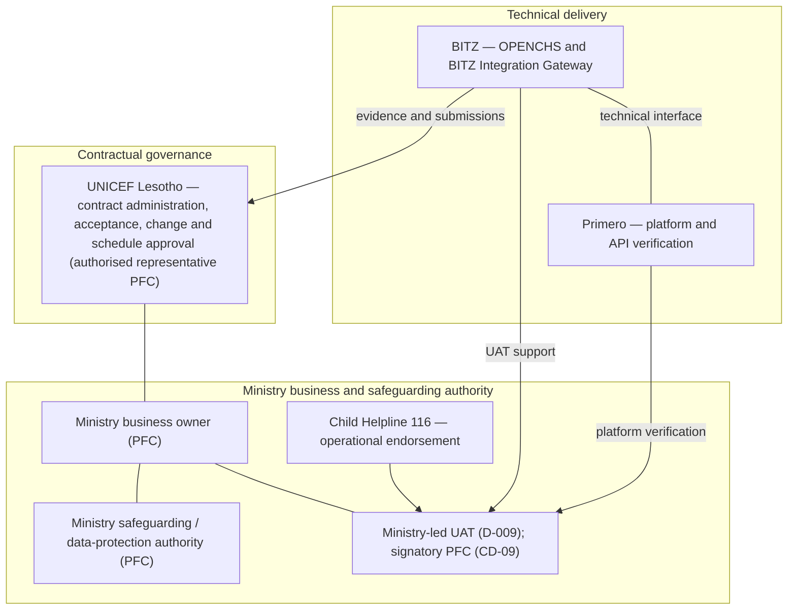

[Historical Figure 8](assets/d1-v2.8/media/image9.png) retained for traceability only.

### 9.2 Responsibility assignment (RACI) matrix

All 16 activity rows in the source matrix are retained, with their evidence references (GOV-002 [RV9]). Earlier validation discussion referred to 15 activities; the source table actually contains 16, and none has been removed. Where different authorities control different decisions, a source row is split into lettered rows (for example 3a and 3b). Each row normally has one Accountable party.

Legend:

- **A** — Accountable (owns the activity or decision)
- **R** — Responsible (performs the work)
- **C** — Consulted (provides input)
- **I** — Informed (receives information)
- **†** — BITZ proposal, pending formal confirmation
- **TBC** — not supported by source evidence; Pending Formal Confirmation

**Table 9.2 — RACI matrix**

| **#** | **Activity** | **UNICEF** | **Ministry** | **Child Helpline** | **Primero** | **BITZ** | **Evidence** |
|----|----|----|----|----|----|----|----|
| 1 | Inception report preparation | C | C | C | C | A / R | A-025 |
| 2 | Requirements approval (business) | C (contractual review) | A† (approver unnamed) | C | C | R | GOV-001 [CI] |
| 3a | Country documents — referral pathways | A / R (A-013) | C | C | I | I | Session 3 actions |
| 3b | Country documents — SOPs | I | A / R (A-014) | C | I | I | Session 3 actions |
| 4a | Privacy materials | A / R (A-017) | R | I | I | I | Session 3 actions |
| 4b | Legal basis determination | C (legal advisers) | A† | I | C | R (A-022 desk research support only) | Section 7.2 |
| 5 | Data mapping | I | A† (business approval) | C | R (definitions) | R (OPENCHS and gateway) | [TR1]; [M2 section 11] |
| 6a | Technical design — OPENCHS and gateway | I | I | I | C | A / R | Section 6 |
| 6b | Technical design — Primero-side validation | I | I | I | A / R | C | Section 6 |
| 6c | Technical design approval (formal) | I | TBC (no approver named) | I | C | R (submit) | No approver named |
| 7 | Primero environment and access | R (checklist, A-015) | C | I | A / R (A-016) | C | Session 3 actions |
| 8 | OPENCHS environments | I | I | I | I | A / R | [M1 section 9] |
| 9 | Service list and routing configuration | I | A† | C | R (A-018) | C | Session 3 actions |
| 10 | Integration build (D2, D3) | I | I | C | C | A / R | Contract |
| 11 | UAT leadership | C | A / R (D-009) | R | R | R (support) | D-009 |
| 12 | UAT test data and scenarios (preparation) | I | C | C | C | A / R (checklist; PFC) | Annotated checklist |
| 13 | UAT sign-off (operational) | C | A (authorised signatory pending, CD-09) | R (endorsement) | C | R (evidence) | D-009 |
| 14 | Issue escalation (process management) | C | R | R | R | A† (BITZ project manager) | Section 9.5 (proposed) |
| 15 | Scope and contract change | A (contracting party; approver TBC) | C | I | C | R (raise request) | Contract relationship |
| 16 | Deliverable review and sign-off | A (authorised representative PFC) | C | I | I | R (submit) | Delivery plan section 4 |
| 17 | BITZ Integration Gateway development | I | I | I | C | A / R | Section 6; TECH-001 |
| 18 | Gateway security and transaction controls | I | C (security approver) | I | C | A / R | Sections 6.7, 7.3 |
| 19 | Primero API technical validation | I | I | I | A / R | C | Section 6 register |
| 20 | Approved synthetic test-data approval | I | A† (privacy owner) | C | C | R (prepare) | DSR-11 |
| 21 | Lesotho integration verification (G4) | I | I | I | R | A / R | Section 8.7 |
| 22 | Safeguarding and lawful disclosure approval | C | A | C | I | I | Table 7.4 |
| 23 | UAT evidence and defect disposition approval | C | A | R | C | R | UAT-007 |
| 24 | Production readiness assessment | I | C | C | R | A / R | Section 8.7 |
| 25a | Written production go/no-go — safeguarding and operational | C | A | C | C | R (evidence) | Section 8.8, checkpoint 9 |
| 25b | Written production go/no-go — contractual authorisation | A | C | I | I | R (evidence) | Section 8.8, checkpoint 9 |
| 26 | Contractual acceptance of D1–D4 | A | C | I | I | R (submit) | [CT2]; section 9.3 |
| 27 | Schedule rebaseline and contractual variation | A | C | I | C | R (impact assessment) | CD-15, CD-17; CR-03 |
| 28a | Training and handover delivery | I | C | C | I | A / R | Item 80 |
| 28b | Handover acceptance (operational) | I | A† (named owner pending) | C | I | R | Section 8.1, phase 12 |
| 28c | Operational support — gateway | I | I | C | I | A / R | OPS-006 |
| 28d | Operational support — Primero platform | I | I | C | A / R | I | OPS-006 |

Corrections to the source rows are listed in the revision change log at the end of this section. Most significantly, row 13 now places operational UAT sign-off with the Ministry, while UNICEF's contractual acceptance is in row 26. Row 14 assigns management of the escalation process, not decision authority, to the BITZ project manager. Technical test completion is not contractual acceptance.

### 9.3 Approval mechanisms

The six original approval areas are retained with their historical statuses (GOV-003 [RV9]). Two areas are added: Lesotho integration verification and contractual acceptance.

*The historical record that stood here is retained unchanged in Annex L.3 (Approval areas as at the source report).*

The "project steering authority" for go-live has not been constituted. It is replaced in the register below by a separate written go/no-go decision (section 8.8, checkpoint 9).

**Table 9.3 — Approval register.** Statuses are Pending, Under Review, Approved, Conditionally Approved, Rejected or Superseded. No entry is Approved, because no authorised, dated approval record exists.

| **ID** | **Subject** | **Accountable authority** | **Supporting parties** | **Required evidence** | **Preconditions** | **Status** | **Conditions** | **Decision date** | **Approval reference** | **Affected milestone** | **Impact if outstanding** |
|----|----|----|----|----|----|----|----|----|----|----|----|
| AP-01 | Requirements and design baseline (D1) | Ministry business owner (business decisions) and UNICEF (D1 approval), both PFC | BITZ; Primero; Child Helpline | Documented Ministry business decisions; written D1 approval or conditional treatment | Sections 5–8 decisions recorded | Under Review (validation meeting held 4 Nov 2026 [M4]) | — | — | — | D1; G1 | Design sign-off and D2–D4 submissions |
| AP-02 | Technical interface validation | BITZ (OPENCHS and gateway) and Primero (platform), each for its own side | Ministry IT | Verified outbound operations, mappings, permissions and security controls; signed-off design specification | G2 | Pending | — | — | — | D3; G2, G3 | Level 3 integration evidence |
| AP-03 | Safeguarding and data protection | Ministry safeguarding and data-protection authority (PFC) | UNICEF legal advisers; BITZ | Approved disclosure rules, data-sharing arrangements, emergency exceptions and production-data controls (DSR-01 to DSR-13) | Section 7 register | Pending | — | — | — | D4; production go/no-go | Real-data exchange |
| AP-04 | Lesotho integration verification | BITZ (evidence), with Primero technical verification | Ministry IT | Authorised test results on the Lesotho environment. Global demonstration results are preliminary only | G2; approved Annex H scenarios | Pending | — | — | — | D4; G4 | UAT |
| AP-05 | Ministry-led UAT (user-testing result) | Ministry-authorised UAT signatory (PFC, CD-09) | Child Helpline (endorsement); BITZ; Primero | Approved scenarios; execution evidence; defect disposition; named signatory; Child Helpline endorsement; technical participation | G4 | Pending | — | — | — | D4; G5 | Go/no-go |
| AP-06 | Contract variation or schedule rebaseline | UNICEF (authorised representative) | Ministry; BITZ | Written amendment or approval | Impact assessment (section 9.6) | Pending | — | — | — | All milestones | Proposed dates remain unapproved |
| AP-07 | Production go/no-go (go-live) | Ministry (safeguarding, operational) and UNICEF (contractual), as confirmed by governance | Primero; Child Helpline; BITZ | Written decision covering safeguarding, data protection, security, production configuration, monitoring, incident escalation, support readiness, rollback and operational responsibility | AP-03, AP-05 | Pending | — | — | — | D4; go-live | No production exchange |
| AP-08 | Contractual acceptance of each deliverable | UNICEF (authorised representative) | Ministry | Formal acceptance under [CT2], with the standard-format report [CT2 section 2.5] | Submission per section 9.4 | Pending (D1–D4) | — | — | — | D1–D4 | Deliverable not accepted |

**Approval sequence.** Requirements and design baseline (AP-01) → technical interface validation (AP-02) → safeguarding and data protection (AP-03, which may proceed in parallel) → Lesotho integration verification (AP-04) → Ministry-led UAT (AP-05) → production go/no-go (AP-07). Contractual acceptance (AP-08) applies to each deliverable at its own milestone. D1–D3 acceptance does not wait for go-live.

**Conditional approval.** A conditional approval may authorise specifically identified non-production activities. It never automatically authorises production exchange of real child-case data, unapproved disclosure, deployment without security readiness, contractual scope expansion or final deliverable acceptance.

### 9.4 Meetings, submissions and progress reporting

The signed contract requires each deliverable to be submitted with a report in its standard reporting format, including user-testing and training reports [CT2 section 2.5] (GOV-004 [RV9]). The meeting and reporting arrangements below are proposed by BITZ. The five-working-day review period and the 19 February 2027 handover date remain proposed until formally approved.

| **Activity** | **Timing** | **Responsibility and evidence** |
|----|----|----|
| Progress meeting | Weekly; virtual unless otherwise agreed | BITZ and UNICEF and partners review progress, problems and next work |
| Meeting minutes | Within 24 hours of each weekly meeting (proposed) | BITZ circulates minutes and actions |
| Monthly report | Last working day of each month | BITZ reports planned versus actual work, evidence, challenges, lessons and mitigation |
| Deliverable submission | At each milestone | BITZ submits each deliverable with a report in the contract's standard format and supporting evidence [CT2 section 2.5] |
| Review and approval | Proposed: within five working days of submission (subject to agreement) | UNICEF records comments or approval; corrections and further review where needed |
| Final technical handover | 19 Feb 2027 (proposed, section 8.7) | BITZ submits the complete documentation and assessment pack |

**Weekly progress meeting.** The agenda is:

1. previous actions and decisions;
2. D1–D4 delivery status;
3. planned versus actual progress;
4. OPENCHS and gateway workstream progress;
5. Primero integration readiness;
6. readiness of gates G1–G5;
7. testing and defects;
8. safeguarding and security issues;
9. critical dependencies (Table 8.5);
10. schedule and contractual impacts;
11. required decisions;
12. next-period priorities.

UNICEF's request that a Ministry coordination representative attend every meeting remains applicable [M3 section 1].

**Meeting minutes.** Minutes record the date and participants; decisions and their evidence; action IDs, accountable owners and due dates; open issues; escalations; dependencies; and follow-up arrangements. They are circulated within the proposed 24 hours. Corrections and confirmations are recorded as amendments, and the historical record is not rewritten.

**Monthly progress report.** The report covers:

- the reporting period;
- baseline versus actual progress, and D1–D4 status (Table 8.4);
- completed work with supporting evidence, and outstanding work;
- integration and test status, using evidence levels 1–3;
- dependencies and risks;
- schedule variance;
- decisions required;
- mitigation and recovery actions;
- next month's work plan.

No progress percentage is reported unless it is supported by evidence.

**Contractual deliverable reporting.** For each deliverable, separate records are kept for submission, receipt, review comments, revised submission, written approval, conditional approval and contractual acceptance. Acceptance is never inferred from silence or from the expiry of a proposed review period.

**Historical records.** The project record contains minutes of three inception sessions, held on 8, 9 and 26 October 2026; the Session 1 and 2 minutes were still marked as drafts for review. At the time the source report was prepared, no minutes of weekly progress meetings and no monthly progress reports had been located. This does not establish that no such meetings or reports occurred. BITZ will file any such records that exist, ask participants to confirm the Session 1 and 2 minutes, and from November 2026 hold weekly progress meetings and issue monthly reports.

**Technical working sessions.** Additional sessions may be held for Primero API access, authentication, mapping, service configuration, security, integration testing and defect resolution. They are separate from weekly progress meetings and do not replace governance meetings or contractual reporting.

**Travel and handover.** The signed contract includes two Maseru trips: an inception workshop (item 50) and training and handover (item 80) [CT2]. The in-country inception workshop (Trip 1) was substituted by the virtual inception meetings held on 8, 9 and 26 October and 4 November 2026 (section 3.2). Trip 2, for training and handover, remains planned for February 2027 (section 8.7).

### 9.5 Escalation path

The original proposed chain is retained (GOV-005 [RV9]): issue owner → BITZ project manager (routine target: two working days) → technical working session or governance review → UNICEF programme owner and Ministry business owner, for scope, schedule or approval blockers. Overdue dependency actions are escalated at the next governance review. The routine two-working-day target does not apply to urgent safeguarding or serious security incidents. No statutory reporting deadline is set here; statutory obligations are as confirmed under section 7.5 (DSR-10).

**Table 9.4 — Severity classification**

| **Severity** | **Examples** | **Treatment** |
|----|----|----|
| Critical | Suspected child-protection data breach; unauthorised disclosure; serious safeguarding incident; major production security incident | Immediate containment, and notification through the approved safeguarding, privacy and security incident channels (OPS-007; DSR-10). Routine meetings are not awaited |
| High | Critical Primero integration blocker; major UAT blocker; material milestone risk; serious unresolved security defect | Prompt escalation to the responsible technical and project authorities, without waiting for the next scheduled governance meeting |
| Medium | Non-critical mapping issues; configuration clarifications; manageable testing defects | Tracked through the issue owner, the BITZ project manager and the relevant technical working session |
| Low | Minor documentation corrections; non-blocking administrative issues | Tracked in the action register and routine progress review |

**Table 9.5 — Escalation ownership.** No decision authority is assigned to an unconstituted steering body.

| **Issue type** | **First owner** | **Escalation authority** |
|----|----|----|
| BITZ implementation defects | BITZ technical lead | BITZ project manager → UNICEF programme owner (if milestone impact) |
| Primero platform issues | Primero technical contact | Primero technical lead → UNICEF programme owner |
| Ministry business decisions | Ministry focal person (PFC) | Ministry business owner (PFC) |
| Child Helpline operational concerns | Child Helpline supervisor | Ministry business owner (PFC) |
| Safeguarding and privacy incidents | Person detecting the incident | Approved safeguarding, privacy and security incident channels (Critical route) |
| UAT blockers | UAT coordinator (PFC) | Ministry UAT signatory (PFC) and UNICEF programme owner |
| Contractual changes | BITZ project manager (raises) | UNICEF authorised representative |
| Schedule changes | BITZ project manager (impact assessment) | UNICEF authorised representative (section 8.3) |
| Production readiness | BITZ project manager | Go/no-go authorities (AP-07) |

**Escalation register.** Each escalated issue is recorded with the following fields:

- issue ID, severity and description;
- detection date and time;
- responsible owner;
- affected system or process;
- safeguarding or security impact;
- notification record;
- mitigation;
- decision required and escalation authority;
- target and actual resolution;
- milestone impact;
- closure evidence.

Current issues are recorded in section 11.3 and Annex F.

**Figure 9 — Escalation path (proposed).**

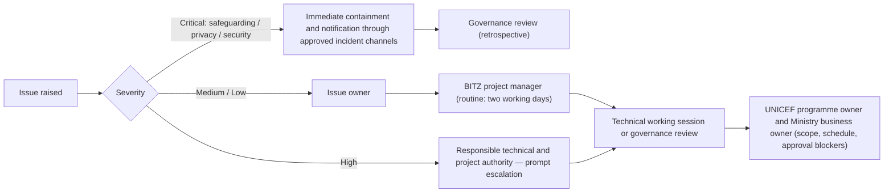

[Historical Figure 9](assets/d1-v2.8/media/image10.png) retained for traceability only.

### 9.6 Change control procedure (Proposed)

The original five-step process is retained and strengthened with classifications, decision authority and evidence requirements (GOV-006 [RV9]).

**Table 9.6 — Change classifications**

| **Class** | **Definition** | **Typical decision authority** |
|----|----|----|
| Clarification | Interpretation or confirmation of an existing requirement, without materially changing the approved baseline | Owner of the requirement (Ministry for business rules; technical authority for design) |
| Defect correction | Correction of implementation behaviour that does not conform to the approved requirement | BITZ (gateway and OPENCHS) or Primero (platform); not a contractual variation |
| Technical design change | Change to an approved design, API mechanism, security approach or operational control | BITZ and Primero technical authorities (AP-02); Ministry consulted where data or safeguarding is affected |
| Business or safeguarding change | Change to referral rules, data disclosure, service selection or safeguarding requirements | Ministry (AP-01, AP-03) |
| Contractual variation | Change affecting contracted scope, price, schedule, obligations or acceptance requirements | UNICEF authorised representative (AP-06) |

**Process.**

1. **Raise and register.** Any party may raise a change. It is recorded with the requesting party, change ID, description, justification, source decision, affected requirement and existing baseline.
2. **Assess impact.** BITZ prepares the technical and delivery assessment, with stakeholder input, within an agreed period. The assessment covers functional scope; architecture; interfaces; data protection; safeguarding; security; effort and staffing; cost; schedule; dependencies; testing; acceptance criteria; and contractual obligations.
3. **Review.** Technical, operational, safeguarding and contractual input is obtained as applicable, through the approved governance forum or authorised decision route. A proposed steering review is not assumed to hold approval authority.
4. **Written decision.** The appropriately authorised party decides in writing: Approved, Conditionally Approved, Rejected, Deferred or Superseded. UNICEF contractual approval is required where the signed agreement requires a variation or schedule amendment. Ministry approval is required for business and safeguarding decisions.
5. **Implement and verify.** After the required approvals, the following are updated: the requirements baseline, this report, the inventory, interface specifications, the implementation plan, testing and acceptance criteria, and risks and dependencies. The authorised change is then implemented and verified, and closure evidence is recorded. Rejected changes are recorded in the decision register. No unapproved scope expansion is implemented.

**Emergency fixes.** Urgent containment and corrective action may be taken under approved incident-response procedures where necessary to protect people, data or system security. The action is recorded and given retrospective governance review. Emergency remediation is never a route to unauthorised scope expansion.

**Figure 10 — Change control flow (proposed).**

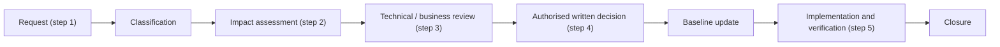

[Historical Figure 10](assets/d1-v2.8/media/image11.png) retained for traceability only.

### 9.7 Change log

CR-01 to CR-04 are retained with their original sources (GOV-007 [RV9]). The log keeps five things distinct: the historical request; the validated technical decision; contractual approval; implementation; and verified closure. No change is shown as contractually closed without approval evidence.

*The historical record that stood here is retained unchanged in Annex L.4 (Change log as at the source report).*

**Table 9.7 — Expanded change log**

| **Change ID** | **Original request** | **Source decision** | **Classification** | **Technical disposition** | **Contractual disposition** | **Impact** | **Decision authority** | **Status** | **Decision date** | **Approval reference** | **Affected baseline** | **Implementation evidence** | **Closure status** |
|----|----|----|----|----|----|----|----|----|----|----|----|----|----|
| CR-01 | Two-way return updates for referred cases | D-007 | Technical design change; contractual variation if inbound is ever added | Historical two-way requirement superseded by the validated baseline: explicit authorised outbound Send Update included; automatic inbound status and intervention synchronisation excluded (SCOPE-001, SCOPE-002; TECH-001) | Formal contractual confirmation of the outbound-only treatment pending; any future inbound work requires an addendum | Scope, effort, testing (Send Update scenarios) | UNICEF (contractual); Ministry (business) | Pending formal confirmation | — | — | Requirements; design; D3 | — | Open |
| CR-02 | Attachments in the referral information set | D-012 | Contractual variation (if ever included) | Attachment and call-recording transfer excluded from initial scope (SCOPE-003; DATA-010) | Future inclusion requires a formal change request, scope and effort assessment, security and safeguarding review, data-protection assessment, testing implications and written contractual authorisation | Scope, security, safeguarding | UNICEF; Ministry | Pending formal confirmation | — | — | Requirements; D3 | — | Open |
| CR-03 | Schedule rebaseline following the missed D1 target | R-009 | Contractual variation (schedule) | Proposed Nov 2026 – Feb 2027 recovery timetable (section 8.7), replacing the 14-week plan as a planning principle (CD-07, [M4]) | Formal schedule approval pending (CD-15, CD-16, CD-17; section 8.8 decisions 1, 2, 4) | Schedule; acceptance | UNICEF authorised representative | Pending formal confirmation | — | — | Schedule; D1–D4 | — | Open; no automatic extension |
| CR-04 | Clarify D2/D4 "save-event" wording to manual referral control | CD-03 | Clarification | Create Referral is an explicit, authorised user action; saving an OPENCHS record never transmits a referral (D-006; WF-002; FN-003) | Reconciliation of the D2 and D4 contractual wording and acceptance criteria pending | Acceptance criteria (D2, D4) | UNICEF (contractual wording); Ministry (business rule) | Proposed | — | — | D2, D4 acceptance criteria | — | Open |

#### Section 9 revision change log

| **GOV reference [RV9]** | **Validated decision** | **Where applied** | **Preserved or corrected** |
|---|---|---|---|
| GOV-001 [RV9] | Five stakeholder groups, recorded contacts and a ten-field role and authority matrix; Figure 8 revised | 9.1; Table 9.1; Figure 8 | All recorded names and actions kept; [M4] nominations added; Ministry name flagged for confirmation |
| GOV-002 [RV9] | RACI with one accountable party per row; split rows; 12 new activity areas | 9.2; Table 9.2 | All 16 source rows kept (some split). Corrected: row 13 UAT sign-off accountability moved from UNICEF to the Ministry (UNICEF acceptance is row 26); row 14 accountability for the escalation process moved from UNICEF† to the BITZ project manager†; row 2 UNICEF changed from TBC to consulted for contractual review; row 16 UNICEF changed from TBC to accountable, with representative PFC; † legend restored from v1.0 |
| GOV-003 [RV9] | Approval register AP-01 to AP-08; approval sequence; limits on conditional approval | 9.3; Table 9.3 | The six original areas kept in their historical table; "project steering authority" replaced by the written go/no-go |
| GOV-004 [RV9] | Agenda, minutes, monthly report and deliverable records; historical gaps; technical sessions; travel | 9.4 | Original table and statements kept; proposed periods labelled |
| GOV-005 [RV9] | Severity classes; ownership routes; register fields; urgent route in Figure 9 | 9.5; Tables 9.4, 9.5; Figure 9 | Original chain and two-working-day target kept for routine issues |
| GOV-006 [RV9] | Five change classes; expanded five-step process; emergency fixes; Figure 10 | 9.6; Table 9.6; Figure 10 | Original five steps kept |
| GOV-007 [RV9] | Expanded change log with technical and contractual dispositions | 9.7; Table 9.7 | CR-01 to CR-04 kept in their historical table; nothing closed |

#### Section 9 quality assurance and unresolved questions

This revision changes only Section 9, and all seven subsections are revised. No appointment, delegation, approval, amendment, progress claim, incident deadline or completed change has been introduced. The only names given as nominees are those recorded at [M4]. Several questions remain open:

- every decision authority marked PFC;
- the formal Ministry institutional name;
- whether a steering body will be constituted;
- the GOV-001 to GOV-007 identifier collision with the completion inventory, which the report owner should resolve by renaming one set.

Sections 10 and 11, Annexes E and F, and the version label still contain wording that predates this revision. These are listed in the separate Section 9 revision record. The report remains **Version 2.8 — Post-Validation Revision, pending formal approval**.

## 10 Testing and acceptance

This section sets out the testing, UAT, training and acceptance framework. It applies the seven Section 10 validation decisions **TST-001–TST-007 [RV10]**. [RV10] means the Section 10 testing-and-acceptance validation instructions supplied for this revision. Like [RV3]–[RV9], it is not an approval of thresholds, signatories or results.

The tests cover the validated scope (TECH-001):

- explicit, authorised Create Referral and Send Update against a persisted CPIMS+ UUID;
- approved validation and service selection, and optional ABR;
- secure authentication and authorisation, and minimum necessary disclosure;
- technical acknowledgements and errors;
- UUID linkage, idempotency, controlled retries, reconciliation, monitoring and audit;
- safe handling of interrupted or uncertain transactions.

No acceptance requirement is set for automatic inbound status or intervention synchronisation, attachment or recording transfer, case-plan exchange, OpenFN, X-Road referral routing or direct external routing. Technical acknowledgements from Primero are tested; they are not inbound case-management synchronisation.

The deliverables are as signed [CT2 items 50–80] and described in section 2.6:

- **D1** — inception, requirements and environment setup;
- **D2** — ABR ID field, checks and referral control;
- **D3** — outbound REST API client and integration module;
- **D4** — testing, UAT, training and go-live.

Technical verification, Ministry operational approval (UAT), UNICEF contractual acceptance and production authorisation are four separate decisions (sections 8.7, 9.3). The proposed November 2026 – February 2027 timetable remains proposed. No test has been executed, and no threshold, signatory or acceptance has been approved.

### 10.1 Test levels and scope

The six source test categories are retained, with clearer terminology and evidence requirements (TST-001). Mock success does not demonstrate verified compatibility with the configured Lesotho Primero environment. A global Primero demonstration system may provide preliminary evidence only; it is not Lesotho integration verification. The source's "approved fallback" remains available as an acceptance basis only if explicitly authorised (section 8.8, decision 7). Testing uses approved synthetic data by default; real child-case information is not used without the documented approvals in section 7.5.

**Table 10.1 — Test levels**

| **Source category** | **Test level** | **What is verified** | **Environment** | **Evidence level (section 8.6)** | **Required evidence** |
|----|----|----|----|----|----|
| Individual features | Unit and component testing | OPENCHS referral controls; authorised Create Referral; explicit Send Update; input validation; optional ABR; role permissions; gateway payload construction; UUID persistence; idempotency; queue handling; retry scheduling; audit generation; error presentation | Development, synthetic data | Level 1 | Test ID, requirement reference, expected and actual result, execution date, tester, pass/fail, defect reference |
| Checks using a simulation | Simulated integration and contract testing | Request formats; authentication handling; successful create responses; UUID handling; update requests; validation failures; authentication failures; service unavailability; timeouts; lost responses; duplicate prevention; retry and reconciliation logic | Development, with mock Primero API | Level 2 (preliminary only) | As above, labelled "simulated" |
| Both systems working together | Lesotho integration testing | Authentication and service-account permissions; supported endpoints; configured field IDs; code lists; service routing; Create Referral; UUID persistence; explicit Send Update; technical acknowledgements; failure handling; duplicate prevention; recovery and reconciliation; audit evidence | Configured Lesotho Primero test environment (G2); any alternative only if explicitly authorised | Level 3 | Recorded results, screenshots and transaction records (gate G4) |
| Protection of information | Security and safeguarding testing | Authentication; role-based permissions; authorised referral initiation; disclosure minimisation; sensitive-data handling; log redaction; audit integrity; unauthorised access attempts; error-message safety; incident escalation (Annex H S-series; Table 7.2) | Test environments | Level 2 and Level 3 | Security test record |
| Existing services | Regression testing | Existing OPENCHS functions are not disrupted; rerun after any change that may affect them (OPS-008) | Test environments | Level 3 | Recorded regression results |
| Testing by users | Ministry-led UAT | Agreed working needs, using approved operational scenarios, country settings and synthetic data (section 10.2) | Lesotho test environment with country settings | Level 3 | Signed UAT report. Technical verification is not operational acceptance |

**Test evidence matrix.** Each executed test is recorded with the fields below. Blocked and Not Run are never recorded as Pass.

| **Field** | **Content** |
|----|----|
| Test ID | Unique identifier (Annex H ID where one exists) |
| Test category | One of the six source categories |
| Requirement reference | Source requirement or decision |
| Test environment | Development, simulation or Lesotho test |
| Test data | Approved synthetic dataset (DSR-11) |
| Expected result | Measurable expected behaviour |
| Actual result | Observed behaviour |
| Status | Pass, Fail, Blocked or Not Run |
| Evidence | Logs, screenshots or transaction records |
| Defect ID | Linked defect, where applicable |
| Tester | Person executing |
| Reviewer | Appropriate verifier |
| Execution date | Actual date |

At the date of this revision, every test is **Not Run**.

### 10.2 User acceptance testing approach (Proposed)

UAT is led by the Ministry under D-009 (TST-002). The source table is retained below, updated for the validated scope.

| **Element** | **Approach** |
|----|----|
| Leadership | Ministry leads (D-009) |
| Participants | OPENCHS development team; Child Helpline agents; Ministry system administrator; CPIMS+ users; district supervisors; other Ministry users who receive, distribute, investigate or close referrals (D-009). UNICEF and the Primero technical team take part. A Child Helpline supervisor takes part (confirmed). Named testers are nominated by the Ministry |
| Preparation | Named testers and test accounts (UAT-002); approved user roles; confirmed UAT signatory (CD-09); approved synthetic cases (SEC-007); environment-readiness checklist (G2); approved test scenarios from Annex H; execution schedule; UAT briefing; defect-reporting process; evidence-capture instructions |
| Test data | Approved synthetic child-case examples (SEC-007; DSR-11). BITZ prepares them, and the Ministry (Tiisetso Mohlabi) approves them before use (confirmed) |
| Functional scenarios | Annex H F- and B-series, covering manual authorised Create Referral; service selection; minimum required information; optional ABR; approved emergency referral handling; input validation; technical delivery status; UUID linkage; explicit Send Update; user-facing error handling. Automatic inbound status or intervention updates are not required |
| Security and privacy scenarios | Annex H S-series |
| Failure and recovery | Annex H RC-series: Primero service interruption; referral queueing; safe retry under the validated policy (1, 5, 30 and 120 minutes; OPS-002); lost-response reconciliation; duplicate prevention; recovery after restoration; manual escalation where necessary |
| Defect classification | Section 10.3 |
| Retesting | Every corrected Critical or High defect is retested by the reporting tester; affected regression tests are rerun; evidence of successful correction is recorded |
| Evidence capture | For each test: tester, date, environment, test steps, expected and actual result, evidence reference (screenshot or log), defect ID, retest result, final disposition |
| Sign-off | Ministry leads testing; an authorised signatory is to be named (CD-09). The UAT report records scope tested, coverage, pass/fail summary, open defects, approved exceptions, safeguarding findings, outstanding operational issues, a recommendation and a signed decision. The signed contract allows UNICEF to withhold payment where work is unsatisfactory or incomplete [CT2 section 4]; any proposed exception needs UNICEF's written agreement. UAT sign-off (AP-05) is not UNICEF contractual acceptance (AP-08) or production go/no-go (AP-07) |

**Scope reconciliation of Annex H.** Scenarios concerning excluded functionality are retained as history but are not initial acceptance tests: F-12 (returned status and interventions), F-15 (attachments), S-04 and S-07 (return-update channel and access), and RC-05 and RC-07 (return-update ordering and webhooks). They are marked for scope reconciliation.

**Figure 11 — Proposed UAT process.**

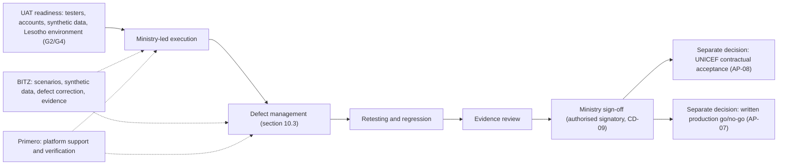

[Historical Figure 11](assets/d1-v2.8/media/image12.png) retained for traceability only.

### 10.3 Defect classification (Proposed)

The four source severity levels are retained (TST-003). The release rules are proposed for governance approval.

| **Severity** | **Definition and examples** | **Go-live rule (Proposed)** |
|----|----|----|
| Critical | Disclosure of protected child-case data; data loss; duplicate CPIMS+ case creation; complete failure of a required referral function (referral cannot be sent); serious security or safeguarding failure | None open. Immediate safeguarding or security escalation where applicable (section 9.5, Critical route) |
| High | Required function fails with no acceptable workaround. Examples: Create Referral or Send Update fails without a workaround; required technical acknowledgement or delivery-status handling fails; significant reconciliation failure; major operational defect | None open unless an appropriate written exception is authorised |
| Medium | Function impaired, with a documented, tested and acceptable workaround | Named owner, workaround, risk assessment, fix plan and follow-up date where agreed |
| Low | Cosmetic or minor | Tracked and prioritised |

The source's High example "status not returned" referred to the technical delivery status. It is not a requirement for automatic inbound CPIMS+ case-status synchronisation.

**Defect register.** Each defect is recorded with: defect ID; test case; requirement; environment; severity; reproduction steps; expected and actual results; evidence; safeguarding implications; owner; correction; workaround; retest; regression result; closure decision.

**Defect lifecycle.** Reported → Triaged → Assigned → Corrected → Retested → Closed or formally dispositioned. A defect is reopened if retesting fails.

**Written exceptions.** The source's proposed High-defect exception mechanism is retained, subject to the signed contract. Each exception identifies:

- the specific defect and its impact;
- the residual risk;
- the proposed workaround;
- the responsible owner and required remediation;
- the authorised approver and the written decision reference.

Ministry safeguarding and operational approval is required where relevant. UNICEF contractual agreement is required where applicable under [CT2 section 4]. No exception may override a mandatory safeguarding or security requirement.

### 10.4 Proposed acceptance criteria

*The thresholds below are proposed for governance approval. Under the signed contract, UNICEF may withhold payment where work is unsatisfactory or incomplete [CT2 section 4]. Any waiver proposed below is subject to UNICEF's written agreement.* The nine original criteria (AC-01 to AC-09) keep their proposed thresholds. AC-10 to AC-18 add traceable verification criteria and do not replace the originals (TST-004). Meeting a technical threshold does not of itself authorise payment, contractual acceptance or go-live.

**Table 10.4 — Acceptance criteria matrix.** The thresholds are agreed: the fault rules were agreed at the D1 validation meeting [M4 section 10] and the full set was adopted by the report owner on 9 November 2026. AC-08 remains future scope. No result has been recorded yet.

| **ID** | **Criterion** | **Source** | **Threshold** | **Approval status** | **Test scenarios** | **Environment** | **Responsible verifier** | **Actual result** | **Evidence** | **Defects** | **Exception** | **Acceptance status** |
|----|----|----|----|----|----|----|----|----|----|----|----|----|
| AC-01 | Scenario coverage | UAT-004 | 100% of approved Annex H Must scenarios executed with evidence; pass and fail recorded separately (execution is not a pass) | Agreed | All Must | Lesotho | BITZ (technical); Ministry (UAT) | — | — | — | — | Not assessed |
| AC-02 | Faults | UAT-007 | 0 open Critical; 0 open High without a written waiver | Agreed | All | Lesotho | Ministry; UNICEF (waiver) | — | — | — | Per section 10.3 | Not assessed |
| AC-03 | Duplicate prevention | OPS-003; DATA-013 | 0 duplicate CPIMS+ cases across all approved retry, resubmission, lost-response and uncertain-create tests; reconciliation before any further create where the outcome is unknown | Agreed | RC-01, RC-02 | Lesotho | BITZ; Primero | — | — | — | Not permitted (Critical) | Not assessed |
| AC-04 | Service interruption recovery | OPS-001 | 100% of referrals queued during a simulated interruption are delivered, or flagged for authorised manual action, after restoration; none lost. A flagged item is not a delivered item | Agreed | RC-03, RC-04 | Lesotho | BITZ; Primero | — | — | — | — | Not assessed |
| AC-05 | Audit completeness | OPS-004 | 100% of Create Referral and Send Update operations, technical responses, retry attempts, reconciliation outcomes, failures and authorised manual actions in the test set have an audit record with all approved fields, without prohibited sensitive content | Agreed | AU-01 | Lesotho | BITZ; security approver | — | — | — | — | Not assessed |
| AC-06 | Log redaction | SEC-006 | No access secrets or complete case descriptions in the activity records checked | Agreed | S-03 | Lesotho | Security approver (DSR-12) | — | — | — | Not permitted | Not assessed |
| AC-07 | Validation rules | D-005, D-010, D-011, D-013, D-014 | 100% of the test cases for optional ABR (D-005), anonymous reporter (D-010), child identifying details (D-011), narrative at referral (D-013) and ABR structure (D-014) behave as specified | Agreed | F-02 to F-09 | Lesotho | BITZ; Ministry | — | — | — | — | Not assessed |
| AC-08 | Return-update timeliness | RT-007 | Not applicable to the initial scope; would be set with any future mechanism (RT-007). It applies only to any future automatic inbound addendum. Explicit Send Update is verified under AC-12. No number is set | PC (future scope) | — | — | — | — | — | — | — | Not applicable to initial scope |
| AC-09 | Regression testing | OPS-008 | No open Critical or High regression defect in existing OPENCHS functions | Agreed | RG-01 | Test | BITZ; Child Helpline | — | — | — | — | Not assessed |
| AC-10 | Authorised Create Referral | WF-002; FN-003 | Save never sends; only an authorised, confirmed action creates exactly one operation | Agreed | F-01, RC-02 | Lesotho | BITZ; Ministry | — | — | — | — | Not assessed |
| AC-11 | UUID persistence | DATA-013 | Every confirmed creation stores the CPIMS+ UUID in the ledger | Agreed | RC-01 | Lesotho | BITZ; Primero | — | — | — | — | Not assessed |
| AC-12 | Send Update linkage | FN-009 | Every Send Update references the existing UUID and creates no new case | Agreed | F-13 | Lesotho | BITZ; Primero | — | — | — | — | Not assessed |
| AC-13 | Uncertain-outcome reconciliation | OPS-003 | Every unresolved create is reconciled before any further create attempt | Agreed | RC-01 | Lesotho | BITZ; Primero | — | — | — | — | Not assessed |
| AC-14 | Lesotho environment compatibility | GOV-004 [CI]; API-001 | Authentication, field IDs, code lists and routing verified on the Lesotho environment | Agreed | Section 6.7 register | Lesotho | Primero; BITZ | — | — | — | — | Not assessed |
| AC-15 | Role permissions | SEC-003 | Unauthorised users cannot initiate, amend, view or recover | Agreed | S-02 | Lesotho | BITZ; security approver | — | — | — | — | Not assessed |
| AC-16 | Safeguarding | WF-007; section 7.6 | Emergency escalation independent of the API; approved exceptions recorded; anonymity preserved | Agreed | B-02, F-03, F-05 | Lesotho | Ministry | — | — | — | Not permitted | Not assessed |
| AC-17 | Data minimisation | SEC-001; FN-011 | Payload contains only approved fields; no case plan, attachments or recordings | Agreed | F-16 | Lesotho | Ministry; BITZ | — | — | — | Not permitted | Not assessed |
| AC-18 | Production-readiness dependencies | AP-07 | All go/no-go checklist items evidenced (Table 8.7) | Agreed | — | Production readiness | Go/no-go authorities | — | — | — | — | Not assessed |

AC-05 originally read "transmissions and return updates". That wording is replaced by the validated operation set, because return updates are outside the initial scope. The 100% threshold is unchanged.

### 10.5 Training and handover (D4)

The signed contract includes in-country operator training and a training and handover trip to Maseru (item 80), with a training report in the contract's format [CT2 section 2.5.4] (TST-005). BITZ proposes training in February 2027, which is not yet approved, with materials in English and Sesotho as agreed and attendance records. Automatic inbound synchronisation is not taught as an implemented function. Production credentials never appear in unrestricted training materials.

**Table 10.5 — Training tracks**

| **Track** | **Audience** | **Content** |
|----|----|----|
| 1 | Operators and social workers | Manual Create Referral; authorised service selection; optional ABR; required information; validation messages; safeguarding; referral delivery (technical) status; explicit Send Update; failure handling; escalation |
| 2 | Supervisors and Ministry business administrators | User roles and permissions; referral oversight; safeguarding authorisation; service routing; operational exceptions; incident escalation; operational monitoring; UAT findings; support coordination |
| 3 | Ministry IT and technical support | OPENCHS architecture; BITZ Integration Gateway; Primero API configuration; authentication; credential handling; UUID linkage; queue management; retry and reconciliation; logging and monitoring; troubleshooting; environment configuration; support escalation [TB section 6] |

**Practical exercises** use approved synthetic cases: Create Referral; invalid input; missing optional ABR; service selection; successful technical acknowledgement; explicit Send Update; service interruption; failed transaction; manual escalation. Participation and observed competency are recorded. The competency threshold is subject to agreement.

**Handover package.** The source materials are retained: the technical report, system architecture and configuration guidance, information-mapping reference, activity-record access and maintenance guidance, user manuals and administrator guide. Where consistent with the contract, the package also includes:

- support contacts;
- the operational runbook;
- monitoring and alert procedures;
- queue and retry procedures;
- incident escalation;
- known limitations and outstanding issues;
- access-transfer controls;
- a handover checklist.

**Training evidence** comprises:

- the approved training plan, agenda and materials;
- attendance records;
- practical-exercise evidence;
- training feedback and outstanding learning needs;
- the contractual training report [CT2 section 2.5.4];
- the handover acknowledgement.

Training delivery, operational handover, Ministry operational endorsement and UNICEF contractual acceptance are four separate records. None exists yet.

### 10.6 Acceptance requirements and evidence

Ministry-led UAT is agreed, the synthetic test data arrangement and the fault rules are confirmed, and the named testers and the UAT signatory remain to be confirmed (D-009; UAT-002; SEC-007; CD-09). Annex H contains the scenario matrix, and Annex J.8 preserves the requirement-level status. Test results, signed acceptance and training evidence will be produced during delivery; none is represented here as available (TST-006).

**Table 10.6 — Acceptance evidence register.** Evidence statuses are Planned, In preparation, Produced, Reviewed, Verified and Formally accepted. Submission alone never makes an item Accepted.

| **ID** | **Evidence package** | **Contents** | **Deliverable / milestone** | **Producer** | **Reviewer (authority)** | **Environment** | **Status** | **Outstanding** | **Decision reference** |
|----|----|----|----|----|----|----|----|----|----|
| EV-01 | Requirements baseline | Approved workflows; field mapping; technical decisions; outstanding conditions | D1; G1 | BITZ | Ministry (business); UNICEF (contractual) | — | Produced (this report, under review) | Configured mapping; approvals (AP-01) | — |
| EV-02 | Technical verification | Gateway test results; Primero API verification; UUID linkage; retry and reconciliation; integration logs | D3, D4; G3, G4 | BITZ | BITZ and Primero technical reviewers | Simulation; Lesotho | Planned | G2 | — |
| EV-03 | Security and safeguarding | Access controls; data minimisation; redaction; synthetic data; incident controls | D3, D4 | BITZ | Security approver (DSR-12); Ministry | Lesotho | Planned | DSR register | — |
| EV-04 | Ministry UAT | Approved scenarios; named testers; execution evidence; defect disposition; signed UAT report | D4; G5 | Ministry, with BITZ support | Authorised Ministry signatory (CD-09) | Lesotho | Planned | CD-09; DSR-11 | — |
| EV-05 | Training and handover | Training plan; attendance; exercises; manuals; technical handover; training report | D4 | BITZ | Ministry (operational); UNICEF (contractual) | — | Planned | Section 8.8, decision 8 | — |
| EV-06 | Contractual acceptance | Deliverable submission; review comments; revised submission; written acceptance decision; conditions where applicable | D1–D4 | BITZ (submission) | Authorised UNICEF representative | — | D1: Produced, under review; D2–D4: Planned | AP-08 | — |
| EV-07 | Production readiness | Security approval; safeguarding approval; environment readiness; monitoring; support; incident response; rollback; written go/no-go | Go-live | BITZ; Primero | Go/no-go authorities (AP-07) | Production | Planned | AP-03, AP-05 | — |

Each evidence item also records its requirement or test reference, document version, production date, verification result, conditions and closure action. These fields are maintained in the delivery evidence log.

**Approval authorities.**

- **Technical verification:** BITZ and Primero technical reviewers.
- **Operational UAT:** the authorised Ministry signatory.
- **Contractual acceptance:** the authorised UNICEF representative under the signed agreement.
- **Production go/no-go:** the separately confirmed operational, safeguarding, security and contractual authorities.

No unconfirmed authority is assigned to a named individual (Table 9.1).

**Acceptance basis.** D1 is submitted for full acceptance. The remaining open items are listed in Table 12.3 with their owners and are tracked to closure through the action register; they are not acceptance conditions.

### 10.7 D1 deliverable completion and acceptance readiness

The historical D1 readiness assessment is retained unchanged, followed by a readiness register at the date of this revision (TST-007). The three dimensions remain distinct:

- **document preparation** — written in a report;
- **implementation** — built, set up or evidenced;
- **formal acceptance** — approved by an authorised person.

A prepared document is not completed implementation, and completed implementation is not formal acceptance.

*The historical record that stood here is retained unchanged in Annex L.5 (D1 readiness assessment, 27 October 2026, and Figure 12).*

Completion inventory status [CI section 1], historical: 19 Resolved, 44 Pending, 8 Deferred. The inventory includes later implementation, UAT and handover items, so these counts are not an inception completion percentage.

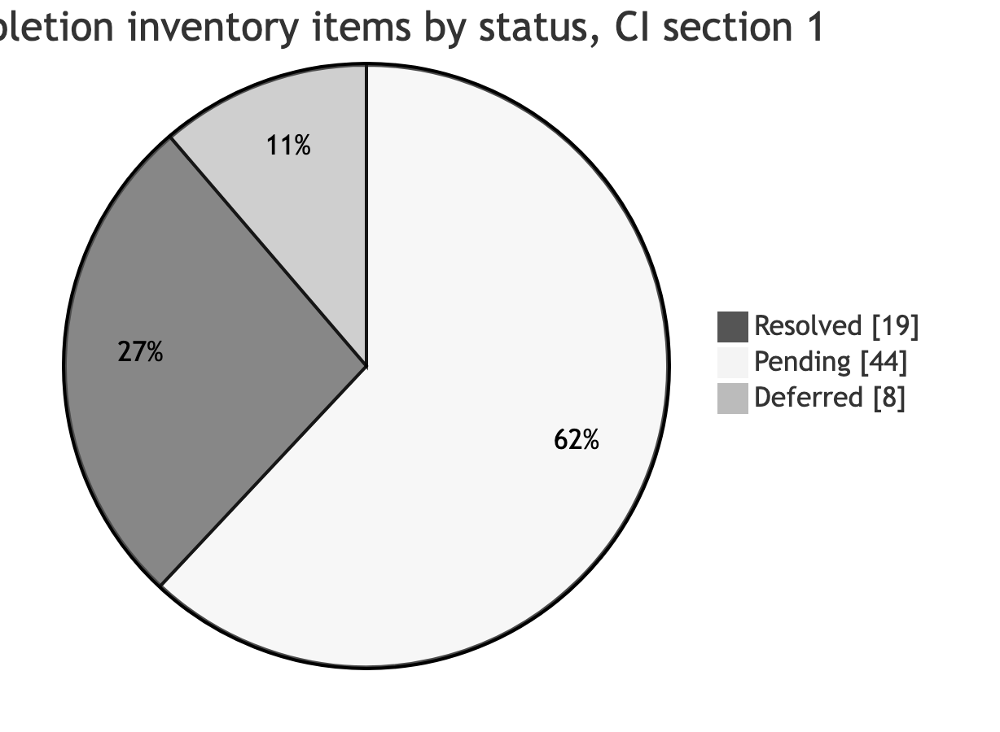

**Table 10.7 — D1 readiness register (position at this revision, 9 November 2026).**

Classification codes:

- **P** — D1 acceptance prerequisite
- **AC** — formal decision or approval condition
- **L** — later-stage dependency (D2–D4), not necessarily a D1 blocker
- **X** — deferred or excluded functionality
- **H** — historical evidence reconciliation

No target date is shown unless one has been agreed.

| **Area** | **Required D1 evidence** | **Document status** | **Implementation status** | **Formal acceptance** | **Outstanding item** | **Class** | **Owner** | **Required decision** | **Evidence reference** | **Target date** | **Impact** |
|----|----|----|----|----|----|----|----|----|----|----|----|
| Inception consultations | Minutes of stakeholder sessions | Sessions 1–3 minutes; D1 validation meeting held 4 Nov 2026 | Not applicable | Not approved | No minutes for 24 Sep and 14 Oct; Session 1 and 2 minutes in draft; S3-N01 | H | BITZ | Participants confirm the minutes | [M1]–[M4] | — | D1 evidence completeness |
| Business requirements | Confirmed workflow, rules, field set | Validated in Section 5 (BR-001–BR-010 [RV5]) | Not built | Not approved | Emergency and partial datasets; correction rules; SOP applicability | P (approval); L (datasets) | Ministry; BITZ | Ministry business approval (AP-01) | Section 5; Annex J | — | G1 |
| Technical requirements | Connection, access, protection, reliable delivery | Validated in Section 6 (TECH-001–TECH-007 [RV6]) | Not verified | Not approved | Authentication flow; supported Send Update operations; retry validation. The "return mechanism" is now excluded (X) | L; X | Primero; BITZ | Technical interface validation (AP-02) | Section 6.7 register | — | G2, G3 |
| Integration architecture | Technical design | Validated: OPENCHS → BITZ Integration Gateway → Primero CPIMS+ API | Not verified against environments | Not approved | Technical review, Lesotho testing and design sign-off | L | BITZ; Primero | Formal design approval (RACI 6c) | Section 6.2 | — | G3, G4 |
| Data mapping | Approved mapping baseline | Business field set; mapping approach (section 7.1) | Configured definitions not received | Not approved | Service list (A-018); configured field IDs; code lists | P (mapping baseline); L (configured mapping) | Primero; Ministry | Ministry approval of the dataset (DSR-06) | Annex C | — | G1 (baseline), G2 |
| Environment setup | Access and connectivity evidence | Environment table prepared (section 6.6) | No access evidence | Not approved | A-015, A-016, A-023, API-005; one successful authorised exchange | P (environment-setup element of D1, item 50) | Primero; UNICEF; BITZ | — | Table 8.5 | 13 Nov 2026 (target recorded at [M4]; not guaranteed) | G2; D1 environment element |
| Work plan | Schedule aligned to contract | Section 8 revised; timetable proposed | Not applicable | Not approved | Rebaseline decision; CD-15, CD-16, CD-17 | AC | UNICEF | Schedule approval (AP-06; CR-03) | Section 8 | — | All proposed dates |
| Risk and issue register | Maintained register | Annex G (alignment with Sections 5–9 pending) | Not applicable | Not approved | P/I validation; scope updates (R-006, R-010) | P | BITZ | — | Annex G | — | D1 completeness |
| Decision and action registers | Maintained registers | Annexes E and F; tracker (validation-decision tables pending) | Not applicable | — | Record receipts; add the RV5–RV10 references | P | BITZ | — | Annexes E, F | — | D1 completeness |
| Stakeholder approval | Signed approval | — | Not applicable | Approvers confirmed (Table 12.2); final report submitted for acceptance | Circulate; resolve comments; obtain written approval | AC | UNICEF; Ministry | D1 approval (AP-01; AP-08) | Table 9.3 | — | G1 |

**Gate position at this revision (9 November 2026).** This is shown separately from the historical Figure 12 and is supported only by the absence or presence of recorded evidence:

- **G1:** D1 under review; not approved.
- **G2:** not met; access target 13 November, not guaranteed.
- **G3, G4 and G5:** not started.
- **Production go/no-go:** not started.

**D1 review and acceptance process.** Document readiness → stakeholder review → comment resolution or recorded conditions → formal contractual decision.

- The Ministry reviews business, safeguarding and operational matters.
- Primero and BITZ review interface and implementation matters.
- UNICEF contractual acceptance follows the signed agreement.

D1 is submitted for full acceptance, with the remaining open items owned and tracked (section 10.6).

**Assessment:** [this report is ready for stakeholder review; formal acceptance of D1 depends on resolving the outstanding items listed above](D1_ACCEPTANCE_READINESS.md). This historical conclusion is unchanged. No dated evidence or approval record supports a different conclusion.

#### Section 10 revision change log

| **TST reference [RV10]** | **Validated decision** | **Where applied** | **Preserved or changed** |
|---|---|---|---|
| TST-001 | Six categories mapped to test levels; environments; evidence levels; test evidence matrix | 10.1; Table 10.1 | All six categories kept; "approved fallback" kept, subject to explicit authorisation |
| TST-002 | Ministry-led UAT; preparation; scenarios; failure and recovery; retesting; evidence; sign-off contents; Figure 11 | 10.2; Figure 11 | Source table and participant groups kept; excluded Annex H scenarios marked for scope reconciliation |
| TST-003 | Four severities with examples; register; lifecycle; written exceptions | 10.3 | Severities and go-live rules kept; High example "status not returned" clarified as technical delivery status |
| TST-004 | AC-01 to AC-09 kept with thresholds; AC-10 to AC-18 added; acceptance matrix | 10.4; Table 10.4 | AC-05 scope wording updated (return updates removed); AC-08 kept as Pending Confirmation (future scope) |
| TST-005 | Three training tracks; exercises; handover additions; evidence | 10.5; Table 10.5 | Item 80, [CT2 section 2.5.4], February proposal, English and Sesotho, and the source handover materials kept; "returned updates" removed from operator training |
| TST-006 | Seven evidence packages; statuses; authorities; conditional acceptance | 10.6; Table 10.6 | Source statement kept |
| TST-007 | Historical assessment kept; readiness register with classifications; current gate position shown separately; review process | 10.7; Table 10.7 | Historical table, Figure 12 (27 Oct), the 19/44/8 counts and the assessment conclusion all kept |

#### Section 10 quality assurance and unresolved questions

This revision changes only Section 10, and all seven subsections are revised. No test result, threshold approval, signatory, training attendance, readiness or acceptance has been introduced. Deliverable descriptions follow [CT2] and section 2.6. The brief's shorthand, for example "D4 — Training and handover", has not been adopted, because the signed D4 also covers testing, UAT and go-live. Several matters remain open:

- approval of all proposed thresholds;
- the UAT signatory (CD-09);
- Lesotho access (G2).

Annex H labels, Section 11 risks and the version label still contain wording that predates this revision. These are listed in the separate Section 10 revision record. The report remains **Version 2.8 — Post-Validation Revision, pending formal approval**.

## 11 Risks and outstanding decisions

This section records the risks, realised issues and outstanding decisions for the integration. It applies the six Section 11 validation decisions **RSK-001–RSK-006 [RV11]**. [RV11] means the Section 11 risk-and-decision validation instructions supplied for this revision. Like [RV3]–[RV10], it closes no risk, approves no decision and grants no variation.

The historical risk and decision record is preserved: every risk ID, rating, owner, date and Open status from the source assessment. New columns separate that record from the validated technical mitigation and from any current verified status.

The validated baseline is:

- architecture **OPENCHS → BITZ Integration Gateway → Primero CPIMS+ API** (TECH-001);
- explicit Create Referral, UUID persistence and technical acknowledgement, and explicit Send Update against the persisted UUID;
- queueing, idempotency, uncertain-outcome reconciliation, bounded retries, manual escalation and audit;
- minimum-necessary data and approved service routing.

Automatic inbound synchronisation, general two-way synchronisation, attachments, recordings, case-plan exchange, direct external routing, OpenFN and X-Road middleware are excluded. A technical design choice is not evidence of a signed contractual variation.

### 11.1 Priority risks

In the table, H means high and M means medium. Likelihood describes how likely the risk is; impact describes how seriously it would affect delivery.

Probability (P) and impact (I) ratings are BITZ's proposed assessment (H/M/L), for validation by project governance. The full register with effects and review notes is in **Annex G**. The historical register (Table 11.1a) is retained unchanged in Annex L.6 from the source assessment (October 2026) (RSK-001).

*The historical record that stood here is retained unchanged in Annex L.6 (Table 11.1a — Risk register, source assessment (October 2026)).*

**Table 11.1b — Risk reconciliation.** Historical ratings, owners and statuses are those in Table 11.1a. "Not reverified" means that no independent evidence of a change since the source assessment exists. No residual exposure has been reassessed, and no risk is closed.

| **Risk** | **Validated mitigation (Sections 5–10)** | **Related actions and decisions** | **Outstanding evidence or decision** | **Decision authority** | **Current verified status** | **Closure evidence required** |
|----|----|----|----|----|----|----|
| R-001 | Parallel mock-based development; G2 readiness gate; Lesotho access required for Level 3 evidence (section 8.6) | A-015, A-016, A-023; G2 | Base URL, credentials, configured endpoints and one successful authorised test exchange; [M4] target of 13 Nov 2026, not guaranteed | Primero (access); UNICEF (checklist) | Open — not reverified | Recorded authorised Lesotho test exchange |
| R-002 | Receipt of a document is distinguished from confirmation that it applies to the integration workflow (DSR-16) | A-013, A-014, A-017 | Pathways (A-013); written SOP applicability (A-014); remaining privacy material (A-017) | Ministry; UNICEF | Open — not reverified ([SOP1] received; applicability pending) | Received documents plus written applicability confirmation |
| R-003 | Approved service catalogue and version-controlled mapping (sections 5.2, 7.1) | A-018; DATA-007; RT-003 | Approved service list and codes; service-to-recipient configuration; approved mapping and routing evidence | Ministry (catalogue); Primero (configuration) | Open — not reverified | Approved mapping; F-10 result |
| R-004 | Persistent queue; idempotency; bounded retries at 1, 5, 30 and 120 minutes after the preceding failed attempt (proposed design parameters, configurable, subject to Primero validation; not a contractual service level); uncertain-create reconciliation before retransmission; manual escalation (section 6.4) | Signed item 70 [CT2]; A-021; OPS-001–OPS-003 | Primero-side downtime behaviour; reconciliation semantics; RC-01 to RC-04 results | BITZ; Primero | Open — not reverified | Passing RC-01 to RC-04 on the Lesotho environment |
| R-005 | ABR optional and non-blocking; structural checks only; no verified check-digit algorithm assumed (SCOPE-005) | A-007, A-019, A-020 (removed at [M4]); D-014 | Official NICR specification and examples | Ministry / relevant authority | Open — not reverified | Received specification; F-06 to F-09 results |
| R-006 | The original two-way description is retained as history. Validated mitigation: outbound-only design with explicit Send Update; technical acknowledgements; reconciliation; disclosure controls; failed-update handling without new case creation. No automatic inbound synchronisation or webhook forms part of the initial implementation (SCOPE-002; TECH-001) | FN-009, FN-010; RT-007; CR-01 | Supported Send Update operations and permitted fields (Primero); contractual confirmation of the outbound-only treatment | Primero (capability); UNICEF (contractual) | Open — not reverified | Verified Send Update operations; F-13 result; written scope confirmation |
| R-007 | Safeguarding, legal and data-protection approvals tracked in the section 7.5 register; synthetic data only until approved | A-017, A-022; DSR-01 to DSR-05 | Legal confirmation; named approvers; processing arrangements | Ministry; UNICEF legal advisers | Open — not reverified | Written approvals before any real case-data exchange (AP-03) |
| R-008 | Named focal persons and support owners required (Table 9.1) | A-024, A-002 | Written nomination of focal person, leave cover and support owners | Ministry (Hopolang, as recorded owner) | Open — not reverified | Nomination records |
| R-009 | Original 14-week baseline (28 Sep 2026 – 3 Jan 2027) retained; Nov 2026 – Feb 2027 recovery dates are proposals pending formal approval; no automatic extension or relief (section 8.3) | CR-03; CD-07, CD-15, CD-16, CD-17; section 8.8 | Written schedule approval; R-009 D1 invoicing and acceptance question | UNICEF (authorised representative) | Open — not reverified | Approved schedule record (AP-06) |
| R-010 | Contractual wording, validated initial technical scope and any required formal variation are kept distinct. Automatic inbound synchronisation and attachments are not accepted development obligations (SCOPE-002, SCOPE-003) | CR-01, CR-02; CD-01, CD-04 | Formal contractual confirmation of the outbound-only scope; written interpretation of specific outbound updates | UNICEF | Open — not reverified | Written contractual confirmation |
| R-011 | Ministry decides consent, lawful basis and override; Primero configuration supports, but does not determine, those decisions (section 7.2) | DATA-012; DSR-02, DSR-03 | Approved consent and lawful-basis rules; Primero configuration confirmation | Ministry | Open — not reverified | Written Ministry decision; S-06 result |
| R-012 | Verified Lesotho environment readiness and authorised go-live coordination required (G2; AP-07) | GOV-004 [CI]; A-016 | Primero Lesotho go-live plan and readiness evidence | Primero; Ministry | Open — not reverified | Readiness evidence |
| R-013 | Contractual JWT authentication [CT2 item 70]; dedicated least-privilege service account; token renewal subject to verification (API-002) | A-023 | Actual credentials, permissions and token-renewal configuration | Primero; BITZ | Open — not reverified | Successful authenticated test call; S-01 and RC-08 results |
| R-014 | Named authorities and recorded decisions (Tables 9.1 and 9.3) | AP-01; GOV-001 [CI], GOV-003 [CI] | Ministry approvers; UNICEF formal delegation | UNICEF; Ministry | Open — UNICEF, OPENCHS, Primero and Ministry (business and data-protection) approvers confirmed; UAT signatory and Ministry UAT endorsement outstanding | Written nominations and recorded D1 decision |
| R-015 | The implementation follows the explicit referral control: saving an OPENCHS record never transmits a referral (D-006; FN-003). The contractual wording has not been formally amended | CD-03; CR-04 | Reconciliation of the D2/D4 contractual wording | UNICEF | Open — not reverified | Written wording decision |
| R-016 | Global demonstration testing is preliminary only; configured Lesotho testing is required for G4 (TECH-006; section 10.1) | D-018; section 8.8, decision 7 | Explicit contractual acceptance of any alternative evidence basis | UNICEF; Ministry | Open — not reverified | Written confirmation of the acceptance basis |
| R-017 | Hosting, controller and processor roles, processing contracts and cross-border access confirmed before real data (DSR-05, DSR-09) | Section 7.5 | Written arrangements | Ministry; UNICEF | Open — not reverified | Written arrangements |

**Figure 13 — Historical BITZ-proposed risk assessment, subject to governance validation.** This is a qualitative 3 × 3 probability and impact matrix. All 17 positions are as originally assessed. No risk is currently rated Low on either axis (RSK-002).

| **Probability ↓ / Impact →** | **High** | **Medium** | **Low** |
|----|----|----|----|
| High | R-001 access · R-002 country documents · R-003 configuration · R-007 privacy · R-009 milestones · R-010 scope · R-014 approvals | R-008 focal person | — |
| Medium | R-004 service interruption and duplicates · R-006 two-way design · R-011 consent · R-012 Primero go-live · R-013 authentication · R-016 test environment for acceptance · R-017 hosting and transfers | R-005 ABR verification · R-015 save-event wording | — |
| Low | — | — | — |

Seven risks sit in the High/High cell. Five of them (R-001, R-002, R-003, R-007, R-014) can be cleared only by inputs or decisions from UNICEF, the Ministry or Primero. They are the focus of the actions in section 11.

*Legend and reassessment rules.* Cell labels are short names for the Table 11.1a risks. R-006 keeps its historical label; its validated mitigation is outbound-only (Table 11.1b).

- Implementing a mitigation does not automatically close a risk, and a risk can remain open after its mitigation has been implemented.
- Closure requires evidence and an authorised disposition (section 11.2).
- A revised probability or impact rating requires dated supporting evidence and governance approval.
- The original ratings remain traceable after any future reassessment.

No current-state heat map or revised score is presented, because no reassessment has been approved.

### 11.2 Risk review and escalation (Proposed)

The four original rules are retained (RSK-003). Until a steering body is constituted (section 9.1), "steering review" means the governance review in section 9.5.

1. The risk register is reviewed at each steering review and updated in Annex G and the inventory.
2. A risk rated H/H, or any risk whose mitigation action passes its due date without evidence, is escalated to the UNICEF programme owner and Ministry business owner at the next steering review.
3. A risk is closed only when evidence of its resolution has been recorded.
4. New risks are added with the next free R-number and recorded in the risk register.

**Lifecycle.** Identification → assessment → mitigation assignment → monitoring → escalation → verification → closure, or continued monitoring. Each stage records its owner and its evidence in Annex G.

**Urgent incidents.** The routine rule 2 does not apply to safeguarding incidents, sensitive-data disclosure or serious security incidents, or critical operational failures with immediate safeguarding implications. These are escalated immediately through the approved incident procedures (section 9.5, Critical route; DSR-10), without waiting for a governance review. No incident-response time limit is set here.

**Materialised risks.** When a risk materialises, the original risk record is preserved. A linked issue record (section 11.3) is created or updated with the event and its date, the actual consequences and the corrective actions. The issue is escalated according to severity, and the risk and issue registers cross-reference each other.

**Closure.** Closure requires documented mitigation or resolution; an evidence review; an assessment of remaining exposure; a recorded closure decision; and authorised approval where required. Accepting a residual risk is recorded separately from closure. Closing a risk is never, of itself, a contractual variation, deliverable acceptance, Ministry safeguarding approval, permission to process real child data or production go-live authorisation.

### 11.3 Issues

The five contractual decision references are retained with their section 2.8 status (RSK-004). Review of the signed contract identifies further planning issues:

- deliver against the agreed dates (CD-15) before the contract end date of 7 July 2027 (CD-16);
- confirm how the late-submission clause applies (CD-17);
- name the user-testing signatory (CD-09);
- reconcile proposed fault thresholds with UNICEF acceptance (CD-12).

The detailed evidence and treatment are in section 2.8.

**Contractual decision safeguards.**

- **CD-15 and CD-16:** delivery dates agreed (D1 13 November 2026, D2 20 November 2026, D3 11 December 2026 and D4 26 February 2027); contract end date 7 July 2027 (section 8.3).
- **CD-17:** the clause and the dependency chronology are preserved. No conclusion is drawn that a penalty, waiver or extension applies.
- **CD-09:** UAT signatory authority is not inferred from attendance or technical participation.
- **CD-12:** reconciled with the proposed Section 10 defect and acceptance framework (sections 10.3 and 10.4), subject to UNICEF's authority under [CT2 section 4].

Historical issues (risks already realised), as recorded at the source assessment: the D1 target month has passed without approval (R-009); the test system checklist made no progress between Session 2 and Session 3 (R-001); Session 3 actions due 26 October remain outstanding (R-002, R-007). The minutes also show that the UNICEF-facilitated inputs due in Weeks 2–4 were not available when due (section 8.5). These are historical observations. They have not been reverified as present-day conditions.

**Table 11.3 — Issue records.** IS numbers are new issue labels; the R, CD and A references are unchanged. No due date has been agreed, and no issue is closed.

| **Issue** | **Linked risk** | **Related decision or action** | **Historical event** | **Identified** | **Source** | **Action owner** | **Affected milestone** | **Impact** | **Corrective action** | **Current verified status** | **Escalation authority** | **Closure evidence** |
|----|----|----|----|----|----|----|----|----|----|----|----|----|
| IS-01 | R-009 | CR-03; CD-15 | D1 target month passed without approval | Source assessment (Oct 2026) | [M3]; section 8.4 | BITZ (submission); UNICEF and Ministry (approval) | D1; G1 | Later proposed dates depend on D1 | Final D1 submission; written decision (AP-01) | Not reverified | UNICEF programme owner | Written D1 decision |
| IS-02 | R-001 | A-015, A-016 | Test-system checklist made no progress between Sessions 2 and 3 | 26 Oct 2026 | [M3 section 8] | UNICEF (Rantsala); Primero (Isaiah) | G2; D3 | No Level 3 evidence possible | Complete the checklist; provide access | Not reverified ([M4] target 13 Nov) | UNICEF programme owner | Recorded test exchange |
| IS-03 | R-002 | A-013, A-014 | Country-document actions due 26 Oct outstanding | 26 Oct 2026 | Annex F | UNICEF; Ministry | D1; UAT | Pathway and SOP alignment pending | Obtain documents; confirm applicability | Not reverified (A-014 received) | Ministry business owner | Received documents and confirmation |
| IS-04 | R-007 | A-017 | Privacy-related actions due 26 Oct outstanding | 26 Oct 2026 | Annex F | UNICEF (Lekhanya) | Production | Real-data exchange blocked | Supply the remaining material; legal confirmation | Not reverified (partly received 29 Oct) | UNICEF programme owner | DSR-01 to DSR-05 evidence |
| IS-05 | R-009 | Section 8.5 historical inputs table | UNICEF-facilitated inputs planned for Weeks 2–4 unavailable when due | Source assessment | [M1]–[M3]; section 8.5 | UNICEF; Primero | D1–D3 | Schedule pressure | Record for the governance decision on treatment of the delay (R-009) | Not reverified | UNICEF programme owner | Governance record |

**Schedule impacts.** A schedule impact is recorded only with all of the following: the original milestone; the dependency; the actual missed date or event; its source; the affected deliverable; any workaround; the demonstrable critical-path impact; the proposed recovery action; and the required formal decision. The original 14-week baseline is preserved, and the proposed recovery schedule is not approved (section 8.3). No finding of breach, fault, entitlement or liability is made.

### 11.4 Decisions required before detailed design can be approved

The eight original decisions are retained with their references (RSK-005):

1. Minimum child-identification dataset and emergency exceptions (WF-004, DATA-005).
2. Consent or lawful-basis approach and override authority (DATA-012, R-011).
3. Service-account credentials and token renewal for the unattended integration; JWT authentication itself is specified in signed item 70 (API-002).
4. Sequence design and service-to-recipient configuration (API-003, RT-003).
5. Duplicate prevention key adoption (OPS-003).
6. Return-update mechanism and permitted fields (RT-007), and contract treatment (R-010).
7. Direct software connection or OpenFN (API-009).
8. Hosting location, data controllers and processing contracts (section 7.5; R-017).

Each decision has one of three dispositions:

- **Technical disposition established** — the approach is documented but not formally approved.
- **Approval condition outstanding** — a required decision or authorisation remains unresolved.
- **Formally approved** — written approval has been issued by the applicable authority.

No decision is Formally approved, so detailed design is not formally approved.

**Table 11.4 — Detailed-design decision matrix**

| **#** | **Source ref.** | **Original question** | **Technical disposition established** | **Approval condition outstanding** | **Technical party** | **Approval authority** | **Required evidence** | **Related risk and action** | **Effect on design approval** | **Written approval** |
|----|----|----|----|----|----|----|----|----|----|----|
| 1 | WF-004, DATA-005 | Minimum child-identification dataset and emergency exceptions | Minimum-necessary principle; routine, partial and emergency datasets; nothing fabricated (section 7.1) | Settled: child's details and narrative; minimum emergency information in emergencies (DSR-06) | BITZ; Primero (feasibility) | Ministry | — | R-007; DSR-06 | — | 9 Nov 2026 |
| 2 | DATA-012, R-011 | Consent or lawful-basis approach and override authority | Four consent states recorded with the lawful basis separately (section 7.2) | Settled: child-protection (vital interest) basis with supervisor authorisation where consent is unavailable; withdrawal stops further updates | BITZ; Primero (configuration) | Ministry | — | R-011; DSR-02, DSR-03 | — | 9 Nov 2026 |
| 3 | API-002 | Service-account credentials and token renewal | Contractual JWT; dedicated least-privilege account; renewal subject to verification | Actual credentials, roles, permissions, token lifecycle and renewal | Primero; BITZ | Primero (technical); Ministry (access approval) | Authenticated test call | R-013; A-023 | Authentication design unverified | — |
| 4 | API-003, RT-003 | Sequence design and service-to-recipient configuration | OPENCHS → BITZ Gateway → Primero CPIMS+; explicit Create Referral and Send Update; technical acknowledgements; UUID persistence (section 6.3) | Service lists, recipients, permissions and mapping configured | Primero; BITZ | Ministry (routing); Primero (operations) | Configured routing; verified operations | R-003; A-018 | Interface specification incomplete | — |
| 5 | OPS-003 | Duplicate prevention key adoption | Persistent correlation; idempotency key; uncertain-create reconciliation; safe retries (section 6.4) | Primero-side compatibility and key adoption verified | BITZ; Primero | Primero (technical) | Tested conflict behaviour or documented limitation | R-004; A-021 | Reliability design unverified | — |
| 6 | RT-007, R-010 | Return-update mechanism and permitted fields, and contract treatment | Explicit authorised outbound Send Update against the persisted UUID; no automatic inbound synchronisation (SCOPE-001, SCOPE-002) | Permitted fields; any timing requirement; API verification; contractual disposition (each separate) | Primero; BITZ | Ministry (fields); UNICEF (contract) | Verified operation list; written confirmation | R-006, R-010; CR-01 | Send Update specification incomplete | — |
| 7 | API-009 | Direct software connection or OpenFN | Direct integration through the BITZ Gateway selected; OpenFN excluded from the initial design (TECH-001; D-015 historical) | Any necessary formal confirmation of the technical selection | BITZ | UNICEF; Ministry (as confirmed) | Written confirmation, if required | R-010 | None technical; formal confirmation only | — |
| 8 | Section 7.5; R-017 | Hosting location, data controllers and processing contracts | Not a technical decision; tracked in DSR-05 and DSR-09 | Settled: Ministry controller, BITZ processor, existing hosting, remote support under the existing contract | BITZ; Primero (hosting input) | Ministry; UNICEF | — | R-017; DSR-05, DSR-09 | Real data still requires production authorisation (DSR-18) | 9 Nov 2026 |

### 11.5 Decisions required before integration testing can be approved

The four original decisions are retained with their references (RSK-006):

1. Configured Lesotho environment or explicit acceptance of global demonstration system limitations (D-018, API-007), with UNICEF confirmation of whether such testing is acceptable evidence.
2. Primero-side downtime behaviour (A-021, OPS-001); the OPENCHS queue and retry logic are part of signed item 70, and the retry intervals are proposed (OPS-002).
3. Approved fictional records for testing (UAT-003).
4. Fault severity and go-live rules (UAT-007).

How these are applied:

- **Decision 1** distinguishes mock, global-demonstration, configured Lesotho and any formally accepted alternative evidence. Global demonstration testing never automatically satisfies Lesotho integration acceptance (section 10.1).
- **Decision 2** includes a test showing that an acknowledgement lost after a successful Create Referral causes no uncontrolled duplicate (RC-01).
- **Decision 3** requires a documented approval of the synthetic dataset (DSR-11). The dataset covers an ordinary referral; an emergency referral; an anonymous reporter with an identified child; a missing optional ABR; a validation failure; a duplicate submission; a failed API request; an uncertain acknowledgement; an explicit Send Update; an authorisation failure; and recovery after interruption. Real child-case data is never used without written approvals.
- **Decision 4** follows sections 10.3 and 10.4: zero open Critical; zero open High unless an authorised written exception is permitted; documented disposition of Medium and Low defects; safeguarding escalation; and traceable evidence. A written exception is not assumed to be permissible.

**Table 11.5 — Testing readiness matrix.** These checks elaborate the four source decisions. They are not nine new contractual conditions.

| **Check** | **Source decision** | **Readiness evidence** | **Authority** | **Status** |
|----|----|----|----|----|
| Test environment | 1 | Configured Lesotho environment, or formally accepted alternative | Primero; UNICEF | Not ready (G2) |
| API authentication | 1 | Authenticated test call | Primero; BITZ | Not ready (A-023) |
| Field and service mapping | 1 | Approved mapping and service list | Ministry; Primero | Not ready (A-018) |
| Create Referral and Send Update operations | 1 | Verified operations | Primero | Not ready |
| Interruption and recovery | 2 | Agreed Primero downtime behaviour; RC-01 to RC-04 prepared | BITZ; Primero | Not ready (A-021) |
| Synthetic test data | 3 | Approved dataset | Ministry | Not ready (DSR-11) |
| Defect severity rules | 4 | Approved section 10.3 rules | Ministry; UNICEF | Proposed |
| Annex H scenarios and evidence | 1–4 | Approved scenario set and evidence fields | Ministry; BITZ | Proposed (additions pending) |
| Acceptance basis and approval authorities | 1, 4 | Named authorities (Table 9.3) | UNICEF; Ministry | Not confirmed |

**Sequence.** The following decisions stay separate and are not collapsed into one approval. A test that has been executed has not, for that reason, passed.

1. Confirm the technical prerequisites.
2. Confirm the testing procedures and approved synthetic data.
3. Authorise execution of the integration tests.
4. Execute the tests and record evidence.
5. Review the integration-test results.
6. Conduct Ministry-led UAT.
7. Obtain the applicable UNICEF contractual acceptance.
8. Complete the separate production go/no-go authorisation.

#### Section 11 revision change log

| **Location** | **Original issue** | **Revision made** | **Decision reference** | **Related source** |
|---|---|---|---|---|
| 11.1, Tables 11.1a and 11.1b | Historical mitigations predated Sections 5–10 (R-004 client UUID, R-006 webhook role, R-010 governance only) | Historical register kept unchanged; reconciliation table adds validated mitigation, actions, outstanding evidence, authority, current verified status and closure evidence | RSK-001 | Annex G; sections 5–10 |
| Figure 13 | Labelled "proposed assessment"; no reassessment rules | Retitled as the historical BITZ-proposed assessment; all 17 positions and the 7 / 5 High/High statements kept; legend and reassessment rules added | RSK-002 | Source Figure 13 |
| 11.2 | Routine steering-review escalation only; no lifecycle, urgent route or closure controls | Four rules kept; lifecycle, urgent incident route, materialised-risk handling and closure controls added; "steering review" interpreted as the section 9.5 governance review | RSK-003 | Section 9.5; DSR-10 |
| 11.3 | Issues stated as "current" without records | Text kept and labelled historical; CD safeguards; issue records IS-01 to IS-05; schedule-impact evidence rule | RSK-004 | Section 2.8; section 8.5 |
| 11.4 | Open questions included OpenFN and an inbound return mechanism | Eight decisions kept verbatim; decision matrix with technical disposition and outstanding approval; none formally approved | RSK-005 | Sections 6, 7; TECH-001 |
| 11.5 | Global demonstration acceptance unclear; no readiness checks | Four decisions kept verbatim; application notes; readiness matrix; eight-step decision sequence | RSK-006 | Sections 8.7, 10.1–10.4 |

#### Section 11 quality assurance and unresolved questions

This revision changes only Section 11. All 17 risks remain, with their original descriptions, ratings, owners and Open statuses. Figure 13 keeps seven High/High risks, five of them externally dependent. The 8 and 4 decision areas are kept verbatim. No risk has been closed, no rating changed, no decision approved, and no due date or test result added. The retry intervals are described as proposed design parameters, not a contractual service level. Annex G mitigations, Annexes E and F, and the version label still contain wording that predates this revision. These are listed in the separate Section 11 revision record. The report remains **Version 2.8 — Post-Validation Revision, pending formal approval**.

## 12 Approval and next steps

Stakeholders are asked to review the business baseline and proposed delivery approach, identify required amendments and name authorised approvers. Approval must state whether unresolved design, access and configuration items are acceptance conditions or outstanding items with an agreed owner, deadline and effect on delivery. Business agreement does not substitute for technical review and testing, a contract variation or formal deliverable acceptance.

This section applies the six Section 12 validation decisions **APR-001–APR-006 [RV12]**. [RV12] means the Section 12 approval-and-next-steps validation instructions supplied for this revision. Like [RV3]–[RV11], it is not stakeholder approval. **Editorial validation of this report, including every [RV] decision set, does not constitute Ministry, UNICEF or Primero review, endorsement or acceptance.**

The baseline under review is set out in Sections 5–11:

- architecture **OPENCHS → BITZ Integration Gateway → Primero CPIMS+ API**;
- explicit Create Referral, UUID persistence and explicit Send Update;
- technical acknowledgements and errors, minimum-necessary data and authorised routing;
- idempotency, queueing, retries, reconciliation and controlled audit.

Inbound synchronisation, attachments, recordings, case-plan exchange, external routing, OpenFN and X-Road are excluded. The Ministry retains authority over workflows, lawful basis and consent, emergency exceptions, disclosure and override rules, minimum identification data and controller and processor arrangements. Technical readiness never authorises the exchange of real child-case information.

**Table 12.1 — Decision boundaries (APR-001)**

| **Decision** | **Meaning** | **Reference** |
|----|----|----|
| Stakeholder review | Examination of D1 and submission of comments | This section |
| Business endorsement | Agreement on the documented business baseline within the reviewer's authority | AP-01 |
| Technical review | Assessment of the proposed architecture, dependencies and controls | AP-02 |
| Formal D1 acceptance | Contractual acceptance by the authorised decision-maker | AP-08 |
| Detailed design approval | Separate approval of the subsequent technical design | Section 11.4; RACI 6c |
| Integration-test authorisation | Approval to execute defined integration tests | Section 11.5 |
| Ministry UAT | User acceptance based on approved test evidence | AP-05 |
| UNICEF contractual acceptance | Acceptance under the applicable contractual provisions | AP-08 |
| Production go/no-go | Separate authorisation for live operations | AP-07 |

These decisions do not stand in for one another:

- Business endorsement does not replace technical verification.
- Technical review does not establish successful integration testing.
- D1 acceptance does not mean that development or testing is complete. It does not of itself approve a contract variation or schedule change (CD-15, CD-16, CD-17), and it does not authorise production operations.

D1 is submitted for full acceptance; open items are owned and tracked (section 10.6).

### 12.1 Review and approval record

This review should consider the proposed dates in section 8.7 for formal UNICEF approval (section 8.8, decision 2). Approval of this report confirms the inception baseline; it does not signify completion of development or testing. Approval authorities are confirmed (Table 12.2), except the UAT signatory.

*The historical record that stood here is retained unchanged in Annex L.7 (Approval record as at the source report).*

No approvals have been recorded to date. This is the source report's historical assessment. No approval record has been received since, so it remains accurate at the date of this revision; it has not been independently reverified with stakeholders.

**Table 12.2 — Expanded approval record (APR-002).** Recorded nominations from [M4] are shown with their evidence. A nomination is not confirmation of authority. No field has been filled by inference.

| **Role** | **Recorded name** | **Scope of review** | **Confirmed authority basis** | **Status** | **Conditions or amendments** | **Decision date** | **Evidence reference** | **Outstanding ID** |
|----|----|----|----|----|----|----|----|----|
| Ministry business owner | Tiisetso Mohlabi (confirmed) | Child-protection business workflows, referral requirements and operational baseline (Sections 5, 7) | Confirmed by the report owner, 9 Nov 2026 | Review pending | — | 9 Nov 2026 | Report owner decision | AP-01; R-014 |
| UNICEF programme / governance owner | Rantsala Sanaha (confirmed) | Programme governance and applicable contractual matters | Confirmed [M4 C2] | Review pending | — | 4 Nov 2026 | [M4 C2] | AP-01, AP-08; GOV-003 [CI] |
| OPENCHS technical authority | Nelson Adagi (confirmed) | OPENCHS and BITZ Gateway technical design and implementation responsibilities (Section 6) | Confirmed [M4 C2] | Review pending | — | 4 Nov 2026 | [M4 C2] | AP-02 |
| Primero technical authority | Isaiah Amutavi Osotsi (confirmed) | Primero API compatibility, configuration, access, service routing and technical dependencies | Confirmed by the report owner, 9 Nov 2026 | Review pending | — | 9 Nov 2026 | Report owner decision | AP-02 |
| Data protection / security authority | Tiisetso Mohlabi (confirmed) | Security, privacy, lawful-basis and safeguarding controls (Section 7) | Confirmed by the report owner, 9 Nov 2026 | Review pending | — | 9 Nov 2026 | Report owner decision | AP-03; DSR-12 |
| User-testing signatory | To confirm (CD-09; Tiisetso Mohlabi's proposed UAT role requires confirmation) | UAT approval only after formal designation under CD-09 | Not confirmed | Not yet applicable (designation pending) | — | — | [M4] | AP-05; CD-09 |
| Ministry user-testing endorsement | Representative and endorsement arrangements to confirm | Appropriate Ministry representation and endorsement arrangements | Not confirmed | Review pending | — | — | — | AP-05 |
| Project coordination (BITZ) | Nelson Adagi | Circulation, review comments, follow-up actions and decision tracking. This is **not** authority to approve D1 on behalf of UNICEF or the Ministry | BITZ project role | Circulation and review tracking pending | — | — | Section 9.1 | — |

**Decision categories (APR-003).** Each review outcome is recorded as one of:

- Review pending;
- Review completed;
- Endorsed within delegated authority;
- Amendments requested;
- Formal acceptance recorded;
- Outstanding approval condition;
- Decision deferred.

"Acceptance with conditions" is used only if the applicable contractual authority confirms that this outcome is permitted. No new acceptance mechanism is created by this wording.

**Evidence for a formal decision.** Each formal decision records:

1. the confirmed decision-maker;
2. their organisation and role;
3. evidence of their authority;
4. the exact document title and version;
5. the scope of the decision;
6. the outcome;
7. the actual decision date;
8. a written approval reference (authorised signed record, formal correspondence or approved minutes);
9. any outstanding conditions;
10. related actions, risks or contractual decisions.

Meeting attendance or an informal technical discussion is not formal approval.

**Table 12.3 — Outstanding conditions register.** Each entry is classified as a required amendment, an acceptance condition or an authorised carried-forward action. No classification is yet confirmed by the approval authority. An unresolved technical dependency is not automatically acceptable for carry-forward. No deadline has been agreed, and none is invented.

| **ID** | **Reference** | **Outstanding matter** | **Proposed classification (for confirmation)** | **Responsible owner (recorded)** | **Agreed deadline** | **Delivery impact** | **Completion evidence** | **Approval authority** | **Current verified status** | **Closure evidence** |
|----|----|----|----|----|----|----|----|----|----|----|
| OC-01 | A-015, A-016, A-023; R-001 | Primero environment access and configuration | Carried-forward action (D1 environment element) | Rantsala; Isaiah; Peter, Marlon | — | G2; D1 environment element; D3 | Authorised test exchange | Primero; UNICEF | Not verified | — |
| OC-02 | A-018, P-02; R-003 | Referral workflow and service mapping | Acceptance condition (mapping baseline) | Isaiah; OPENCHS; Ministry | — | G2; D3 | Agreed, verified mapping | Ministry | Not verified | — |
| OC-03 | A-007; R-005 | ABR verification rules | Carried-forward action | Ministry / relevant authority | — | D2 acceptance | Official specification | Ministry | Not verified | — |
| OC-04 | A-017, A-022; R-007, R-011, R-017 | Privacy, safeguarding and lawful basis | Carried-forward action (blocks real data) | Lekhanya; Nelson; Ministry | — | Production | DSR-01 to DSR-05 | Ministry | Not verified | — |
| OC-05 | P-01; R-010; RT-007 | Explicit Send Update and contractual scope treatment | Acceptance condition | OPENCHS; Isaiah; Ministry | — | D3; G3 | Verified operations; written scope confirmation | UNICEF; Ministry | Not verified | — |
| OC-06 | A-021; R-004 | Service interruption and recovery | Carried-forward action | Nelson, Peter, Isaiah | — | G4 | RC-01 to RC-04 results | Primero (technical) | Not verified | — |
| OC-07 | New — D1 approvers; R-014 | D1 approval authority | Required before formal acceptance | UNICEF, Ministry | — | G1 | Written nominations | UNICEF; Ministry | Not verified (nominations recorded at [M4] for UNICEF and OPENCHS only) | — |
| OC-08 | CD-09, CD-12 | UAT signatory and defect acceptance rules | Carried-forward action | Ministry; UNICEF | — | G5; D4 | Nomination; approved thresholds | Ministry; UNICEF | Not verified | — |
| OC-09 | CD-15, CD-16 | Contract end date and deliverable dates | Resolved: dates agreed; end date 7 July 2027 | UNICEF | — | All | Signed Amendment 3; agreed timetable | UNICEF | Resolved | — |
| OC-10 | New — scope and schedule; CD-17; R-009 | Proposed recovery schedule | Formal decision required | UNICEF, Ministry | — | All | Written schedule approval | UNICEF | Not verified (proposed only) | — |
| OC-11 | Section 11.5; D-018 | Integration-testing readiness | Later-stage condition | BITZ; Primero; Ministry | — | G4 | Table 11.5 evidence | As in Table 11.5 | Not verified | — |
| OC-12 | AP-07 | Production authorisation | Later-stage condition | Go/no-go authorities | — | Go-live | Written go/no-go | Ministry; UNICEF | Not verified | — |

**Contractual safeguards.** Approval of the D1 technical or business baseline does not of itself amend the contractual schedule. The deliverable dates are agreed (CD-15), the contract end date is 7 July 2027 (CD-16), and the late-submission clause applies to the agreed dates (CD-17). CD-09 and CD-12 are preserved for the later decisions on UAT signatory and defect acceptance.

### 12.2 Immediate actions

*The historical record that stood here is retained unchanged in Annex L.8 (Immediate actions, status as at 28 October 2026).*

**Table 12.4 — Action closure and reconciliation.** "Later recorded position" is taken only from dated entries elsewhere in this report, principally Annex F later-treatment notes from [M4]. "Current verified status" is Not verified unless evidence of completion against the completion criterion exists. Partial receipt is never closure, and a proposed action is not an approved commitment. No entry is closed.

| **Action** | **Completion criterion** | **Required evidence** | **Later recorded position (source)** | **Current verified status** | **Related risk or decision** | **Closure authority** | **Closure date** |
|----|----|----|----|----|----|----|----|
| A-013 | Pathways received and reviewed | Received documents | None | Not verified | R-002 | Ministry | — |
| A-015 | Checklist complete; outcome recorded | Completed checklist | None | Not verified | R-001 | UNICEF; Primero | — |
| A-017 | All privacy material received | Received documents | [M4] recorded partial receipt and closure; lawful disclosure, prior Ministry work and classification policy unresolved (Annex F) | Not verified (receipt is not legal approval) | R-007; DSR-01 | UNICEF | — |
| S3-N01 | Minutes circulated | Circulation record | None | Not verified | — | BITZ | — |
| A-014 | Applicability of the SOPs determined, not merely the SOPs received | Written applicability confirmation | [M4] recorded closure after receipt; applicability and mapping verification pending (Annex F) | Not verified | R-002; DSR-16 | Ministry | — |
| A-020 | Use cases received | Received documents | Removed from this referral integration at [M4] (Annex F) | Not verified | R-005 | UNICEF; Ministry | — |
| A-024 | Leave cover named | Written nomination | None | Not verified | R-008 | Ministry | — |
| S3-N02 | Follow-ups held; outcomes recorded | Follow-up record | None | Not verified | — | BITZ | — |
| A-016 | Usable access to the intended Lesotho environment | Authenticated test call | [M4] revised target to 13 Nov 2026; availability not evidenced (Annex F) | Not verified | R-001; G2 | Primero | — |
| A-018 | Primero service configuration confirmed | Approved service list and codes | None | Not verified | R-003 | Ministry; Primero | — |
| A-021 | Interruption handling agreed and validated: persistent queue, idempotency, uncertain-outcome reconciliation, bounded retries (1, 5, 30 and 120 minutes, proposed), escalation | Primero validation; RC-03 and RC-04 results | [M4] proposed queue and gradual resend; parameters need Primero validation (Annex F) | Not verified | R-004 | Primero (technical) | — |
| A-022 | Desk research complete. Research is not Ministry safeguarding approval | Research note | None | Not verified | R-007 | BITZ (research); Ministry (approval) | — |
| A-025 | Draft delivered | Circulation record | D1 v2.7 circulated 30 Oct 2026 (version history; Table 8.3a); v2.8 in preparation | Initial draft circulated (v2.7); formal D1 acceptance not recorded | R-009 | BITZ (delivery); UNICEF (acceptance) | — |
| A-023 | Authentication configured; test calls executed | Test-call record | None | Not verified (no configured authentication or test call evidenced) | R-013 | Primero; BITZ | — |
| A-019 | Session held or invitation resolved. X-Road is not part of the selected architecture (TECH-001) | Session record | None | Not verified | R-005 | UNICEF | — |
| A-002 | Focal person named | Written nomination | None | Not verified | R-008 | Ministry | — |
| A-007 | Official ABR rules received | Specification | None | Not verified | R-005 | Ministry / relevant authority | — |
| P-01 | Historical wording retained. Current technical disposition: explicit outbound Create Referral and Send Update against the persisted UUID; automatic inbound synchronisation excluded (SCOPE-002) | Written contractual disposition by the applicable authority | Future inbound contract requires a formal addendum; explicit outbound operations tracked under API-003 (Annex F) | Not verified | R-010; CR-01 | UNICEF; Ministry | — |
| P-02 | Mapping agreed and verified against the Lesotho environment | Approved mapping | None | Not verified | R-003 | Ministry | — |
| P-03 | UNICEF action owners confirmed | Written confirmation | Removed at [M4]; nominations remain separately pending (Annex F) | Not verified | R-014 | UNICEF | — |
| New — D1 approvers | Authorised representatives confirmed | Written nominations | Nominees recorded at [M4] for UNICEF and OPENCHS (section 1.4) | Not verified (authority unconfirmed) | R-014; AP-01 | UNICEF; Ministry | — |
| New — Scope and schedule governance | Written governance decision | Written decision | None | Not verified | R-009, R-010; CR-01 to CR-03 | UNICEF | — |

The A-025 entry is the only one whose later position is evidenced in this report: v2.7 was circulated on 30 October 2026. Its historical status is unchanged above.

#### Dependency sequencing and next steps

The register is not replaced by a schedule (APR-005). The recorded dependencies are:

- **Environment and API:** A-015 → A-016 → A-023. Complete or resolve the checklist; obtain usable access; then configure authentication and make the first API calls. A-018 also informs mapping and routing verification. Access alone is not integration readiness.
- **Mapping:** A-016 + A-018 → P-02, verified against the Lesotho environment and the approved business requirements. A-013, A-014 and A-020 are the business inputs, although A-020 was removed from this integration at [M4].
- **ABR:** A-019 + A-020 → A-007. No ABR rule is invented. ABR remains optional and non-blocking (SCOPE-005).
- **Privacy and safeguarding:** A-017 → A-022. Desk research is neither Ministry safeguarding approval nor authorisation for real child data.
- **Scope and schedule:** P-01 and R-010; the D1 approver nomination; the governance decision on scope and schedule; CD-15, CD-16 and CD-17. Each requires an authorised written disposition.

**Work that may proceed in parallel** without an approved prerequisite:

- review of business and safeguarding documents;
- technical environment preparation;
- preparation of data mapping;
- coordination of approvals;
- preparation of synthetic test scenarios;
- drafting of technical specifications;
- mock-based development (section 8.6).

The work that needs an approved prerequisite is Level 3 integration evidence (G2), formal design sign-off, integration-test execution, UAT, real-data use and go-live. Technical preparation does not stop while independent business or governance reviews are under way.

**Logical implementation sequence.** This is not an approved recovery timetable.

1. **Governance and business inputs:** approvers, pathways, applicable SOPs, use cases, focal persons and privacy materials.
2. **Technical prerequisites:** the checklist, access, service configuration and authentication.
3. **Integration and safeguarding decisions:** mapping, routing, ABR rules, explicit Send Update, recovery controls and authorised data handling.
4. **Formal governance disposition:** contractual scope, schedule and approval questions.
5. **Later delivery gates:** detailed design, integration testing, Ministry UAT, UNICEF contractual acceptance and production go/no-go, each under its own approval requirement.

No date, completion status or authorisation is implied.

#### D1 readiness

Three states are kept distinct (APR-006):

- **Ready for stakeholder review** — the report is organised and traceable enough for reviewers to evaluate its baseline, assumptions, risks and unresolved matters.
- **Ready for formal D1 acceptance** — the applicable authority has received the required evidence and can issue a documented contractual disposition.
- **Formal D1 acceptance** — an authorised written acceptance has actually been issued.

**Table 12.5 — D1 readiness criteria (position at this revision).** No criterion is declared satisfied for acceptance purposes without evidence.

| **Criterion** | **Required verification** | **Position at this revision** |
|----|----|----|
| Controlled D1 version | Exact report version and review status | Version 2.8 — Post-Validation Revision, pending formal approval. The Markdown file is the controlled source; the Word edition is generated from it with the same label in its header and footer |
| Business baseline | Recorded Ministry review disposition | Validated in Section 5 [RV5]; no Ministry disposition recorded |
| Technical baseline | Documented architecture and applicable technical review | Documented in Section 6 [RV6]; no technical-authority review recorded |
| Safeguarding | Outstanding legal and data-protection decisions identified | Identified in Table 7.4 (DSR-01 to DSR-18); none resolved |
| Schedule | Original baseline distinguished from recovery proposal | Distinguished in section 8.3; recovery proposal not approved |
| Risks | All 17 historical risks preserved and traceable | Preserved in Table 11.1a; Annex G alignment pending |
| Issues | Realised issues and contractual decisions recorded | Table 11.3; section 2.8 |
| Actions | All 22 historical entries retained | Retained in 12.2; reconciled in Table 12.4 |
| Approval authority | Authorised representatives identified or explicitly pending | Explicitly pending (Table 12.2) |
| Acceptance evidence | Actual dated decision where available | None |

**Assessment.** The report is ready for stakeholder review. It is not yet ready for formal D1 acceptance, because the approval authorities are unconfirmed and the outstanding conditions in Table 12.3 have no recorded classification by the approval authority. No formal D1 acceptance exists.

**Recommended D1 review package.** These are recommended components; none is stated to be complete or approved.

1. the controlled D1 document;
2. consolidated stakeholder comments and dispositions;
3. the approval and endorsement record (Table 12.2);
4. the outstanding-conditions register (Table 12.3);
5. the decision register (Annex E);
6. the action register (Annex F; Table 12.4);
7. the risk and issue registers (Table 11.1a and 11.1b, Table 11.3; Annex G);
8. a comparison of the contractual baseline and the proposed schedule (section 8.3);
9. a technical dependency summary (section 6.7 register);
10. a safeguarding and data-protection decision summary (Table 7.4).

#### Section 12 revision change log

| **Location** | **Original issue** | **Revision made** | **Validation reference** | **Related source** |
|---|---|---|---|---|
| Section 12 introduction | Approval purpose stated, but decision types not distinguished | Original paragraph kept; Table 12.1 decision boundaries; explicit non-substitution statements; editorial validation is not approval | APR-001 | Sections 8.8, 9.3, 10.6 |
| 12.1 | "This review should confirm the proposed dates in section 8.7" | Changed to "consider … for formal UNICEF approval"; historical approval table and "No approvals" statement kept; Table 12.2 expanded record with [M4] nominations marked as not confirmed authority | APR-002 | [M4]; section 1.4; CD-09 |
| 12.1 | No evidence or conditions framework | Decision categories; ten-point evidence requirement; Table 12.3 outstanding conditions (OC-01 to OC-12, covering the 12 approval categories); contractual safeguards | APR-003 | CD-09, CD-12, CD-15, CD-16, CD-17 |
| 12.2 | Historical register with no closure criteria; A-017 chronology | All 22 entries kept unchanged; chronology note; Table 12.4 completion criteria, later recorded positions, current verified status and closure authority | APR-004 | Annex F later treatments |
| 12.2, dependency sequencing | Dependencies implicit in a column | Five recorded dependency chains; parallel work; five-stage logical sequence (not a schedule) | APR-005 | Section 8.2, 8.6 |
| 12.2, D1 readiness | Readiness conclusion only in section 10.7 | Three readiness states; Table 12.5; assessment; recommended review package | APR-006 | Section 10.7 |

#### Section 12 quality assurance and unresolved questions

This revision changes only Section 12. All eight approval and coordination roles remain, with Nelson Adagi as BITZ project coordinator. The 22 action entries are unchanged, and the historical "No approvals have been recorded to date" is preserved. No approval, completion, deadline, variation or test result has been introduced. The only later position treated as evidenced is the circulation of v2.7 on 30 October 2026 (A-025). Annex E, F and G alignment, the A-017 chronology and the version label are listed in the separate Section 12 revision record. The report remains **Version 2.8 — Post-Validation Revision, pending formal approval**.

## Annexes

| **Annex** | **Content**                                              |
|-----------|----------------------------------------------------------|
| A         | Detailed requirements matrix (consolidated into Annex J) |
| B         | API operations and authentication                        |
| C         | Field mapping and data dictionary status                 |
| D         | Referral workflow, sequence detail and status vocabulary |
| E         | Decision register                                        |
| F         | Action register                                          |
| G         | Detailed risk register                                   |
| H         | UAT scenario matrix                                      |
| I         | Source documents and references                          |
| J         | Categorised requirement baseline and status              |
| K         | Detailed connection design and security specifications   |
| L         | Historical record (dated tables and figures from Sections 8–12) |

## Annex A — Detailed requirements matrix

The former detailed requirements matrix (79 records) has been consolidated into **Annex J** to remove duplication. Annex J holds all 68 baseline requirements with their historical and current classifications; the 11 additional traceability records are in Annex J.9. The complete former Annex A, including its validation-method and Annex H scenario columns, is archived unchanged in [ANNEX_A_DETAILED_REQUIREMENTS_MATRIX_V2.8_ARCHIVE.md](ANNEX_A_DETAILED_REQUIREMENTS_MATRIX_V2.8_ARCHIVE.md).

## Annex B — API operations and authentication

### B.1 Specification and version

The API reference supplied in the Primero technical response [TR1 section 2] describes Primero API v2 (development_v2 branch README). D-017 accepts it as the build basis unless it changes. The development_v2 branch moves over time. For this report the upstream Primero source and API documentation (doc/api/) were reviewed at release **v2.16.0** (commit 622e0d2d6d). **Neither establishes the release or configuration deployed for Lesotho** (GOV-004).

### B.2 Operations relevant to the integration (upstream v2.16.0)

**Scope qualification:** this is an upstream capability inventory, not an initial operation commitment or proof of the Lesotho instance. Attachment transfer and automated referral-outcome retrieval / case-management synchronisation are future addendum work. Initial create, UUID linkage, narrow reconciliation and explicit update operations require technical verification and contractual confirmation where necessary (section 4).

| **Purpose** | **Operation** | **Documented behaviour** |
|----|----|----|
| Obtain or renew token | POST /api/v2/tokens | Username/password, or an existing valid token; token returned in the Authorization header |
| Invalidate token | DELETE /api/v2/tokens | Expires the token presented |
| Create case | POST /api/v2/cases | data object; optional client-generated UUID in data.id |
| Update case | PATCH /api/v2/cases/:id | Merges submitted fields; subform arrays merged and appended |
| Refer case | POST /api/v2/cases/:id/referrals | Addressed to a receiving user (transitioned_to); accepts service, agency, notes and consent-override fields |
| Read referral outcomes | GET /api/v2/cases/:id/referrals; GET /api/v2/cases/:id/transitions | Lists referrals and other transitions |
| Attach file | POST /api/v2/cases/:id/attachments | Base64 file with field name, type and content type; requires permission on that field |
| Read history | GET /api/v2/cases/:id/record_history | Change history for a case |

Case creation and referral are separate operations. A referral grants another user access to the record; a transfer changes ownership through acceptance or rejection. Because an API referral is addressed to a user, service-based routing (D-008) needs a configured mapping from each service to a receiving user or agency (RT-003). The API accepts only fields the integration account’s role permits it to set, so that role must cover the approved mapping and no more (SEC-003).

### B.3 Case creation and duplicate protection

When a client-generated UUID is supplied, case creation returns 204 No Content on success and 409 Conflict if a case with that identifier exists. Other documented errors are 403 Forbidden and 422 Unprocessable Entity (naming the invalid field). Errors share a code / resource / message structure.

**Proposed idempotency approach:** OPENCHS generates and stores the UUID before the first attempt and reuses it on every retry; a repeat after a lost response yields 409 rather than a second case. Trade-off: 204 returns no case content, so the case display identifier must be read separately. Adoption requires confirmation that the Lesotho deployment behaves as documented and agreement on 409 reconciliation (OPS-003).

### B.4 Authentication

The upstream documentation describes a bearer JWT returned in the response Authorization header, a 60-minute expiry, issuance by username/password, and reissue using a valid existing token; reissue does not invalidate other unexpired tokens. Isaiah prefers SSO where an identity provider exists, with username/password as the alternative, and confirms that Primero will set up credentials once implementation is ready. **Integration authentication is confirmed as JWT** bearer tokens issued to a dedicated least-privilege integration service account, as the contract requires [CT2 item 70] (API-002). SSO may still be used for interactive users; it does not apply to the gateway. Primero issues the integration credentials (A-023).

Isaiah confirms network/security controls apply without naming them. Obtain the actual TLS/certificate, VPN, IP allowlisting and firewall prerequisites. Isaiah reports no API rate limits and proposes joint performance management; concurrency, payload limits, timeouts and performance acceptance remain to be agreed (API-004).

### B.5 Return-update options

**Future-phase reference only — Pending Validation — Contract Addendum (RT-007).** Webhooks, polling, inbound endpoints and return-data reconciliation are not required for initial acceptance. The following upstream evidence is retained for later assessment, not selected for initial implementation.

Primero supports outbound webhooks that send a record’s data to an external URL on create or update, authenticated by API key or basic authentication. Fields sent are limited to those permitted to a configured role; each delivery is logged in Primero’s audit log; webhooks are enabled per module by configuration. In v2.16.0 the webhook job logs errors and **does not retry failed deliveries**.

| **Option** | **Description** | **Strengths** | **Constraints** |
|----|----|----|----|
| 1\. Webhook + reconciliation | Primero posts updates to an authenticated OPENCHS endpoint; OPENCHS periodically reconciles via referral/transition endpoints | Near-real-time; role-based field minimisation | Needs inbound endpoint and network path; missed deliveries need reconciliation; Lesotho enablement and whether referral status changes trigger a webhook unconfirmed |
| 2\. Polling | OPENCHS periodically reads referral and transition status for open referred cases | Outbound-only network path; simpler security | Update lag; API load; intervention details may need case reads |

Decision: **Pending Validation — Contract Addendum** (RT-007); Ministry data-sharing approval and Primero technical validation are also required before future implementation.

### B.6 Consent check at referral

In the upstream child-protection module, a user referral checks that the case records consent for disclosure to other organisations and consent for services, unless consent is overridden. The earlier session gap was subsequently addressed by the consent-capture discussion in [M4] and design decisions in [RV3]; Ministry lawful-disclosure / exception approval and deployed field verification remain pending (DATA-012, R-011).

### B.7 API contract still required for Lesotho

- Sandbox/UAT and production base URLs and the deployed release.

- Integration account, authentication flow and permissions.

- Token expiry and renewal handling for the unattended backend.

- Initial create / referral, verified UUID linkage, narrow reconciliation and explicit outbound follow-up sequence; confirm contractual treatment of specific update operations where needed. Attachment operations require a future addendum.

- Configured request and response examples for the Lesotho forms.

- Confirmation of client-generated identifier support and conflict handling.

- Error classes, timeouts and retry/manual-correction rules.

- Service-to-recipient configuration and lookup/form endpoints if needed.

- Future addendum only: return-update mechanism, payload and delivery behaviour; not an initial readiness prerequisite.

- TLS, certificate, VPN, IP allowlisting or firewall requirements.

### B.8 Configuration dependencies

Primero configures the Lesotho demo from SOPs, paper referral forms, approved child-journey use cases and referral pathways; Isaiah expects field definitions and lookup lists after setup. Isaiah reports no existing interface specification, so the teams must jointly capture one (template 04_templates/06_api_contract_capture.docx).

## Annex C — Field mapping and data dictionary status

### C.1 Confirmed information set (D-012) and mapping status

The field set is a **business payload baseline**, not a deployed API schema. D-012 historical inclusion is retained below; current initial scope follows SCOPE-001–SCOPE-005. No unapproved field is transmitted merely because it appears in this table.

| **Information** | **Business requirement** | **Status** | **Technical mapping still needed** |
|----|----|----|----|
| Child name and location | Identifying details required to trace the child (D-011) | Confirmed | Name parts, minimum identity, location hierarchy, exceptions |
| Age, sex, nationality, child contact | In agreed bio-data set | Confirmed | Types, codes, estimated age, unavailable contact |
| Case category | Maps to CPIMS+ protection concerns (multi-select) | Confirmed | Approved concern list, multi-value codes |
| Case narrative | Mandatory at referral, not first save (D-013) | Confirmed | Target field, length, permitted sensitive content |
| Reporter contact | Included when available; anonymous reporter allowed (D-010) | Confirmed | Anonymous flag/value, optional contact, privacy |
| Perpetrator details | Included | Confirmed | Fields, unknowns, access, conditional validation |
| Attachments | Historically included by D-012; no initial electronic file transfer, URLs, tokens or sensitive details | Pending Validation — Contract Addendum (DATA-010) | Future controls and API support only after addendum |
| Supporting-material-existence metadata | Non-sensitive existence indication only; does not authorise file transfer | Conditional; omit pending all five SCOPE-003 conditions | Ministry approval and necessity, supported field, no sensitive details, validated mapping and security |
| Follow-up updates | Explicit authorised outbound Send Update action using the linked UUID | Validated initial requirement; specific contractual treatment / capability pending where needed | Approved fields, operations, permissions, UUID linkage and audit; saving alone sends nothing |
| ABR ID | Optional; NICR structural validation (D-005, D-014) | Confirmed | Target field, blank representation, correction |
| Selected service | Agent selects from CPIMS+ service list (D-008) | Confirmed; list is a Dependency | Service codes; receiving user or agency per service |
| Consent and disclosure | Call-time capture / withdrawal discussed in [M4]; states defined in [RV3] | Pending Ministry Business or Legal Approval | Approved purpose / disclosure / exception rules and deployed field representation (B.6) |
| CPIMS+ feedback | Historical D-007 business request; automatic inbound excluded initially | Pending Validation — Contract Addendum | Future approved values, access, delivery and reconciliation; no initial automated retrieval |
| Helpline case plan | Not transmitted | Excluded (Confirmed) | Exclude from payload |
| External case reference | Gateway table links OPENCHS case / referral, CPIMS+ UUID, operation idempotency key, linkage state and timestamps | Validated design; technical verification pending | Verify actual UUID retrieval / narrow reconciliation; do not assume a creation response always contains a UUID |

### C.2 ABR identifier rules (D-005, D-014)

| **Attribute** | **Rule** | **Status** |
|----|----|----|
| Meaning | Birth registration number issued at birth; persists through national ID, passport and school records [M1 section 5] | Confirmed |
| Issuing authority | NICR, Ministry of Home Affairs | Confirmed (reported by Hopolang after contact with Home Affairs) |
| Length | 12 digits | Confirmed |
| Prefix | First digit 0 or 1 | Confirmed |
| Sex position | Seventh digit: 1 male, 2 female | Confirmed |
| Requiredness | Optional; referral proceeds when unavailable | Confirmed |
| Missing identifier | Receiving caseworker obtains it during follow-up | Confirmed |
| Storage | Text, preserving leading zeroes | Proposed |
| Sex mismatch handling | Warn; authorised audited override under approved roles | Validated design [RV3; SCOPE-005]; Ministry role approval pending |
| Checksum / uniqueness / live verification | Not supplied; A-007 open; Home Affairs route via A-019 sessions | Pending Confirmation |

**Figure 14 — ABR ID structure** (D-014; [M3 section 9]; [RC1] item 6). The source defines only positions 1 and 7. The meaning of the other positions is not recorded.

**Rule**

**1:** 0 or 1

**2:** digit

**3:** digit

**4:** digit

**5:** digit

**6:** digit

**7:** 1 = male, 2 = female

**8:** digit

**9:** digit

**10:** digit

**11:** digit

**12:** digit

Validation outcomes: a blank value is accepted (D-005). A value that is not 12 digits, starts with 2–9, or has a seventh digit other than 1 or 2 is rejected with a message (F-08). A seventh digit that conflicts with recorded sex produces a warning and permits an authorised audited override under approved roles (F-09; SCOPE-005).

Structural checks do not prove that an identifier exists, is unique or belongs to the child. Live NICR / Home Affairs / X-Road verification and operation of an identity platform are excluded initially; technical coordination does not create a build obligation (DEF-009; SCOPE-005).

### C.3 Mapping attributes required per field

Source and target field; direction; datatype; requiredness (including conditional); validation; transformation; lookup values; sensitivity classification; approving owner. Isaiah supplies configured definitions and lookups; Ministry and OPENCHS stakeholders approve the business mapping (Proposed approval route). The contract requires all Primero field names and category mappings to be held in a central configuration file rather than in program code, so that changes do not need a software release (proposed). Template: 04_templates/04_field_mapping_worksheet.docx.

### C.4 Candidate field names

Earlier developer examples (abr_id, OPENCHS_reference_id, name_first, name_last, protection_concerns, location_current, referral_notes) are **candidate names, not the confirmed Lesotho schema**. Date-of-birth, risk-level, module and referral-source examples require explicit mapping approval; their presence in earlier material does not expand the agreed field set. Primero will produce one standardised protection-concern list aligned across both systems [M2 section 11]. The OPENCHS “Services Offered” value sent on referral is a label such as “CPIMS+” or “Child Protection Service”.

### C.5 Data dictionary status

| **Item** | **Status** |
|----|----|
| OPENCHS case/contact data object | Shared by Nelson in Session 2 |
| CPIMS+ required field list | Requested in Session 2; not received |
| Configured Lesotho field definitions and lookups | Dependency — after sandbox setup |
| Unified national referral form | Recorded as shared (A-004); not available |
| Standardised protection-concern list | Dependency — Primero |
| CPIMS+ service list | Dependency — A-018 |

## Annex D — Referral workflow, sequence detail and status vocabulary

### D.1 Agreed referral lifecycle

1.  The agent receives the call, records the contact and saves the helpline case. The narrative need not be complete at first save (D-013).

2.  The handling agent explicitly selects Refer to CPIMS+, selects an approved service and confirms the referral (D-006, D-008); optional supervisor escalation applies unless an approved rule requires it. Saving or editing alone sends nothing.

3.  OPENCHS validates the narrative and required child-identifying information, allowing an anonymous reporter and absent ABR ID (D-010, D-011, D-005).

4.  The BITZ gateway persists the operation / idempotency key, submits authorised mapped data and records technical outcome and verified UUID linkage, or an ambiguity / failure needing reconciliation (D-016; DATA-013).

5.  The receiving party accepts or rejects the referral through the CPIMS+ workflow. System receipt does not prove human acceptance (D-016).

6.  Ministry users distribute and assign internally; the helpline does not select a caseworker (D-008).

7.  An authorised agent explicitly selects Send Update to CPIMS+ against the linked UUID, subject to verified operations and contractual confirmation where necessary. D-007 remains a historical business request; automatic inbound status / intervention updates require an addendum (SCOPE-001–SCOPE-002).

8.  Closure, correction, cancellation and re-referral retain linkage and an auditable history; detailed rules pending (WF-006).

Urgent cases are phoned to police or first responders in parallel (WF-007).

### D.2 Native CPIMS+ referral mechanism (Session 2 demonstration)

A user opens the Services panel, chooses an Internal or External referral and a service (for example case management or medical service), and records the reason and expected outcome. The recipient sees the referral as pending and must accept it (which opens the case file) or reject it with a reason. Assignment to a caseworker by a district manager is a separate, later step. The helpline needs visibility of acceptance and later service completion or closure, not of internal assignment [M2 section 4].

### D.3 Status vocabulary

The validated business vocabulary [RV3] is **Pending, Accepted, Rejected, Ongoing and Closed**. These are business labels, not asserted deployed Primero enumerations. Ministry rules, mapping and reliable decision provenance remain to be verified. OPENCHS may display a Ministry decision only when actually received or reliably recorded through an authorised process; technical success never supplies human acceptance. No automatic retrieval is inferred (SCOPE-002).

**Figure 15 — Separate business and technical status presentation.** This is a display boundary, not an approved transition sequence.

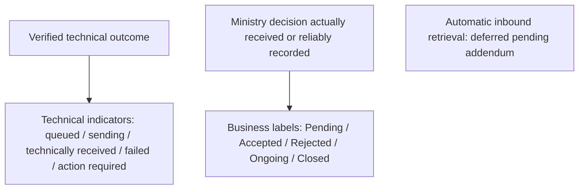

| Status information | Initial treatment | Evidence / dependency |
|---|---|---|
| Case saved / not referred | No transmission triggered | Explicit referral test F-01 |
| Technical delivery / failure | Separate transaction indicator | Gateway result, attempt history and failure classification |
| Pending | Business workflow label only; never implies receipt or acceptance without evidence | Ministry-approved meaning / authorised process |
| Accepted / Rejected | Display only an actual evidenced Ministry decision | Authorised decision provenance; technical receipt is insufficient |
| Ongoing / Closed | Display only actual evidenced case-management information | Approved recording process; no automatic inbound synchronisation initially |

**Historical vocabulary retained:** earlier Annex D proposed Draft, Queued, Needs action, Received, Accepted, Rejected, In progress, Completed and Withdrawn; it cited upstream v2.16.0 transitions in_progress, accepted, rejected, done and revoked, plus service outcomes. These are historical design / upstream references, not the current business vocabulary or proof of deployed Lesotho mapping. [Historical Figure 15](assets/d1-v2.8/media/image15.png) is retained as evidence only.

### D.4 Reliability design (Proposed)

The gateway persists each operation before transmission, maintains a persistent operation idempotency key separately from CPIMS+ case linkage, and records restricted metadata audit. Four configurable retries follow the initial failed attempt at delays of 1, 5, 30 and 120 minutes after the preceding failure, subject to Primero validation. Exhaustion produces a failed transmission indicator and administrator alert; controlled manual retry records authorised actor, reason, timestamp and result after duplicate checks. Permanent errors require correction; ambiguous creation requires reconciliation before any potentially duplicate resubmission. No specific response code or UUID-return format is assumed.

Earlier repeated / out-of-order return-update controls are retained as future RT-007 requirements, not initial acceptance conditions. An OPENCHS save must not transmit, close or overwrite a CPIMS+ case automatically. Explicit corrections / withdrawal / re-referral require permitted operations, approved rules and contractual confirmation where necessary (SCOPE-001–SCOPE-002).

## Annex E — Decision register

Identifiers continue the Session 1–2 register; where Session 3 updated an earlier decision it kept the earlier ID. Earlier v0.4 report-local numbering is not equivalent.

### E.1 Current decisions

The decision wording and sources below preserve the recorded Session 1–3 business history. “Confirmed” in the historical record is not current contractual inclusion; the later treatment stated in each affected row and E.3 governs this draft scope.

| **ID** | **Decision** | **Source** | **Status** | **Supersedes** |
|----|----|----|----|----|
| D-001 | Support referrals to CPIMS+/MGYSD and other approved stakeholders | Session 2 | Confirmed (in principle) | — |
| D-002 | SOP covers the broader referral ecosystem and role-holders | Session 2 | Confirmed (in principle) | — |
| D-003 | Emergency referrals need not capture every detail first | Session 2 | Confirmed direction; minimum dataset Pending | — |
| D-004 | Perpetrator information is important | Session 2 | Confirmed; included by D-012 | — |
| D-005 | ABR optional; receiving caseworker obtains it if missing | Session 3 | Confirmed | Session 2 D-005 (“subject to approved Ministry process”) |
| D-006 | Manual handling-agent referral; process as presented | Session 3 | Confirmed | Session 2 D-006 (“direction discussed”) |
| D-007 | Two-way integration for referred-case updates | Session 3 | Confirmed **Current scope treatment:** Historical business requirement; current automatic inbound implementation is Pending Validation — Contract Addendum (SCOPE-002) | Session 2 D-007 (closed-loop “in principle”); Session 1 decision 5 one-way scope |
| D-008 | Ministry distribution; helpline selects CPIMS+ service | Session 3 | Confirmed; service list to confirm | Session 2 D-008; Session 1 decision 6 (direct to district supervisor) |
| D-009 | Ministry-led UAT with recorded participant roles | Session 3 | Confirmed | Session 2 D-009 (“agreed direction”) |
| D-010 | Anonymous reporter allowed, recorded as such in CPIMS+ | Session 3 | Confirmed | Session 2 position that anonymous reports cannot be referred |
| D-011 | Child identifying details mandatory for referral | Session 3 | Confirmed | — |
| D-012 | Field set as presented; case plan not sent | Session 3 | Confirmed **Current scope treatment:** Historical field-set agreement retained; initial electronic attachments excluded, non-sensitive existence metadata conditional under SCOPE-003; case plan still excluded | Session 3 facilitation-deck proposal to defer attachments |
| D-013 | Narrative mandatory at referral, not first save | Session 3 | Confirmed | — |
| D-014 | NICR ABR format for initial validation | Session 3 | Confirmed | Session 1 “validation deferred” |
| D-015 | Direct API or OpenFN; X-Road only for Home Affairs checks | Session 3 | Confirmed; API vs OpenFN choice Pending (Ministry) **Current scope treatment:** Historical choice unresolved at Session 3 and [M4]; SCOPE-006 then preferred the gateway with conditional OpenFN. **Final position:** BITZ Integration Gateway; OpenFN is not used (TECH-001) | — |
| D-016 | Two acknowledgements: system and human | Session 3 | Confirmed | — |
| D-017 | Primero API documentation is the build basis unless it changes | Session 3 | Confirmed **Current scope treatment:** Generic API material remains reference evidence; deployed version / capability verification still required (GOV-004) | — |
| D-018 | Global playground if Lesotho sandbox not ready by draft report | Session 3 | Confirmed | — |

“Confirmed” means agreed in the minutes; approval of this report remains pending.

### E.2 Session 1 numbered decisions

| **Session 1 \#** | **Decision** | **Current position** |
|----|----|----|
| 1 | Manual trigger by handling agent | Retained (D-006) |
| 2 | Perpetrator details included | Retained (D-004, D-012) |
| 3 | Payload: bio-data, category, narrative, reporter contact, perpetrator | Historically extended by D-012 (attachments, follow-ups, ABR); current SCOPE-003 excludes file transfer and permits only conditional existence metadata |
| 4 | ABR field optional; validation deferred | Updated by D-005, D-014 |
| 5 | Post-referral updates pushed to CPIMS+; return not committed | Historical treatment: retained for outbound; return requested under D-007. Current scope: explicit outbound subject to verified / contractually confirmed operations; automatic inbound requires addendum (SCOPE-001–SCOPE-002) |
| 6 | Helpline refers directly to district supervisor | Superseded by D-008 |
| 7 | Emergencies by direct phone in parallel | Retained (WF-007) |
| 8 | OPENCHS integrates directly with CPIMS+; X-Road separate | Retained (D-015) |

### E.3 Subsequent scope-validation decisions — SCOPE-001–SCOPE-010

Source: user-supplied scope-validation instructions [RV4], defined in section 4. These ten references record a validated implementation position for this draft. They are not new Annex J requirement IDs, formal Ministry approvals, technical verification or a signed variation. Earlier D-007 / D-012 decisions remain preserved in E.1–E.2.

| Validation reference | Validated position [RV4] | Affected sections / existing requirements | Remaining authority / dependency |
|---|---|---|---|
| SCOPE-001 | Initial outbound creation and explicit authorised follow-up through BITZ gateway | 4.1, 4.3; FN-009, API-003, DATA-013 | Specific update operations require contractual confirmation where not explicit; Primero verifies support |
| SCOPE-002 | Retain D-007 history; automatic inbound / related mechanisms deferred | 4.2; FN-010, RT-007, SEC-008, AUD-003 | Formal addendum, Ministry sharing approval and Primero validation |
| SCOPE-003 | Exclude all electronic files; narrowly conditional existence metadata only | 4.4; DATA-010; Annex C.1 | All five metadata conditions evidenced; actual file transfer requires addendum |
| SCOPE-004 | Explicit exclusions with essential UI / security / deployment-readiness exception | 4.1, 4.4; D-012; DEF-002, DEF-004–DEF-009 | Material expansion requires approved change control; signed obligations not waived |
| SCOPE-005 | Optional structural ABR checks; external registry integration excluded | 4.3; FN-001–FN-002, DATA-003–DATA-004; DEF-009 | Official specification and override roles; additional integration requires variation |
| SCOPE-006 | BITZ gateway / direct API baseline; no X-Road referral path. (The conditional OpenFN element is superseded by TECH-001: OpenFN is not used) | 4.3; API-009, GOV-004; Section 6 / Annex K | Deployed version, API, authentication, UUID, permissions and environments unverified |
| SCOPE-007 | Shared technical / business responsibility without new SLA | 4.5; OPS-006–OPS-007; UAT-002 | Named owners, support escalation and authorised UAT signatory |
| SCOPE-008 | Formal documented impact assessment and change control | 4.6; CD-01, CD-04; existing change register | Required contracting-party approval before out-of-scope implementation |
| SCOPE-009 | Initial-scope evidence and four separate acceptance / go-live stages | 4.7; UAT-002–UAT-004, UAT-007, UAT-010 | Verified results, named authority and separate acceptance records; no deferred gate |
| SCOPE-010 | Dependency control within existing registers; no automatic contractual entitlement | 4.5; Annex F.3 / G | Evidence, impact assessment and applicable contractual approval |

## Annex F — Action register

F.1–F.2 retain the earlier dated action history, including subsequently recorded document receipt. Later [M4] treatment is appended where directly relevant; current scope dependencies are consolidated in F.3. “Completed” or “Verified” requires evidence, and a meeting-recorded administrative closure does not establish legal approval or technical readiness.

### F.1 Session 3 actions

| **ID** | **Action** | **Owner** | **Recorded due** | **Status** |
|----|----|----|----|----|
| A-013 | Share national referral pathways | Rantsala | 26 Oct 2026 | Overdue — not yet received |
| A-014 | Resend case-management SOPs incl. referral section | Hopolang Mosena | 27 Oct 2026 | Received [SOP1]; Ministry to confirm current applicability; BITZ to complete mapping review **Later treatment:** [M4] recorded closure after SOP receipt; applicability / mapping verification remains pending in F.3. |
| A-015 | Complete sandbox checklist; post-meeting call | Rantsala / Isaiah | 26 Oct 2026 | Overdue — outcome not recorded |
| A-016 | Provide Lesotho sandbox or global playground access | Isaiah | 28 Oct 2026 | Pending **Later treatment:** [M4] revised access target to 13 Nov 2026; availability / credentials still not evidenced. |
| A-017 | Share Ministry data-protection work, policy and legislation | Lekhanya (UNICEF), as recorded | 26 Oct 2026 | Partly received 29 Oct 2026 (Data Protection Act; draft Data Management Policy); earlier Ministry work overdue; owner to confirm **Later treatment:** [M4] recorded partial receipt and closure; lawful disclosure, missing prior Ministry work and classification policy remain unresolved. |
| A-018 | Confirm CPIMS+ service list | Isaiah | 28 Oct 2026 | Pending |
| A-019 | Invite BITZ to Primero/X-Road sessions | Lekhanya (UNICEF) / Isaiah | Next session | Pending |
| A-020 | Share Berea X-Road workshop use cases | Melusi | 27 Oct 2026 | Due 27 October — not yet received **Later treatment:** Removed from this referral integration at [M4]; separate Home Affairs coordination is not an implementation prerequisite. |
| A-021 | Agree handling of referrals during outages | Nelson / Peter / Isaiah | 28 Oct 2026 or during testing | Pending **Later treatment:** [M4] proposed queue / gradual resend; current four-retry parameters and duplicate recovery require Primero technical validation. |
| A-022 | Data protection desk research | Nelson | 28 Oct 2026 | In progress |
| A-023 | Configure API authentication; begin test calls | Peter / Marlon | After A-016 | Awaiting dependency |
| A-024 | Name helpline coordination leave cover | Hopolang | 27 Oct 2026 | Due 27 October — not yet confirmed |
| A-025 | Deliver initial draft inception report | Nelson / BITZ | 28 Oct 2026, COB | Draft prepared; circulation pending |
| S3-N01 | Circulate Session 3 minutes | BITZ | 26 Oct 2026 | Circulation not confirmed |
| S3-N02 | One-to-one follow-ups (outage, service list, cover) | BITZ | 26–27 Oct 2026 | Outcome not recorded |
| P-01 | Define two-way update contract | OPENCHS / Isaiah / Ministry | To agree | Proposed **Later treatment:** Future inbound contract requires formal addendum; explicit outbound operations tracked separately under API-003. |
| P-02 | Complete configured field mapping | OPENCHS / Isaiah / Ministry | To agree | Proposed |
| P-03 | Confirm UNICEF action owners | UNICEF | To agree | Proposed **Later treatment:** Removed at [M4]; required signatory / contact nominations remain separately pending. |

### F.2 Earlier actions (Sessions 1–2)

| **ID** | **Action** | **Owner** | **Status as last recorded** | **Current treatment** |
|----|----|----|----|----|
| A-001 | Provide participant list | Hopolang | Completed (Session 2 minutes) | Closed |
| A-002 | Name Child Helpline focal person | Hopolang | Pending | Carried forward by Session 3 |
| A-003 | Share referral workflow/process | Tiisetso | Completed (Session 2 minutes) | Closed; document not available |
| A-004 | Share referral form | Isaiah | Completed (Session 2 minutes) | Closed; form not available |
| A-005 | Review referral form for field requirements | Project team | Pending | Not carried forward; field set settled by D-012 |
| A-006 | Identify ABR integration support | Hopolang | Pending | Not carried forward; addressed by D-014, A-019 |
| A-007 | Confirm ABR format, ownership, rules | Ministry / relevant authority | Pending | Carried forward for residual verification rules |
| A-008 | Agree CPIMS+ recipients and routing | Ministry / CPIMS+ | Pending | Not carried forward; D-008, A-018, RT-003 |
| A-009 | Define closed-loop feedback statuses and mechanism | Ministry / CPIMS+ / CHL | Pending | Not carried forward; D-007, P-01, RT-006/007 |
| A-010 | Set up sandbox and API access | UNICEF / technical teams | Pending | Not carried forward; A-015, A-016 |
| A-011 | Confirm UAT participants, data, scenarios, sign-off | Ministry / CHL / technical | Pending | Not carried forward; D-009, UAT-002/003 |
| A-012 | Confirm UNICEF participation or approval | UNICEF / governance | Pending | Participation addressed in Session 3; approval route GOV-003 |

### F.3 Scope dependency control — current validation view

This view implements SCOPE-010 within the existing action register. IDs below reuse action or requirement references; they are not new requirements and do not alter the Annex J count. F.1–F.2 retain dated source history. Status reflects the evidence reviewed for [M4], [RV3] and [RV4], not a live environment check. No unverified item is marked Verified and no new completion or due date is inferred.

| Dependency ID | Description / related references | Responsible party | Required evidence | Target date | Affected activity | Current status | Impact / risk link | Escalation owner / route | Contractual treatment |
|---|---|---|---|---|---|---|---|---|---|
| GOV-004 | Deployed Primero version and applicable API documentation | Primero | Version / configuration record and deployed API contract | Pending Confirmation | Design, development, integration testing | Pending | Unverified compatibility may require redesign; R-001 / R-013 | BITZ project coordination → Primero / UNICEF; named escalation contact to confirm | Assess effects under [CT2]; no automatic entitlement |
| A-016 | Sandbox access and connectivity; original 28 Oct target retained in F.1 | Primero / Isaiah | URL, securely issued access, network approval and authenticated test call | Target 13 Nov 2026 [M4], not guaranteed | Mapping, integration testing, UAT | Pending | End-to-end verification cannot be evidenced without access; R-001 | BITZ coordination → Isaiah / UNICEF | Assess delay and approved response under contract |
| API-008 | Production environment and connectivity | Primero and infrastructure owners; BITZ for gateway | Approved environment / connectivity, secure credentials and readiness record | Pending Confirmation | Deployment, go-live | Pending | Production readiness dependent on evidence; R-012 / R-017 | BITZ coordination → Ministry / Primero infrastructure owners; names to confirm | Readiness requirement; assess any material scope impact |
| API-002 | Integration service account, permissions and token handling; linked A-023 | Primero; BITZ verifies gateway authentication | Least-privilege role, authentication / renewal specification and test evidence | Pending Confirmation | Development, security testing, UAT | Pending | Unattended operation / access controls unverified; R-013 | BITZ technical coordination → Primero | Contractual JWT capability; any changed mechanism needs assessment |
| API-003 | UUID response / retrieval and explicit update operations | Primero; Ministry approves permitted operations | Verified create / link / update semantics, permissions and narrow reconciliation; contractual interpretation where needed | Pending Confirmation | Design, development, testing, acceptance | Pending | Update or reconciliation design may change; R-004 / R-010 | BITZ coordination → Primero and UNICEF for contractual issue | Specific update operations confirmed under [CT2] or formal variation before added obligation |
| A-018 | Ministry-approved CPIMS+ referral service list | Ministry approves; Primero / Isaiah supplies configuration | Versioned services, codes, receiving roles and configuration | Pending Confirmation | Mapping, development, UAT | Pending | Routing cannot be validated without approved configuration; R-003 | BITZ coordination → Ministry / Isaiah | Configuration dependency; assess material delivery impact |
| DATA-007 | Approved multi-concern gateway mapping; linked P-02 | Ministry; Primero; BITZ mapping | Approved concerns / codes, versioned mapping and unmapped-value handling tests | Pending Confirmation | Mapping, development, testing | Pending | Incorrect mapping risks misrouting / rejection; R-003 | BITZ technical coordination → Ministry / Primero | Within approved definitions; changed scope requires assessment |
| WF-004 | Child-identification minimums and emergency exceptions; linked DATA-005 | Ministry; Primero checks mandatory fields | Written reduced dataset / exception authority and verified field compatibility | Pending Confirmation | Design, testing, UAT | Pending | Emergency safeguards / validation cannot be accepted without rules; R-002 / R-011 | BITZ coordination → Ministry safeguarding / business approver; nomination pending | Business rule dependency; assess technical and contractual impacts |
| SEC-001 | Consent, lawful disclosure and necessary fields; linked DATA-012 / A-017 / A-022 | Ministry legal / safeguarding approvers | Written lawful basis, purposes, disclosure / withdrawal / exception matrix and production-use approval | Pending Confirmation | Mapping, security testing, UAT, go-live | Pending | Real-data production disclosure not authorised by requirement validation; R-007 / R-011 / R-017 | BITZ coordination → Ministry; UNICEF facilitates | Approval prerequisite; no waiver or extra-work entitlement assumed |
| A-014 | Applicable SOP and referral forms; linked A-013 / A-004 | Ministry / Hopolang; UNICEF coordinates pathways | 2019 SOP received; confirm applicable edition / amendments, national pathways and Form 4 reconciliation | Pending Confirmation for applicability / missing inputs | Workflow, mapping, UAT | Received — SOP; verification / other inputs pending | A-014 receipt closure does not verify applicable rules; R-002 | BITZ coordination → Ministry / Hopolang and UNICEF | Assess changed rules if material; retain receipt history |
| OPS-006 | Named support contacts, escalation and incident ownership; linked OPS-007 / A-002 / A-024 | BITZ, Ministry, Child Helpline and Primero | Acknowledged responsibility / contact register and incident / recovery runbook | Pending Confirmation | Handover, go-live | Pending | Incident ownership incomplete; R-008 | BITZ coordination and each organisation appointing its contact | Existing support provisions only; no new SLA |
| UAT-002 | Ministry UAT coordinator, testers and authorised signatory; linked A-011 | Ministry; Child Helpline; technical teams provide testers | Written nominations, authority and test-account roster | Pending Confirmation | UAT, acceptance | Pending | No formal UAT sign-off authority evidenced; R-008 / R-009 | BITZ coordination → Ministry; UNICEF facilitates | Acceptance governance under existing agreement |
| UAT-003 | Dedicated non-production end-to-end test readiness; linked A-015 / API-005 / API-006 | BITZ and Primero; Ministry approves test arrangements | Verified three-component environment, roles, synthetic dataset and readiness checklist | Pending Confirmation | Integration testing, UAT | Pending | Mocks cannot establish end-to-end acceptance; R-001 | BITZ technical coordination → Primero / Ministry | Assess dependency impact; no acceptance waiver |
| DATA-010 | Supporting-material-existence metadata approval, if proposed | Ministry; Primero; BITZ | All five SCOPE-003 conditions: necessity, approval, supported field, non-sensitive content, validated mapping / security | Pending Confirmation | Optional field mapping / testing | Pending | Omit metadata until evidenced; no initial file-transfer dependency; R-007 / R-010 | BITZ coordination → Ministry / Primero | Metadata exception only; binary transfer still requires addendum |
| RT-007 | Contract addendum for future inbound and attachment functionality; linked FN-010 / DATA-010 / SEC-008 / AUD-003 / P-01 | Authorised contracting parties; Ministry / Primero validate dependencies | Signed addendum, sharing approval, technical evidence and future acceptance criteria | Pending Confirmation | Future-phase design / implementation / UAT | Pending | Deferred features not initial acceptance gates; R-006 / R-010 | BITZ coordination → UNICEF / Ministry; authorised signatories to confirm | Formal variation before out-of-scope implementation |

BITZ records the affected activity and impact when a dependency becomes a blocker, then escalates through agreed governance. Named operational escalation contacts remain to be confirmed. No delay automatically establishes an extension, payment or acceptance waiver; section 4.6 governs proposed variations. Mocks, assumptions and synthetic data may support safe provisional work but cannot establish completed end-to-end verification.

## Annex G — Detailed risk register

Risk IDs, historical ratings / triggers and open statuses are retained. The current scope qualifications below and dependency view in Annex F.3 do not declare risks closed or create automatic schedule / cost entitlement.

| **Risk ID** | **Description** | **Effect** | **P** | **I** | **Mitigation** | **Owner** | **Trigger for escalation** | **Status** |
|----|----|----|:--:|:--:|----|----|----|----|
| **R-001** | Sandbox / API access delay | Blocks configured mapping and integration tests | H | H | A-015 checklist; A-016 access or playground; escalation template 14 | Rantsala / Isaiah | No access by 28 Oct | Open |
| **R-002** | Outstanding country documents and SOP applicability | Requirements cannot be checked against approved practice | H | H | Obtain A-013/A-017; confirm SOP applicability; reconcile Form 4 with the unified referral form; retain receipts | Rantsala / Hopolang / UNICEF | Any item overdue at next review | Open |
| **R-003** | Field and service configuration incomplete | Invalid payloads or misrouting | H | H | A-018 service list; service-to-recipient configuration; approved mapping | Isaiah / Ministry | No list by 28 Oct | Open |
| **R-004** | Outage and duplicate recovery unresolved | Lost, repeated or uncertain referrals | M | H | Resolve A-021; adopt client UUID; recovery tests RC-01–RC-04 **Current: operation idempotency and CPIMS+ UUID linkage are distinct; verify ambiguous-result reconciliation rather than assuming client UUID / conflict behaviour.** | Nelson / Peter / Isaiah | Not agreed before design sign-off | Open |
| **R-005** | ABR verification dependency | Format-valid IDs may remain unverified | M | M | Keep missing ABR non-blocking; A-007, A-019, A-020; interim configurable format rule (D-014); ask HMIS/EMIS teams for the check-digit method **Current: structural checks only; A-020 removed at [M4]. Live NICR / Home Affairs / X-Road implementation is outside initial scope; coordination creates no build obligation.** | Ministry / UNICEF / Isaiah | Home Affairs route demands build scope | Open |
| **R-006** | Two-way design | Disclosure risk or lost updates | M | H | Bounded feedback; reconciliation; webhook role **Current: inbound design is future addendum scope, not initial acceptance; Ministry sharing and Primero capability approval still needed.** | BITZ / Primero | Mechanism undecided at design review | Open |
| **R-007** | Privacy and authority gaps | Unauthorised sharing or unclear approvals | H | H | Remaining A-017 item; A-022 desk research against the Act [DPA1]; named approvers; processing contracts | UNICEF / Ministry / Nelson | Materials not received by next review | Open |
| **R-008** | Focal-person or support gaps | Delayed review, UAT and incident resolution | H | M | A-024 cover; A-002 focal; named support owners | Hopolang | No cover named by 27 Oct | Open |
| **R-009** | Milestone slippage | D1 overdue; D2/D3 windows at risk | H | H | Governance confirms D1 status; written rebaseline; agree the dated timetable in section 8.7, as the signed contract has a late-submission clause [CT2 section 4] **Current: use the conditional planning baseline and F.3 impact assessment; no delay automatically grants extension, payment or waiver.** | Project governance | Already realised (issue) | Open |
| **R-010** | Contract scope change | Two-way updates and attachments exceed outbound D3 | H | H | Governance decision (section 9) **Current: formal addendum required for automatic inbound / electronic attachments; specific outbound updates need written contract interpretation where not explicit.** | UNICEF / governance | No decision before D3 design sign-off | Open |
| **R-011** | CPIMS+ consent requirement | Referrals blocked or made without agreed basis | M | H | Ministry defines consent capture and override; Isaiah confirms configured checks | Ministry / Isaiah | Consent check active in configured environment without decision | Open |
| **R-012** | Primero go-live dependency | OPENCHS delivery pushed outside window | M | H | Primero reports Lesotho go-live plan | Isaiah / governance | No plan by next steering review | Open |
| **R-013** | Service-account credentials and token renewal not yet supplied (method fixed by contract) | Integration cannot run unattended or credentials handled insecurely | M | H | Agree service-account flow, renewal and storage | Isaiah / Peter / Marlon | Not agreed when access arrives | Open (new, proposed) |
| **R-014** | Stakeholder approval delays | D1 cannot be accepted; payment and schedule affected | H | H | Name approvers; agreed review window | UNICEF / Ministry | No approvers named by draft circulation | Open (new, proposed) |
| **R-015** | “Save-event” wording in plan conflicts with D-006 | Misbuild or acceptance dispute for D2/D4 | M | M | Confirm acceptance wording (CD-03) | Project governance | Not clarified before D2 demonstration | Open (new, proposed) |
| **R-016** | Global demonstration system testing may not be accepted as integration-test evidence | Integration testing repeated or D4 acceptance disputed | M | H | UNICEF confirms the acceptance basis; plan January tests on the Lesotho system | UNICEF / Isaiah | No Lesotho system by end November 2026 | Open (new, proposed) |
| **R-017** | Hosting location, processing contracts and cross-border access not confirmed | Deployment delayed or unlawful transfer of child data | M | H | Ministry confirms hosting and data controllers; processing contracts before real case data (section 7.5) | Ministry / UNICEF / Nelson | Not confirmed before production setup in February 2027 | Open (new, proposed) |

P and I: proposed BITZ assessment, **not formally assessed**. All risks remain open until closure is evidenced.

## Annex H — UAT scenario matrix

Planned scenarios, **not executed tests**. Original scenario wording, basis, expected result and priority are retained as history; the current scope / criterion column controls this validation draft. Historical Must priorities on future tests do not make them initial gates. Each executed test must record requirement, prerequisites, steps, expected / actual result, tester, environment, evidence, defects and outcome. Synthetic data is the default. Contractual ambiguity for a specific outbound operation must be resolved before final acceptance criteria (SCOPE-001, SCOPE-009).

### H.1 Business process (B)

| **ID** | **Scenario** | **Basis** | **Original expected result (historical)** | **Priority** | **Current scope / acceptance criterion** |
|----|----|----|----|----|----|
| B-01 | End-to-end referral following SOP pathway | WF-001; D-006 | Steps D.1 1–7 complete with correct states | Must | Initial: demonstrate explicit outbound lifecycle and verified linkage in Annex D.1; no automatic return update required. |
| B-02 | Emergency case: phone call plus system referral | WF-007; D-003 | Phone path unaffected; referral recorded and tracked | Must | Initial: apply the original scenario within section 4 scope, approved business rules and verified technical behaviour; no implementation or test completion claimed. |
| B-03 | Agent escalates to supervisor before referral | WF-003 | Escalation recorded; referral by agent after review | Should | Initial: optional escalation; authorised agents may refer directly unless a separately approved rule requires escalation. |

### H.2 Functional (F)

| **ID** | **Scenario** | **Basis** | **Original expected result (historical)** | **Priority** | **Current scope / acceptance criterion** |
|----|----|----|----|----|----|
| F-01 | Save case without referring | D-006 | Nothing sent to CPIMS+ | Must | Initial: apply the original scenario within section 4 scope, approved business rules and verified technical behaviour; no implementation or test completion claimed. |
| F-02 | Save without narrative; attempt referral without narrative | D-013 | Save succeeds; referral blocked with message | Must | Initial: save succeeds without narrative; ordinary referral requires it, with only approved documented emergency exceptions. |
| F-03 | Anonymous reporter, identified child | D-010; D-011 | Referral succeeds; CPIMS+ shows reporter anonymous; no reporter identity sent | Must | Initial: apply the original scenario within section 4 scope, approved business rules and verified technical behaviour; no implementation or test completion claimed. |
| F-04 | Missing child identifying details | D-011 | Referral blocked with message (unless approved emergency exception) | Must | Initial: apply the original scenario within section 4 scope, approved business rules and verified technical behaviour; no implementation or test completion claimed. |
| F-05 | Emergency minimum-information referral | D-003; WF-004 | Behaves per approved minimum dataset | Must (rule pending) | Initial: apply the original scenario within section 4 scope, approved business rules and verified technical behaviour; no implementation or test completion claimed. |
| F-06 | Valid ABR ID | D-014 | Accepted and transmitted | Must | Initial: apply the original scenario within section 4 scope, approved business rules and verified technical behaviour; no implementation or test completion claimed. |
| F-07 | ABR absent | D-005 | Referral proceeds | Must | Initial: apply the original scenario within section 4 scope, approved business rules and verified technical behaviour; no implementation or test completion claimed. |
| F-08 | ABR invalid: 11 or 13 digits; prefix 2–9; seventh digit not 1 or 2; non-numeric | D-014 | Clear validation message; leading zero preserved for valid IDs | Must | Initial: apply the original scenario within section 4 scope, approved business rules and verified technical behaviour; no implementation or test completion claimed. |
| F-09 | ABR seventh digit inconsistent with recorded sex | D-014 | Behaves per agreed rule | Should (rule pending) | Initial: sex mismatch warning with authorised audited override; approved roles and structural rule evidence required. |
| F-10 | Service selection routes to configured recipient | D-008 | Referral appears for the configured receiving user/agency | Must | Initial: apply the original scenario within section 4 scope, approved business rules and verified technical behaviour; no implementation or test completion claimed. |
| F-11 | System acknowledgement, then accept; separately reject with reason | D-016 | Distinct Received, Accepted / Rejected states and reason shown | Must | Initial: separate technical response from Ministry decision actually received / reliably recorded; no automated status retrieval or inferred acceptance. |
| F-12 | Status and intervention updates returned | D-007 | Linked OPENCHS case shows approved fields only | Must | Future — contract addendum required; historical test retained, excluded from initial UAT / acceptance. Ministry data-sharing approval and Primero verification required before later execution. |
| F-13 | OPENCHS follow-up, including prank re-flag | D-012; [M1 section 7] | Update applied to linked CPIMS+ case, no new case | Must | Initial validated operation: explicit Send Update to CPIMS+ uses verified UUID linkage; saving alone sends nothing; prank notice does not close CPIMS+. Confirm contractual treatment and supported API operation. |
| F-14 | Perpetrator details | D-004; D-012 | Transmitted to agreed fields; unknowns handled | Must | Initial: apply the original scenario within section 4 scope, approved business rules and verified technical behaviour; no implementation or test completion claimed. |
| F-15 | Attachment within and outside agreed limits | D-012 | Allowed files transmitted; disallowed rejected with message | Must | Future — contract addendum required; historical test retained, excluded from initial UAT / acceptance. Ministry data-sharing approval and Primero verification required before later execution. |
| F-16 | Case plan present in OPENCHS | D-012 | Case plan not in payload | Must | Initial negative-transfer test: case plan, all file / media contents, file URLs, tokens and sensitive attachment details absent. Supporting-material-existence metadata absent unless all five SCOPE-003 conditions evidenced; permitted metadata conveys no file access. |
| F-17 | ABR added or corrected later | DATA-004 | Behaves per agreed update contract | Should | Initial validated operation: authorised correction explicitly updates linked UUID with history; supported operation / contract treatment and field rules confirmed. |
| F-18 | Ministry distribution after acceptance | D-008 | Helpline sees acceptance and progress, not internal assignment | Must | Initial: authorised Ministry distribution / assignment demonstrated; OPENCHS displays only reliably recorded decisions, without requiring automatic progress retrieval. |
| F-19 | Correction, cancellation, re-referral | WF-006 | Behaves per approved rules; history preserved | Must (rules pending) | Initial only for approved / supported / contractually confirmed operations; explicit action, preserved linkage / history, no automatic closure or overwrite. |

### H.3 Security and privacy (S)

| **ID** | **Scenario** | **Basis** | **Original expected result (historical)** | **Priority** | **Current scope / acceptance criterion** |
|----|----|----|----|----|----|
| S-01 | Token issue, expiry after 60 minutes, renewal | API-002 | Uninterrupted delivery; no credential in logs | Must | Initial: verify actual token lifetime / renewal semantics in the deployed contract rather than assuming the reported 60 minutes; secrets absent from logs. |
| S-02 | Integration account attempts unapproved field | SEC-003 | Field not set | Must | Initial: disallow unapproved fields, unrestricted case reading and administrative privileges. |
| S-03 | Log inspection | SEC-006 | No tokens or full narratives; reporter anonymity intact | Must | Initial: metadata-only restricted logs; no full payloads, ABR values, credentials or tokens; test redaction, access audit and approved retention. |
| S-04 | Return-update channel authentication and field limits | SEC-008; RT-007 | Unauthenticated calls refused; only approved fields stored | Must | Future — contract addendum required; historical test retained, excluded from initial UAT / acceptance. Ministry data-sharing approval and Primero verification required before later execution. |
| S-05 | Transport security | SEC-005 | TLS enforced; invalid certificate rejected outside local | Must | Initial: TLS 1.2+ and valid certificate verification; reject invalid certificates and obsolete protocols; confirm required network controls. |
| S-06 | Consent fields and override | DATA-012 | Behaves per Ministry decision | Must | Initial: test approved consent / alternative-lawful-basis / withdrawal / exception matrix; no unapproved disclosure. |
| S-07 | OPENCHS role access to returned data | SEC-008 | Only authorised roles see returned updates | Must | Future — contract addendum required; historical test retained, excluded from initial UAT / acceptance. Ministry data-sharing approval and Primero verification required before later execution. |
| S-08 | Test data check | SEC-007 | Only approved synthetic data in test environments | Must | Initial: synthetic by default; exceptional real-data use only with separate Ministry approval and safeguards. |

### H.4 Recovery and reliability (RC)

| **ID** | **Scenario** | **Basis** | **Original expected result (historical)** | **Priority** | **Current scope / acceptance criterion** |
|----|----|----|----|----|----|
| RC-01 | Lost response after case creation; retry with same UUID | OPS-003 | 409 reconciled; exactly one CPIMS+ case | Must | Initial: persist operation key, lock / enforce uniqueness, reconcile ambiguous creation using verified semantics and establish UUID linkage before resubmission; no assumed HTTP code proves success. |
| RC-02 | Agent double-clicks referral | FN-003 | One referral only | Must | Initial: apply the original scenario within section 4 scope, approved business rules and verified technical behaviour; no implementation or test completion claimed. |
| RC-03 | Primero unavailable; referrals queued; service restored | OPS-001 | All queued referrals delivered or flagged; none lost | Must | Initial: apply the original scenario within section 4 scope, approved business rules and verified technical behaviour; no implementation or test completion claimed. |
| RC-04 | Retries exhausted | OPS-002; AUD-001/002 | Failed state, administrator alert, controlled manual retry works | Must | Initial: four configurable retries after initial attempt at 1 / 5 / 30 / 120 minutes after preceding failure, subject to Primero validation; exhaustion alerts and controlled manual retry after duplicate checks, with actor / reason / time / result. |
| RC-05 | Duplicate and out-of-order return updates | RT-007 | Duplicates ignored; stale updates do not overwrite newer state | Must | Future — contract addendum required; historical test retained, excluded from initial UAT / acceptance. Ministry data-sharing approval and Primero verification required before later execution. |
| RC-06 | 422 validation error from Primero | API-004 | Needs-action state with field named; no blind retry | Must | Initial: verify actual validation-error schema, require correction and avoid blind retry; generic 422 is not a deployment assertion. |
| RC-07 | Missed webhook delivery (if Option 1) | B.5 | Reconciliation recovers the update | Must (if Option 1) | Future — contract addendum required; historical test retained, excluded from initial UAT / acceptance. Ministry data-sharing approval and Primero verification required before later execution. |
| RC-08 | Token expires while queue is draining | API-002 | Re-authentication; delivery continues | Must | Initial: apply the original scenario within section 4 scope, approved business rules and verified technical behaviour; no implementation or test completion claimed. |

### H.5 Audit and regression

| **ID** | **Scenario** | **Basis** | **Original expected result (historical)** | **Priority** | **Current scope / acceptance criterion** |
|----|----|----|----|----|----|
| AU-01 | Audit record completeness | OPS-004 | Every transmission and return update has all approved fields | Must | Initial: outbound transaction references, operation / UUID / idempotency linkage, actors, outcomes, attempts and interventions audited as restricted metadata; return-update audit deferred. |
| RG-01 | Regression of existing OPENCHS functions | OPS-008 | No Critical/High regression | Must | Initial: existing OPENCHS functionality unaffected; no open initial-scope Critical / High defects; lower-severity exceptions only under UAT-007. |

### H.6 Coverage of Session 3 decisions

This is historical decision-to-scenario traceability. D-007 scenarios and F-15 are future addendum tests; their continued presence does not make them initial acceptance criteria. F-16 includes the initial negative-transfer / conditional-metadata checks.

| **Decision** | **Scenarios** |
|----|----|
| D-005 | F-07, F-17 |
| D-006 | F-01, B-01, RC-02 |
| D-007 | F-12, RC-05, S-04, RC-07 |
| D-008 | F-10, F-18 |
| D-009 | UAT organisation (section 10.2) |
| D-010 | F-03, S-03 |
| D-011 | F-03, F-04 |
| D-012 | F-13, F-14, F-15, F-16 |
| D-013 | F-02 |
| D-014 | F-06, F-08, F-09 |
| D-015 | Architecture review (section 6) |
| D-016 | F-11 |
| D-017 | S-01, RC-01, RC-06 (built to documented API) |
| D-018 | Environment record notes playground vs Lesotho configuration for each test |

## Annex I — Source documents and references

### I.1 Source register

The bracketed codes are used for citations throughout the report. Where a source has numbered sections, citations take the form [M3 section 11].

| **Ref.** | **Source** | **Location** | **Date** | **Use** |
|----|----|----|----|----|
| [M3] | OPENCHS & Primero CPIMS+ Integration — Session 3 Minutes | 03_meetings/session_3/OPENCHS & Primero CPIMS+ Integration — Session 3 Minutes.pdf | 26 Oct 2026 | Governing baseline: D-005–D-018; A-013–A-025 |
| [M4] | D1 Validation Meeting Minutes — 4 November 2026 (Draft) | 03_meetings/session_4/D1_VALIDATION_MEETING_MINUTES_2026-11-04_DRAFT.docx | 4 Nov 2026 | Validation outcomes, amended requirements, implementation approach, scope clarifications, action ownership, revised timetable and outstanding approvals. |
| [AT3] | Session 3 Action Tracker | 03_meetings/session_3/SESSION_3_ACTION_TRACKER_2026-10-26.xlsx | 26 Oct 2026 | Actions, S3-N, P-01–P-03, contacts |
| [M2] | OPENCHS & Primero CPIMS+ Integration — Session 2 Minutes (Technical Architecture) | 03_meetings/session_2/SESSION_2_MINUTES.pdf | 9 Oct 2026 | D-001–D-004; CPIMS+ demonstration; earlier actions |
| [M1] | OPENCHS & Primero CPIMS+ Integration — Session 1 Minutes (Business & Workflow) | 03_meetings/session_1/SESSION_1_MINUTES.pdf | 8 Oct 2026 | Workflow, attendees, original decisions |
| [TR1] | Primero Technical Response to the BITZ inception questionnaire (request dated 2 Oct 2026); section numbers follow the questionnaire | 06_correspondence/ISAIAH_RESPONSE_SOURCE_2026-10-26.md (transcription) | Recorded 26 Oct 2026; reply date not supplied | Environment, API, authentication, error handling, test data, UAT |
| [RQ1] | BITZ circulated requirements and ownership checklist (email) | 06_correspondence/NELSON_LAST_CIRCULATED_REQUIREMENTS_EMAIL_SOURCE_2026-10-26.md | Sent date not supplied | Outstanding checklist; 14 Oct call reference |
| [CT2] | UNICEF institutional contract 43427866, Amendment 3 (revised scope, cost and time), with contractual provisions and general terms (Annex A); signed by UNICEF and BITZ | Signed copy held by UNICEF and BITZ; not stored in the project repository | Signed 15 Sep 2026 | Governing contract; items 50–80; validity; effective date; late-submission and data-ownership clauses |
| [DPA1] | Data Protection Act, 2011 (Act No. 5 of 2012), Government Gazette Vol. 57 No. 19, 22 February 2012 | 03_meetings/session_3/data protection /Lesotho_Data Protection Act.pdf | Gazetted 22 Feb 2012; received 29 Oct 2026; scanned copy partly illegible | Legal position, lawful grounds, children’s and sensitive information, processing contracts, notification, transfers (section 7.2) |
| [DMP1] | Draft Data Management Policy, version 1.0 (MICSTI / UNDP; Cabinet approval pending) | 03_meetings/session_3/data protection /Data Management Policy_1.0.pdf | Received 29 Oct 2026; undated in text (file created Feb 2025) | Hosting, classification, cross-border and security direction (sections 5.6.3–5.6.8); Commission status (section 4.1.2) |
| [RC1] | CHL Integration with Primero Requirement Checklist (annotated); item numbers follow the checklist | 03_meetings/CHL intergration with Primero Requirement Checklist.docx | Author and date not recorded | NICR format (item 6); UAT participants and sign-off (item 10); data protection reference (item 11) |
| [TB] | Technical Scope / TOR Brief — Lesotho Child Helpline 116 / OPENCHS, Amendment 3 | 07_source_documents/Lesotho_OPENCHS_Technical_Scope_Inception_Brief.pdf | 24 Sep 2026 | Contract scope; workstreams; inception questions |
| [DP] | Contract-Aligned Delivery Plan v0.3 | 02_project_management/CONTRACT_ALIGNED_DELIVERY_PLAN.md | 14 Oct 2026; updated 26 Oct 2026 | Milestones; payment gates |
| [CI] | Inception Completion Inventory v0.3 | 01_inception/INCEPTION_COMPLETION_INVENTORY.md | 26 Oct 2026 | Requirement IDs and status |
| [R06] | D1 Inception Report v0.6 | 01_inception/DRAFT_INCEPTION_REPORT_D1_OPENCHS_PRIMERO.md | 27 Oct 2026 | Predecessor |
| [PA] | Primero source and API v2 documentation, release v2.16.0 | Local repository, commit 622e0d2d6d; doc/api/; public reference <https://github.com/primeroIMS/primero/blob/development_v2/app/controllers/api/README.md> | Commit 19 Oct 2026; public reference reviewed 26 Oct 2026 | Annex B |
| — | Technical reference material | 05_technical_reference/ | Various | Prior design context only |
| — | Capture templates | 04_templates/ | 26 Oct 2026 | Working forms; pre-Session 3 content must be reconciled |

### I.2 Sources referenced but not yet available

| **Source** | **Status** |
|----|----|
| Signed governing contract and general terms | Received: signed Amendment 3 to contract 43427866 with contractual provisions and general terms [CT2] |
| Minutes of the 24 Sep 2026 inception meeting | Not available |
| Minutes or outcome of the 14 Oct 2026 technical call | Not available |
| National referral pathways (A-013) | Not received as at 27 Oct |
| Case-management SOPs (A-014) | Received and reviewed for report impact on 28 Oct [SOP1]; September 2019 edition; current applicability pending Ministry confirmation |
| Unified national referral form (A-004) | Recorded as shared; not available |
| Privacy materials and legislation (A-017) | Act and draft policy received 29 Oct [DPA1; DMP1]; earlier Ministry data-protection work not received |
| Berea X-Road workshop use cases (A-020) | Not received as at 27 Oct |
| Sandbox readiness checklist (A-015) | Not available |
| CPIMS+ service list (A-018) | Not received as at 27 Oct |
| Configured Lesotho field definitions and lookups | Dependent on sandbox setup |
| Original Isaiah email | Transcription only; sent date not supplied |

### I.3 Acronyms retained from sources

ABR ID; API; CHL; CPIMS / CPIMS+; D1–D4; GBV; JWT; MGYSD; NICR; OPENCHS; OpenFN; SOP; SSO; TLS; TOR; UAT; UNICEF; VPN; X-Road. Expansions are given only where the sources state them (NICR: issued by the Ministry of Home Affairs).

## Annex J — Categorised requirement baseline and status

**Scope validation cross-reference:** SCOPE-001–SCOPE-010 are decisions, not additional requirements. Apply section 4 to current acceptance criteria; particular outbound operations need contractual confirmation where necessary. The DATA-010 metadata exception does not change its addendum classification for file transfer.

This register retains **68 unique requirements** in the original eight categories. Each historical table preserves the original requirement wording, source, priority and status verbatim; its paired current table supplies the validated decision, principal classification, scope, dependency, responsible validating party and required acceptance evidence. The two tables describe the same records and must not be counted twice. Historical “Confirmed”, “Contractual”, “Must” or “new” labels are not current approval or scope determinations.

Current decisions use the user-supplied consolidated validation instructions **[RV3]**, defined in section 3.1, together with the historical evidence shown per record and [M4] where explicitly discussed in section 3.3. [RV3] is not Ministry endorsement, a verified API specification or a contract amendment. Principal classifications are defined in section 3.6; “Confirmed” establishes a requirement position or an existing contractual capability, not delivered functionality. Existing contract [CT2] prevails over supporting briefs and checklist labels. Exact retry parameters, UI details and technical mechanisms remain subject to the dependencies stated below.

Original priority values are preserved for traceability and remain proposals where not contractually established. Historical Must priorities for future items do not make them initial UAT gates. **FN-010, RT-007, SEC-008, AUD-003 and DATA-010 require a formal contract addendum.** Direct external-provider routing under RT-004 is also a future configuration option, not an initial delivery commitment.

### J.1 Business and workflow requirements

**Historical baseline — retained verbatim; not the current classification**

| ID | Original requirement | Original source | Original priority (proposed) | Original status |
|---|---|---|---|---|
| WF-001 | Referral follows the lifecycle presented in Session 3, aligned to existing national pathways and SOPs; BITZ does not draft a new national pathway | D-006; [M3 sections 3–4] | Must | Confirmed; SOP received, applicability pending; separate pathways outstanding (A-013, A-014) |
| WF-002 | Referral is initiated manually by the handling agent; saving a case does not send a referral | D-006; [M1 section 6] | Must | Confirmed |
| WF-003 | Agent may escalate to a supervisor before referring; rules for mandatory escalation to be defined | [M1 section 6] | Should | Pending Confirmation |
| WF-004 | Emergency referrals need not capture every detail first; minimum dataset to be defined | D-003 | Must | Pending Confirmation |
| WF-005 | Partial referrals and later information handled with a defined status and completion rule | [M2 section 3] | Should | Pending Confirmation |
| WF-006 | Correction, cancellation, withdrawal and re-referral rules with preserved history | [TB section 4] Q6–Q7 | Must | Pending Confirmation |
| WF-007 | Urgent cases continue to be phoned to police or first responders in parallel | [M1 section 8] | Must | Confirmed |
| WF-009 | Reporter may be anonymous; child’s identifying details are required for referral | D-010; D-011 | Must | Confirmed |
| RT-002 | Agent selects an approved CPIMS+ service; Ministry users distribute; helpline does not select a caseworker | D-008 | Must | Confirmed; service list is a Dependency (A-018) |
| RT-003 | Configured receiving users or agencies, accept/reject reasons and assignment permissions | D-008; [M2 section 4] | Must | Pending Confirmation |
| RT-004 | Routing to non-Ministry stakeholders (police, courts) via CPIMS+ accounts | D-001; [M2 section 4] | Could | Pending Confirmation |
| WF-010 *(new)* | A case later found to be a prank is reported to CPIMS+ as a follow-up update | [M1 section 7] | Must | Confirmed (Session 1, not superseded) |

**Current reconciliation — [RV3]; one principal classification per requirement**

| ID | Validated decision | Updated classification / scope | Remaining dependency | Responsible validating party | Required acceptance evidence / verification criterion |
|---|---|---|---|---|---|
| WF-001 | Follow applicable Ministry-approved national referral pathways and SOPs; BITZ does not create a replacement pathway. | Confirmed — Requirements Validation **Scope:** Initial — dependencies apply | Current applicability of the received 2019 SOP and separate national pathways (A-013); A-014 receipt closure does not resolve applicability. | Ministry; BITZ documents alignment | Ministry identifies applicable editions; reviewed lifecycle maps each referral step to the approved pathway. |
| WF-002 | Only the handling agent's explicit referral action initiates submission; saving or updating a case never sends a referral. | Confirmed — Requirements Validation **Scope:** Initial — dependencies apply | Authorised agent roles and implementation testing. | Ministry / Child Helpline; BITZ | Save and edit without transmission; explicit confirmed referral creates one transaction. |
| WF-003 | Supervisor escalation is optional; authorised agents may refer directly unless a separately approved business rule requires escalation. | Confirmed — Requirements Validation **Scope:** Initial — dependencies apply | Ministry endorsement of role permissions and any mandatory exception. | Ministry / Child Helpline | Role-based tests demonstrate direct referral and only approved mandatory escalation rules. |
| WF-004 | Emergency referrals may use an approved reduced dataset; urgent telephone escalation remains independent. | Pending Ministry Business or Legal Approval **Scope:** Initial — dependencies apply | Written minimum dataset, exception authority and safeguards; configured API mandatory fields. | Ministry; Primero validates feasibility | Approved emergency scenarios pass with reduced data; unapproved omissions are rejected without blocking emergency phone response. |
| WF-005 | Permit appropriate partial referrals; subsequent completion requires an explicit authorised outbound update. | Confirmed — Requirements Validation **Scope:** Initial — dependencies apply | Ministry completion rules and Primero update semantics; no automatic save-triggered update. | Ministry; Primero; BITZ | Partial referral and later Send Update action preserve linkage and history; saving alone sends nothing. |
| WF-006 | Allow authorised corrections, cancellations, withdrawals and re-referrals with preserved history, subject to Primero API support. Specific outbound update operations remain subject to written contractual confirmation where [CT2] is not explicit (SCOPE-001); validation does not independently amend the contract. | Pending Primero Technical Validation **Scope:** Initial — dependencies apply | Verified operations and permissions; Ministry rules for each action; unsupported operations require an agreed alternative. | Primero; Ministry | Demonstrate each supported operation against the linked case with authorised actor, reason and audit; do not infer deletion or closure. |
| WF-007 | Urgent telephone contact with police or first responders continues independently of electronic referral and outages. | Confirmed — Requirements Validation **Scope:** Initial — dependencies apply | Ministry-approved escalation contacts and training. | Ministry / Child Helpline | Emergency exercise demonstrates phone escalation while the electronic queue is unavailable. |
| WF-009 | Permit anonymous reporters; require sufficient child-identifying information subject to approved emergency exceptions. | Confirmed — Requirements Validation **Scope:** Initial — dependencies apply | Approved child minimums and disclosure rules; see DATA-005 and DATA-008. | Ministry; BITZ | Anonymous referral excludes reporter identifiers; child minimums and emergency exceptions are tested. |
| RT-002 | Agent selects a Ministry-approved CPIMS+ service; Ministry users control distribution and caseworker assignment. | Confirmed — Requirements Validation **Scope:** Initial — dependencies apply | Service list A-018, receiving configuration and permissions. | Ministry; Primero | Configured service selection enters Ministry-controlled distribution; agent does not select an individual caseworker. |
| RT-003 | Human acceptance, rejection and assignment are Ministry-controlled and separate from technical delivery acknowledgement. | Pending Ministry Business or Legal Approval **Scope:** Initial — dependencies apply | Approved recipient roles, reasons, assignment rules and reliable recording arrangements. | Ministry; Primero | Demonstrate authorised Ministry decisions separately from technical receipt; OPENCHS never infers acceptance from delivery. |
| RT-004 | Use Ministry-controlled electronic routing initially; direct external-provider routing remains a future configuration option. | Confirmed — Requirements Validation **Scope:** Initial Ministry routing; direct external routing future | Future Ministry routing approval, Primero account configuration and scope assessment. | Ministry; Primero; UNICEF if scope changes | Initial referral enters Ministry workflow; no unapproved direct police, court or provider routing is implemented. |
| WF-010 | An authorised agent may send a corrective outbound notification when a case is later identified as prank or false; never automatically close the CPIMS+ case. | Confirmed — Requirements Validation **Scope:** Initial — dependencies apply | Primero update support; Ministry correction and disposition rules. | Ministry; Primero; BITZ | Explicit corrective update retains original history and leaves case disposition under Ministry control. |

### J.2 Functional requirements

**Historical baseline — retained verbatim; not the current classification**

| ID | Original requirement | Original source | Original priority (proposed) | Original status |
|---|---|---|---|---|
| FN-001 | Optional ABR ID field on the OPENCHS intake form; blank value never blocks saving or referral | D-005; [TB section 4] | Must | Confirmed |
| FN-002 | ABR structural validation: 12 digits; first digit 0 or 1; seventh digit 1 (male) or 2 (female); clear message when invalid | D-014 | Must | Confirmed (handling of sex mismatch Pending Confirmation) |
| FN-003 | Explicit referral control available to the handling agent; prevents accidental or double submission | D-006; [TB section 4] | Must | Confirmed (contract); design Proposed |
| FN-004 | Referral blocked until case narrative is present; case can be saved without it | D-013 | Must | Confirmed |
| FN-005 | Referral blocked until required child identifying details are present, subject to approved emergency exceptions | D-011; WF-004 | Must | Confirmed; minimum fields Pending Confirmation |
| FN-006 | Agent selects one approved CPIMS+ service from a maintained list | D-008 | Must | Confirmed; list is a Dependency |
| FN-007 | Referral status displayed clearly to operators | [TB section 4] | Must | Contractual; vocabulary Pending Confirmation (RT-006) |
| FN-008 | System acknowledgement and human accept/reject recorded and displayed as separate events | D-016; RT-005 | Must | Confirmed |
| FN-009 | OPENCHS sends follow-up updates against the linked CPIMS+ case | D-012; [M1 section 7] | Must | Confirmed; update contract Pending Confirmation (RT-007) |
| FN-010 | CPIMS+ status and intervention updates for referred cases are shown on the linked OPENCHS case | D-007; RT-008 | Must | Confirmed; mechanism Pending Confirmation |
| FN-011 | Helpline case plan is never transmitted | D-012; WF-008 | Must | Confirmed |
| FN-012 | Validation messages explain missing or invalid data | [TB section 4] | Must | Contractual |

**Current reconciliation — [RV3]; one principal classification per requirement**

| ID | Validated decision | Updated classification / scope | Remaining dependency | Responsible validating party | Required acceptance evidence / verification criterion |
|---|---|---|---|---|---|
| FN-001 | Provide optional ABR entry; an empty ABR never blocks saving or an otherwise valid referral. | Confirmed — Requirements Validation **Scope:** Initial — dependencies apply | Configured optional-field behaviour. | Ministry / Child Helpline; BITZ | Save and refer with blank ABR; other applicable referral requirements remain enforced. |
| FN-002 | For entered ABR values check 12 digits, first digit 0 or 1 and seventh digit 1 (male) or 2 (female). Sex mismatch warns and permits authorised audited override; these are structural checks, not official identity verification. | Confirmed — Requirements Validation **Scope:** Initial — dependencies apply | Official NICR specification; Ministry override roles and handling of recorded sex values. | Ministry / NICR; BITZ | Valid/invalid examples and blank values tested; sex mismatch records warning, authorised actor and override reason. |
| FN-003 | Provide an explicit Refer to CPIMS+ action with confirmation summary and duplicate prevention; saving or editing never initiates referral. | Confirmed — Requirements Validation **Scope:** Initial — dependencies apply | Role confirmation and tested UI / gateway behaviour. | Ministry / Child Helpline; BITZ | Confirmation shows authorised referral data; cancel sends nothing; repeated clicks create one operation. |
| FN-004 | Require the case narrative at referral, not initial save, subject only to an approved emergency exception. | Confirmed — Requirements Validation **Scope:** Initial — dependencies apply | Ministry emergency narrative rule and API mandatory-field compatibility. | Ministry; Primero; BITZ | Save without narrative; ordinary referral requires it; only approved emergency exceptions pass and are audited. |
| FN-005 | Require sufficient child-identifying details using flexible Ministry-approved minimums and documented emergency exceptions. | Pending Ministry Business or Legal Approval **Scope:** Initial — dependencies apply | Approved minimum field combinations and configured Primero mandatory fields. | Ministry; Primero | Test normal minimum combinations and each approved emergency exception against the agreed mapping. |
| FN-006 | Provide a maintained selectable list of Ministry-approved CPIMS+ services. | Pending Ministry Business or Legal Approval **Scope:** Initial — dependencies apply | A-018 service list, owner, codes, receiving configuration and change process. | Ministry; Primero | Approved list and version recorded; retired or unknown services cannot silently route referrals. |
| FN-007 | Use business statuses Pending, Accepted, Rejected, Ongoing and Closed; display technical transmission states separately. Never display a Ministry decision not actually received or reliably recorded. | Confirmed — Requirements Validation **Scope:** Initial — dependencies apply | Ministry vocabulary endorsement and reliable provenance; automatic inbound updates excluded initially. | Ministry / Child Helpline; BITZ | Receipt alone does not produce Accepted; case status shows provenance; transmission failures remain separate. |
| FN-008 | Record technical acknowledgement separately from human acceptance or rejection; use the five business statuses in FN-007 only when reliably evidenced. | Confirmed — Requirements Validation **Scope:** Initial — dependencies apply | Ministry decision-recording rules; future automated receipt of decisions requires addendum. | Ministry; Primero; BITZ | Technical success and a separately evidenced human decision have distinct events, actors and times. |
| FN-009 | Provide explicit Send Update to CPIMS+ for authorised outbound follow-up; store the CPIMS+ case UUID and use verified linkage for each update. Specific outbound update operations remain subject to written contractual confirmation where [CT2] is not explicit (SCOPE-001); validation does not independently amend the contract. | Pending Primero Technical Validation **Scope:** Initial — dependencies apply | Primero create / UUID retrieval / update semantics and permissions; approved updateable fields. | Primero; Ministry; BITZ | Create, establish UUID linkage, then explicitly update the same case; saving alone sends nothing and no duplicate case is created. |
| FN-010 | Automatic inbound CPIMS+ status and intervention updates are excluded from initial delivery and initial UAT. | Pending Validation — Contract Addendum **Scope:** Future — addendum required | Formal contract addendum; approved fields, permissions, mechanisms and technical verification. | UNICEF contractual approval; Ministry; Primero | After addendum only: approved linked-case updates demonstrated with access controls and reconciliation. |
| FN-011 | Exclude the helpline case plan from transmission; call recordings also remain outside initial exchange. | Confirmed — Requirements Validation **Scope:** Initial — dependencies apply | Approved mapping review and negative payload tests. | Ministry; BITZ | Outgoing payload contains neither case plan nor call recording. |
| FN-012 | Give clear validation messages for missing or invalid referral data without exposing sensitive data. | Confirmed — Existing Contractual Obligation **Scope:** Initial — dependencies apply | Detailed field rules and usability testing; [CT2 item 60] and [TB section 4]. | BITZ; Ministry / Child Helpline | Invalid and missing values produce actionable messages; a saved case remains maintainable without referral. |

### J.3 Data and field requirements

**Historical baseline — retained verbatim; not the current classification**

| ID | Original requirement | Original source | Original priority (proposed) | Original status |
|---|---|---|---|---|
| DATA-001 | ABR issuing authority: NICR, Ministry of Home Affairs | D-014 | Must | Confirmed |
| DATA-002 | ABR optional; receiving caseworker obtains it later if missing | D-005 | Must | Confirmed |
| DATA-003 | Remaining ABR verification contract: examples, checksum or uniqueness rules if any, invalid-value policy, live verification route | A-007 | Should | Pending Confirmation |
| DATA-004 | Subsequent ABR correction and cross-system update | D-005 | Should | Pending Confirmation |
| DATA-005 | Configured child identity mapping and minimum fields | D-011; D-012 | Must | Pending Confirmation (Dependency on configured definitions) |
| DATA-006 | Age, sex, nationality, location and contact mappings | D-012 | Must | Pending Confirmation |
| DATA-007 | Case category mapped to CPIMS+ multi-select protection concerns using one standardised list | [M2 section 11] | Must | Pending Confirmation (Primero to supply list) |
| DATA-008 | Reporter contact when available; anonymous representation | D-010; D-012 | Must | Pending Confirmation (mapping) |
| DATA-009 | Perpetrator details mapping | D-004; D-012 | Must | Pending Confirmation (mapping) |
| DATA-010 | Attachments: types, size, scanning, permissions, retention | D-012 | Must | Pending Confirmation |
| DATA-011 | Narrative mandatory at referral | D-013 | Must | Confirmed |
| DATA-012 *(new)* | Consent or other basis for disclosure represented in CPIMS+ referral data | Primero referral consent check (Annex B.6); R-011 | Must | Pending Confirmation |
| DATA-013 *(new)* | Stable external case reference linking the OPENCHS case and CPIMS+ case | OPS-003; [TB section 5E] | Must | Proposed |

**Current reconciliation — [RV3]; one principal classification per requirement**

| ID | Validated decision | Updated classification / scope | Remaining dependency | Responsible validating party | Required acceptance evidence / verification criterion |
|---|---|---|---|---|---|
| DATA-001 | Retain NICR, Ministry of Home Affairs, as the recorded ABR issuing authority; do not infer verification rules. | Confirmed — Requirements Validation **Scope:** Initial — dependencies apply | Authoritative specification needed for verification beyond agreed structure. | Ministry / NICR | Provenance references D-014; no unsupported checksum, uniqueness or live-verification claim. |
| DATA-002 | ABR remains optional; where absent, receiving caseworkers may obtain it later in their workflow. | Confirmed — Requirements Validation **Scope:** Initial — dependencies apply | Ministry follow-up process; any later electronic correction uses explicit authorised update. | Ministry; BITZ | Blank ABR passes valid referral; later values do not automatically trigger transmission. |
| DATA-003 | Apply the agreed structural checks in FN-002; checksum, uniqueness and live NICR verification require authoritative specification and separate confirmed arrangements. | Confirmed — Requirements Validation **Scope:** Initial — dependencies apply | A-007 official specification, examples and invalid-value policy; no invented NICR checks. | Ministry / NICR; BITZ | Structural test cases pass; unverified official checks remain disabled and clearly documented as pending. |
| DATA-004 | Allow authorised ABR correction with preserved history and an explicit outbound update to the linked CPIMS+ case. Specific outbound update operations remain subject to written contractual confirmation where [CT2] is not explicit (SCOPE-001); validation does not independently amend the contract. | Pending Primero Technical Validation **Scope:** Initial — dependencies apply | Primero update support; Ministry correction authority and field rules. | Primero; Ministry; BITZ | Corrected ABR reaches the existing UUID only after authorised action; old and new values are protected in case history, not operational logs. |
| DATA-005 | Use flexible approved child-identification minimums with documented emergency exceptions. | Pending Ministry Business or Legal Approval **Scope:** Initial — dependencies apply | Ministry field approval and deployed CPIMS+ mapping / mandatory fields. | Ministry; Primero | Approved mapping and minimum combinations verified, including reduced emergency dataset. |
| DATA-006 | Transmit available and authorised age, sex, nationality, location and contact information; never fabricate missing values. | Pending Primero Technical Validation **Scope:** Initial — dependencies apply | Approved disclosure and deployed field names, types, codes and null handling. | Primero; Ministry | Mapping tests preserve genuine values and permitted absence; no placeholder is sent as a factual value. |
| DATA-007 | Maintain a version-controlled gateway mapping from OPENCHS categories to Ministry-approved CPIMS+ protection concerns, supporting multiple concerns and flagging unmapped values. | Pending Primero Technical Validation **Scope:** Initial — dependencies apply | Approved concern list, actual CPIMS+ codes and ownership of mapping changes. | Ministry; Primero; BITZ | Multi-concern examples map correctly; unmapped values flag an actionable exception without invented codes. |
| DATA-008 | Preserve reporter anonymity; disclose only necessary reporter details where authorised consent or another approved lawful basis permits it. Exclude reporter identifiers when anonymity must be maintained. | Pending Ministry Business or Legal Approval **Scope:** Initial — dependencies apply | Ministry disclosure matrix and approved representation in CPIMS+. | Ministry; Primero; BITZ | Anonymous and permitted-disclosure payloads tested; denied identifiers never leave the gateway. |
| DATA-009 | Transmit available, authorised alleged-perpetrator information, explicitly identified as allegations; unknown values do not block permitted emergency referrals. | Pending Primero Technical Validation **Scope:** Initial — dependencies apply | Ministry disclosure approval and deployed mapping / emergency constraints. | Ministry; Primero | Allegation labels and permitted missing values survive transformation without asserting guilt. |
| DATA-010 | Electronic attachment transfer remains outside initial delivery and requires a formal contract addendum; historical D-012 inclusion is retained. No files, file URLs, access tokens or sensitive file details are sent. Non-sensitive supporting-material-existence metadata is permitted only after all five SCOPE-003 conditions in section 4.4 are evidenced; otherwise omit it. | Pending Validation — Contract Addendum **Scope:** Future — addendum required | Formal addendum; approved types, size, malware scanning, access, retention and API support. | UNICEF; Ministry; Primero | After addendum only: approved attachment controls and transfer tests; excluded from initial UAT gates. |
| DATA-011 | Narrative is required for referral subject to approved emergency exceptions; it is not required merely to save a case. | Confirmed — Requirements Validation **Scope:** Initial — dependencies apply | Ministry exception rules and configured field validation. | Ministry; Primero; BITZ | Ordinary narrative gate and documented emergency exceptions tested; save remains independent. |
| DATA-012 | Capture consent given, declined, withdrawn or not obtainable, or an approved alternative lawful basis. Apply Ministry-approved disclosure rules and audit the decision; proposed transmission to CPIMS+ requires approved mapping. | Pending Ministry Business or Legal Approval **Scope:** Initial — dependencies apply | Written lawful basis, purposes, withdrawal effect, exception authority, retention and consent-field mapping. | Ministry legal / safeguarding approvers; Primero | Approved decision matrix tests each state; decline or absence never silently authorises disclosure; withdrawals preserve audit history. |
| DATA-013 | Maintain an authoritative gateway reference table with OPENCHS case ID, referral ID, CPIMS+ UUID, operation idempotency key, linkage state and timestamps; reconcile ambiguous creation before resubmission. | Confirmed — Requirements Validation **Scope:** Initial — dependencies apply | Primero UUID retrieval and duplicate-query semantics; restricted linkage access. | BITZ; Primero | Lost-response test reconciles the actual case before retry; updates link to the correct UUID and cannot create duplicates. |

Annex C retains the earlier mapping discussion. Apply the current decisions above pending its separately authorised alignment; configured fields remain unverified.

### J.4 Integration and interoperability requirements

**Historical baseline — retained verbatim; not the current classification**

| ID | Original requirement | Original source | Original priority (proposed) | Original status |
|---|---|---|---|---|
| API-001 | Supplied Primero API specification (API v2) is the build basis unless it changes | D-017 | Must | Confirmed |
| API-009 | Direct connection (API-to-API or OpenFN); no X-Road between OPENCHS and CPIMS+ | D-015 | Must | Confirmed; API vs OpenFN choice Pending Confirmation (Ministry) |
| GOV-004 | Deployed Lesotho Primero release and base URLs recorded | — | Must | Pending Confirmation |
| API-002 | Authentication contract for the unattended integration account | [TR1 section 3]; [TB section 5B] | Must | Pending Confirmation |
| API-003 | Agreed operation sequence: create case, refer, follow-up update, attachments | Annex B | Must | Pending Confirmation |
| API-004 | Error classes, timeouts, concurrency and performance expectations | [TR1 section 8] | Must | Pending Confirmation |
| RT-007 | Return-update contract: events, fields, mechanism, ordering and reconciliation | D-007 | Must | Pending Confirmation |
| OPS-003 | Idempotency key and duplicate reconciliation agreed with Primero | [TB section 5E] | Must | Pending Confirmation; candidate Proposed |

**Current reconciliation — [RV3]; one principal classification per requirement**

| ID | Validated decision | Updated classification / scope | Remaining dependency | Responsible validating party | Required acceptance evidence / verification criterion |
|---|---|---|---|---|---|
| API-001 | Use supplied API v2 material as a discovery reference; confirm compatibility with the deployed Lesotho version before finalising the build specification. | Pending Primero Technical Validation **Scope:** Initial — dependencies apply | Deployed version, operations, permissions and schemas; generic documentation is not deployment evidence. | Primero | Versioned deployed API contract and authenticated sandbox evidence recorded. |
| API-009 | Integrate through the BITZ Integration Gateway calling the Primero API directly (final architecture position, TECH-001). OpenFN is not used. Exclude X-Road from this path. | Confirmed — Requirements Validation **Scope:** Initial — dependencies apply | Primero architecture review; documented decision and approved network / security arrangements. | Primero; BITZ; Ministry | Reviewed architecture confirms the BITZ gateway path with no OpenFN component; no X-Road intermediary or separate Home Affairs work is assumed. |
| GOV-004 | Record deployed release, sandbox and production base URLs, credentials, network restrictions and technical documentation as pending until verified. | Pending Primero Technical Validation **Scope:** Initial — dependencies apply | Primero environment provisioning and access evidence; no credentials in report or logs. | Primero; BITZ verifies connectivity | Securely issued access, version record, role checks and authenticated non-production call demonstrate readiness. |
| API-002 | Use a dedicated least-privilege integration service account, secure credential management and token renewal; JWT remains the contractual authentication requirement. | Pending Primero Technical Validation **Scope:** Initial — dependencies apply | Primero unattended authentication contract, expiry / renewal / revocation behaviour and scopes; [CT2 item 70]. | Primero; BITZ | Authenticated create / update and expiry / renewal tests with restricted account; no interactive SSO assumption. |
| API-003 | Initial operations are referral creation, CPIMS+ UUID retrieval / linkage and explicit authorised outbound follow-up updates, subject to verified API semantics; no attachment operation is assumed. Specific outbound update operations remain subject to written contractual confirmation where [CT2] is not explicit (SCOPE-001); validation does not independently amend the contract. | Pending Primero Technical Validation **Scope:** Initial — dependencies apply | Primero operation sequence, endpoints, schemas, permissions and UUID-return method. | Primero; BITZ; Ministry approves fields | Captured non-production request / response evidence proves sequence and linkage, including empty-body and ambiguous outcomes where applicable. |
| API-004 | Distinguish validation, authentication, authorisation, rate-limit, server and network failures; retry only recoverable failures under controlled policy. | Pending Primero Technical Validation **Scope:** Initial — dependencies apply | Verified error schemas, retry signals, timeouts and concurrency limits; no invented response-time commitment. | Primero; BITZ | Failure-injection evidence proves permanent errors require correction and ambiguous creation triggers reconciliation. |
| RT-007 | Inbound events, polling, webhooks and automatic case-management synchronisation require a contract addendum; explicit outbound updates are addressed by FN-009 / API-003. | Pending Validation — Contract Addendum **Scope:** Future — addendum required | Formal addendum and verified inbound event, ordering, permission and reconciliation contract. | UNICEF; Ministry; Primero | After addendum only: approved inbound mechanism, event ordering and reconciliation tests. |
| OPS-003 | Use a persistent idempotency key per referral operation, transaction locking, uniqueness constraints and duplicate reconciliation; do not resend an ambiguous creation blindly. | Confirmed — Existing Contractual Obligation **Scope:** Initial — dependencies apply | Primero reconciliation semantics and implementation tests; [CT2 item 70] governs duplicate-prevention capability. | BITZ; Primero | Double-submit, concurrent-worker and lost-response tests create at most one intended case / operation and preserve linkage. |

### J.5 Security and privacy requirements

**Historical baseline — retained verbatim; not the current classification**

| ID | Original requirement | Original source | Original priority (proposed) | Original status |
|---|---|---|---|---|
| SEC-001 | Lawful basis and authorised purposes for sharing confirmed | A-017; A-022; [DPA1] sections 15, 29–36 | Must | Dependency |
| SEC-002 | Reporter anonymity preserved through transfer and return updates | D-010 | Must | Confirmed |
| SEC-003 | Integration account limited to the approved mapping (least privilege) | Annex B.2 | Must | Proposed |
| SEC-004 | Credentials held in a secret store, separate per environment, with rotation | [TB section 5B]; API-008 | Must | Pending Confirmation |
| SEC-005 | Encrypted transport (proposed minimum HTTPS with TLS 1.2+; certificate verification outside local environments proposed) and the network controls Primero specifies | [TR1 section 3] | Must | TLS minimum proposed; Primero network controls Pending Confirmation |
| SEC-006 | Logs exclude tokens and full child payloads by default; redaction and access rules approved | [TB section 5F]; OPS-005 | Must | Pending Confirmation |
| SEC-007 | Approved synthetic child-journey dataset for testing; no real child records in test environments without authorisation | [TR1 section 9]; UAT-003 | Must | Proposed |
| SEC-008 | Return updates limited to referred cases and approved fields | D-007; RT-008 | Must | Proposed (bound); direction Confirmed |

**Current reconciliation — [RV3]; one principal classification per requirement**

| ID | Validated decision | Updated classification / scope | Remaining dependency | Responsible validating party | Required acceptance evidence / verification criterion |
|---|---|---|---|---|---|
| SEC-001 | Gateway disclosure rules enforce approved lawful bases, purposes, consent restrictions and data minimisation; formal Ministry legal approval is required before production. | Pending Ministry Business or Legal Approval **Scope:** Initial — dependencies apply | Written disclosure and safeguarding approval, including emergency exceptions and withdrawal handling. | Ministry legal / safeguarding approvers | Signed disclosure matrix and positive / negative tests demonstrate permitted fields and blocked disclosures. |
| SEC-002 | Preserve reporter anonymity in initial outbound transfer; any future inbound exchange remains subject to addendum and equivalent restrictions. | Confirmed — Requirements Validation **Scope:** Initial — dependencies apply | Ministry anonymity / disclosure rules and payload tests. | Ministry; BITZ | Reporter identifiers excluded where anonymity applies; no identity leaks through operational logs. |
| SEC-003 | Use a restricted integration account without unrestricted case-reading or administrative privileges. | Confirmed — Requirements Validation **Scope:** Initial — dependencies apply | Primero role and field-level permission support; approved operation set. | Primero; BITZ; Ministry | Allowed linked-case operations succeed; unrelated-case reading and administrative actions fail. |
| SEC-004 | Store credentials securely, separately per environment; restrict access, rotate and revoke secrets, and audit privileged credential operations without logging secret values. | Confirmed — Requirements Validation **Scope:** Initial — dependencies apply | Primero credential lifecycle and named authorised operators. | BITZ; Primero | Secret-store review and rotation / revocation tests; no credentials or access tokens in logs or report. |
| SEC-005 | Require TLS 1.2 or later, valid certificate verification and approved network controls for integration traffic. | Confirmed — Requirements Validation **Scope:** Initial — dependencies apply | Primero network restrictions, certificates and connectivity verification. | Primero; BITZ | Invalid certificates and obsolete protocols rejected; approved connectivity tested. |
| SEC-006 | Use metadata-only operational logs with sensitive-data redaction, restricted audited access and Ministry-approved retention; exclude full payloads, credentials and tokens. | Pending Ministry Business or Legal Approval **Scope:** Initial — dependencies apply | Approved retention, access roles and redaction policy. | Ministry; BITZ | Log inspection and access / expiry tests show no child-protection payloads or secrets and record privileged access. |
| SEC-007 | Use synthetic child-protection data by default in development, integration testing and UAT; exceptional real-data use requires separate Ministry approval and safeguards. | Confirmed — Requirements Validation **Scope:** Initial — dependencies apply | Approved synthetic dataset and any exceptional authorisation, minimisation and disposal plan. | Ministry; BITZ; Primero | Dataset review confirms synthetic provenance; no real records used without separately documented approval. |
| SEC-008 | Future inbound access must be limited to linked cases and approved fields; these controls require a contract addendum with that functionality. | Pending Validation — Contract Addendum **Scope:** Future — addendum required | Formal addendum, Ministry disclosure / access rules and verified Primero permissions. | UNICEF; Ministry; Primero | After addendum only: negative tests deny unrelated cases and unapproved returned fields. |

### J.6 Operational and reliability requirements

**Historical baseline — retained verbatim; not the current classification**

| ID | Original requirement | Original source | Original priority (proposed) | Original status |
|---|---|---|---|---|
| OPS-001 | Durable queue so referrals are not lost during outages; behaviour during outages agreed | [TB section 5D]; A-021 | Must | Pending Confirmation |
| OPS-002 | Retry and back-off policy with escalation after exhaustion | [TB section 5D]; delivery plan | Must | Proposed |
| OPS-006 | Named monitoring and support owners | — | Must | Pending Confirmation |
| OPS-007 | Incident and outage procedure | A-021; A-017; [DPA1] section 23 | Must | Pending Confirmation |
| OPS-008 *(new)* | Regression testing shows existing OPENCHS functionality is not adversely affected | [TB section 6] | Must | Contractual |

**Current reconciliation — [RV3]; one principal classification per requirement**

| ID | Validated decision | Updated classification / scope | Remaining dependency | Responsible validating party | Required acceptance evidence / verification criterion |
|---|---|---|---|---|---|
| OPS-001 | Persist each transaction before transmission; queue during outages, resume automatically after restoration and preserve audit history. Emergency phone escalation remains independent. | Confirmed — Existing Contractual Obligation **Scope:** Initial — dependencies apply | Primero restoration behaviour and gradual-resend parameters; [CT2 item 70]. | BITZ; Primero; Child Helpline | Restart and outage tests lose no transactions; controlled recovery reconciles uncertain outcomes before resend. |
| OPS-002 | After the initial attempt, allow four automatic retries delayed 1, 5, 30 and 120 minutes after the preceding failed attempt. Make intervals configurable and subject to Primero validation; then fail, alert administrators and allow controlled manual retry. Correct permanent failures; reconcile ambiguous creation. | Confirmed — Existing Contractual Obligation **Scope:** Initial — dependencies apply | Primero technical confirmation of parameters; retry capability is contractual, exact schedule is a validated design parameter, not a signed setting [CT2 item 70]. | BITZ; Primero | Tests verify exactly four automatic retries, relative timing, exhaustion alerts, no blind retry of permanent errors and duplicate checks before manual retry. |
| OPS-006 | BITZ supports the gateway under existing contract provisions; helpline supervisors monitor outcomes; Ministry owns business escalation; Primero supports its platform and APIs. | Pending Operational or UAT Governance Confirmation **Scope:** Initial — dependencies apply | Named contacts, coverage and handover arrangements before go-live; no new support term or SLA. | BITZ; Ministry / Child Helpline; Primero | Named responsibility and contact register acknowledged by each party and exercised in handover. |
| OPS-007 | Prepare an incident / outage runbook covering detection, severity, ownership, escalation, communication, queue recovery and reconciliation; create no new response-time commitment. | Pending Operational or UAT Governance Confirmation **Scope:** Initial — dependencies apply | Named owners and operational approval; legal incident obligations reviewed by Ministry. | BITZ; Ministry; Primero | Approved runbook and outage exercise demonstrate escalation, recovery and reconciliation under existing provisions. |
| OPS-008 | Demonstrate by regression testing that existing OPENCHS functionality is not adversely affected. | Confirmed — Existing Contractual Obligation **Scope:** Initial — dependencies apply | Regression baseline, test environment and recorded results; [TB section 6], D4 under [CT2 item 80]. | BITZ; Child Helpline; Ministry | Before / after regression evidence covers existing intake, save, edit and operational workflows; defects resolved under UAT policy. |

### J.7 Reporting, audit and monitoring requirements

**Historical baseline — retained verbatim; not the current classification**

| ID | Original requirement | Original source | Original priority (proposed) | Original status |
|---|---|---|---|---|
| OPS-004 | Audit record per transaction: case/reference ID, ABR ID where available, transaction ID, timestamp, actor or system, endpoint/action, outcome, retry history; modelled on CPIMS+ log structure | [TB section 5F]; [M2 section 9] | Must | Confirmed in principle; final fields Pending Confirmation |
| AUD-001 *(new)* | Queue monitoring with controlled manual retry | [TB section 5D] | Must | Contractual |
| AUD-002 *(new)* | Operator-visible failure state and administrator alert on exhausted retries | Delivery plan; [CT2 item 70] | Should | Proposed |
| AUD-003 *(new)* | Helpline can review returned status and interventions per referred case | [M3 section 11] | Must | Confirmed purpose; display design Proposed |

**Current reconciliation — [RV3]; one principal classification per requirement**

| ID | Validated decision | Updated classification / scope | Remaining dependency | Responsible validating party | Required acceptance evidence / verification criterion |
|---|---|---|---|---|---|
| OPS-004 | Audit transaction references, operation type, CPIMS+ UUID, idempotency key, timestamps, initiating actor, outcomes, retries and administrative interventions; use restricted access and approved retention, without full payloads, credentials, tokens or ABR values in operational logs. | Confirmed — Existing Contractual Obligation **Scope:** Initial — dependencies apply | Approved metadata schema, retention and access; [CT2 item 70]; original log-field proposal narrowed for minimisation. | BITZ; Ministry | Sample audit records reconstruct transactions and manual interventions without sensitive payloads or unnecessary personal identifiers. |
| AUD-001 | Provide a restricted administrator queue dashboard using metadata only, role-based access and controlled manual retry after duplicate checks; log actor, reason, timestamp and result. | Confirmed — Existing Contractual Obligation **Scope:** Initial — dependencies apply | Approved administrator roles and duplicate reconciliation; [TB section 5D], implementing [CT2 item 70] reliability capability. | BITZ; Ministry; Primero | Unauthorised access denied; manual retry requires reason and reconciliation and leaves complete metadata audit. |
| AUD-002 | Notify referring agents when transmission fails or needs action; alert authorised administrators after retries are exhausted. Keep transmission indicators separate from Ministry case statuses. | Confirmed — Requirements Validation **Scope:** Initial — dependencies apply | Approved notification recipients, channels and content without sensitive payloads. | BITZ; Ministry / Child Helpline | Failure / exhaustion scenarios reach correct recipients without falsely changing a Ministry status or exposing case content. |
| AUD-003 | Electronic review of returned CPIMS+ statuses and interventions requires a contract addendum; preserve the earlier helpline visibility requirement. | Pending Validation — Contract Addendum **Scope:** Future — addendum required | Formal addendum, approved fields and access, and verified inbound mechanism. | UNICEF; Ministry / Child Helpline; Primero | After addendum only: authorised review of linked-case updates with traceable source and restricted fields. |

### J.8 UAT and acceptance requirements

**Historical baseline — retained verbatim; not the current classification**

| ID | Original requirement | Original source | Original priority (proposed) | Original status |
|---|---|---|---|---|
| UAT-001 | Ministry leads UAT; participant roles as recorded | D-009 | Must | Confirmed |
| UAT-002 | Named testers, accounts and authorised signatories | — | Must | Pending Confirmation |
| UAT-003 | Safe test data and environment approved | [TR1 section 9] | Must | Pending Confirmation |
| UAT-004 | Core scenarios recorded and converted to numbered test cases | S2 UAT scope; [M3 section 10] | Must | Confirmed (scenarios); test cases Proposed (Annex H) |
| UAT-007 | Defect severity and conditional go-live rules | — | Must | Pending Confirmation |
| UAT-010 *(new)* | Checklist positions: Child Helpline supervisor participates; BITZ provides test data and scenarios; MGYSD sign-off proposed in earlier checklist; user-testing signatory to be named | Annotated checklist | Must | Reconcile Ministry endorsement; name signatory |

**Current reconciliation — [RV3]; one principal classification per requirement**

| ID | Validated decision | Updated classification / scope | Remaining dependency | Responsible validating party | Required acceptance evidence / verification criterion |
|---|---|---|---|---|---|
| UAT-001 | Ministry leads UAT; Child Helpline supervisors and agents validate workflows, BITZ supplies scenarios / data / evidence, and Primero validates platform and API behaviour. | Confirmed — Requirements Validation **Scope:** Initial — dependencies apply | Named coordinator, testers and authorised signatory. | Ministry; Child Helpline; BITZ; Primero | Approved UAT plan records each party's role; participation does not imply signatory authority. |
| UAT-002 | Ministry appoints the coordinator and authorised UAT acceptance signatory; name testers and account permissions for each participating party. | Pending Operational or UAT Governance Confirmation **Scope:** Initial — dependencies apply | Written nominations and authority; role-based test accounts. | Ministry; Primero; BITZ | Signed nominations and access roster exist before formal UAT execution. |
| UAT-003 | Use a dedicated non-production OPENCHS–gateway–Primero environment with synthetic data by default; verify access, credentials, roles, connectivity and readiness before formal UAT. | Pending Primero Technical Validation **Scope:** Initial — dependencies apply | Provisioned sandbox and verified end-to-end connectivity; approved dataset and test access. | Primero; BITZ; Ministry | Recorded readiness check demonstrates all three components and permitted roles using synthetic records. |
| UAT-004 | Prepare a requirements-to-test matrix covering workflows, positive / negative cases, mapping / consent, anonymity / emergencies, UUID / outbound updates, queues / retries, duplicates, security, administration and regression. | Confirmed — Requirements Validation **Scope:** Initial — dependencies apply | Detailed test cases and prerequisites; Ministry review; Annex H needs scoped alignment before execution. | BITZ; Ministry / Child Helpline; Primero | Each test records requirement, prerequisites, steps, expected and actual results, evidence, defects and outcome; all initial requirements covered. |
| UAT-007 | Use Critical, High, Medium and Low severities. Fix and retest initial-scope Critical / High defects before go-live. Medium / Low need mitigation, owner, resolution plan and explicit Ministry approval. Routine conditional acceptance cannot waive mandatory child-safety, privacy or security controls. | Pending Operational or UAT Governance Confirmation **Scope:** Initial — dependencies apply | Ministry endorsement of defect and acceptance policy; named authority and documented decisions. | Ministry; BITZ; Primero | Defect register proves no open initial-scope Critical / High defects and documents any permitted Medium / Low exceptions without waiving mandatory controls. |
| UAT-010 | BITZ prepares scenarios, synthetic data and technical evidence; helpline representatives endorse business results; Primero verifies technical behaviour; authorised Ministry signatory accepts UAT. Document UAT acceptance, UNICEF contractual acceptance and production go-live authorisation separately. | Pending Operational or UAT Governance Confirmation **Scope:** Initial — dependencies apply | Named authorised signatories and separate approval records; earlier checklist is not an approval instrument. | Ministry; UNICEF; Primero; BITZ | Distinct dated records and supporting evidence establish each governance gate; none is inferred from participation or requirements validation. |

### J.9 Additional traceability records (from former Annex A)

These 11 records (WF-008, RT-001, RT-005, RT-006, RT-008, API-005, API-006, API-007, API-008, API-010, OPS-005) appeared in the former Annex A but not in the 68-item Annex J baseline. They are carried here unchanged so that no requirement record is lost. They are not counted in the Annex J baseline (section 3.6, Figure 3).

| ID | Original requirement / current decision [RV3] | Original source | Original priority | Original status / current classification | Historical validation reference / current acceptance criterion |
|---|---|---|---|---|---|
| WF-008 | Case plan excluded **Current:** Exclude case plans from exchange; call recordings remain outside initial exchange. | D-012 | Must | Confirmed **Current:** Confirmed — Requirements Validation **Scope:** Initial | T: F-16 **Current criterion:** Payload review and F-16 demonstrate exclusion. **Dependency:** Confirmation and evidence stated in the current criterion; earlier evidence is not completion. **Validating party:** Ministry; BITZ |
| RT-001 | CPIMS+ service list **Current:** Obtain and maintain the Ministry-approved CPIMS+ service list (A-018). | A-018 | Must | Dependency **Current:** Pending Ministry Business or Legal Approval **Scope:** Initial | E: list received and approved **Current criterion:** Approved versioned list, codes, owner and receiving configuration. **Dependency:** Confirmation and evidence stated in the current criterion; earlier evidence is not completion. **Validating party:** Ministry; Primero |
| RT-005 | Technical receipt distinct from human acceptance **Current:** Technical receipt is separate from human Ministry acceptance or rejection. | D-016 | Must | Confirmed **Current:** Confirmed — Requirements Validation **Scope:** Initial | T: F-11 **Current criterion:** F-11 demonstrates separate events without inferred acceptance. **Dependency:** Confirmation and evidence stated in the current criterion; earlier evidence is not completion. **Validating party:** Ministry; Primero; BITZ |
| RT-006 | Intermediate status vocabulary **Current:** Use Pending, Accepted, Rejected, Ongoing and Closed as business vocabulary, separate from transmission; do not display unevidenced Ministry decisions. | [M2 section 5] | Must | Pending Confirmation **Current:** Confirmed — Requirements Validation **Scope:** Initial; automatic inbound excluded | E: approved vocabulary (Annex D.3) **Current criterion:** Vocabulary endorsement and provenance tests; Annex D.3 requires later alignment. **Dependency:** Confirmation and evidence stated in the current criterion; earlier evidence is not completion. **Validating party:** Ministry; BITZ |
| RT-008 | Two-way referred-case feedback **Current:** Preserve D-007 historical two-way feedback; automatic inbound feedback requires a contract addendum. | D-007 | Must | Confirmed **Current:** Pending Validation — Contract Addendum **Scope:** Future — addendum required | T: F-12 **Current criterion:** After addendum only: scoped F-12 and verified inbound access / mechanism. **Dependency:** Confirmation and evidence stated in the current criterion; earlier evidence is not completion. **Validating party:** UNICEF; Ministry; Primero |
| API-005 | OPENCHS test/UAT environment **Current:** Verify dedicated non-production OPENCHS and gateway components linked to the Primero test environment; synthetic data by default. | [M1 section 9] | Must | Pending Confirmation **Current:** Pending Primero Technical Validation **Scope:** Initial | E: access evidence **Current criterion:** End-to-end readiness evidence and restricted test accounts (UAT-003). **Dependency:** Confirmation and evidence stated in the current criterion; earlier evidence is not completion. **Validating party:** BITZ; Primero; Ministry |
| API-006 | Sandbox checklist closed **Current:** Close the sandbox checklist with demonstrated access and configuration; a checklist request is not readiness. | A-015 | Must | Dependency **Current:** Pending Primero Technical Validation **Scope:** Initial | E: completed checklist **Current criterion:** Completed A-015 checklist with authenticated connectivity and role evidence. **Dependency:** Confirmation and evidence stated in the current criterion; earlier evidence is not completion. **Validating party:** Primero; BITZ |
| API-007 | Sandbox or playground access **Current:** Primero sandbox / playground access remains pending; 13 November is a target, not evidence of availability. | D-018; A-016 | Must | Dependency **Current:** Pending Primero Technical Validation **Scope:** Initial | E: authenticated test call **Current criterion:** A-016 authenticated test call and environment confirmation. **Dependency:** Confirmation and evidence stated in the current criterion; earlier evidence is not completion. **Validating party:** Primero; BITZ |
| API-008 | Production environment and secrets **Current:** Confirm production environment, restricted account, securely managed credentials and approved network controls. |  | Must | Pending Confirmation **Current:** Pending Primero Technical Validation **Scope:** Initial; production authorisation separate | E: readiness checklist **Current criterion:** Readiness and security evidence; secrets never included in report; separate go-live approval. **Dependency:** Confirmation and evidence stated in the current criterion; earlier evidence is not completion. **Validating party:** Primero; BITZ; Ministry |
| API-010 | Upstream API documentation received **Current:** Retain received upstream API documentation as reference material, not proof of deployed Lesotho capabilities. | D-017 | Must | Confirmed **Current:** Confirmed — Requirements Validation **Scope:** Initial reference | R: reference retained **Current criterion:** Reference provenance retained; deployed compatibility separately verified under API-001 / GOV-004. **Dependency:** Confirmation and evidence stated in the current criterion; earlier evidence is not completion. **Validating party:** Primero; BITZ |
| OPS-005 | Masking and log access **Current:** Use metadata-only redacted logs with restricted audited access and approved retention; exclude payloads, tokens and credentials. |  | Must | Pending Confirmation **Current:** Pending Ministry Business or Legal Approval **Scope:** Initial | T: S-03 **Current criterion:** Approved retention / access rules and S-03 log inspection, aligned with SEC-006 / OPS-004. **Dependency:** Confirmation and evidence stated in the current criterion; earlier evidence is not completion. **Validating party:** Ministry; BITZ |

## Annex K — Detailed connection design and security specifications

The original v0.8 technical evidence is retained where applicable, with targeted SCOPE-001–SCOPE-010 corrections. Current initial design is outbound through the BITZ gateway; earlier inbound / attachment options are future references only. Nothing here establishes technical verification, approval or completed implementation.

### K.1 Detailed connection design

**All current diagrams are validated design positions subject to deployed technical verification, not approval or implementation evidence.** The BITZ Integration Gateway is the final architecture position; OpenFN is not used (TECH-001); X-Road is excluded from this referral path. Webhooks / polling and attachment transfer are future addendum scope. Historical diagram files remain linked for traceability.

#### K.1.1 Design principles

1.  **Manual, explicit referral** — nothing is sent because a case was saved (D-006).

2.  **Separate events** — system receipt, human acceptance/rejection, distribution and case progress are distinct states (D-016).

3.  **No duplicates** — retries reuse the persistent operation idempotency key; the gateway separately maintains CPIMS+ UUID linkage and reconciles ambiguous creation before resend (OPS-003).

4.  **No silent loss** — failed transmissions are queued, visible and recoverable (OPS-001).

5.  **Minimum necessary data** — only approved initial outbound fields move; future inbound sharing needs addendum and approved field / case restrictions (SEC-003, SEC-008).

6.  **Evidence by design** — every transmission and update is auditable without logging sensitive content (OPS-004, SEC-006).

#### K.1.2 Diagram A — System context

*Proposed Architecture – Subject to Technical Validation*

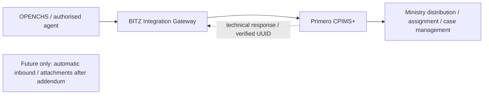

[Historical architecture diagram](assets/d1-v2.8/media/image16.png) retained for evidence only; it does not define current initial delivery.

#### K.1.3 Diagram B — Referral sequence

*Proposed Architecture – Subject to Technical Validation.* Operation names are from the upstream API v2 documentation (Annex B); the Lesotho operation sequence is confirmed by Primero (Isaiah Amutavi Osotsi) (API-003).

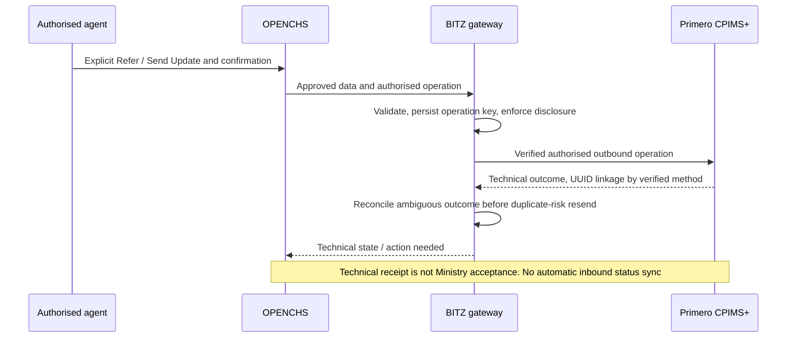

[Historical architecture diagram](assets/d1-v2.8/media/image17.png) retained for evidence only; it does not define current initial delivery.

#### K.1.4 Diagram C — Technical integration

*Proposed Architecture – Subject to Technical Validation*

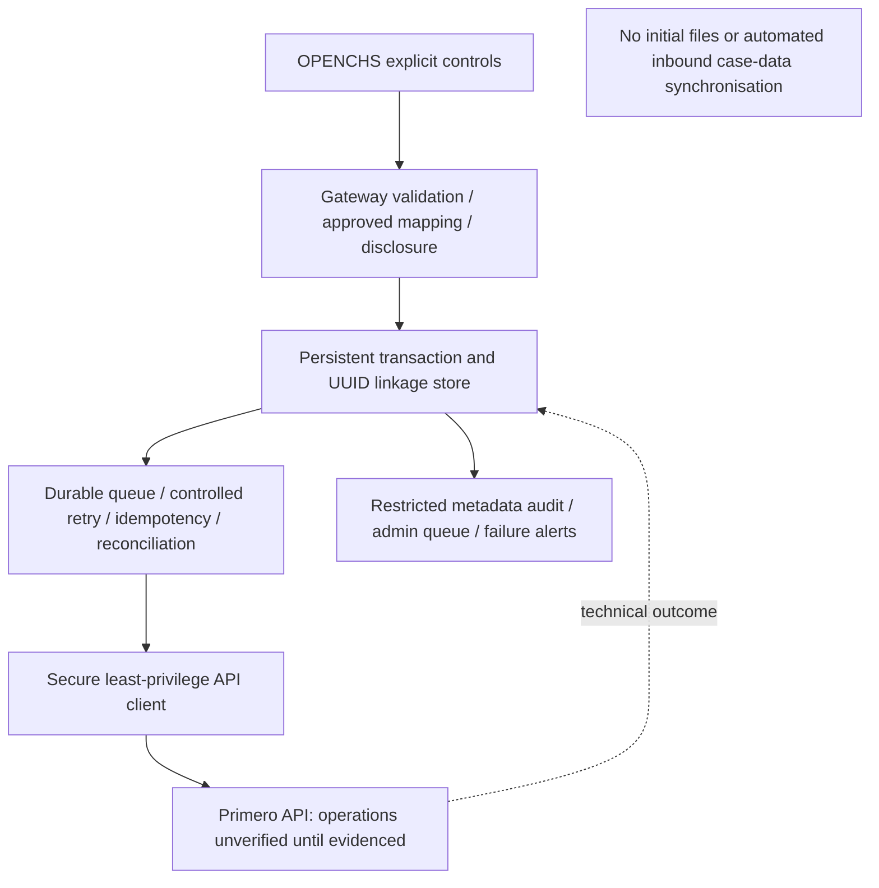

[Historical architecture diagram](assets/d1-v2.8/media/image18.png) retained for evidence only; it does not define current initial delivery.

#### K.1.5 Component summary

| **Layer** | **Proposed component** | **Evidence status** |
|----|----|----|
| Intake | OPENCHS case form with ABR field and referral control | D2 build; form engine to verify |
| Outbound | BITZ Integration Gateway with approved transformation, persistent state, queue, operation idempotency, retry, UUID linkage and reconciliation | Validated initial design; implementation framework / deployed API evidence pending |
| Authentication | Primero JWT bearer tokens; integration account | Confirmed (JWT); credentials issued by Primero (A-023) |
| Receiving system | Authorised create / referral, verified UUID linkage and explicit outbound update operations | Deployed sequence / schemas / permissions unverified; particular updates need contractual confirmation; attachment operations excluded initially |
| Return channel | Future webhook / polling / inbound reconciliation only | Pending Validation — Contract Addendum (RT-007); not an initial component or acceptance gate |
| Controls | Metadata-only audit, restricted admin queue, failure alerts and secure credentials | Validated design; retention / access approval and technical tests pending |

Before design sign-off, the BITZ developers must verify the actual OPENCHS case model, integration framework, queue, role permissions, audit facilities, deployment and secret management. The Primero technical coordinator must confirm receiving-system capabilities, service configuration and permissions. Earlier technical reference material describes referral being created automatically on case save; that conflicts with D-006 and must not be implemented.

#### K.1.6 Diagram D — Environment architecture

*Proposed Architecture – Subject to Technical Validation*

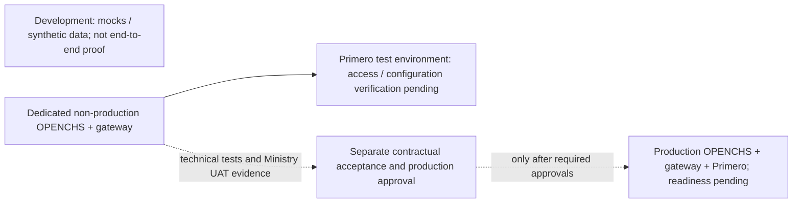

[Historical architecture diagram](assets/d1-v2.8/media/image19.png) retained for evidence only; it does not define current initial delivery.

| **Environment** | **Owner** | **Historical status (27 Oct 2026)** | **Notes** |
|----|----|----|----|
| OPENCHS development | BITZ | Internal; not shared | Mock and contract tests only; must not be described as live integration |
| OPENCHS test/UAT with API Gateway | BITZ | Being stood up; access evidence pending (API-005) | Dedicated non-production outbound client using restricted Primero credentials; readiness evidence pending |
| Lesotho CPIMS+ sandbox/demo | Primero (Isaiah), Lesotho checklist (Rantsala) | Checklist incomplete; no progress since Session 2 (A-015) | Configured from country SOPs, forms and use cases |
| Primero global playground | Primero (Isaiah) | Agreed fallback (D-018); URL and access pending (A-016) | Not Lesotho-configured; tests needing country configuration must be repeated |
| Production (both systems) | Infrastructure owners | Not confirmed (API-008) | Endpoints, credentials, certificates and rollback to define |

Current environment dependency status is in Annex F.3. The historical table does not establish current access; [M4] targeted 13 November, without guaranteeing availability. Synthetic data is the default and mocks are not end-to-end evidence.

#### K.1.7 Integration reliability and audit requirements

The supplied generic Primero API specification is reference material pending deployed compatibility checks. The release, authentication, initial outbound operation sequence, UUID linkage / reconciliation and service-to-recipient mapping require technical confirmation. Return-update mechanisms remain future addendum work, not initial dependencies. The design must address durable queuing, duplicate prevention, retries, escalation, monitoring and transaction audit without asserting that those controls have been implemented. Detailed requirements are retained in Annex J.4, J.6 and J.7; API evidence and configuration dependencies are in Annex B.

### K.2 Detailed data safeguards

The detailed data safeguards are set out in **Section 7** (data requirements and mapping, legal and policy position, information security controls, data flows and classification, matters requiring confirmation, and safeguarding requirements), with the confirmation register in Table 7.4 (DSR-01 to DSR-18). The former K.2 text duplicated the pre-revision Section 7 and has been archived in [ANNEX_K2_DETAILED_DATA_SAFEGUARDS_V2.8_ARCHIVE.md](ANNEX_K2_DETAILED_DATA_SAFEGUARDS_V2.8_ARCHIVE.md); it is superseded.

## Annex L — Historical record

This annex holds the dated historical tables and figures that were previously shown inside Sections 8–12. They are moved here unchanged so that the main sections show only the current position. Each subsection names the section it came from. Statuses, dates, owners and ratings are as recorded at the dates shown and have not been updated.

### L.1 Delivery status as at 30 October 2026 (from section 8.4)

**Historical baseline — status as at 30 October 2026**

| **Deliverable** | **Proposed date (section 8.7)** | **Status as at 30 Oct 2026** | **Evidence** |
|----|----|----|----|
| D1 | 13 Nov 2026 | Requirements substantially defined; report in draft; mapping, environment evidence and approval outstanding | This report; inventory |
| D2 | 20 Nov 2026 | Design inputs largely available (ABR format, manual trigger, narrative rule). No build or test evidence submitted to date | — |
| D3 | 11 Dec 2026 | Blocked on environment access, authentication, configured mapping and the scope decision on return updates | A-016, A-023, R-010 |
| D4 | 26 Feb 2027 | Not started; Ministry-led testing agreed (D-009); user-testing signatory to be named; no test results yet | — |

### L.2 Inputs needed before development, as recorded in the minutes (from section 8.5)

**Historical record — inputs needed before development, as recorded in the minutes.** This record is retained unchanged from earlier versions so that governance can decide how to treat the delay (R-009). It does not assign fault.

| **Input needed before development** | **When expected** | **Position recorded in the minutes** | **Effect** |
|----|----|----|----|
| Primero test system credentials and base URL | Within about a week of 9 Oct [M2]; 28 Oct under A-016 | Not ready on 8 Oct [M1 section 9]; expected within about a week on 9 Oct [M2, Risks]; no progress on 26 Oct, with access due 28 Oct under A-016 [M3 section 8] | Authentication, field mapping and live connection tests cannot start (R-001) |
| ABR ID specification: length, structure, check-digit method and at least 10 valid examples | Under A-007 | Number structure only, supplied 26 Oct; no check-digit method or examples [M3 section 9] | Interim format rule under D-014; full validation awaits A-007 (CD-05) |
| Aligned protection-concern category list (Primero) | Undertaken by Primero in Session 2 | Not held. Primero undertook to produce one aligned protection-concern list [M2 section 11] | Category mapping in the data-mapping document remains incomplete (R-003) |
| Primero field names: ABR ID field, protection-concern codes, risk levels and mandatory fields | After test-system set-up | Field set accepted by Primero on 26 Oct (D-012); configured field names not yet supplied [M3 section 5] | Connection client can be tested against a simulation only until received |
| UNICEF participation in the inception kickoff | Inception sessions | UNICEF absent from Sessions 1 and 2 [M1, Attendees; M2, Attendees]; chaired Session 3 on 26 Oct [M3] | Cross-workstream decisions on scope, schedule and X-Road deferred to Session 3 |

### L.3 Approval areas as at the source report (from section 9.3)

**Historical approval areas (as at the source report)**

| **Approval** | **Proposed approver** | **Evidence required** | **Status** |
|----|----|----|----|
| Requirements baseline (this report) | Ministry business owner and UNICEF programme owner | Written approval or comments resolved | Pending Confirmation |
| Technical design and interface agreement | OPENCHS and Primero technical authorities | Signed-off design specification | Pending Confirmation |
| Data protection and security controls | Data protection/security authority | Written confirmation of lawful basis and controls | Pending Confirmation |
| User-testing result | Ministry leads testing; signatory to be named | Signed user-testing report | Named signatory pending |
| Contract variation or schedule rebaseline | UNICEF | Written amendment or approval | Pending Confirmation |
| Go-live | Project steering authority | Go/no-go record | Pending Confirmation |

### L.4 Change log as at the source report (from section 9.7)

**Historical change log (as at the source report)**

| **Change ID** | **Change** | **Source** | **Status** |
|----|----|----|----|
| CR-01 | Two-way return updates for referred cases | D-007 | Requirement Confirmed; contract treatment Pending Confirmation |
| CR-02 | Attachments in the referral information set | D-012 | Requirement Confirmed; contract treatment Pending Confirmation |
| CR-03 | Schedule rebaseline following the missed D1 target | R-009 | Pending Confirmation |
| CR-04 | Clarify D2/D4 "save-event" wording to manual referral control | CD-03 | Proposed |

### L.5 D1 readiness assessment, 27 October 2026, and Figure 12 (from section 10.7)

**Historical assessment (27 October 2026)**

| **Area / Section** | **Required evidence** | **Document prepared / Implementation** | **Formal acceptance** | **Outstanding work** | **Owner** |
|----|----|----|----|----|----|
| Inception consultations | Minutes of sessions with key stakeholders | Completed (Sessions 1–3 minutes) | Not approved | No minutes available for 24 Sep and 14 Oct; Session 3 minutes circulation for correction (S3-N01) | BITZ |
| Business requirements | Confirmed workflow, rules, field set | Completed (Annex J, Annex A) | Not approved | Minimum information, emergency exceptions, correction/cancellation rules; SOP review | Ministry; BITZ |
| Technical requirements | System connection, authorised access, protection of information and reliable delivery | Prepared, partly Pending | Not approved | Authentication flow, sequence design, return mechanism, service interruption rules | Primero; BITZ |
| Integration architecture | Technical design | Proposed (section 6) / Not verified against environments | Not approved | Technical review and testing and sign-off | BITZ; Primero |
| Data mapping | Approved mapping baseline | Business field set Confirmed; mapping Pending / Configured definitions not received | Not approved | Service list, configured field IDs, code lists | Primero; Ministry |
| Environment setup | Access and connectivity evidence | Testing-settings table prepared / No access evidence; OPENCHS test/UAT being stood up | Not approved | A-015, A-016, API-005; successful authorised exchange of test information | Primero; BITZ |
| Work plan | Schedule aligned to contract | Baseline and recovery sequencing prepared | Not approved | Rebaseline decision | Governance |
| Risk and issue register | Maintained register | Completed (Annex G) | Not approved | Proposed P/I to be validated | BITZ |
| Decision and action registers | Maintained registers | Completed (Annexes E, F; tracker) | \- | Record receipts as they arrive | BITZ |
| Stakeholder approval | Signed approval or conditional acceptance | \- | Not started; approvers unnamed | Name approvers; circulate; resolve comments | UNICEF; Ministry |

**Figure 12 — Position against delivery gates (27 October 2026).** Gates as defined in section 8.7. This is a historical snapshot and is not updated.

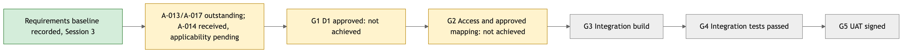

### L.6 Table 11.1a — Risk register, source assessment (October 2026) (from section 11.1)

**Table 11.1a — Historical risk register (source assessment, October 2026)**

| **Risk ID** | **Description** | **P** | **I** | **Mitigation** | **Owner** | **Status** |
|----|----|----|----|----|----|----|
| **R-001** | Sandbox and API access delay | H | H | Close checklist (A-015); access or global demonstration system (A-016); escalate if not received by 28 Oct | Rantsala / Isaiah | Open |
| **R-002** | Outstanding country documents and SOP applicability | H | H | Obtain A-013/A-017; confirm SOP applicability under A-014; record receipts | Rantsala / Hopolang / UNICEF | Open |
| **R-003** | Field and service-routing configuration incomplete | H | H | Service list (A-018); service-to-recipient configuration; mapping approval | Isaiah / Ministry | Open |
| **R-004** | Service interruption and duplicate recovery unresolved | M | H | Build the offline queue and duplicate prevention in signed item 70 [CT2]; resolve Primero-side downtime under A-021; test recovery | Nelson / Peter / Isaiah | Open |
| **R-005** | ABR verification dependency | M | M | Keep missing ABR non-blocking; A-007, A-019, A-020; interim configurable format rule (D-014); ask HMIS/EMIS teams for the check-digit method | Ministry / UNICEF / Isaiah | Open |
| **R-006** | Two-way design: disclosure risk or lost updates | M | H | Bounded feedback; reconciliation; webhook role | BITZ / Primero | Open |
| **R-007** | Privacy and authority gaps | H | H | Remaining A-017 item; A-022 desk research against the Act [DPA1]; named approvers; processing contracts | UNICEF / Ministry / Nelson | Open |
| **R-008** | Focal-person or support gaps | H | M | A-024 cover; A-002 permanent focal; named support owners | Hopolang | Open |
| **R-009** | Milestone slippage | H | H | Governance confirms D1 status; written schedule rebaseline; record missed UNICEF-facilitated dependencies (section 8.5); agree the dated timetable in section 8.7, as the signed contract has a late-submission clause [CT2 section 4] | Project governance | Open |
| **R-010** | Contract scope change (two-way, attachments) | H | H | Governance decision (section 9) | UNICEF / governance | Open |
| **R-011** | CPIMS+ consent requirement | M | H | Ministry defines consent capture and override; Primero confirms configured checks | Ministry / Isaiah | Open |
| **R-012** | Primero country go-live dependency | M | H | Primero reports Lesotho go-live plan | Isaiah / governance | Open |
| **R-013 (new)** | Service-account credentials and token renewal for the automated connection not yet supplied (method fixed by contract) | M | H | Agree how the connection signs in automatically and renews its access in A-023 working session | Isaiah / Peter / Marlon | Open |
| **R-014 (new)** | Stakeholder approval delays; approvers unnamed | H | H | Name approvers; set review window for this draft | UNICEF / Ministry | Open |
| **R-015 (new)** | Contract and plan wording on “save-event” trigger conflicts with D-006 | M | M | Governance confirms D2/D4 acceptance wording (CD-03) | Project governance | Open |
| **R-016 (new)** | Testing on the Primero global demonstration system may not be accepted as integration-test evidence | M | H | UNICEF confirms the acceptance basis; plan January tests on the Lesotho system | UNICEF / Isaiah | Open |
| **R-017 (new)** | Hosting location, processing contracts and cross-border access for child data not confirmed (DPA sections 21–22 and 52; DMP section 5.6.3) | M | H | Ministry confirms hosting and data controllers; processing contracts in place before real case data is exchanged (section 7.5) | Ministry / UNICEF / Nelson | Open |

### L.7 Approval record as at the source report (from section 12.1)

**Historical approval record (as at the source report)**

| **Approval role** | **Name** | **Decision** | **Date** |
|----|----|----|----|
| Ministry business owner | To confirm | Pending |  |
| UNICEF programme / governance owner | To confirm | Pending |  |
| OPENCHS technical authority | To confirm | Pending |  |
| Primero technical authority | To confirm | Pending |  |
| Data protection / security authority | To confirm | Pending |  |
| User-testing signatory | To confirm (CD-09) | Pending |  |
| Ministry user-testing endorsement | Representative and endorsement arrangements to confirm | Pending |  |
| Project coordination (BITZ) | Nelson Adagi | Circulation and review tracking pending |  |

### L.8 Immediate actions, status as at 28 October 2026 (from section 12.2)

**“Overdue” indicates that the due date has passed and completion has not yet been confirmed to BITZ**.

All 22 entries are retained with their original wording, owners, dependencies, dates and statuses (APR-004).

| **Action** | **Responsible party** | **Dependency** | **Required by** | **Status** |
|----|----|----|----|----|
| A-013 Share national referral pathways | Rantsala (UNICEF) | — | 26 Oct 2026 | Overdue — not yet received |
| A-015 Complete test system checklist; post-meeting call | Rantsala, Isaiah | — | 26 Oct 2026 | Overdue — outcome not recorded |
| A-017 Share privacy materials | Lekhanya (UNICEF) | — | 26 Oct 2026 | Partly received 29 Oct 2026 (Data Protection Act; draft Data Management Policy); earlier Ministry work overdue |
| S3-N01 Circulate Session 3 minutes | BITZ | — | 26 Oct 2026 | Overdue — circulation not confirmed |
| A-014 Resend case-management SOPs | Hopolang | — | 27 Oct 2026 | Received; applicability review pending [SOP1] |
| A-020 Share Berea workshop use cases | Melusi | — | 27 Oct 2026 | Due 27 October — not yet received |
| A-024 Name helpline leave cover | Hopolang | — | 27 Oct 2026 | Due 27 October — not yet confirmed |
| S3-N02 One-to-one follow-ups | BITZ | — | 27 Oct 2026 | Due 27 October — outcome not recorded |
| A-016 Provide test system or global demonstration system access | Isaiah | A-015 | 28 Oct 2026 | Pending |
| A-018 Confirm CPIMS+ service list | Isaiah | — | 28 Oct 2026 | Pending |
| A-021 Agree service interruption handling | Nelson, Peter, Isaiah | — | 28 Oct 2026 or during testing | Pending; proposals in section 6 |
| A-022 Data protection desk research | Nelson | A-017 | 28 Oct 2026 | In progress |
| A-025 Deliver initial draft inception report | Nelson / BITZ | — | 28 Oct 2026, close of business | Draft prepared; circulation pending |
| A-023 Configure API authentication; start test calls | Peter, Marlon | A-016 | After A-016 | Awaiting dependency |
| A-019 Invite BITZ to Primero/X-Road sessions | Lekhanya (UNICEF), Isaiah | — | Next session; date not recorded | Pending |
| A-002 Confirm permanent Child Helpline focal person | Hopolang | — | Not restated | Carried over |
| A-007 Remaining ABR verification rules | Ministry / relevant authority | A-019, A-020 | Not restated | Carried over |
| P-01 Define two-way update contract | OPENCHS / Isaiah / Ministry | R-010 | To agree | Proposed |
| P-02 Complete the agreed data mapping between the two systems | OPENCHS / Isaiah / Ministry | A-016, A-018 | To agree | Proposed |
| P-03 Confirm UNICEF action owners | UNICEF | — | To agree | Proposed |
| New — Name approvers for D1 | UNICEF, Ministry | — | Before formal review | Proposed |
| New — Governance decision on scope and schedule | UNICEF, Ministry | — | Before D3 design sign-off | Proposed |

*Chronology note.* The table is headed "status as at 28 October 2026", but the A-017 entry records partial receipt on 29 October 2026. Both are retained as recorded. The discrepancy is flagged for editorial clarification: either the table was updated after 28 October, or the heading date needs qualification.
