**DELIVERABLE D1 · INCEPTION, REQUIREMENTS & ENVIRONMENT SETUP**

# Inception Report

Lesotho Child Helpline 116 — OPENCHS and Primero CPIMS+ Integration

|  |  |
|----|----|
| **PREPARED FOR** | UNICEF Lesotho; Ministry of Gender, Youth and Social Development (MGYSD); Child Helpline 116; Primero technical team |
| **PREPARED BY** | BITZ IT Consulting Ltd — OPENCHS project team |
| **CONTRACT** | 43427866, Amendment 3 (signed 15 September 2026) — contract item 50 |
| **VERSION** | 2.9 — Final Draft for Stakeholder Approval |
| **DATE** | 10 November 2026 |
| **STATUS** | Final draft submitted for stakeholder approval — not yet approved |

|  |  |
|----|---:|
| **BITZ IT Consulting Ltd** | Version 2.9 — Final Draft for Stakeholder Approval · 10 November 2026 |

## Document control

| **Item** | **Detail** |
|----|----|
| Project | Lesotho Child Helpline 116 / OPENCHS integration with Primero CPIMS+ |
| Contract | Contract 43427866, Amendment 3 [CT2], signed by UNICEF and BITZ on 15 September 2026. It adds the integration as contract items 50–80 and is the governing contractual source for this report |
| Deliverable | D1 — Inception, Requirements & Environment Setup (contract item 50) |
| Prepared for | UNICEF Lesotho; Ministry of Gender, Youth and Social Development (MGYSD); Child Helpline 116 stakeholders; Primero technical team |
| Prepared by | BITZ IT Consulting Ltd, OPENCHS project team |
| Version and status | 2.9 — Final Draft for Stakeholder Approval |
| Date | 10 November 2026 |
| Supersedes | Version 2.8 (Post-Validation Revision), 9 November 2026 |

### Version history

| **Version** | **Date** | **Summary** |
|----|----|----|
| 2.7 | 30 October 2026 | Draft circulated to Session 3 participants for review |
| 2.8 | 9 November 2026 | Revision incorporating the D1 validation meeting of 4 November 2026 and the project decisions recorded on 9 November 2026 |
| 2.9 | 10 November 2026 | Consolidated final draft for stakeholder approval: structure simplified, repetition removed, historical records moved to supporting files, all decisions and open items stated once |

### Document status and approval

This report records four different kinds of position, and the distinction matters for approval:

- **Stakeholder validation:** requirements and approaches reviewed and agreed by the project stakeholders, principally at the inception sessions of 8, 9 and 26 October 2026 and the D1 validation meeting of 4 November 2026 [M3; M4].
- **Project confirmation:** positions confirmed by the responsible party and recorded in the BITZ project record of 9 November 2026 [PR1], including Primero's technical confirmations and the Ministry roles and safeguarding positions set out in Sections 6, 7 and 9.
- **Technical verification:** evidence produced by testing against the configured Lesotho Primero environment. No integration has yet been verified in this way.
- **Formal approval and contractual acceptance:** a written decision by an authorised approver. Nothing in this report has yet been formally approved, and D1 has not yet been accepted.

The record of the 4 November meeting [M4] is a draft. A technical design choice, or agreement in a meeting, is not a variation of the signed contract; any variation requires a written amendment signed by UNICEF [CT2 general terms, article 11.9].

Items still awaiting a decision or evidence are **highlighted** in this report and listed together in Section 11.3.

### Contents

- [1 Executive summary](#1-executive-summary)
- [2 Project background and objectives](#2-project-background-and-objectives)
- [3 Inception activities and key findings](#3-inception-activities-and-key-findings)
- [4 Agreed scope and deliverables](#4-agreed-scope-and-deliverables)
- [5 Business requirements and referral workflow](#5-business-requirements-and-referral-workflow)
- [6 Technical integration approach](#6-technical-integration-approach)
- [7 Data protection and safeguarding](#7-data-protection-and-safeguarding)
- [8 Implementation plan and milestones](#8-implementation-plan-and-milestones)
- [9 Governance and responsibilities](#9-governance-and-responsibilities)
- [10 Testing, acceptance and handover](#10-testing-acceptance-and-handover)
- [11 Risks, dependencies and outstanding decisions](#11-risks-dependencies-and-outstanding-decisions)
- [12 Conclusions and approval](#12-conclusions-and-approval)
- [Annexes](#annexes)

## 1 Executive summary

### 1.1 Purpose

This report is Deliverable D1 (Inception, Requirements and Environment Setup), contract item 50 of Contract 43427866, Amendment 3 [CT2]. It sets out what the inception phase established about integrating the Lesotho Child Helpline 116 case system (OPENCHS) with the Ministry's child-protection case-management system (Primero CPIMS+): the agreed requirements, the selected technical approach, the safeguarding arrangements, the delivery plan and the decisions still needed. It is submitted for review and approval by UNICEF Lesotho and the Ministry of Gender, Youth and Social Development (MGYSD).

Approval of D1 confirms the requirements and design baseline. It does not mean that development, testing, user acceptance or deployment has taken place; those are delivered and accepted under D2–D4 (contract items 60–80).

### 1.2 Inception work completed

Between 24 September and 4 November 2026 the project held an inception meeting, three structured requirements sessions (8, 9 and 26 October), a written technical exchange with the Primero team, and a D1 validation meeting with UNICEF, the Ministry, the Child Helpline and BITZ (4 November). It reviewed the signed contract, the technical scope brief, the Primero API documentation, the Ministry's 2019 case-management SOP, the Data Protection Act and the draft Data Management Policy. Eighteen business decisions (D-001 to D-018) and a 68-item requirements baseline resulted (Section 3).

### 1.3 Principal findings

- Child Helpline agents currently refer cases to the Ministry through manual channels and generally see only "referred" and "closed". An electronic referral link is needed to remove re-keying, make delivery traceable and support follow-up.
- The stakeholders agreed that referrals must be initiated manually and deliberately by an agent; saving a case must never send it.
- The Ministry controls distribution, acceptance, assignment and case management inside CPIMS+; the helpline selects only the CPIMS+ service.
- The signed contract describes an **outbound** API client (item 70). Session 3 also recorded a business wish for two-way updates and attachments (D-007, D-012). The initial design delivers outbound referral and explicit outbound updates only; the two-way and attachment requests require a written contractual decision (Section 4.5).
- Country readiness depends on the Lesotho Primero test environment, integration credentials, the CPIMS+ service list and the configured field identifiers, all due from Primero by 13 November 2026 (Section 8).

### 1.4 Selected architecture and initial scope

The integration uses BITZ's own gateway: **OPENCHS → BITZ Integration Gateway → Primero CPIMS+ API**. OpenFN and X-Road are not used.

An authorised agent creates a referral in OPENCHS, selects the CPIMS+ service and confirms. The gateway validates and maps the approved data, sends it to Primero (**Create Referral**) and stores the CPIMS+ case identifier (UUID). Later information is sent through a separate, explicit **Send Update** against that UUID. The gateway handles JWT authentication, the persistent queue, duplicate prevention, retries, reconciliation of uncertain outcomes and audit logging. A technical acknowledgement from Primero is never shown as Ministry acceptance.

The initial scope excludes automatic inbound status or intervention updates, attachments and call recordings, and transfer of the helpline case plan.

### 1.5 Safeguarding approach

Only the minimum necessary child-protection information is sent. Consent is captured during the call; where it cannot be obtained or is refused, a referral may proceed on the child-protection (vital interest) basis with supervisor authorisation. Emergency referrals carry the child's details and a narrative, kept to the minimum, and urgent cases are still telephoned to police or first responders in parallel. The Ministry is data controller and BITZ is processor. Testing uses synthetic data only, and real child data is exchanged only after the Ministry's written production authorisation (Section 7).

### 1.6 Milestones and key dependencies

| **Deliverable** | **Agreed date** |
|----|----|
| D1 — Inception report (this document) | 13 November 2026 |
| D2 — ABR ID field, checks and referral control | 20 November 2026 |
| D3 — Outbound REST API client | 11 December 2026 |
| D4 — Testing, UAT, training and go-live | 26 February 2027 |

These dates were agreed at the D1 validation meeting [M4]. The contract itself states no due dates and ends on 7 July 2027. The critical dependency is Primero's delivery of the Lesotho test environment, credentials, service list and field identifiers by 13 November 2026 (gate G2); D3 cannot be verified without them.

### 1.7 Decisions requiring stakeholder action

The decisions that most affect delivery are:

1. **UNICEF:** written contractual disposition of the historical two-way update and attachment requirements against the outbound-only initial design.
2. **Ministry:** the operational route by which a Ministry rejection in CPIMS+ is communicated back to the helpline.
3. **Ministry:** rules for correction, cancellation, withdrawal and re-referral, and the reporter-anonymity disclosure rules.
4. **Ministry:** confirmation of the proposed 24-month retention period and the security-incident notification procedure.
5. **Ministry / relevant authority:** the official ABR ID validation rules.

The full register is in Section 11.3.

### 1.8 D1 approval status

The report is ready for stakeholder approval. Approvers are confirmed for UNICEF, the Ministry, OPENCHS and Primero (Section 12.4). D1 is submitted for full acceptance; the remaining open items are owned and tracked to closure through Section 11.3 and Annex E and are not conditions of D1 acceptance. No written approval has yet been received.

## 2 Project background and objectives

### 2.1 Operational context

Child Helpline 116 operates a single call centre in Lesotho. Agents receive calls, record contacts and cases in OPENCHS, and decide whether a case needs referral to the Ministry, which carries out child-protection case management in Primero CPIMS+ [M2 sections 5–6]. Referrals currently travel by manual channels, and the helpline has little visibility of what happens next.

For urgent cases, such as active abuse or an abandoned child, agents telephone the police or first responders directly. That emergency route continues unchanged; an electronic referral never replaces or delays it [M1 section 8; WF-007].

### 2.2 The two systems and the gateway

| **System** | **Owner / operator** | **Role in the integration** |
|----|----|----|
| OPENCHS | Child Helpline 116; maintained by BITZ under the existing support-and-maintenance contract | Records cases; captures the referral information and optional ABR ID; provides the explicit "Refer to CPIMS+" control and the Send Update action; shows technical delivery status |
| BITZ Integration Gateway | BITZ | Authenticates to Primero; maps approved data; queues, retries and de-duplicates operations; stores the CPIMS+ UUID; reconciles uncertain outcomes; keeps the audit record |
| Primero CPIMS+ | Ministry; Primero technical coordination by Isaiah Amutavi Osotsi | Receives referrals; Ministry users accept or reject, distribute, assign and manage cases within the Ministry workflow |

The referral connection is separate from any Home Affairs identity-verification work; X-Road is not part of the referral path.

### 2.3 Objectives and expected outcomes

**Overall objective:** to strengthen referral coordination for Child Helpline 116 by establishing reliable, traceable electronic outbound referral exchange between OPENCHS and Primero CPIMS+, supported by testing, Ministry-led user acceptance, training, deployment and handover [CT2; TB section 1].

The expected outcomes of the initial integration are:

- consistent electronic referral submission aligned with the applicable SOP and national pathways;
- less duplicate data entry, because agreed referral information is transmitted rather than re-keyed;
- technical delivery tracking and an audit trail for every referral and update;
- Ministry-controlled distribution of referrals inside CPIMS+.

Returning Ministry decisions and case progress automatically to OPENCHS, attachment exchange and direct routing to external service providers are not outcomes of the initial integration (Section 4).

The specific objectives of D1 were to validate the referral lifecycle, the information set and mapping approach, the ABR ID rules, the technical environment, the reliability design, the UAT approach, and the delivery plan and registers.

### 2.4 Contractual scope and deliverables

Contract 43427866, Amendment 3, signed on 15 September 2026, is the governing instrument. It amends the OPENCHS support-and-maintenance contract that began on 10 March 2025, adds the integration as items 50–80, and takes effect on UNICEF's receipt of the countersigned copy [CT2 contractual provisions, clause 2.1]. The contract is valid until **7 July 2027**: its operative clause provides that it expires on satisfactory completion of the services "but not later than 07 Jul 2027" [CT2].

**Table 2.1 — Contract deliverables**

| **Deliverable and item** | **Signed activity description [CT2]** | **Agreed date** | **Evidence for acceptance** |
|----|----|----|----|
| D1 — item 50 | Inception, Requirements & Environment Setup (incl. in-country Trip 1: Inception Workshop, Maseru) | 13 Nov 2026 | Approved inception report |
| D2 — item 60 | ABR ID Field + Validation Rules & Referral Checkbox UI | 20 Nov 2026 | Demonstrated optional ABR field and checks; explicit referral control; unit-test evidence |
| D3 — item 70 | Outbound REST API Client (JWT auth, retry logic, offline queue, idempotency, audit logging) | 11 Dec 2026 | Working outbound client verified against the agreed specification; simulated and Lesotho evidence identified separately |
| D4 — item 80 | Testing, UAT, In-Country Operator Training & Go-Live (incl. in-country Trip 2: Training & Handover, Maseru) | 26 Feb 2027 | Signed UAT, training and handover evidence; go-live authorisation |

The in-country inception workshop (Trip 1) was replaced by the virtual inception sessions of 8, 9 and 26 October and 4 November 2026 [PR1]. Trip 2 (training and handover) is planned for February 2027.

The report's title for D2, "ABR ID Field, Checks & Referral Checkbox UI", is retained for continuity. The signed wording governs; the "checkbox" is implemented as an explicit "Refer to CPIMS+" action, because saving a case must never send a referral (D-006).

**Post-go-live support** is provided under the existing OPENCHS support-and-maintenance provisions, including troubleshooting and remote support, minor updates and bug fixing, and a response to support calls within 24 hours [CT2 sections 2.2–2.4]. This report introduces no new warranty, service level or support period.

### 2.5 Contractual matters affecting delivery

The full register of contractual discrepancies (CD-01 to CD-17) is in Annex E. The matters still affecting implementation or acceptance are:

**Table 2.2 — Live contractual matters**

| **Ref.** | **Matter** | **Position** |
|----|----|----|
| CD-01, CD-04 | The signed scope is an outbound client; Session 3 recorded two-way updates and attachments as business needs (D-007, D-012) | Outbound-only initial design adopted. [Pending: written UNICEF disposition]{.mark} of the two-way and attachment requirements before D3 acceptance (Section 11.3, OD-01) |
| CD-03 | The signed D2 wording refers to a "referral checkbox"; the agreed rule is an explicit referral action | [Pending: UNICEF confirmation]{.mark} that the explicit action satisfies the D2 and D4 wording (OD-12) |
| CD-05 | The official ABR validation specification has not been supplied | Optional ABR with structural checks only; [official rules pending]{.mark} (OD-09) |
| CD-12 | Proposed fault thresholds and UNICEF's contractual acceptance authority | Thresholds agreed (Section 10.4); UNICEF retains its right under the contract to withhold payment for unsatisfactory or incomplete work [CT2 section 4] |
| CD-15, CD-17 | No due dates are stated in the signed activity descriptions; the contract has a late-submission clause (10% reduction at 20 days, 20% at one month, 30% at two months, withholding beyond two months) | Delivery dates agreed at the validation meeting (Table 2.1). The clause applies to those dates; dependency delays are recorded and handled through change control (Section 9.5) |

## 3 Inception activities and key findings

### 3.1 Consultations

**Table 3.1 — Inception consultations**

| **Date** | **Activity** | **Participants** | **Main outcomes** |
|----|----|----|----|
| 24 Sep 2026 | Inception meeting | Project stakeholders (no minutes available) | Technical scope brief presented [TB] |
| 2 Oct 2026 | Written technical questions to Primero | BITZ; Primero | API reference, token-based authentication, credential set-up by Primero and test-data approach [TR1] |
| 8 Oct 2026 | Session 1 — business and workflow | BITZ; Primero; Ministry IT and CPIMS focal person; Child Helpline supervisor and social workers | Manual trigger; referral information; optional ABR ID [M1] |
| 9 Oct 2026 | Session 2 — technical architecture | BITZ; Primero; Ministry | Service-based routing; case plan not shared; CPIMS+ referral demonstration; decisions D-001 to D-004 [M2] |
| 26 Oct 2026 | Session 3 — closing requirements | UNICEF (chair); Ministry; Primero; BITZ | Decisions D-005 to D-018; actions A-013 to A-025 [M3] |
| 4 Nov 2026 | D1 validation meeting | UNICEF (chair); Ministry IT and child protection; Child Helpline; BITZ (Primero absent) | Outbound-first approach; Ministry distribution; consent capture; approvers named; working timetable agreed [M4, draft] |
| 9 Nov 2026 | Project confirmations | BITZ report owner, recording confirmations from the responsible parties | Primero technical confirmations; Ministry roles; safeguarding positions; agreed thresholds [PR1] |

A technical progress meeting with Primero was scheduled for 10 November 2026, with weekly technical meetings and fortnightly full-group meetings thereafter [M4].

**Documents reviewed:** the signed contract [CT2]; the technical scope brief [TB]; the Session 1–3 minutes, action tracker and transcript; the Primero technical response [TR1] and API v2 documentation (release v2.16.0) [PA]; the annotated requirements checklist [RC1]; the Ministry's September 2019 case-management SOP and Form 4 [SOP1]; the Data Protection Act, 2011 [DPA1]; and the draft Data Management Policy [DMP1]. The source register is Annex G.

### 3.2 Key findings

**Business workflow.** Referral is a deliberate agent action on an existing case (D-006). The agent selects a Ministry-approved CPIMS+ service; the Ministry distributes and assigns (D-008). The reporter may remain anonymous, but the child must be identifiable (D-010, D-011). A narrative is required at referral but not when a case is first saved (D-013). The ABR ID is optional and never blocks a referral (D-005, D-014). Technical receipt is distinct from the Ministry's human decision (D-016). UAT is led by the Ministry (D-009).

**Country documents.** The 2019 SOP is confirmed as the applicable SOP for the referral workflow, and its Form 4 is the unified national referral form; its fields inform the mapping [SOP1; PR1]. The SOP's confidentiality guidance provides for exceptions, including emergencies. The separate national referral pathways have not yet been received (A-013).

**Technical.** Primero has confirmed JWT authentication for the integration account, the operation sequence and the behaviour of the deployed API, test-environment access and the service list [PR1]. Upstream documentation describes 60-minute bearer tokens and conflict detection for client-supplied identifiers; how the Lesotho deployment returns the case UUID and handles duplicates is verified during integration testing.

**Legal.** The Data Protection Act, 2011 (Act No. 5 of 2012) applies. The draft Data Management Policy, awaiting Cabinet approval, records that the Data Protection Commission had not yet been established [DMP1 section 4.1.2]; this affects how incidents and processing are notified (Section 7).

**Scope.** Two-way updates (D-007) and attachments (D-012) were recorded as business needs in Session 3, but the signed contract provides for an outbound client. The 4 November meeting supported an outbound-first approach (Section 4).

### 3.3 Requirements baseline

The baseline contains 68 requirements in eight categories, each with one current classification (Annex A). Eleven further traceability records from earlier versions are kept in Annex A.9 and are not counted.

**Table 3.2 — Requirements by category and classification**

| **Category** | **Confirmed — validated** | **Confirmed — contractual** | **Pending Primero technical validation** | **Pending Ministry approval** | **Contract addendum** | **Pending governance confirmation** | **Total** |
|----|----|----|----|----|----|----|----|
| A.1 Business and workflow | 10 | 0 | 0 | 2 | 0 | 0 | 12 |
| A.2 Functional | 10 | 1 | 0 | 0 | 1 | 0 | 12 |
| A.3 Data and field | 7 | 0 | 3 | 2 | 1 | 0 | 13 |
| A.4 Integration and interoperability | 6 | 1 | 0 | 0 | 1 | 0 | 8 |
| A.5 Security and privacy | 5 | 0 | 0 | 2 | 1 | 0 | 8 |
| A.6 Operational and reliability | 1 | 3 | 0 | 0 | 0 | 1 | 5 |
| A.7 Reporting, audit and monitoring | 1 | 2 | 0 | 0 | 1 | 0 | 4 |
| A.8 UAT and acceptance | 5 | 0 | 0 | 0 | 0 | 1 | 6 |
| **Total** | **45** | **7** | **3** | **6** | **5** | **2** | **68** |

**Figure 3.1 — Requirements baseline by classification (68 requirements).** Classification records the decision position, not implementation progress.

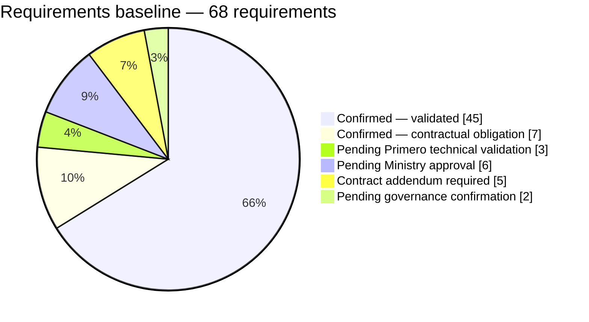

The five addendum-dependent requirements — FN-010, RT-007, SEC-008, AUD-003 and DATA-010 — cover automatic inbound updates and attachments; they are retained for traceability and are not part of the initial delivery.

### 3.4 Information still required

The inputs still needed for implementation are listed with their owners in Section 8.4 and Annex E. In summary: the integration credentials, CPIMS+ service list, configured field identifiers and protection-concern list (Primero, by 13 November 2026); the national referral pathways (A-013); the official ABR validation rules (A-007); and the Ministry decisions in Section 11.3.

## 4 Agreed scope and deliverables

### 4.1 Scope matrix

**Table 4.1 — Initial scope**

| **Category** | **Content** | **Basis** |
|----|----|----|
| **Included** | Manual, agent-initiated referral with confirmation; CPIMS+ destination and Ministry-approved service selection; validation of the approved referral data; optional ABR ID with structural checks; secure outbound **Create Referral**; storage of the CPIMS+ UUID; explicit outbound **Send Update** against the UUID; technical acknowledgement and status display; persistent queue, retries, duplicate prevention and reconciliation; security controls and metadata-only audit; restricted monitoring and alerts; integration, security, regression and Ministry-led user acceptance testing; training, deployment and handover | [CT2 items 50–80]; D-005, D-006, D-008, D-010–D-016; SCOPE-001, SCOPE-005, SCOPE-006 |
| **Excluded** | Automatic inbound status or intervention updates (including polling and webhooks); electronic transfer of attachments, documents, photographs or call recordings; transfer of the helpline case plan; direct electronic routing to external service providers; selection of Ministry caseworkers by helpline agents; automatic closure of CPIMS+ cases by OPENCHS; live NICR / Home Affairs identity verification; OpenFN and X-Road | SCOPE-002–SCOPE-005; D-012 (case plan) |
| **Requiring written disposition** | The historical two-way update requirement (D-007) and the attachment requirement (D-012), against the outbound-only design | CD-01, CD-04; P-01; R-010 — [pending UNICEF]{.mark} (OD-01) |
| **External dependencies** | Lesotho test environment and credentials; CPIMS+ service list and field identifiers; protection-concern list; national pathways; official ABR rules; Ministry decisions in Section 11.3 | Section 8.4 |

A limited, non-sensitive indication that supporting material exists may be sent only if the Ministry approves the disclosure, it is necessary for the referral, Primero supports the field, no sensitive file detail is exposed, and the mapping and security controls are validated (SCOPE-003). Until all five conditions are evidenced, the field is omitted.

The excluded items are not presented as a committed future phase. Any of them would require a change request (Section 9.5) and, where the contract is affected, a signed amendment before work begins.

### 4.2 Contribution of each deliverable

**Table 4.2 — Deliverables and initial scope**

| **Deliverable** | **Initial-scope content** |
|----|----|
| D1 (item 50) | Requirements and scope baseline; design and mapping approach; environment assessment; plan; registers |
| D2 (item 60) | Optional ABR ID with structural checks; explicit "Refer to CPIMS+" control with destination, service selection and confirmation; validation and status display |
| D3 (item 70) | Outbound REST API client through the BITZ gateway: JWT authentication, retry logic, offline queue, idempotency, audit logging, Create Referral and Send Update |
| D4 (item 80) | Testing, Ministry-led UAT, operator and technical training, deployment, go-live and handover |

### 4.3 Responsibilities

**Table 4.3 — Responsibilities by party**

| **Party** | **Responsibilities** |
|----|----|
| BITZ | OPENCHS referral functionality; the BITZ Integration Gateway; mapping and transaction processing; gateway reliability, monitoring and technical support under the existing contract; technical test evidence; training and handover; change-impact assessments |
| Primero technical team | Primero API and platform; Lesotho test and production environments; integration-account credentials and permissions; configured field identifiers and service codes; platform-side verification and support |
| Ministry (MGYSD) | Service catalogue; referral, safeguarding and disclosure rules; routing, acceptance and caseworker assignment in CPIMS+; Ministry-led UAT and its sign-off; production authorisation for real data; operational support and escalation (Hopolang Mosena responsible) |
| Child Helpline 116 | Validation of the agent workflow; participation in UAT, including a Child Helpline supervisor; operational monitoring of referrals; first-line escalation |
| UNICEF Lesotho | Contract administration; coordination; contractual acceptance of D1–D4; approval of any contract variation |

### 4.4 Boundaries within the included scope

- **ABR ID.** Optional; a blank value never blocks a referral. An entered value is checked for 12 digits, a first digit of 0 or 1, and a seventh digit of 1 (male) or 2 (female); a sex-digit mismatch produces a warning that an authorised user can override, with the override audited. These checks do not verify that the identifier exists.
- **Send Update.** Covers supplementary information, completion of partial referrals, corrections and permitted lifecycle requests. Primero has confirmed the operation sequence [PR1]; the Ministry rules for corrections, cancellations, withdrawals and re-referrals are [still to be confirmed]{.mark} (OD-03).
- **Reconciliation.** Where the gateway must establish the outcome of its own operation, a narrowly authorised check is permitted. This is not case reading or status synchronisation.

### 4.5 Scope requiring written disposition

The outbound-only design is the selected technical approach. It has not been recorded as a contract variation. UNICEF's written disposition is needed on how the historical two-way update requirement (D-007) and attachment requirement (D-012) are treated — for example, recorded as outside the current contract, or deferred to a future addendum with agreed effort, phase and acceptance evidence. Until then, these requirements are retained for traceability and are not acceptance criteria for the initial delivery. The initial delivery is not rejected for lacking them, and their exclusion does not waive any signed obligation.

## 5 Business requirements and referral workflow

### 5.1 Referral workflow

**Figure 5.1 — Referral workflow.** Electronic referral runs alongside, never instead of, the emergency telephone route.

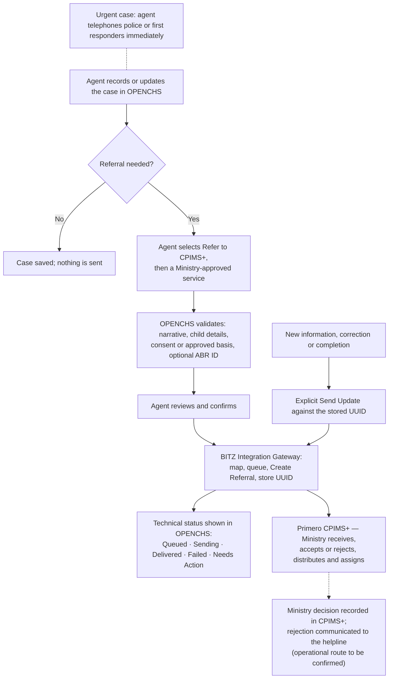

The workflow, from referral preparation to Ministry case handling, is:

1. **Case recording.** The agent records the contact and creates or updates the OPENCHS case. The narrative need not be complete when the case is first saved. Saving or updating a case never sends a referral.
2. **Referral initiation.** The agent explicitly chooses "Refer to CPIMS+", selects Primero CPIMS+ as the destination and chooses a Ministry-approved service from the list. Supervisor consultation is optional and is recorded when it takes place. The agent never selects a Ministry caseworker.
3. **Validation.** OPENCHS checks the referral against the agreed rules (Table 5.1). Unavailable child details are never invented.
4. **Confirmation and transmission.** The agent reviews and confirms. The gateway sends the referral to Primero, records the technical outcome and stores the CPIMS+ case UUID.
5. **Ministry handling.** Authorised Ministry users receive the referral in CPIMS+, accept it or reject it with a reason, and distribute and assign it. These decisions belong to the Ministry.
6. **Follow-up.** When new information becomes available, an authorised user sends an explicit **Send Update** linked to the existing CPIMS+ case. An update never creates a second case.

### 5.2 Rules at referral

**Table 5.1 — Referral rules**

| **Rule** | **Agreed position** | **Status** | **Reference** |
|----|----|----|----|
| Manual initiation | Submission requires an explicit referral action and confirmation; cancelling sends nothing | Confirmed | D-006; WF-002; FN-003 |
| Service selection | The agent chooses from the Ministry-approved CPIMS+ services; an inactive or invalid service blocks submission with a clear message | Confirmed; service list confirmed by Primero, delivery by 13 Nov 2026 (A-018) | D-008; RT-001, RT-002; FN-006 |
| Narrative | Required at referral, not at first save | Confirmed | D-013; FN-004 |
| Child identification | The child's details are required; available details are recorded and none is fabricated | Confirmed | D-011; FN-005; DATA-005 |
| Minimum information | The child's details and the narrative | Confirmed [M4; PR1] | DSR-06 |
| Emergency referral | The child's details and a narrative, limited to the minimum emergency information; other fields are optional and may follow by Send Update; each exception is recorded | Confirmed [PR1]; Primero mandatory-field check during mapping | D-003; WF-004 |
| Partial referral | An authorised incomplete referral is allowed; missing information is recorded and completed later by Send Update | Confirmed | WF-005 |
| Reporter anonymity | The reporter may remain anonymous; reporter identifiers are then not sent | Rule confirmed; [disclosure rules Pending Confirmation]{.mark} (DSR-07) | D-010; WF-009; DATA-008 |
| ABR ID | Optional; structural checks only (Section 4.4) | Confirmed; [official rules pending]{.mark} (A-007) | D-005, D-014; FN-001, FN-002 |
| Consent | Captured during the call and recorded; otherwise the child-protection basis with supervisor authorisation (Section 7.3) | Confirmed [PR1] | DATA-012; SEC-001 |
| Supervisor consultation | Optional by default and recorded when used | Confirmed | WF-003 |
| Emergency telephone route | Continues independently of the electronic referral | Confirmed | WF-007 |
| Case plan | Never transmitted | Confirmed | D-012; FN-011 |

### 5.3 Technical and business status

OPENCHS shows two separate kinds of status, so that technical delivery is never mistaken for a Ministry decision.

**Table 5.2 — Status categories**

| **Category** | **Values** | **Source** |
|----|----|----|
| Gateway technical status | **Queued** (stored, awaiting transmission or retry); **Sending**; **Delivered** (acknowledged by Primero, UUID recorded); **Failed** (retries exhausted or permanent failure; administrators alerted); **Needs Action** (validation error or uncertain outcome awaiting reconciliation) | The BITZ gateway |
| Ministry business status | **Pending**, **Accepted**, **Rejected**, **Ongoing**, **Closed** | Shown only where it comes from an authorised, verified source; otherwise OPENCHS shows that the business status is not confirmed |

"Delivered" never produces "Accepted". The mapping of these helpline labels to Primero's native status values is verified during integration testing (RT-006).

### 5.4 Follow-up, corrections and rejection feedback

- **Send Update** covers supplementary information, completion of partial referrals, corrections and permitted lifecycle requests. Each update references the stored UUID, has its own operation identifier and audit record, and never overwrites a Ministry decision.
- **Corrections, cancellations, withdrawals and re-referrals** preserve the link to the original case and its history. A re-referral needs a recorded reason and a new referral reference linked to the earlier one. A later finding that a call was a prank is sent as corrective information; it never closes the Ministry case automatically. The Ministry rules for each of these actions are [to be confirmed]{.mark} (OD-03).
- **Rejection feedback.** The validation meeting recorded that a rejection in CPIMS+ must reach the helpline [M4]. The initial design has no automatic inbound feed, so the Ministry's operational route for communicating a rejection to the helpline (for example, notification by the receiving officer through an agreed channel) is [to be confirmed]{.mark} by the Ministry (OD-02). Until then, OPENCHS shows the business status as not confirmed.

### 5.5 Summary of confirmed rules and Ministry decisions

| **Confirmed business rules** | **Matters for Ministry confirmation** |
|----|----|
| Manual initiation; service selection; Ministry distribution and assignment; narrative at referral; child identification; minimum and emergency information; partial referrals; optional ABR; consent and child-protection basis; optional supervisor consultation; parallel emergency telephone route; separate technical and business status; explicit Send Update | Operational route for rejection feedback (OD-02); correction, cancellation, withdrawal and re-referral rules (OD-03); reporter-anonymity disclosure rules (OD-04); recipient roles and routing configuration in CPIMS+ (OD-08) |

The detailed requirements are in Annex A.1–A.3.

## 6 Technical integration approach

### 6.1 Architecture

The integration uses a single architecture (TECH-001): **OPENCHS → BITZ Integration Gateway → Primero CPIMS+ API**. The gateway calls the Primero API directly. OpenFN is not used, and X-Road is not part of the referral path.

**Figure 6.1 — Integration architecture**

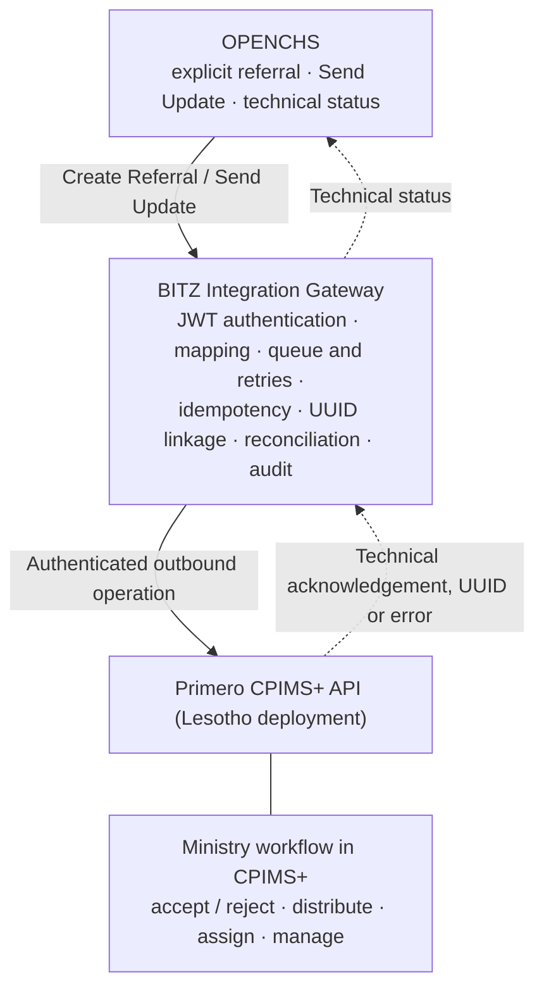

Every arrow towards OPENCHS carries only the technical response to an operation that OPENCHS started. There is no automatic inbound flow of Ministry statuses, interventions or case changes.

### 6.2 Gateway responsibilities

The BITZ Integration Gateway is responsible for:

- **Authentication:** JWT bearer tokens issued to a dedicated, least-privilege integration service account, as required by the contract [CT2 item 70] and confirmed by Primero [PR1]; token renewal is handled automatically; credentials are held in a secret store and never logged.
- **Data mapping:** transformation of the approved referral data to the configured CPIMS+ fields and service codes, enforcing the disclosure rules.
- **Transaction correlation:** a persistent link between the OPENCHS case, the referral reference, each operation and the CPIMS+ UUID.
- **Queueing and retries:** every operation is stored before transmission and survives restarts.
- **Idempotency:** a repeated operation does not create a duplicate case or update.
- **Reconciliation:** uncertain outcomes are resolved before any further creation attempt.
- **Error reporting and audit:** clear errors to users and administrators; a metadata-only audit record of every operation.

### 6.3 Create Referral and Send Update

**Figure 6.2 — Transaction sequence**

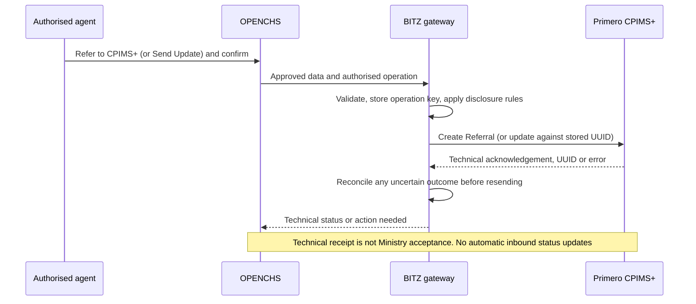

Create Referral and Send Update are distinct operations, each with its own operation identifier, idempotency key and history; both share the case linkage. The Lesotho operation sequence follows the Primero API v2 operations confirmed by Primero [PR1]; the request and response formats, and the method by which the UUID is returned or retrieved, are verified in integration testing. The upstream documentation includes a creation mode that returns no content, so the design does not assume that every response contains the UUID.

### 6.4 Reliability: failures, retries and reconciliation

**Failure classes.** A *transient* failure (for example, a network interruption or service unavailability) may be retried. A *permanent or validation* failure (invalid data, an invalid service, an unauthorised operation) is corrected, not retried. An *uncertain* outcome (for example, a timeout after submission) is not treated as a failure; it is reconciled.

**Retries.** An eligible transient failure is retried up to four times, at **1, 5, 30 and 120 minutes** after the preceding failed attempt. The intervals are configurable design parameters (TECH-004), not a contractual service level. When retries are exhausted, the operation is marked Failed, administrators are alerted and a controlled manual retry is available after duplicate checks; each manual action records the user, reason, time and result.

**Duplicate prevention.** Persistent operation identifiers and idempotency keys prevent duplicates caused by double-clicks, refreshes, network interruptions, restarts, retries or uncertain responses (OPS-003).

**Reconciliation.** Where the gateway cannot confirm whether Primero created the case, it marks the transaction unresolved, keeps its original identity, blocks any unsafe repeat, uses an authorised lookup or assisted procedure to establish the outcome, records the evidence and resumes only when safe.

### 6.5 Audit logging and monitoring

The gateway keeps a transaction ledger recording, for each operation: the OPENCHS case and referral references; the operation identifier, type and idempotency key; the CPIMS+ UUID once confirmed; the selected service; status and timestamps; the attempt history; a sanitised response or error class; the initiating user; and the reconciliation outcome. Audit records cover initiation, confirmation, submission, acknowledgement, failure and retry, manual intervention, reconciliation, updates and configuration changes. They never contain narratives, full payloads, tokens or passwords, and they are protected by role-based access and tamper-evident storage.

Monitoring covers gateway availability, queue processing, failed operations, retry exhaustion, unresolved submissions, missing UUID linkage and the reconciliation backlog. Responsibilities and escalation are defined in the operational runbook (Section 9.4).

### 6.6 Environments

**Table 6.1 — Environments**

| **Environment** | **Use** | **Limitation** |
|----|----|----|
| BITZ development | Component development, unit tests and simulated integration with synthetic data | Simulations are not end-to-end evidence |
| OPENCHS test | OPENCHS referral functions, status display, Send Update, permissions and errors | OPENCHS side only until connected to Lesotho CPIMS+ |
| Lesotho CPIMS+ test | Country-specific integration verification: connectivity, credentials, authentication, service codes, field mappings, Create Referral, Send Update, UUID handling, permissions, errors and reconciliation | Access confirmed by Primero; delivery due by 13 November 2026 (G2) |
| Primero global demonstration | Preliminary technical tests only, if Lesotho access is delayed | Not a substitute for Lesotho verification or acceptance |
| Joint UAT | Ministry-led business validation with approved synthetic cases | Critical and High defects resolved before go-live |
| Production | Live operation | Requires Lesotho verification, security and safeguarding approvals, UAT sign-off, training and a written go/no-go decision |

Synthetic data is used in every non-production environment. Real child data is never used in testing.

### 6.7 Technical verification requirements

The following are verified on the Lesotho test environment before D3 is accepted, and each produces recorded evidence (Annex B):

- authenticated access with the integration account, including token renewal;
- Create Referral with the configured field identifiers and service codes;
- the method by which the CPIMS+ UUID is returned or retrieved;
- Send Update against an existing case, for each permitted update type;
- error codes, timeouts and response behaviour;
- duplicate behaviour and the authorised reconciliation lookup;
- transport security (HTTPS with TLS 1.2 or higher, proposed), network allow-listing and secret storage.

## 7 Data protection and safeguarding

### 7.1 Legal and policy framework

The Data Protection Act, 2011 (Act No. 5 of 2012) [DPA1] applies. The provisions most relevant to the integration, as read by BITZ for planning purposes, are those on children's and sensitive information (sections 29, 34 and 36), lawful grounds (section 15), minimal information and compatible purpose (sections 16 and 18), retention (section 19), security safeguards (section 20), processing on behalf of a controller (sections 21–22), notification of security compromises (section 23), notification of processing (sections 25(5) and 53) and transfers outside Lesotho (section 52). The draft Data Management Policy [DMP1] adds direction on government hosting, cross-border sharing and data classification; it awaits Cabinet approval and is treated as policy direction, not law. The signed contract assigns data ownership to UNICEF and the designated government ministries and requires confidentiality [CT2 sections 3.1–3.2].

This is a planning analysis, not legal advice. [Legal confirmation of the applicable requirements by the Ministry and UNICEF legal advisers is Pending Confirmation]{.mark} (DSR-01).

### 7.2 Roles

The **Ministry** is data controller for CPIMS+ and the helpline data. **BITZ** is processor for OPENCHS and the gateway under the existing contract. Existing hosting arrangements are unchanged, and remote support follows the existing support contract [PR1] (DSR-04, DSR-05, DSR-09). Tiisetso Mohlabi is the Ministry's data-protection and security authority (DSR-12).

### 7.3 Consent, lawful basis and emergencies

- **Consent** is captured during the call: the agent explains that information will be shared with another organisation to help the child, asks whether that is acceptable and records the answer as Given, Declined, Withdrawn or Not Obtainable [M4 section 1].
- **Child-protection basis.** Where consent cannot be obtained or is refused, a referral may proceed on the child-protection (vital interest) basis with supervisor authorisation, which is recorded [PR1] (DSR-02, DSR-03).
- **Withdrawal** is recorded with an audit trail rather than by deleting the record. It stops further updates but does not recall referrals already sent.
- **Emergencies.** The emergency referral carries the child's details and a narrative, limited to the minimum emergency information; the urgent telephone escalation proceeds without waiting for electronic submission. An emergency does not authorise unrestricted disclosure.

### 7.4 Data minimisation and information security

Only the approved, necessary fields are sent: child identity and demographics, location and contact details, case category and narrative, reporter details where given and permitted, alleged-perpetrator details identified as allegations, the optional ABR ID, consent or lawful-basis information, the selected service and the transaction identifiers. Attachments, call recordings and the case plan are never sent. The gateway stores only the technical records needed for delivery, reconciliation and audit; it does not become a second repository of child-protection cases.

**Figure 7.1 — Data flow and trust boundaries.** Dotted arrows carry only technical acknowledgements, errors or confirmed identifiers.

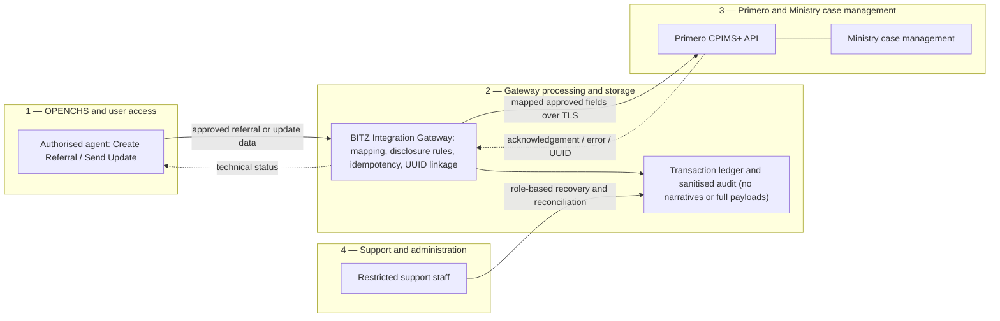

### 7.5 Decision and control matrix

**Table 7.1 — Data protection, security and safeguarding controls.** The full register (DSR-01 to DSR-18) is in Annex C.

| **Area** | **Control or decision** | **Status** | **Ref.** |
|----|----|----|----|
| Legal framework | Data Protection Act, 2011 applies; legal confirmation by Ministry and UNICEF advisers | [Pending Confirmation]{.mark} | DSR-01 |
| Lawful basis and consent | Consent during the call; otherwise child-protection basis with supervisor authorisation; withdrawal stops further updates | Confirmed [PR1] | DSR-02, DSR-03 |
| Controller and processor | Ministry controller; BITZ processor under the existing contract | Confirmed [PR1] | DSR-04, DSR-05 |
| Minimum and emergency data | Child's details and narrative; minimum emergency information in emergencies | Confirmed [PR1]; Primero mandatory-field check during mapping | DSR-06 |
| Reporter anonymity and child identity | Disclosure rules and representation of anonymous reporters in CPIMS+ | [Pending Confirmation]{.mark} | DSR-07 |
| Retention | Proposed: metadata logs and transaction ledger kept for 24 months; queued payloads deleted once delivery succeeds | Proposed — [Ministry to confirm]{.mark} | DSR-08 |
| Hosting and remote support | Existing hosting unchanged; remote support under the existing support contract | Confirmed [PR1] | DSR-09 |
| Incident notification | Procedure and recipients, including while the Data Protection Commission is not established | [Pending Confirmation]{.mark} | DSR-10 |
| Test data | Synthetic data prepared by BITZ and approved by the Ministry (Tiisetso Mohlabi) before use; no real data in testing | Confirmed [PR1] | DSR-11 |
| Approver | Ministry data-protection and security authority: Tiisetso Mohlabi | Confirmed [PR1] | DSR-12 |
| Classification | Government classification policy and security documentation | [Pending Confirmation]{.mark} | DSR-13 |
| Transport and authentication | HTTPS with TLS 1.2 or higher (proposed); JWT service account; least privilege | Confirmed (mechanism); verified in testing | SEC-003–SEC-005; API-002 |
| Encryption at rest and secrets | Sensitive gateway records and backups encrypted; secrets in a secret store with rotation; separate credentials per environment | Design requirement | SEC-004 |
| Audit and access | Sanitised, access-controlled, tamper-evident audit; restricted administrative access with recorded reasons | Design requirement | OPS-004; SEC-006; AUD-001 |
| Operational support and escalation | Responsible person: Hopolang Mosena; runbook and contacts before go-live | Confirmed (responsible person) | DSR-17 |
| Production authorisation | Written Ministry authorisation before any real child data is exchanged | [Pending —]{.mark} depends on the items above | DSR-18 |

Security evidence — authentication, authorisation, transport security, data protection, log redaction, secrets management, environment isolation and recovery permissions — is produced during testing (Section 10) and reviewed by the Ministry's security authority before go-live.

## 8 Implementation plan and milestones

### 8.1 Phases

**Table 8.1 — Implementation phases**

| **#** | **Phase** | **Main outputs** | **Exit criterion** | **Deliverable** |
|----|----|----|----|----|
| 1 | Requirements confirmation and D1 approval | Approved D1 report | Written D1 approval (G1) | D1 |
| 2 | Detailed gateway and interface design | Integration design and interface specification | Design reviewed by BITZ and Primero technical authorities | D3 |
| 3 | Test-environment preparation | OPENCHS and Lesotho CPIMS+ test environments; credentials | One successful authenticated test exchange (G2) | D3 |
| 4 | OPENCHS referral interface | Referral control, service selection, validation, optional ABR, status display, Send Update | Demonstrated features and unit tests | D2 |
| 5 | Gateway and Primero API integration | Integration module: authentication, ledger, queue, retries, idempotency, reconciliation, audit | Component and contract tests (G3) | D3 |
| 6 | Security and functional verification | Security and functional test report | Documented evidence reviewed by the security authority | D3 |
| 7 | Lesotho integration testing | Integration test evidence | Approved scenarios pass on the Lesotho environment (G4) | D4 |
| 8 | Ministry-led UAT | Signed UAT report | Ministry sign-off (G5) | D4 |
| 9 | Training | Materials; attendance records; training report | Training delivered and reported | D4 |
| 10 | Production preparation | Readiness checklist; rollback plan | Written go/no-go decision | D4 |
| 11 | Go-live and stabilisation | Stabilisation log | Agreed exit conditions met | D4 |
| 12 | Handover | Handover pack | Handover accepted in writing; D4 submitted | D4 |

### 8.2 Timetable

The deliverable dates were agreed at the D1 validation meeting as the delivery baseline, replacing the earlier 14-week plan [M4 section 8]. The signed contract states no due dates; the agreement does not amend the contract. The intermediate dates below are the working plan.

**Table 8.2 — Working timetable**

| **Period** | **Activity** | **Owner** |
|----|----|----|
| By Fri 13 Nov 2026 | **D1 final submitted (G1).** Lesotho test access, credentials, field identifiers and service list supplied (G2) | BITZ (G1); Primero (G2) |
| By Fri 20 Nov 2026 | **D2 submitted:** referral interface, service list, confirmation, optional ABR, status display, unit tests | BITZ |
| Mon 16 Nov – Fri 11 Dec 2026 | D3 build against mocks, then the Lesotho test environment; **D3 evidence by 11 Dec (G3)** | BITZ; Primero |
| Mon 14 – Fri 18 Dec 2026 | Component tests; synthetic test cases approved; UAT plan agreed | BITZ; Ministry |
| Mon 21 Dec 2026 – Fri 8 Jan 2027 | Contingency for defect correction; holiday support cover | BITZ |
| Mon 11 – Fri 22 Jan 2027 | Lesotho integration testing (G4) | BITZ; Primero |
| Mon 25 – Fri 29 Jan 2027 | Ministry-led UAT | Ministry; Child Helpline; Primero; UNICEF; BITZ |
| By Fri 5 Feb 2027 | UAT sign-off (G5) | Tiisetso Mohlabi (Ministry UAT signatory) |
| Before deployment | Written production go/no-go | Ministry; UNICEF |
| Mon 8 – Fri 12 Feb 2027 | Production deployment and go-live | BITZ; Ministry; UNICEF |
| Mon 15 – Fri 19 Feb 2027 | In-country training in Maseru (Trip 2); handover pack submitted 19 Feb | BITZ; Ministry |
| By Fri 26 Feb 2027 | **D4 acceptance** | UNICEF |
| Until 7 Jul 2027 | Support under the existing support provisions | BITZ |

Each submission date assumes five working days for UNICEF review. BITZ staffing: Nelson Adagi (project manager), with Peter Rogendo and Marlon Amunga as developers.

**Figure 8.1 — Timetable**

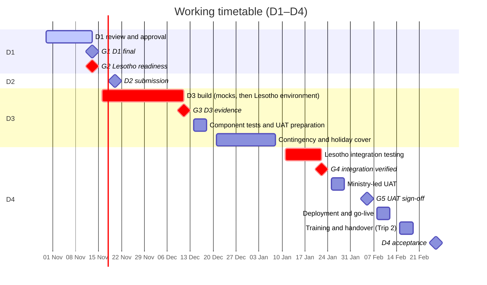

### 8.3 Gates

**Table 8.3 — Delivery gates**

| **Gate** | **Entry requirement** | **Evidence** |
|----|----|----|
| G1 — D1 baseline | Written D1 approval | Dated written approval |
| G2 — Lesotho readiness | Test-environment access; integration credentials; API specification; configured field identifiers; approved service list; successful connectivity | One successful authenticated test exchange |
| G3 — D3 development evidence | Gateway implemented; unit and contract tests; Create Referral and Send Update; idempotency; retries; reconciliation; audit | Test reports, with simulated and Lesotho evidence identified separately |
| G4 — Lesotho integration verified | Approved Annex D scenarios pass on the Lesotho environment, including failure, duplicate, retry, uncertain-outcome, security and update scenarios | Test evidence; Critical and High defects resolved |
| G5 — UAT sign-off | Approved UAT evidence; defect disposition; Ministry sign-off; Child Helpline endorsement | Signed UAT report |
| Production go/no-go | Ministry safeguarding and production authorisation (DSR-18); security approval; production credentials and configuration; monitoring and alerting; rollback; incident escalation; support ownership | Written go/no-go record |

Development against mocks continues while G2 is outstanding. Progress evidence is reported at three levels — development (Level 1), simulated integration (Level 2) and verified Lesotho integration (Level 3) — and only Level 3 supports G4.

### 8.4 Critical dependencies

**Table 8.4 — Critical dependencies**

| **Ref.** | **Input** | **Responsible** | **Needed for** | **Status** |
|----|----|----|----|----|
| A-015, A-016 | Lesotho test-environment access | Primero (Isaiah); UNICEF (checklist, Rantsala) | G2; D3 | Confirmed by Primero; due 13 Nov 2026 |
| A-023 | Integration credentials; first authenticated test call | Primero; BITZ (Peter, Marlon) | G2; D3 | After A-016 |
| A-018 | CPIMS+ service list and codes | Primero (Isaiah); Ministry | D2 list; G2 | Confirmed by Primero; due 13 Nov 2026 |
| P-02 | Field mapping verified on the Lesotho environment | Primero; Ministry; BITZ | D3; G4 | After A-016 and A-018 |
| — | Protection-concern list | Primero | D3 mapping | [Pending —]{.mark} not yet received |
| A-013 | National referral pathways | Hopolang Mosena (responsible) | UAT scenarios | [Pending —]{.mark} not yet received |
| A-007 | Official ABR validation rules | Ministry / relevant authority | D2 acceptance of checks | [Pending —]{.mark} not yet received |
| A-021 | Primero-side behaviour during outages | BITZ (Nelson, Peter); Primero (Isaiah) | G4 | Verified by RC-01 to RC-04 tests |
| A-002, A-024 | Child Helpline focal person and leave cover | Hopolang Mosena (responsible) | Go-live | [Pending —]{.mark} names to be confirmed |
| DSR register | Outstanding safeguarding decisions (Table 7.1) | Ministry | Production go/no-go | See Table 7.1 |

The full dependency and action register is in Annex E. The recorded dependency chains are: A-015 → A-016 → A-023 (access, then authentication and test calls); A-016 + A-018 → P-02 (environment and service list, then mapping); A-017 → A-022 (privacy materials, then desk research); and A-007 for the ABR rules.

### 8.5 Conditions for schedule change

Dates do not move automatically. If a dependency is late — in particular if G2 is not met by 13 November 2026 — BITZ notifies UNICEF in writing with an impact assessment, mitigation and proposed revised dates. No agreed date changes until that proposal is approved through change control (Section 9.5). A missed dependency does not by itself entitle BITZ to more time or payment, and it does not waive any acceptance requirement.

## 9 Governance and responsibilities

### 9.1 Governance structure

**Figure 9.1 — Governance structure.** The lines show authority domains. No steering committee has been constituted; decisions are taken by the authorities named in Table 9.1.

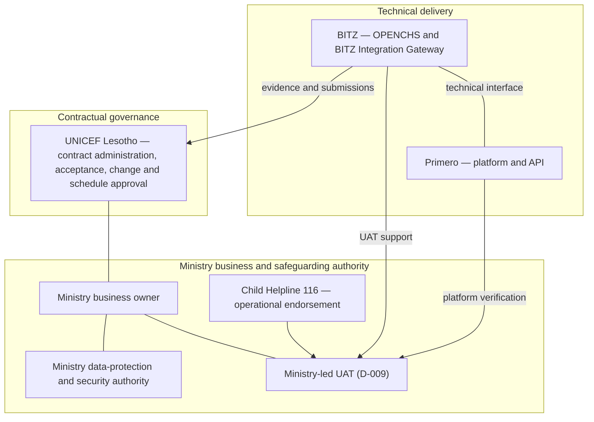

### 9.2 Roles and approval authorities

**Table 9.1 — Roles and approvers**

| **Role** | **Name** | **Organisation** | **Authority** | **Status** |
|----|----|----|----|----|
| Programme and governance owner; D1 approver | Rantsala Sanaha | UNICEF Lesotho | Programme governance; D1 approval; coordination | Confirmed [M4 C2] |
| Contractual acceptance and variation | Authorised UNICEF representative | UNICEF Lesotho | Acceptance of D1–D4; contract variations; schedule changes [CT2] | Under the contract |
| Ministry business owner | Tiisetso Mohlabi | Ministry (MGYSD) | Business rules, service catalogue, routing and operational baseline | Confirmed [PR1] |
| Data-protection and security authority | Tiisetso Mohlabi | Ministry (MGYSD) | Disclosure, safeguarding and security approvals; production authorisation | Confirmed [PR1] |
| UAT signatory | Tiisetso Mohlabi | Ministry (MGYSD) | Sign-off of Ministry-led UAT (CD-09) | Confirmed [PR1] |
| D1 sign-off (Ministry) | Lerato Mokuena | Ministry (MGYSD) | Joint Ministry sign-off of D1, as recorded at the validation meeting [M4 C3] | Confirmed [PR1]; [department and role to be confirmed]{.mark} |
| Operational support and escalation | Hopolang Mosena | Ministry (MGYSD), IT | Operational support and incident escalation; pathways and focal-person actions | Confirmed (responsible person) [PR1] |
| OPENCHS technical authority; BITZ project manager | Nelson Adagi | BITZ | OPENCHS and gateway design and delivery | Confirmed [M4 C2] |
| Primero technical authority | Isaiah Amutavi Osotsi | Primero | Platform, API, environments and credentials | Confirmed [PR1] |
| Child Helpline UAT endorsement | [To be confirmed]{.mark} | Child Helpline 116 | Operational endorsement of UAT results | [Pending Confirmation]{.mark} |

BITZ developers: Peter Rogendo and Marlon Amunga. BITZ chief executive: James Nganga Kaminju.

**Approval decisions.** Each decision type has its own authority:

| **Decision** | **Authority** |
|----|----|
| Requirements and design baseline (D1) | Ministry business owner and UNICEF |
| Technical interface | BITZ and Primero technical authorities, each for its own side |
| Safeguarding and data protection; production authorisation | Ministry data-protection and security authority |
| Lesotho integration verification (G4) | BITZ evidence, verified by Primero |
| UAT sign-off (G5) | Ministry UAT signatory, with Child Helpline endorsement |
| Contract variation or schedule change | UNICEF authorised representative |
| Production go/no-go | Ministry (safeguarding and operational) and UNICEF (contractual) |
| Contractual acceptance of each deliverable | UNICEF authorised representative |

### 9.3 Responsibility matrix

**Table 9.2 — RACI matrix** (A = accountable; R = responsible; C = consulted; I = informed)

| **Activity** | **UNICEF** | **Ministry** | **Child Helpline** | **Primero** | **BITZ** |
|----|----|----|----|----|----|
| Inception report | C | C | C | C | A/R |
| Business requirements approval | C | A | C | C | R |
| Referral pathways and SOP | R (pathways) | A | C | I | I |
| Safeguarding and lawful-disclosure approval | C | A | C | I | I |
| Data mapping | I | A (business approval) | C | R (definitions) | R (OPENCHS and gateway) |
| OPENCHS and gateway design and build | I | I | C | C | A/R |
| Primero environment, credentials and API validation | R (checklist) | C | I | A/R | C |
| Service list and routing configuration | I | A | C | R | C |
| Synthetic test data | I | A (approval) | C | C | R (prepare) |
| Lesotho integration verification (G4) | I | I | I | R | A/R |
| UAT leadership and sign-off | C | A/R | R (endorsement) | R | R (support and evidence) |
| Training and handover | I | C | C | I | A/R |
| Production go/no-go | A (contractual) | A (safeguarding, operational) | C | C | R (evidence) |
| Operational support — gateway / platform | I | C | C | A/R (platform) | A/R (gateway) |
| Contractual acceptance; scope and schedule change | A | C | I | C | R (submit; impact assessment) |

### 9.4 Escalation and operational support

Issues are escalated from the issue owner to the BITZ project manager (routine target: two working days), then to a technical working session, and then to the UNICEF programme owner and the Ministry business owner for scope, schedule or approval blockers. Safeguarding and security incidents bypass this route.

**Table 9.3 — Severity and treatment**

| **Severity** | **Examples** | **Treatment** |
|----|----|----|
| Critical | Suspected child-data breach; unauthorised disclosure; serious safeguarding incident; major production security incident | Immediate containment and notification through the approved safeguarding, privacy and security channels (DSR-10); routine meetings are not awaited |
| High | Critical integration blocker; major UAT blocker; material milestone risk; serious security defect | Prompt escalation to the responsible technical and project authorities |
| Medium | Non-critical mapping or configuration issues; manageable defects | Issue owner, BITZ project manager and technical working session |
| Low | Minor documentation or administrative issues | Action register and routine review |

Hopolang Mosena (Ministry IT) is responsible for operational support and incident escalation. Before go-live the named support contacts, the incident runbook, monitoring responsibilities and credential custody are confirmed; no new service level is introduced.

### 9.5 Change control

Any party may raise a change. Each change request records the request and justification, the affected requirements and decisions, and the contractual, technical, security, safeguarding, effort, cost, schedule and acceptance implications. BITZ prepares the impact assessment. The decision is taken in writing by the competent authority:

| **Change class** | **Decision authority** |
|----|----|
| Clarification of an existing requirement | Owner of the requirement (Ministry for business rules; technical authority for design) |
| Defect correction | BITZ (OPENCHS and gateway) or Primero (platform) |
| Technical design change | BITZ and Primero technical authorities; Ministry consulted where data or safeguarding is affected |
| Business or safeguarding change | Ministry |
| Contractual variation (scope, price, schedule, obligations or acceptance) | UNICEF authorised representative, by signed amendment |

Urgent containment may be taken under the incident procedures to protect people, data or systems; it is recorded and reviewed afterwards and is never a route to unauthorised scope. The open change requests (CR-01 to CR-04) are listed in Annex E.

### 9.6 Meetings and reporting

The technical team meets weekly, with additional working sessions as needed; the full group meets every two weeks [M4]. Minutes record participants, decisions with their evidence, action owners and due dates, open issues, escalations and dependencies. For each deliverable, BITZ keeps separate records of submission, review comments, revised submission and written acceptance.

## 10 Testing, acceptance and handover

### 10.1 Test levels

**Table 10.1 — Test levels**

| **Level** | **What is verified** | **Environment** | **Evidence level** |
|----|----|----|----|
| Unit and component | Referral controls; Create Referral and Send Update; validation; optional ABR; permissions; payload construction; UUID storage; idempotency; queue; retries; audit; error display | Development, synthetic data | 1 |
| Simulated integration | Request formats; authentication; responses; failures, timeouts and lost responses; duplicate prevention; retry and reconciliation logic | Development with mock Primero API | 2 (preliminary) |
| Lesotho integration | Authentication and permissions; endpoints; field identifiers and code lists; service routing; Create Referral; UUID storage; Send Update; failure handling; duplicates; reconciliation; audit | Lesotho CPIMS+ test (G2) | 3 |
| Security and safeguarding | Authentication; role permissions; disclosure minimisation; log redaction; audit integrity; unauthorised access; incident escalation | Test environments | 2 and 3 |
| Recovery and reliability | Primero interruption; queueing; retries at the configured intervals; lost-response reconciliation; recovery after restoration; manual escalation | Lesotho CPIMS+ test | 3 |
| Regression | Existing OPENCHS functions unaffected | Test environments | 3 |
| Ministry-led UAT | Agreed working needs with approved operational scenarios and synthetic data | Lesotho test with country settings | 3 |

The Primero global demonstration system may support preliminary tests only; it is not Lesotho verification. Each executed test records its identifier, requirement, environment, test data, expected and actual result, status (Pass, Fail, Blocked or Not Run), evidence, defect, tester and date. The detailed scenarios are in Annex D.

### 10.2 Ministry-led user acceptance testing

UAT is led by the Ministry (D-009), with Child Helpline agents and a Child Helpline supervisor, Ministry CPIMS+ users and administrators, UNICEF and the Primero technical team taking part, and BITZ providing support, scenarios and evidence. The Ministry nominates the testers ([named testers to be confirmed]{.mark}). BITZ prepares the synthetic test cases, and the Ministry (Tiisetso Mohlabi) approves them before use. Scenarios cover the referral workflow, service selection, minimum and emergency information, optional ABR, validation, technical status, UUID linkage, Send Update, errors, security and privacy, and failure and recovery. Automatic inbound updates and attachments are not tested, because they are outside the initial scope.

The signed UAT report records the scope tested, coverage, pass and fail results, open defects, approved exceptions, safeguarding findings and the signatory's decision. Tiisetso Mohlabi signs as Ministry UAT signatory, with the Child Helpline's operational endorsement.

### 10.3 Defect management

**Table 10.2 — Defect severities**

| **Severity** | **Definition and examples** | **Go-live rule** |
|----|----|----|
| Critical | Disclosure of protected child data; data loss; duplicate CPIMS+ case; a required referral function fails completely; serious security or safeguarding failure | None open |
| High | A required function fails with no acceptable workaround (for example, Create Referral or Send Update fails; status handling or reconciliation fails) | None open, unless a written exception is authorised |
| Medium | Function impaired, with a documented and tested workaround | Owner, workaround, risk assessment and fix plan |
| Low | Cosmetic or minor | Tracked and prioritised |

Each defect is recorded, triaged, assigned, corrected, retested and closed or formally dispositioned, and reopened if retesting fails. A written exception for a High defect identifies the defect, residual risk, workaround, owner, remediation and approver; it needs Ministry approval where safeguarding or operations are affected and UNICEF's agreement under the contract. No exception may override a mandatory safeguarding or security requirement.

### 10.4 Acceptance criteria

The thresholds below are agreed: the fault rules were agreed at the validation meeting [M4 section 10] and the full set was adopted on 9 November 2026 [PR1]. The full set (AC-01 to AC-18) is in Annex D.

**Table 10.3 — Principal acceptance criteria**

| **ID** | **Criterion** | **Threshold** |
|----|----|----|
| AC-01 | Scenario coverage | 100% of approved Must scenarios executed with evidence |
| AC-02 | Faults | No open Critical; no open High without a written exception |
| AC-03 | Duplicate prevention | No duplicate CPIMS+ cases across retry, resubmission, lost-response and uncertain-create tests |
| AC-04 | Interruption recovery | 100% of referrals queued during a simulated interruption are delivered or flagged for authorised action; none lost |
| AC-05 | Audit completeness | 100% of operations, responses, retries, reconciliations and manual actions have a complete audit record without prohibited content |
| AC-10 | Authorised Create Referral | Saving never sends; only a confirmed action creates exactly one operation |
| AC-11, AC-12 | UUID linkage and Send Update | Every confirmed creation stores the UUID; every update references it and creates no new case |
| AC-13 | Reconciliation | Every unresolved creation is reconciled before any further creation attempt |
| AC-14 | Lesotho compatibility | Authentication, field identifiers, code lists and routing verified on the Lesotho environment |
| AC-16, AC-17 | Safeguarding and minimisation | Emergency route independent of the API; exceptions recorded; anonymity preserved; only approved fields sent |

UNICEF retains its contractual right to withhold payment where work is unsatisfactory or incomplete [CT2 section 4].

### 10.5 Training and handover

Training is delivered in Maseru during Trip 2 (planned for 15–19 February 2027), with materials in English and Sesotho as agreed and attendance records, followed by the training report in the contract's format [CT2 section 2.5.4].

**Table 10.4 — Training tracks**

| **Track** | **Audience** | **Content** |
|----|----|----|
| 1 | Operators and social workers | Create Referral; service selection; optional ABR; required information; validation messages; safeguarding; technical status; Send Update; failures; escalation |
| 2 | Supervisors and Ministry business administrators | Roles and permissions; referral oversight; safeguarding authorisation; routing; exceptions; incident escalation; monitoring |
| 3 | Ministry IT and technical support | Architecture; the gateway; Primero API configuration; authentication and credentials; UUID linkage; queue, retry and reconciliation; logging and monitoring; troubleshooting |

Practical exercises use approved synthetic cases. The training dates, languages and competency threshold are [to be confirmed]{.mark} with the Ministry (OD-11).

The **handover package** contains the technical report, architecture and configuration guidance, the mapping reference, user manuals, the administrator guide, the support runbook, monitoring and alert procedures, queue and retry procedures, incident escalation, known limitations and a handover checklist.

### 10.6 Readiness, endorsement, authorisation and acceptance

Four separate decisions govern go-live and acceptance:

| **Decision** | **Meaning** | **Authority** |
|----|----|----|
| Technical readiness | The integration works on the Lesotho environment (G3, G4) | BITZ, verified by Primero |
| UAT endorsement | Ministry users accept that it meets their working needs (G5) | Ministry UAT signatory, with Child Helpline endorsement |
| Safeguarding authorisation | Real child data may be exchanged in production (DSR-18) | Ministry data-protection authority |
| Contractual acceptance | The deliverable is accepted under the contract | UNICEF authorised representative |

None implies another. The written production go/no-go decision is taken after G5, when the safeguarding authorisation, security approval, production configuration, monitoring, rollback, incident escalation and support arrangements are all evidenced.

## 11 Risks, dependencies and outstanding decisions

### 11.1 Priority risks

The full register of 17 risks, with their original ratings, is in Annex F. All remain open; none has been closed. The risks that most affect delivery are:

**Table 11.1 — Priority risks**

| **Risk** | **Impact** | **P / I** | **Owner** | **Mitigation or action** | **Evidence needed** | **Status** | **Gate** |
|----|----|----|----|----|----|----|----|
| R-001 Lesotho environment and API access delayed | D3 cannot be verified; schedule slips | H / H | Primero (Isaiah); UNICEF (Rantsala) | Access confirmed by Primero for 13 Nov; mock-based development continues; escalate if missed | One authenticated test exchange | Open | G2 |
| R-003 Service list and mapping incomplete | Referrals cannot be routed or mapped | H / H | Primero; Ministry | Service list confirmed by Primero; configurable list; versioned mapping | Service list loaded; mapping verified | Open | G2, G4 |
| R-009 Milestone slippage | Late submission under the contract clause | H / H | UNICEF; BITZ | Agreed dates; dependency notice and change control (Section 8.5) | Delivery records against agreed dates | Open | All |
| R-010 Contract scope (two-way, attachments) | Dispute over D3 and D4 acceptance | H / H | UNICEF | Written disposition (OD-01) | Written UNICEF decision | Open | D3, D4 |
| R-007 Privacy and authority gaps | Production blocked | H / H | Ministry; UNICEF | Roles and lawful basis confirmed; legal confirmation, retention and incident procedure outstanding (Table 7.1) | DSR-01, DSR-08, DSR-10, DSR-18 | Open | Go/no-go |
| R-004 Service interruption and duplicates | Lost or duplicate referrals | M / H | BITZ; Primero | Persistent queue; idempotency; retries at 1, 5, 30 and 120 minutes; reconciliation | RC-01 to RC-04 results | Open | G4 |
| R-013 Credentials and token renewal | Integration cannot authenticate | M / H | Primero; BITZ | JWT service account confirmed; credentials due with G2 | Authenticated test call | Open | G2 |
| R-005 ABR verification rules | D2 checks incomplete | M / M | Ministry | ABR optional and non-blocking; structural checks only | Official specification | Open | D2 |
| R-011 Consent requirement in CPIMS+ | Referrals rejected or unlawful | M / H | Ministry; Primero | Consent and child-protection basis confirmed; Primero configuration checked in testing | Consent scenarios pass | Open | G4, G5 |
| R-017 Hosting, contracts and cross-border access | Unlawful transfer or delay | M / H | Ministry | Controller, processor and hosting confirmed [PR1] | Production authorisation | Open | Go/no-go |

### 11.2 Realised issues

| **ID** | **Issue** | **Effect** | **Action** |
|----|----|----|----|
| IS-01 | The original D1 target month passed without approval (R-009) | Later dates depend on D1 | Submit final D1; obtain written approval |
| IS-02 | The test-system checklist made no progress between Sessions 2 and 3 (R-001) | No Lesotho evidence yet | Access confirmed for 13 Nov 2026 |
| IS-03 | Country-document actions due on 26 October were outstanding (R-002) | Pathway alignment pending | SOP received and confirmed; pathways outstanding (A-013) |
| IS-04 | Privacy actions due on 26 October were outstanding (R-007) | Production blocked until approvals | Act and draft policy received; decisions in Table 7.1 |
| IS-05 | UNICEF-facilitated inputs planned for weeks 2–4 were unavailable when due (R-009) | Schedule pressure | Recorded for change-control assessment |

### 11.3 Outstanding decisions

**Table 11.2 — Decision register.** Each decision has one owner; none is a condition of D1 acceptance.

| **ID** | **Decision required** | **Owner** | **Needed by** | **Ref.** | **Status** |
|----|----|----|----|----|----|
| OD-01 | Written contractual disposition of the two-way update (D-007) and attachment (D-012) requirements against the outbound-only design | UNICEF | Before D3 acceptance | CD-01, CD-04; P-01; R-010 | [Pending —]{.mark} |
| OD-02 | Operational route by which a Ministry rejection in CPIMS+ is communicated to the helpline | Ministry | Before UAT | [M4 section 5]; RT-005 | [Pending —]{.mark} |
| OD-03 | Rules for correction, cancellation, withdrawal and re-referral | Ministry | Before UAT | WF-006; DATA-004 | [Pending —]{.mark} |
| OD-04 | Reporter-anonymity and child-identity disclosure rules | Ministry | Before UAT | DSR-07; DATA-008 | [Pending —]{.mark} |
| OD-05 | Confirmation of the proposed 24-month retention period | Ministry | Before go/no-go | DSR-08; SEC-006 | [Pending —]{.mark} |
| OD-06 | Security-incident notification procedure and contacts | Ministry; UNICEF | Before go/no-go | DSR-10; OPS-007 | [Pending —]{.mark} |
| OD-07 | Legal confirmation of the applicable requirements; government classification policy | Ministry; UNICEF legal advisers | Before go/no-go | DSR-01, DSR-13 | [Pending —]{.mark} |
| OD-08 | Recipient roles, rejection reasons and routing configuration in CPIMS+ | Ministry; Primero | Before G4 | RT-003 | [Pending —]{.mark} |
| OD-09 | Official ABR ID validation rules and examples | Ministry / relevant authority | Before D2 acceptance of checks | A-007; CD-05 | [Pending —]{.mark} |
| OD-10 | Named UAT testers and the Child Helpline endorsement arrangement | Ministry; Child Helpline | Before UAT | UAT-002 | [Pending —]{.mark} |
| OD-11 | Training dates, languages and competency threshold | Ministry; UNICEF; BITZ | Before training | Item 80 | [Pending —]{.mark} |
| OD-12 | Confirmation that the explicit referral action satisfies the signed D2 and D4 wording | UNICEF | Before D2 acceptance | CD-03; R-015 | [Pending —]{.mark} |
| OD-13 | Production authorisation for real child data | Ministry | Go/no-go | DSR-18 | [Pending —]{.mark} depends on OD-04 to OD-07 |

## 12 Conclusions and approval

### 12.1 Conclusions

The inception phase has established a clear, agreed basis for the integration. The business workflow is confirmed: manual, deliberate referral; Ministry-controlled distribution; minimum necessary information with defined emergency handling; and separate technical and business status. The architecture is settled on the BITZ Integration Gateway, with explicit Create Referral and Send Update operations and the reliability, security and audit controls required by the contract. Primero has confirmed the technical approach, and the Ministry roles and principal safeguarding positions are confirmed. The remaining decisions (Section 11.3) are owned and do not prevent D1 approval.

### 12.2 Readiness

The report is ready for stakeholder approval. D1 is submitted for full acceptance; the open items in Section 11.3 are tracked to closure and are not acceptance conditions. Formal D1 acceptance requires the written approval of the signatories below. No written approval has yet been received.

### 12.3 Priority actions

| **Action** | **Owner** | **Target** |
|----|----|----|
| Approve D1 | Signatories in Table 12.1 | 13 November 2026 |
| Provide Lesotho test access, credentials, field identifiers and service list (G2) | Primero (Isaiah Amutavi Osotsi) | 13 November 2026 |
| First authenticated test call | BITZ (Peter Rogendo, Marlon Amunga) | After access |
| Submit D2 | BITZ | 20 November 2026 |
| Written disposition of the two-way and attachment requirements (OD-01) | UNICEF | Before D3 acceptance |
| Rejection-feedback route, correction rules and anonymity rules (OD-02 to OD-04) | Ministry | Before UAT |
| National referral pathways; focal person and leave cover | Hopolang Mosena | Before UAT |
| Full-group coordination meeting | UNICEF; Ministry; BITZ | 17 November 2026 |

### 12.4 Approval

**Table 12.1 — D1 approval**

| **Role** | **Name and organisation** | **Signature** | **Date** |
|----|----|----|----|
| UNICEF programme and governance owner | Rantsala Sanaha, UNICEF Lesotho | | |
| Ministry business owner and data-protection authority | Tiisetso Mohlabi, Ministry of Gender, Youth and Social Development | | |
| Ministry D1 sign-off | Lerato Mokuena, Ministry of Gender, Youth and Social Development ([role to be confirmed]{.mark}) | | |
| Primero technical authority | Isaiah Amutavi Osotsi, Primero | | |
| OPENCHS technical authority (submitting party) | Nelson Adagi, BITZ IT Consulting Ltd | | |
| Contractual acceptance | Authorised UNICEF representative | | |

## Annexes

| **Annex** | **Content** |
|----|----|
| A | Requirements and traceability matrix |
| B | Technical integration and API specification |
| C | Data mapping, data dictionary and safeguarding register |
| D | Testing and acceptance matrix |
| E | Decisions, actions and dependencies |
| F | Risk register |
| G | Source documents and references |

## Annex A — Requirements and traceability matrix

The baseline contains **68 requirements** in eight categories. Each row gives the current requirement, its original source and proposed priority, its single current classification, the remaining dependency and the evidence required for acceptance. Classifications record the decision position, not implementation progress. Statuses marked [PR1] reflect the project confirmations of 9 November 2026. The requirements FN-010, RT-007, SEC-008, AUD-003 and DATA-010 concern automatic inbound updates and attachments; they require a contract addendum and are not part of the initial delivery.

| **Code** | **Classification** |
|----|----|
| V | Confirmed — Requirements Validation |
| C | Confirmed — Existing Contractual Obligation |
| T | Pending Primero Technical Validation |
| M | Pending Ministry Business or Legal Approval |
| A | Pending Validation — Contract Addendum |
| O | Pending Operational or UAT Governance Confirmation |

### A.1 Business and workflow requirements

| **ID** | **Requirement** | **Source; priority** | **Classification; scope** | **Remaining dependency** | **Validating party** | **Acceptance evidence** |
|----|----|----|----|----|----|----|
| WF-001 | Follow applicable Ministry-approved national referral pathways and SOPs; BITZ does not create a replacement pathway. | D-006; [M3 sections 3–4]; Must | Confirmed — Requirements Validation **Scope:** Initial — dependencies apply | Current applicability of the received 2019 SOP and separate national pathways (A-013); A-014 receipt closure does not resolve applicability. | Ministry; BITZ documents alignment | Ministry identifies applicable editions; reviewed lifecycle maps each referral step to the approved pathway. |
| WF-002 | Only the handling agent's explicit referral action initiates submission; saving or updating a case never sends a referral. | D-006; [M1 section 6]; Must | Confirmed — Requirements Validation **Scope:** Initial — dependencies apply | Authorised agent roles and implementation testing. | Ministry / Child Helpline; BITZ | Save and edit without transmission; explicit confirmed referral creates one transaction. |
| WF-003 | Supervisor escalation is optional; authorised agents may refer directly unless a separately approved business rule requires escalation. | [M1 section 6]; Should | Confirmed — Requirements Validation **Scope:** Initial — dependencies apply | Ministry endorsement of role permissions and any mandatory exception. | Ministry / Child Helpline | Role-based tests demonstrate direct referral and only approved mandatory escalation rules. |
| WF-004 | Emergency referrals may use an approved reduced dataset; urgent telephone escalation remains independent. | D-003; Must | Confirmed — Requirements Validation **Scope:** Initial — dependencies apply | Emergency dataset confirmed [PR1] (DSR-06); Primero mandatory-field check during mapping. | Ministry; Primero validates feasibility | Approved emergency scenarios pass with reduced data; unapproved omissions are rejected without blocking emergency phone response. |
| WF-005 | Permit appropriate partial referrals; subsequent completion requires an explicit authorised outbound update. | [M2 section 3]; Should | Confirmed — Requirements Validation **Scope:** Initial — dependencies apply | Ministry completion rules and Primero update semantics; no automatic save-triggered update. | Ministry; Primero; BITZ | Partial referral and later Send Update action preserve linkage and history; saving alone sends nothing. |
| WF-006 | Allow authorised corrections, cancellations, withdrawals and re-referrals with preserved history, subject to Primero API support. Specific outbound update operations remain subject to written contractual confirmation where [CT2] is not explicit (SCOPE-001); validation does not independently amend the contract. | [TB section 4] Q6–Q7; Must | Pending Ministry Business or Legal Approval **Scope:** Initial — dependencies apply | Operations confirmed by Primero [PR1]; Ministry rules for each action outstanding (OD-03). | Primero; Ministry | Demonstrate each supported operation against the linked case with authorised actor, reason and audit; do not infer deletion or closure. |
| WF-007 | Urgent telephone contact with police or first responders continues independently of electronic referral and outages. | [M1 section 8]; Must | Confirmed — Requirements Validation **Scope:** Initial — dependencies apply | Ministry-approved escalation contacts and training. | Ministry / Child Helpline | Emergency exercise demonstrates phone escalation while the electronic queue is unavailable. |
| WF-009 | Permit anonymous reporters; require sufficient child-identifying information subject to approved emergency exceptions. | D-010; D-011; Must | Confirmed — Requirements Validation **Scope:** Initial — dependencies apply | Approved child minimums and disclosure rules; see DATA-005 and DATA-008. | Ministry; BITZ | Anonymous referral excludes reporter identifiers; child minimums and emergency exceptions are tested. |
| RT-002 | Agent selects a Ministry-approved CPIMS+ service; Ministry users control distribution and caseworker assignment. | D-008; Must | Confirmed — Requirements Validation **Scope:** Initial — dependencies apply | Service list A-018, receiving configuration and permissions. | Ministry; Primero | Configured service selection enters Ministry-controlled distribution; agent does not select an individual caseworker. |
| RT-003 | Human acceptance, rejection and assignment are Ministry-controlled and separate from technical delivery acknowledgement. | D-008; [M2 section 4]; Must | Pending Ministry Business or Legal Approval **Scope:** Initial — dependencies apply | Approved recipient roles, reasons, assignment rules and reliable recording arrangements. | Ministry; Primero | Demonstrate authorised Ministry decisions separately from technical receipt; OPENCHS never infers acceptance from delivery. |
| RT-004 | Use Ministry-controlled electronic routing initially; direct external-provider routing remains a future configuration option. | D-001; [M2 section 4]; Could | Confirmed — Requirements Validation **Scope:** Initial Ministry routing; direct external routing future | Future Ministry routing approval, Primero account configuration and scope assessment. | Ministry; Primero; UNICEF if scope changes | Initial referral enters Ministry workflow; no unapproved direct police, court or provider routing is implemented. |
| WF-010 | An authorised agent may send a corrective outbound notification when a case is later identified as prank or false; never automatically close the CPIMS+ case. | [M1 section 7]; Must | Confirmed — Requirements Validation **Scope:** Initial — dependencies apply | Primero update support; Ministry correction and disposition rules. | Ministry; Primero; BITZ | Explicit corrective update retains original history and leaves case disposition under Ministry control. |

### A.2 Functional requirements

| **ID** | **Requirement** | **Source; priority** | **Classification; scope** | **Remaining dependency** | **Validating party** | **Acceptance evidence** |
|----|----|----|----|----|----|----|
| FN-001 | Provide optional ABR entry; an empty ABR never blocks saving or an otherwise valid referral. | D-005; [TB section 4]; Must | Confirmed — Requirements Validation **Scope:** Initial — dependencies apply | Configured optional-field behaviour. | Ministry / Child Helpline; BITZ | Save and refer with blank ABR; other applicable referral requirements remain enforced. |
| FN-002 | For entered ABR values check 12 digits, first digit 0 or 1 and seventh digit 1 (male) or 2 (female). Sex mismatch warns and permits authorised audited override; these are structural checks, not official identity verification. | D-014; Must | Confirmed — Requirements Validation **Scope:** Initial — dependencies apply | Official NICR specification; Ministry override roles and handling of recorded sex values. | Ministry / NICR; BITZ | Valid/invalid examples and blank values tested; sex mismatch records warning, authorised actor and override reason. |
| FN-003 | Provide an explicit Refer to CPIMS+ action with confirmation summary and duplicate prevention; saving or editing never initiates referral. | D-006; [TB section 4]; Must | Confirmed — Requirements Validation **Scope:** Initial — dependencies apply | Role confirmation and tested UI / gateway behaviour. | Ministry / Child Helpline; BITZ | Confirmation shows authorised referral data; cancel sends nothing; repeated clicks create one operation. |
| FN-004 | Require the case narrative at referral, not initial save, subject only to an approved emergency exception. | D-013; Must | Confirmed — Requirements Validation **Scope:** Initial — dependencies apply | Ministry emergency narrative rule and API mandatory-field compatibility. | Ministry; Primero; BITZ | Save without narrative; ordinary referral requires it; only approved emergency exceptions pass and are audited. |
| FN-005 | Require sufficient child-identifying details using flexible Ministry-approved minimums and documented emergency exceptions. | D-011; WF-004; Must | Confirmed — Requirements Validation **Scope:** Initial — dependencies apply | Minimum dataset confirmed [PR1] (DSR-06); Primero mandatory-field check during mapping. | Ministry; Primero | Test normal minimum combinations and each approved emergency exception against the agreed mapping. |
| FN-006 | Provide a maintained selectable list of Ministry-approved CPIMS+ services. | D-008; Must | Confirmed — Requirements Validation **Scope:** Initial — dependencies apply | Service list confirmed by Primero [PR1]; delivery under A-018 by 13 November 2026. | Ministry; Primero | Approved list and version recorded; retired or unknown services cannot silently route referrals. |
| FN-007 | Use business statuses Pending, Accepted, Rejected, Ongoing and Closed; display technical transmission states separately. Never display a Ministry decision not actually received or reliably recorded. | [TB section 4]; Must | Confirmed — Requirements Validation **Scope:** Initial — dependencies apply | Ministry vocabulary endorsement and reliable provenance; automatic inbound updates excluded initially. | Ministry / Child Helpline; BITZ | Receipt alone does not produce Accepted; case status shows provenance; transmission failures remain separate. |
| FN-008 | Record technical acknowledgement separately from human acceptance or rejection; use the five business statuses in FN-007 only when reliably evidenced. | D-016; RT-005; Must | Confirmed — Requirements Validation **Scope:** Initial — dependencies apply | Ministry decision-recording rules; future automated receipt of decisions requires addendum. | Ministry; Primero; BITZ | Technical success and a separately evidenced human decision have distinct events, actors and times. |
| FN-009 | Provide explicit Send Update to CPIMS+ for authorised outbound follow-up; store the CPIMS+ case UUID and use verified linkage for each update. Specific outbound update operations remain subject to written contractual confirmation where [CT2] is not explicit (SCOPE-001); validation does not independently amend the contract. | D-012; [M1 section 7]; Must | Confirmed — Requirements Validation **Scope:** Initial — dependencies apply | Update operations confirmed by Primero [PR1]; each permitted update type verified in testing. | Primero; Ministry; BITZ | Create, establish UUID linkage, then explicitly update the same case; saving alone sends nothing and no duplicate case is created. |
| FN-010 | Automatic inbound CPIMS+ status and intervention updates are excluded from initial delivery and initial UAT. | D-007; RT-008; Must | Pending Validation — Contract Addendum **Scope:** Future — addendum required | Formal contract addendum; approved fields, permissions, mechanisms and technical verification. | UNICEF contractual approval; Ministry; Primero | After addendum only: approved linked-case updates demonstrated with access controls and reconciliation. |
| FN-011 | Exclude the helpline case plan from transmission; call recordings also remain outside initial exchange. | D-012; WF-008; Must | Confirmed — Requirements Validation **Scope:** Initial — dependencies apply | Approved mapping review and negative payload tests. | Ministry; BITZ | Outgoing payload contains neither case plan nor call recording. |
| FN-012 | Give clear validation messages for missing or invalid referral data without exposing sensitive data. | [TB section 4]; Must | Confirmed — Existing Contractual Obligation **Scope:** Initial — dependencies apply | Detailed field rules and usability testing; [CT2 item 60] and [TB section 4]. | BITZ; Ministry / Child Helpline | Invalid and missing values produce actionable messages; a saved case remains maintainable without referral. |

### A.3 Data and field requirements

| **ID** | **Requirement** | **Source; priority** | **Classification; scope** | **Remaining dependency** | **Validating party** | **Acceptance evidence** |
|----|----|----|----|----|----|----|
| DATA-001 | Retain NICR, Ministry of Home Affairs, as the recorded ABR issuing authority; do not infer verification rules. | D-014; Must | Confirmed — Requirements Validation **Scope:** Initial — dependencies apply | Authoritative specification needed for verification beyond agreed structure. | Ministry / NICR | Provenance references D-014; no unsupported checksum, uniqueness or live-verification claim. |
| DATA-002 | ABR remains optional; where absent, receiving caseworkers may obtain it later in their workflow. | D-005; Must | Confirmed — Requirements Validation **Scope:** Initial — dependencies apply | Ministry follow-up process; any later electronic correction uses explicit authorised update. | Ministry; BITZ | Blank ABR passes valid referral; later values do not automatically trigger transmission. |
| DATA-003 | Apply the agreed structural checks in FN-002; checksum, uniqueness and live NICR verification require authoritative specification and separate confirmed arrangements. | A-007; Should | Confirmed — Requirements Validation **Scope:** Initial — dependencies apply | A-007 official specification, examples and invalid-value policy; no invented NICR checks. | Ministry / NICR; BITZ | Structural test cases pass; unverified official checks remain disabled and clearly documented as pending. |
| DATA-004 | Allow authorised ABR correction with preserved history and an explicit outbound update to the linked CPIMS+ case. Specific outbound update operations remain subject to written contractual confirmation where [CT2] is not explicit (SCOPE-001); validation does not independently amend the contract. | D-005; Should | Pending Ministry Business or Legal Approval **Scope:** Initial — dependencies apply | Update operations confirmed by Primero [PR1]; Ministry correction rules outstanding (OD-03). | Primero; Ministry; BITZ | Corrected ABR reaches the existing UUID only after authorised action; old and new values are protected in case history, not operational logs. |
| DATA-005 | Use flexible approved child-identification minimums with documented emergency exceptions. | D-011; D-012; Must | Confirmed — Requirements Validation **Scope:** Initial — dependencies apply | Minimum and emergency dataset confirmed [PR1] (DSR-06); Primero mandatory-field check during mapping. | Ministry; Primero | Approved mapping and minimum combinations verified, including reduced emergency dataset. |
| DATA-006 | Transmit available and authorised age, sex, nationality, location and contact information; never fabricate missing values. | D-012; Must | Pending Primero Technical Validation **Scope:** Initial — dependencies apply | Approved disclosure and deployed field names, types, codes and null handling. | Primero; Ministry | Mapping tests preserve genuine values and permitted absence; no placeholder is sent as a factual value. |
| DATA-007 | Maintain a version-controlled gateway mapping from OPENCHS categories to Ministry-approved CPIMS+ protection concerns, supporting multiple concerns and flagging unmapped values. | [M2 section 11]; Must | Pending Primero Technical Validation **Scope:** Initial — dependencies apply | Approved concern list, actual CPIMS+ codes and ownership of mapping changes. | Ministry; Primero; BITZ | Multi-concern examples map correctly; unmapped values flag an actionable exception without invented codes. |
| DATA-008 | Preserve reporter anonymity; disclose only necessary reporter details where authorised consent or another approved lawful basis permits it. Exclude reporter identifiers when anonymity must be maintained. | D-010; D-012; Must | Pending Ministry Business or Legal Approval **Scope:** Initial — dependencies apply | Ministry disclosure matrix and approved representation in CPIMS+. | Ministry; Primero; BITZ | Anonymous and permitted-disclosure payloads tested; denied identifiers never leave the gateway. |
| DATA-009 | Transmit available, authorised alleged-perpetrator information, explicitly identified as allegations; unknown values do not block permitted emergency referrals. | D-004; D-012; Must | Pending Primero Technical Validation **Scope:** Initial — dependencies apply | Ministry disclosure approval and deployed mapping / emergency constraints. | Ministry; Primero | Allegation labels and permitted missing values survive transformation without asserting guilt. |
| DATA-010 | Electronic attachment transfer remains outside initial delivery and requires a formal contract addendum; historical D-012 inclusion is retained. No files, file URLs, access tokens or sensitive file details are sent. Non-sensitive supporting-material-existence metadata is permitted only after all five SCOPE-003 conditions in section 4 are evidenced; otherwise omit it. | D-012; Must | Pending Validation — Contract Addendum **Scope:** Future — addendum required | Formal addendum; approved types, size, malware scanning, access, retention and API support. | UNICEF; Ministry; Primero | After addendum only: approved attachment controls and transfer tests; excluded from initial UAT gates. |
| DATA-011 | Narrative is required for referral subject to approved emergency exceptions; it is not required merely to save a case. | D-013; Must | Confirmed — Requirements Validation **Scope:** Initial — dependencies apply | Ministry exception rules and configured field validation. | Ministry; Primero; BITZ | Ordinary narrative gate and documented emergency exceptions tested; save remains independent. |
| DATA-012 | Capture consent given, declined, withdrawn or not obtainable, or an approved alternative lawful basis. Apply Ministry-approved disclosure rules and audit the decision; proposed transmission to CPIMS+ requires approved mapping. | Primero referral consent check (Annex B.6); R-011; Must | Confirmed — Requirements Validation **Scope:** Initial — dependencies apply | Consent and child-protection basis confirmed [PR1] (DSR-02, DSR-03); consent-field mapping verified in testing. | Ministry legal / safeguarding approvers; Primero | Approved decision matrix tests each state; decline or absence never silently authorises disclosure; withdrawals preserve audit history. |
| DATA-013 | Maintain an authoritative gateway reference table with OPENCHS case ID, referral ID, CPIMS+ UUID, operation idempotency key, linkage state and timestamps; reconcile ambiguous creation before resubmission. | OPS-003; [TB section 5E]; Must | Confirmed — Requirements Validation **Scope:** Initial — dependencies apply | Primero UUID retrieval and duplicate-query semantics; restricted linkage access. | BITZ; Primero | Lost-response test reconciles the actual case before retry; updates link to the correct UUID and cannot create duplicates. |

### A.4 Integration and interoperability requirements

| **ID** | **Requirement** | **Source; priority** | **Classification; scope** | **Remaining dependency** | **Validating party** | **Acceptance evidence** |
|----|----|----|----|----|----|----|
| API-001 | Use supplied API v2 material as a discovery reference; confirm compatibility with the deployed Lesotho version before finalising the build specification. | D-017; Must | Confirmed — Requirements Validation **Scope:** Initial — dependencies apply | Deployed API behaviour confirmed by Primero (Isaiah Amutavi Osotsi) [PR1]; verified on the Lesotho environment (G4). | Primero | Versioned deployed API contract and authenticated sandbox evidence recorded. |
| API-009 | Integrate through the BITZ Integration Gateway calling the Primero API directly (final architecture position, TECH-001). OpenFN is not used. Exclude X-Road from this path. | D-015; Must | Confirmed — Requirements Validation **Scope:** Initial — dependencies apply | Primero architecture review; documented decision and approved network / security arrangements. | Primero; BITZ; Ministry | Reviewed architecture confirms the BITZ gateway path with no OpenFN component; no X-Road intermediary or separate Home Affairs work is assumed. |
| GOV-004 | Record deployed release, sandbox and production base URLs, credentials, network restrictions and technical documentation as pending until verified. | —; Must | Confirmed — Requirements Validation **Scope:** Initial — dependencies apply | Test-environment access confirmed by Primero [PR1]; delivery due 13 November 2026 (G2). | Primero; BITZ verifies connectivity | Securely issued access, version record, role checks and authenticated non-production call demonstrate readiness. |
| API-002 | Use a dedicated least-privilege integration service account, secure credential management and token renewal; JWT remains the contractual authentication requirement. | [TR1 section 3]; [TB section 5B]; Must | Confirmed — Requirements Validation **Scope:** Initial — dependencies apply | JWT service-account authentication confirmed by Primero [PR1]; credentials issued under A-023; renewal verified in testing. | Primero; BITZ | Authenticated create / update and expiry / renewal tests with restricted account; no interactive SSO assumption. |
| API-003 | Initial operations are referral creation, CPIMS+ UUID retrieval / linkage and explicit authorised outbound follow-up updates, subject to verified API semantics; no attachment operation is assumed. Specific outbound update operations remain subject to written contractual confirmation where [CT2] is not explicit (SCOPE-001); validation does not independently amend the contract. | Annex B; Must | Confirmed — Requirements Validation **Scope:** Initial — dependencies apply | Operation sequence confirmed by Primero [PR1]; request/response formats and UUID method verified in testing. | Primero; BITZ; Ministry approves fields | Captured non-production request / response evidence proves sequence and linkage, including empty-body and ambiguous outcomes where applicable. |
| API-004 | Distinguish validation, authentication, authorisation, rate-limit, server and network failures; retry only recoverable failures under controlled policy. | [TR1 section 8]; Must | Confirmed — Requirements Validation **Scope:** Initial — dependencies apply | Deployed behaviour confirmed by Primero [PR1]; error schemas, timeouts and retry signals verified in testing. | Primero; BITZ | Failure-injection evidence proves permanent errors require correction and ambiguous creation triggers reconciliation. |
| RT-007 | Inbound events, polling, webhooks and automatic case-management synchronisation require a contract addendum; explicit outbound updates are addressed by FN-009 / API-003. | D-007; Must | Pending Validation — Contract Addendum **Scope:** Future — addendum required | Formal addendum and verified inbound event, ordering, permission and reconciliation contract. | UNICEF; Ministry; Primero | After addendum only: approved inbound mechanism, event ordering and reconciliation tests. |
| OPS-003 | Use a persistent idempotency key per referral operation, transaction locking, uniqueness constraints and duplicate reconciliation; do not resend an ambiguous creation blindly. | [TB section 5E]; Must | Confirmed — Existing Contractual Obligation **Scope:** Initial — dependencies apply | Primero reconciliation semantics and implementation tests; [CT2 item 70] governs duplicate-prevention capability. | BITZ; Primero | Double-submit, concurrent-worker and lost-response tests create at most one intended case / operation and preserve linkage. |

### A.5 Security and privacy requirements

| **ID** | **Requirement** | **Source; priority** | **Classification; scope** | **Remaining dependency** | **Validating party** | **Acceptance evidence** |
|----|----|----|----|----|----|----|
| SEC-001 | Gateway disclosure rules enforce approved lawful bases, purposes, consent restrictions and data minimisation; formal Ministry legal approval is required before production. | A-017; A-022; [DPA1] sections 15, 29–36; Must | Pending Ministry Business or Legal Approval **Scope:** Initial — dependencies apply | Written disclosure and safeguarding approval, including emergency exceptions and withdrawal handling. | Ministry legal / safeguarding approvers | Signed disclosure matrix and positive / negative tests demonstrate permitted fields and blocked disclosures. |
| SEC-002 | Preserve reporter anonymity in initial outbound transfer; any future inbound exchange remains subject to addendum and equivalent restrictions. | D-010; Must | Confirmed — Requirements Validation **Scope:** Initial — dependencies apply | Ministry anonymity / disclosure rules and payload tests. | Ministry; BITZ | Reporter identifiers excluded where anonymity applies; no identity leaks through operational logs. |
| SEC-003 | Use a restricted integration account without unrestricted case-reading or administrative privileges. | Annex B.2; Must | Confirmed — Requirements Validation **Scope:** Initial — dependencies apply | Primero role and field-level permission support; approved operation set. | Primero; BITZ; Ministry | Allowed linked-case operations succeed; unrelated-case reading and administrative actions fail. |
| SEC-004 | Store credentials securely, separately per environment; restrict access, rotate and revoke secrets, and audit privileged credential operations without logging secret values. | [TB section 5B]; API-008; Must | Confirmed — Requirements Validation **Scope:** Initial — dependencies apply | Primero credential lifecycle and named authorised operators. | BITZ; Primero | Secret-store review and rotation / revocation tests; no credentials or access tokens in logs or report. |
| SEC-005 | Require TLS 1.2 or later, valid certificate verification and approved network controls for integration traffic. | [TR1 section 3]; Must | Confirmed — Requirements Validation **Scope:** Initial — dependencies apply | Primero network restrictions, certificates and connectivity verification. | Primero; BITZ | Invalid certificates and obsolete protocols rejected; approved connectivity tested. |
| SEC-006 | Use metadata-only operational logs with sensitive-data redaction, restricted audited access and Ministry-approved retention; exclude full payloads, credentials and tokens. | [TB section 5F]; OPS-005; Must | Pending Ministry Business or Legal Approval **Scope:** Initial — dependencies apply | Approved retention, access roles and redaction policy. | Ministry; BITZ | Log inspection and access / expiry tests show no child-protection payloads or secrets and record privileged access. |
| SEC-007 | Use synthetic child-protection data by default in development, integration testing and UAT; exceptional real-data use requires separate Ministry approval and safeguards. | [TR1 section 9]; UAT-003; Must | Confirmed — Requirements Validation **Scope:** Initial — dependencies apply | Approved synthetic dataset and any exceptional authorisation, minimisation and disposal plan. | Ministry; BITZ; Primero | Dataset review confirms synthetic provenance; no real records used without separately documented approval. |
| SEC-008 | Future inbound access must be limited to linked cases and approved fields; these controls require a contract addendum with that functionality. | D-007; RT-008; Must | Pending Validation — Contract Addendum **Scope:** Future — addendum required | Formal addendum, Ministry disclosure / access rules and verified Primero permissions. | UNICEF; Ministry; Primero | After addendum only: negative tests deny unrelated cases and unapproved returned fields. |

### A.6 Operational and reliability requirements

| **ID** | **Requirement** | **Source; priority** | **Classification; scope** | **Remaining dependency** | **Validating party** | **Acceptance evidence** |
|----|----|----|----|----|----|----|
| OPS-001 | Persist each transaction before transmission; queue during outages, resume automatically after restoration and preserve audit history. Emergency phone escalation remains independent. | [TB section 5D]; A-021; Must | Confirmed — Existing Contractual Obligation **Scope:** Initial — dependencies apply | Primero restoration behaviour and gradual-resend parameters; [CT2 item 70]. | BITZ; Primero; Child Helpline | Restart and outage tests lose no transactions; controlled recovery reconciles uncertain outcomes before resend. |
| OPS-002 | After the initial attempt, allow four automatic retries delayed 1, 5, 30 and 120 minutes after the preceding failed attempt. Make intervals configurable and subject to Primero validation; then fail, alert administrators and allow controlled manual retry. Correct permanent failures; reconcile ambiguous creation. | [TB section 5D]; delivery plan; Must | Confirmed — Existing Contractual Obligation **Scope:** Initial — dependencies apply | Primero technical confirmation of parameters; retry capability is contractual, exact schedule is a validated design parameter, not a signed setting [CT2 item 70]. | BITZ; Primero | Tests verify exactly four automatic retries, relative timing, exhaustion alerts, no blind retry of permanent errors and duplicate checks before manual retry. |
| OPS-006 | BITZ supports the gateway under existing contract provisions; helpline supervisors monitor outcomes; Ministry owns business escalation; Primero supports its platform and APIs. | —; Must | Confirmed — Requirements Validation **Scope:** Initial — dependencies apply | Responsible person: Hopolang Mosena [PR1]; named contacts and runbook before go-live. | BITZ; Ministry / Child Helpline; Primero | Named responsibility and contact register acknowledged by each party and exercised in handover. |
| OPS-007 | Prepare an incident / outage runbook covering detection, severity, ownership, escalation, communication, queue recovery and reconciliation; create no new response-time commitment. | A-021; A-017; [DPA1] section 23; Must | Pending Operational or UAT Governance Confirmation **Scope:** Initial — dependencies apply | Named owners and operational approval; legal incident obligations reviewed by Ministry. | BITZ; Ministry; Primero | Approved runbook and outage exercise demonstrate escalation, recovery and reconciliation under existing provisions. |
| OPS-008 | Demonstrate by regression testing that existing OPENCHS functionality is not adversely affected. | [TB section 6]; Must | Confirmed — Existing Contractual Obligation **Scope:** Initial — dependencies apply | Regression baseline, test environment and recorded results; [TB section 6], D4 under [CT2 item 80]. | BITZ; Child Helpline; Ministry | Before / after regression evidence covers existing intake, save, edit and operational workflows; defects resolved under UAT policy. |

### A.7 Reporting, audit and monitoring requirements

| **ID** | **Requirement** | **Source; priority** | **Classification; scope** | **Remaining dependency** | **Validating party** | **Acceptance evidence** |
|----|----|----|----|----|----|----|
| OPS-004 | Audit transaction references, operation type, CPIMS+ UUID, idempotency key, timestamps, initiating actor, outcomes, retries and administrative interventions; use restricted access and approved retention, without full payloads, credentials, tokens or ABR values in operational logs. | [TB section 5F]; [M2 section 9]; Must | Confirmed — Existing Contractual Obligation **Scope:** Initial — dependencies apply | Approved metadata schema, retention and access; [CT2 item 70]; original log-field proposal narrowed for minimisation. | BITZ; Ministry | Sample audit records reconstruct transactions and manual interventions without sensitive payloads or unnecessary personal identifiers. |
| AUD-001 | Provide a restricted administrator queue dashboard using metadata only, role-based access and controlled manual retry after duplicate checks; log actor, reason, timestamp and result. | [TB section 5D]; Must | Confirmed — Existing Contractual Obligation **Scope:** Initial — dependencies apply | Approved administrator roles and duplicate reconciliation; [TB section 5D], implementing [CT2 item 70] reliability capability. | BITZ; Ministry; Primero | Unauthorised access denied; manual retry requires reason and reconciliation and leaves complete metadata audit. |
| AUD-002 | Notify referring agents when transmission fails or needs action; alert authorised administrators after retries are exhausted. Keep transmission indicators separate from Ministry case statuses. | Delivery plan; [CT2 item 70]; Should | Confirmed — Requirements Validation **Scope:** Initial — dependencies apply | Approved notification recipients, channels and content without sensitive payloads. | BITZ; Ministry / Child Helpline | Failure / exhaustion scenarios reach correct recipients without falsely changing a Ministry status or exposing case content. |
| AUD-003 | Electronic review of returned CPIMS+ statuses and interventions requires a contract addendum; preserve the earlier helpline visibility requirement. | [M3 section 11]; Must | Pending Validation — Contract Addendum **Scope:** Future — addendum required | Formal addendum, approved fields and access, and verified inbound mechanism. | UNICEF; Ministry / Child Helpline; Primero | After addendum only: authorised review of linked-case updates with traceable source and restricted fields. |

### A.8 UAT and acceptance requirements

| **ID** | **Requirement** | **Source; priority** | **Classification; scope** | **Remaining dependency** | **Validating party** | **Acceptance evidence** |
|----|----|----|----|----|----|----|
| UAT-001 | Ministry leads UAT; Child Helpline supervisors and agents validate workflows, BITZ supplies scenarios / data / evidence, and Primero validates platform and API behaviour. | D-009; Must | Confirmed — Requirements Validation **Scope:** Initial — dependencies apply | Named coordinator, testers and authorised signatory. | Ministry; Child Helpline; BITZ; Primero | Approved UAT plan records each party's role; participation does not imply signatory authority. |
| UAT-002 | Ministry appoints the coordinator and authorised UAT acceptance signatory; name testers and account permissions for each participating party. | —; Must | Pending Operational or UAT Governance Confirmation **Scope:** Initial — dependencies apply | Written nominations and authority; role-based test accounts. | Ministry; Primero; BITZ | Signed nominations and access roster exist before formal UAT execution. |
| UAT-003 | Use a dedicated non-production OPENCHS–gateway–Primero environment with synthetic data by default; verify access, credentials, roles, connectivity and readiness before formal UAT. | [TR1 section 9]; Must | Confirmed — Requirements Validation **Scope:** Initial — dependencies apply | Test-environment access confirmed by Primero [PR1]; delivery due 13 November 2026 (G2); synthetic dataset approved before use (DSR-11). | Primero; BITZ; Ministry | Recorded readiness check demonstrates all three components and permitted roles using synthetic records. |
| UAT-004 | Prepare a requirements-to-test matrix covering workflows, positive / negative cases, mapping / consent, anonymity / emergencies, UUID / outbound updates, queues / retries, duplicates, security, administration and regression. | S2 UAT scope; [M3 section 10]; Must | Confirmed — Requirements Validation **Scope:** Initial — dependencies apply | Detailed test cases and prerequisites; Ministry review; Annex D needs scoped alignment before execution. | BITZ; Ministry / Child Helpline; Primero | Each test records requirement, prerequisites, steps, expected and actual results, evidence, defects and outcome; all initial requirements covered. |
| UAT-007 | Use Critical, High, Medium and Low severities. Fix and retest initial-scope Critical / High defects before go-live. Medium / Low need mitigation, owner, resolution plan and explicit Ministry approval. Routine conditional acceptance cannot waive mandatory child-safety, privacy or security controls. | —; Must | Confirmed — Requirements Validation **Scope:** Initial — dependencies apply | Defect rules and thresholds agreed [M4; PR1]. | Ministry; BITZ; Primero | Defect register proves no open initial-scope Critical / High defects and documents any permitted Medium / Low exceptions without waiving mandatory controls. |
| UAT-010 | BITZ prepares scenarios, synthetic data and technical evidence; helpline representatives endorse business results; Primero verifies technical behaviour; authorised Ministry signatory accepts UAT. Document UAT acceptance, UNICEF contractual acceptance and production go-live authorisation separately. | Annotated checklist; Must | Confirmed — Requirements Validation **Scope:** Initial — dependencies apply | Signatories confirmed: Tiisetso Mohlabi (UAT), with Child Helpline endorsement [PR1]. | Ministry; UNICEF; Primero; BITZ | Distinct dated records and supporting evidence establish each governance gate; none is inferred from participation or requirements validation. |

### A.9 Additional traceability records

These 11 records come from earlier versions and are not counted in the 68-item baseline. Their statuses are as last recorded before 9 November 2026; the current position of the environment, credentials and service list is in Sections 6.6 and 8.4.

These 11 records (WF-008, RT-001, RT-005, RT-006, RT-008, API-005, API-006, API-007, API-008, API-010, OPS-005) appeared in the former Annex A but not in the 68-item Annex A baseline. They are carried here unchanged so that no requirement record is lost. They are not counted in the Annex A baseline (section 3, the corresponding figure).

| ID | Original requirement / current decision | Original source | Original priority | Original status / current classification | Historical validation reference / current acceptance criterion |
|---|---|---|---|---|---|
| WF-008 | Case plan excluded **Current:** Exclude case plans from exchange; call recordings remain outside initial exchange. | D-012 | Must | Confirmed **Current:** Confirmed — Requirements Validation **Scope:** Initial | T: F-16 **Current criterion:** Payload review and F-16 demonstrate exclusion. **Dependency:** Confirmation and evidence stated in the current criterion; earlier evidence is not completion. **Validating party:** Ministry; BITZ |
| RT-001 | CPIMS+ service list **Current:** Obtain and maintain the Ministry-approved CPIMS+ service list (A-018). | A-018 | Must | Dependency **Current:** Pending Ministry Business or Legal Approval **Scope:** Initial | E: list received and approved **Current criterion:** Approved versioned list, codes, owner and receiving configuration. **Dependency:** Confirmation and evidence stated in the current criterion; earlier evidence is not completion. **Validating party:** Ministry; Primero |
| RT-005 | Technical receipt distinct from human acceptance **Current:** Technical receipt is separate from human Ministry acceptance or rejection. | D-016 | Must | Confirmed **Current:** Confirmed — Requirements Validation **Scope:** Initial | T: F-11 **Current criterion:** F-11 demonstrates separate events without inferred acceptance. **Dependency:** Confirmation and evidence stated in the current criterion; earlier evidence is not completion. **Validating party:** Ministry; Primero; BITZ |
| RT-006 | Intermediate status vocabulary **Current:** Use Pending, Accepted, Rejected, Ongoing and Closed as business vocabulary, separate from transmission; do not display unevidenced Ministry decisions. | [M2 section 5] | Must | Pending Confirmation **Current:** Confirmed — Requirements Validation **Scope:** Initial; automatic inbound excluded | E: approved vocabulary (Annex B) **Current criterion:** Vocabulary endorsement and provenance tests; Annex B requires later alignment. **Dependency:** Confirmation and evidence stated in the current criterion; earlier evidence is not completion. **Validating party:** Ministry; BITZ |
| RT-008 | Two-way referred-case feedback **Current:** Preserve D-007 historical two-way feedback; automatic inbound feedback requires a contract addendum. | D-007 | Must | Confirmed **Current:** Pending Validation — Contract Addendum **Scope:** Future — addendum required | T: F-12 **Current criterion:** After addendum only: scoped F-12 and verified inbound access / mechanism. **Dependency:** Confirmation and evidence stated in the current criterion; earlier evidence is not completion. **Validating party:** UNICEF; Ministry; Primero |
| API-005 | OPENCHS test/UAT environment **Current:** Verify dedicated non-production OPENCHS and gateway components linked to the Primero test environment; synthetic data by default. | [M1 section 9] | Must | Pending Confirmation **Current:** Pending Primero Technical Validation **Scope:** Initial | E: access evidence **Current criterion:** End-to-end readiness evidence and restricted test accounts (UAT-003). **Dependency:** Confirmation and evidence stated in the current criterion; earlier evidence is not completion. **Validating party:** BITZ; Primero; Ministry |
| API-006 | Sandbox checklist closed **Current:** Close the sandbox checklist with demonstrated access and configuration; a checklist request is not readiness. | A-015 | Must | Dependency **Current:** Pending Primero Technical Validation **Scope:** Initial | E: completed checklist **Current criterion:** Completed A-015 checklist with authenticated connectivity and role evidence. **Dependency:** Confirmation and evidence stated in the current criterion; earlier evidence is not completion. **Validating party:** Primero; BITZ |
| API-007 | Sandbox or playground access **Current:** Primero sandbox / playground access remains pending; 13 November is a target, not evidence of availability. | D-018; A-016 | Must | Dependency **Current:** Pending Primero Technical Validation **Scope:** Initial | E: authenticated test call **Current criterion:** A-016 authenticated test call and environment confirmation. **Dependency:** Confirmation and evidence stated in the current criterion; earlier evidence is not completion. **Validating party:** Primero; BITZ |
| API-008 | Production environment and secrets **Current:** Confirm production environment, restricted account, securely managed credentials and approved network controls. |  | Must | Pending Confirmation **Current:** Pending Primero Technical Validation **Scope:** Initial; production authorisation separate | E: readiness checklist **Current criterion:** Readiness and security evidence; secrets never included in report; separate go-live approval. **Dependency:** Confirmation and evidence stated in the current criterion; earlier evidence is not completion. **Validating party:** Primero; BITZ; Ministry |
| API-010 | Upstream API documentation received **Current:** Retain received upstream API documentation as reference material, not proof of deployed Lesotho capabilities. | D-017 | Must | Confirmed **Current:** Confirmed — Requirements Validation **Scope:** Initial reference | R: reference retained **Current criterion:** Reference provenance retained; deployed compatibility separately verified under API-001 / GOV-004. **Dependency:** Confirmation and evidence stated in the current criterion; earlier evidence is not completion. **Validating party:** Primero; BITZ |
| OPS-005 | Masking and log access **Current:** Use metadata-only redacted logs with restricted audited access and approved retention; exclude payloads, tokens and credentials. |  | Must | Pending Confirmation **Current:** Pending Ministry Business or Legal Approval **Scope:** Initial | T: S-03 **Current criterion:** Approved retention / access rules and S-03 log inspection, aligned with SEC-006 / OPS-004. **Dependency:** Confirmation and evidence stated in the current criterion; earlier evidence is not completion. **Validating party:** Ministry; BITZ |

## Annex B — Technical integration and API specification

### B.1 Specification and version

The API reference supplied in the Primero technical response [TR1 section 2] describes Primero API v2 (development_v2 branch README). D-017 accepts it as the build basis unless it changes. The development_v2 branch moves over time. For this report the upstream Primero source and API documentation (doc/api/) were reviewed at release **v2.16.0** (commit 622e0d2d6d). **Neither establishes the release or configuration deployed for Lesotho** (GOV-004).

### B.2 Operations relevant to the integration (upstream v2.16.0)

**Scope qualification:** this is an upstream capability inventory, not an initial operation commitment or proof of the Lesotho instance. Attachment transfer and automated referral-outcome retrieval / case-management synchronisation are future addendum work. Initial create, UUID linkage, narrow reconciliation and explicit update operations require technical verification and contractual confirmation where necessary (section 4).

| **Purpose** | **Operation** | **Documented behaviour** |
|----|----|----|
| Obtain or renew token | POST /api/v2/tokens | Username/password, or an existing valid token; token returned in the Authorization header |
| Invalidate token | DELETE /api/v2/tokens | Expires the token presented |
| Create case | POST /api/v2/cases | data object; optional client-generated UUID in data.id |
| Update case | PATCH /api/v2/cases/:id | Merges submitted fields; subform arrays merged and appended |
| Refer case | POST /api/v2/cases/:id/referrals | Addressed to a receiving user (transitioned_to); accepts service, agency, notes and consent-override fields |
| Read referral outcomes | GET /api/v2/cases/:id/referrals; GET /api/v2/cases/:id/transitions | Lists referrals and other transitions |
| Attach file | POST /api/v2/cases/:id/attachments | Base64 file with field name, type and content type; requires permission on that field |
| Read history | GET /api/v2/cases/:id/record_history | Change history for a case |

Case creation and referral are separate operations. A referral grants another user access to the record; a transfer changes ownership through acceptance or rejection. Because an API referral is addressed to a user, service-based routing (D-008) needs a configured mapping from each service to a receiving user or agency (RT-003). The API accepts only fields the integration account’s role permits it to set, so that role must cover the approved mapping and no more (SEC-003).

### B.3 Case creation and duplicate protection

When a client-generated UUID is supplied, case creation returns 204 No Content on success and 409 Conflict if a case with that identifier exists. Other documented errors are 403 Forbidden and 422 Unprocessable Entity (naming the invalid field). Errors share a code / resource / message structure.

**Proposed idempotency approach:** OPENCHS generates and stores the UUID before the first attempt and reuses it on every retry; a repeat after a lost response yields 409 rather than a second case. Trade-off: 204 returns no case content, so the case display identifier must be read separately. Adoption requires confirmation that the Lesotho deployment behaves as documented and agreement on 409 reconciliation (OPS-003).

### B.4 Authentication

The upstream documentation describes a bearer JWT returned in the response Authorization header, a 60-minute expiry, issuance by username/password, and reissue using a valid existing token; reissue does not invalidate other unexpired tokens. Isaiah prefers SSO where an identity provider exists, with username/password as the alternative, and confirms that Primero will set up credentials once implementation is ready. **Integration authentication is confirmed as JWT** bearer tokens issued to a dedicated least-privilege integration service account, as the contract requires [CT2 item 70] (API-002). SSO may still be used for interactive users; it does not apply to the gateway. Primero issues the integration credentials (A-023).

Isaiah confirms network/security controls apply without naming them. Obtain the actual TLS/certificate, VPN, IP allowlisting and firewall prerequisites. Isaiah reports no API rate limits and proposes joint performance management; concurrency, payload limits, timeouts and performance acceptance remain to be agreed (API-004).

### B.5 Return-update options

**Future-phase reference only — Pending Validation — Contract Addendum (RT-007).** Webhooks, polling, inbound endpoints and return-data reconciliation are not required for initial acceptance. The following upstream evidence is retained for later assessment, not selected for initial implementation.

Primero supports outbound webhooks that send a record’s data to an external URL on create or update, authenticated by API key or basic authentication. Fields sent are limited to those permitted to a configured role; each delivery is logged in Primero’s audit log; webhooks are enabled per module by configuration. In v2.16.0 the webhook job logs errors and **does not retry failed deliveries**.

| **Option** | **Description** | **Strengths** | **Constraints** |
|----|----|----|----|
| 1\. Webhook + reconciliation | Primero posts updates to an authenticated OPENCHS endpoint; OPENCHS periodically reconciles via referral/transition endpoints | Near-real-time; role-based field minimisation | Needs inbound endpoint and network path; missed deliveries need reconciliation; Lesotho enablement and whether referral status changes trigger a webhook unconfirmed |
| 2\. Polling | OPENCHS periodically reads referral and transition status for open referred cases | Outbound-only network path; simpler security | Update lag; API load; intervention details may need case reads |

Decision: **Pending Validation — Contract Addendum** (RT-007); Ministry data-sharing approval and Primero technical validation are also required before future implementation.

### B.6 Consent check at referral

In the upstream child-protection module, a user referral checks that the case records consent for disclosure to other organisations and consent for services, unless consent is overridden. The earlier session gap was subsequently addressed by the consent-capture discussion in [M4] and design decisions in; Ministry lawful-disclosure / exception approval and deployed field verification remain pending (DATA-012, R-011).

### B.7 API contract still required for Lesotho

- Sandbox/UAT and production base URLs and the deployed release.

- Integration account, authentication flow and permissions.

- Token expiry and renewal handling for the unattended backend.

- Initial create / referral, verified UUID linkage, narrow reconciliation and explicit outbound follow-up sequence; confirm contractual treatment of specific update operations where needed. Attachment operations require a future addendum.

- Configured request and response examples for the Lesotho forms.

- Confirmation of client-generated identifier support and conflict handling.

- Error classes, timeouts and retry/manual-correction rules.

- Service-to-recipient configuration and lookup/form endpoints if needed.

- Future addendum only: return-update mechanism, payload and delivery behaviour; not an initial readiness prerequisite.

- TLS, certificate, VPN, IP allowlisting or firewall requirements.

### B.8 Configuration dependencies

Primero configures the Lesotho demo from SOPs, paper referral forms, approved child-journey use cases and referral pathways; Isaiah expects field definitions and lookup lists after setup. Isaiah reports no existing interface specification, so the teams must jointly capture one (template 04_templates/06_api_contract_capture.docx).

### B.9 Referral lifecycle

1.  The agent receives the call, records the contact and saves the helpline case. The narrative need not be complete at first save (D-013).

2.  The handling agent explicitly selects Refer to CPIMS+, selects an approved service and confirms the referral (D-006, D-008); optional supervisor escalation applies unless an approved rule requires it. Saving or editing alone sends nothing.

3.  OPENCHS validates the narrative and required child-identifying information, allowing an anonymous reporter and absent ABR ID (D-010, D-011, D-005).

4.  The BITZ gateway persists the operation / idempotency key, submits authorised mapped data and records technical outcome and verified UUID linkage, or an ambiguity / failure needing reconciliation (D-016; DATA-013).

5.  The receiving party accepts or rejects the referral through the CPIMS+ workflow. System receipt does not prove human acceptance (D-016).

6.  Ministry users distribute and assign internally; the helpline does not select a caseworker (D-008).

7.  An authorised agent explicitly selects Send Update to CPIMS+ against the linked UUID, subject to verified operations and contractual confirmation where necessary. D-007 remains a historical business request; automatic inbound status / intervention updates require an addendum (SCOPE-001–SCOPE-002).

8.  Closure, correction, cancellation and re-referral retain linkage and an auditable history; detailed rules pending (WF-006).

Urgent cases are phoned to police or first responders in parallel (WF-007).

### B.10 Native CPIMS+ referral mechanism

A user opens the Services panel, chooses an Internal or External referral and a service (for example case management or medical service), and records the reason and expected outcome. The recipient sees the referral as pending and must accept it (which opens the case file) or reject it with a reason. Assignment to a caseworker by a district manager is a separate, later step. The helpline needs visibility of acceptance and later service completion or closure, not of internal assignment [M2 section 4].

### B.11 Status vocabulary

The validated business vocabulary is **Pending, Accepted, Rejected, Ongoing and Closed**. These are business labels, not asserted deployed Primero enumerations. Ministry rules, mapping and reliable decision provenance remain to be verified. OPENCHS may display a Ministry decision only when actually received or reliably recorded through an authorised process; technical success never supplies human acceptance. No automatic retrieval is inferred (SCOPE-002).

**the corresponding figure — Separate business and technical status presentation.** This is a display boundary, not an approved transition sequence.

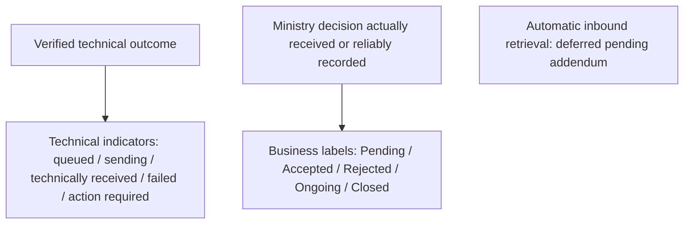

| Status information | Initial treatment | Evidence / dependency |
|---|---|---|
| Case saved / not referred | No transmission triggered | Explicit referral test F-01 |
| Technical delivery / failure | Separate transaction indicator | Gateway result, attempt history and failure classification |
| Pending | Business workflow label only; never implies receipt or acceptance without evidence | Ministry-approved meaning / authorised process |
| Accepted / Rejected | Display only an actual evidenced Ministry decision | Authorised decision provenance; technical receipt is insufficient |
| Ongoing / Closed | Display only actual evidenced case-management information | Approved recording process; no automatic inbound synchronisation initially |

### B.12 Reliability design

The gateway persists each operation before transmission, maintains a persistent operation idempotency key separately from CPIMS+ case linkage, and records restricted metadata audit. Four configurable retries follow the initial failed attempt at delays of 1, 5, 30 and 120 minutes after the preceding failure, subject to Primero validation. Exhaustion produces a failed transmission indicator and administrator alert; controlled manual retry records authorised actor, reason, timestamp and result after duplicate checks. Permanent errors require correction; ambiguous creation requires reconciliation before any potentially duplicate resubmission. No specific response code or UUID-return format is assumed.

Earlier repeated / out-of-order return-update controls are retained as future RT-007 requirements, not initial acceptance conditions. An OPENCHS save must not transmit, close or overwrite a CPIMS+ case automatically. Explicit corrections / withdrawal / re-referral require permitted operations, approved rules and contractual confirmation where necessary (SCOPE-001–SCOPE-002).

### B.13 Connection design

**All current diagrams are validated design positions subject to deployed technical verification, not approval or implementation evidence.** The BITZ Integration Gateway is the final architecture position; OpenFN is not used (TECH-001); X-Road is excluded from this referral path. Webhooks / polling and attachment transfer are future addendum scope. Historical diagram files remain linked for traceability.

#### B.13.1 Design principles

1.  **Manual, explicit referral** — nothing is sent because a case was saved (D-006).

2.  **Separate events** — system receipt, human acceptance/rejection, distribution and case progress are distinct states (D-016).

3.  **No duplicates** — retries reuse the persistent operation idempotency key; the gateway separately maintains CPIMS+ UUID linkage and reconciles ambiguous creation before resend (OPS-003).

4.  **No silent loss** — failed transmissions are queued, visible and recoverable (OPS-001).

5.  **Minimum necessary data** — only approved initial outbound fields move; future inbound sharing needs addendum and approved field / case restrictions (SEC-003, SEC-008).

6.  **Evidence by design** — every transmission and update is auditable without logging sensitive content (OPS-004, SEC-006).

#### B.13.2 Diagram A — System context

*Proposed Architecture – Subject to Technical Validation*

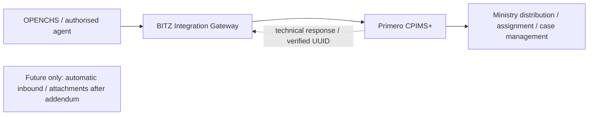

#### B.13.3 Diagram B — Referral sequence

*Proposed Architecture – Subject to Technical Validation.* Operation names are from the upstream API v2 documentation (Annex B); the Lesotho operation sequence is confirmed by Primero (Isaiah Amutavi Osotsi) (API-003).

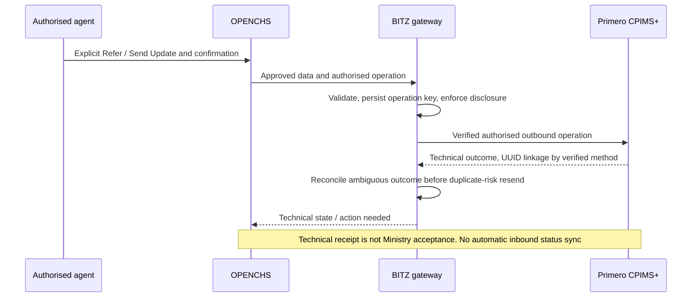

#### B.13.4 Diagram C — Technical integration

*Proposed Architecture – Subject to Technical Validation*

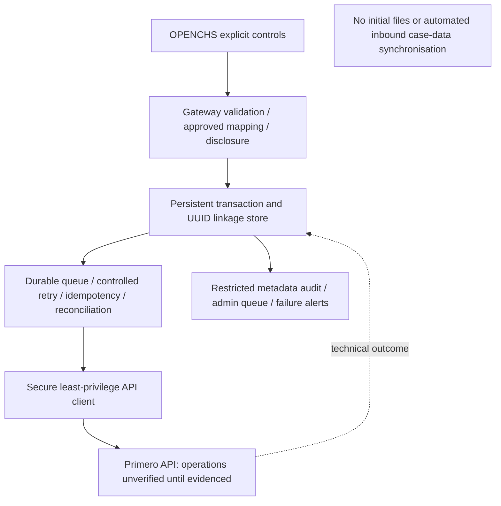

#### B.13.5 Component summary

| **Layer** | **Proposed component** | **Evidence status** |
|----|----|----|
| Intake | OPENCHS case form with ABR field and referral control | D2 build; form engine to verify |
| Outbound | BITZ Integration Gateway with approved transformation, persistent state, queue, operation idempotency, retry, UUID linkage and reconciliation | Validated initial design; implementation framework / deployed API evidence pending |
| Authentication | Primero JWT bearer tokens; integration account | Confirmed (JWT); credentials issued by Primero (A-023) |
| Receiving system | Authorised create / referral, verified UUID linkage and explicit outbound update operations | Deployed sequence / schemas / permissions unverified; particular updates need contractual confirmation; attachment operations excluded initially |
| Return channel | Future webhook / polling / inbound reconciliation only | Pending Validation — Contract Addendum (RT-007); not an initial component or acceptance gate |
| Controls | Metadata-only audit, restricted admin queue, failure alerts and secure credentials | Validated design; retention / access approval and technical tests pending |

Before design sign-off, the BITZ developers must verify the actual OPENCHS case model, integration framework, queue, role permissions, audit facilities, deployment and secret management. The Primero technical coordinator must confirm receiving-system capabilities, service configuration and permissions. Earlier technical reference material describes referral being created automatically on case save; that conflicts with D-006 and must not be implemented.

#### B.13.6 Diagram D — Environment architecture

*Proposed Architecture – Subject to Technical Validation*

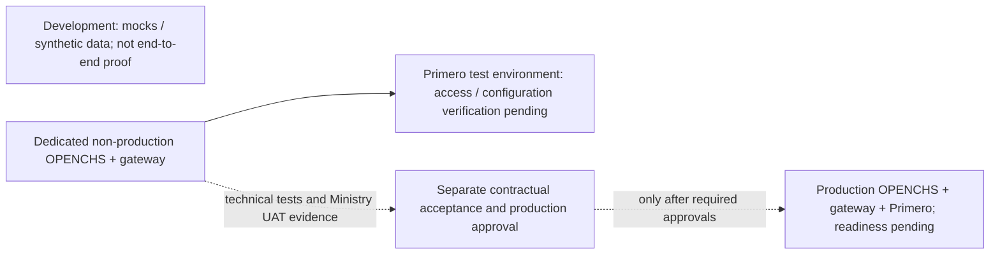

| **Environment** | **Owner** | **Historical status (27 Oct 2026)** | **Notes** |
|----|----|----|----|
| OPENCHS development | BITZ | Internal; not shared | Mock and contract tests only; must not be described as live integration |
| OPENCHS test/UAT with API Gateway | BITZ | Being stood up; access evidence pending (API-005) | Dedicated non-production outbound client using restricted Primero credentials; readiness evidence pending |
| Lesotho CPIMS+ sandbox/demo | Primero (Isaiah), Lesotho checklist (Rantsala) | Checklist incomplete; no progress since Session 2 (A-015) | Configured from country SOPs, forms and use cases |
| Primero global playground | Primero (Isaiah) | Agreed fallback (D-018); URL and access pending (A-016) | Not Lesotho-configured; tests needing country configuration must be repeated |
| Production (both systems) | Infrastructure owners | Not confirmed (API-008) | Endpoints, credentials, certificates and rollback to define |

Current environment dependency status is in Annex E. The historical table does not establish current access; [M4] targeted 13 November, without guaranteeing availability. Synthetic data is the default and mocks are not end-to-end evidence.

#### B.13.7 Integration reliability and audit requirements

The supplied generic Primero API specification is reference material pending deployed compatibility checks. The release, authentication, initial outbound operation sequence, UUID linkage / reconciliation and service-to-recipient mapping require technical confirmation. Return-update mechanisms remain future addendum work, not initial dependencies. The design must address durable queuing, duplicate prevention, retries, escalation, monitoring and transaction audit without asserting that those controls have been implemented. Detailed requirements are retained in Annex A.4, J.6 and J.7; API evidence and configuration dependencies are in Annex B.

## Annex C — Data mapping, data dictionary and safeguarding register

### C.1 Confirmed information set (D-012) and mapping status

The field set is a **business payload baseline**, not a deployed API schema. D-012 historical inclusion is retained below; current initial scope follows SCOPE-001–SCOPE-005. No unapproved field is transmitted merely because it appears in this table.

| **Information** | **Business requirement** | **Status** | **Technical mapping still needed** |
|----|----|----|----|
| Child name and location | Identifying details required to trace the child (D-011) | Confirmed | Name parts, minimum identity, location hierarchy, exceptions |
| Age, sex, nationality, child contact | In agreed bio-data set | Confirmed | Types, codes, estimated age, unavailable contact |
| Case category | Maps to CPIMS+ protection concerns (multi-select) | Confirmed | Approved concern list, multi-value codes |
| Case narrative | Mandatory at referral, not first save (D-013) | Confirmed | Target field, length, permitted sensitive content |
| Reporter contact | Included when available; anonymous reporter allowed (D-010) | Confirmed | Anonymous flag/value, optional contact, privacy |
| Perpetrator details | Included | Confirmed | Fields, unknowns, access, conditional validation |
| Attachments | Historically included by D-012; no initial electronic file transfer, URLs, tokens or sensitive details | Pending Validation — Contract Addendum (DATA-010) | Future controls and API support only after addendum |
| Supporting-material-existence metadata | Non-sensitive existence indication only; does not authorise file transfer | Conditional; omit pending all five SCOPE-003 conditions | Ministry approval and necessity, supported field, no sensitive details, validated mapping and security |
| Follow-up updates | Explicit authorised outbound Send Update action using the linked UUID | Validated initial requirement; specific contractual treatment / capability pending where needed | Approved fields, operations, permissions, UUID linkage and audit; saving alone sends nothing |
| ABR ID | Optional; NICR structural validation (D-005, D-014) | Confirmed | Target field, blank representation, correction |
| Selected service | Agent selects from CPIMS+ service list (D-008) | Confirmed; list is a Dependency | Service codes; receiving user or agency per service |
| Consent and disclosure | Call-time capture / withdrawal discussed in [M4]; states defined in | Pending Ministry Business or Legal Approval | Approved purpose / disclosure / exception rules and deployed field representation (B.6) |
| CPIMS+ feedback | Historical D-007 business request; automatic inbound excluded initially | Pending Validation — Contract Addendum | Future approved values, access, delivery and reconciliation; no initial automated retrieval |
| Helpline case plan | Not transmitted | Excluded (Confirmed) | Exclude from payload |
| External case reference | Gateway table links OPENCHS case / referral, CPIMS+ UUID, operation idempotency key, linkage state and timestamps | Validated design; technical verification pending | Verify actual UUID retrieval / narrow reconciliation; do not assume a creation response always contains a UUID |

### C.2 ABR identifier rules (D-005, D-014)

| **Attribute** | **Rule** | **Status** |
|----|----|----|
| Meaning | Birth registration number issued at birth; persists through national ID, passport and school records [M1 section 5] | Confirmed |
| Issuing authority | NICR, Ministry of Home Affairs | Confirmed (reported by Hopolang after contact with Home Affairs) |
| Length | 12 digits | Confirmed |
| Prefix | First digit 0 or 1 | Confirmed |
| Sex position | Seventh digit: 1 male, 2 female | Confirmed |
| Requiredness | Optional; referral proceeds when unavailable | Confirmed |
| Missing identifier | Receiving caseworker obtains it during follow-up | Confirmed |
| Storage | Text, preserving leading zeroes | Proposed |
| Sex mismatch handling | Warn; authorised audited override under approved roles | Validated design (SCOPE-005); Ministry role approval pending |
| Checksum / uniqueness / live verification | Not supplied; A-007 open; Home Affairs route via A-019 sessions | Pending Confirmation |

**the corresponding figure — ABR ID structure** (D-014; [M3 section 9]; [RC1] item 6). The source defines only positions 1 and 7. The meaning of the other positions is not recorded.

**Rule**

**1:** 0 or 1

**2:** digit

**3:** digit

**4:** digit

**5:** digit

**6:** digit

**7:** 1 = male, 2 = female

**8:** digit

**9:** digit

**10:** digit

**11:** digit

**12:** digit

Validation outcomes: a blank value is accepted (D-005). A value that is not 12 digits, starts with 2–9, or has a seventh digit other than 1 or 2 is rejected with a message (F-08). A seventh digit that conflicts with recorded sex produces a warning and permits an authorised audited override under approved roles (F-09; SCOPE-005).

Structural checks do not prove that an identifier exists, is unique or belongs to the child. Live NICR / Home Affairs / X-Road verification and operation of an identity platform are excluded initially; technical coordination does not create a build obligation (DEF-009; SCOPE-005).

### C.3 Mapping attributes required per field

Source and target field; direction; datatype; requiredness (including conditional); validation; transformation; lookup values; sensitivity classification; approving owner. Isaiah supplies configured definitions and lookups; Ministry and OPENCHS stakeholders approve the business mapping (Proposed approval route). The contract requires all Primero field names and category mappings to be held in a central configuration file rather than in program code, so that changes do not need a software release (proposed). Template: 04_templates/04_field_mapping_worksheet.docx.

### C.4 Candidate field names

Earlier developer examples (abr_id, OPENCHS_reference_id, name_first, name_last, protection_concerns, location_current, referral_notes) are **candidate names, not the confirmed Lesotho schema**. Date-of-birth, risk-level, module and referral-source examples require explicit mapping approval; their presence in earlier material does not expand the agreed field set. Primero will produce one standardised protection-concern list aligned across both systems [M2 section 11]. The OPENCHS “Services Offered” value sent on referral is a label such as “CPIMS+” or “Child Protection Service”.

### C.5 Data dictionary status

| **Item** | **Status** |
|----|----|
| OPENCHS case/contact data object | Shared by Nelson in Session 2 |
| CPIMS+ required field list | Requested in Session 2; not received |
| Configured Lesotho field definitions and lookups | Dependency — after sandbox setup |
| Unified national referral form | Recorded as shared (A-004); not available |
| Standardised protection-concern list | Dependency — Primero |
| CPIMS+ service list | Dependency — A-018 |

### C.6 Proposed data classification

**Table C.6 — Proposed classification matrix**

The labels below are proposed. Final classification labels will be applied only after confirmation against the Ministry's applicable information-classification policy [DMP1 section 5].

| **Data** | **Direction** | **Proposed sensitivity** | **Control** |
|----|----|----|----|
| Child identity and demographics | OPENCHS → CPIMS+ | High: sensitive child-protection information requiring heightened protection (DPA section 29(a)) | Approved fields only; TLS; least privilege; not written to logs |
| Location and contact details | OPENCHS → CPIMS+ | High | Necessary, authorised fields only |
| Case narratives and safeguarding allegations | OPENCHS → CPIMS+ | High: heightened protection (DPA section 29(b)) | Not written to logs or the ledger; role-based access |
| Reporter information | OPENCHS → CPIMS+ only where given and permitted | High | Anonymity preserved (D-010); excluded where anonymity applies |
| Alleged perpetrator details | OPENCHS → CPIMS+ | High | Approved, relevant fields only; identified as allegations |
| ABR identifier | OPENCHS → CPIMS+ when available | High (national identifier) | Structural checks; stored as text; excluded from operational logs |
| Approved service and referral linkage | OPENCHS → gateway → CPIMS+ | Medium | Approved service codes; ledger |
| CPIMS+ UUID | CPIMS+ → gateway (technical response) | Medium | Ledger; displayed only to authorised users |
| Technical transaction metadata | Gateway (internal) | Medium | Sanitised; restricted access; approved retention (OPS-004, OPS-005) |
| Security credentials and secrets | Gateway (internal) | Restricted | Secret store; never logged; rotation (SEC-004) |
| Attachments, recordings and case plan | Not transferred | — | Excluded (DATA-010; FN-011) |
| Ministry business statuses and interventions | Not transferred initially | — | Deferred to a future addendum (RT-007) |

### C.7 Data-protection, security and safeguarding register (DSR-01 to DSR-18)

Milestone codes: DEV development; TIT technical integration testing; UAT joint user acceptance testing; PROD production exchange; GL go-live. Statuses marked Confirmed reflect the project record [PR1].

**Table C.7 — Safeguarding register**

| **ID** | **Description** | **Accountable organisation** | **Named person (where confirmed)** | **Required evidence** | **Status** | **Affected requirement** | **Milestone blocked** | **Acceptance impact** | **Target date** | **Related reference** |
|----|----|----|----|----|----|----|----|----|----|----|
| DSR-01 | Applicable data-protection legislation and its current status, including amendments, regulations, codes and child-protection legislation | Ministry; UNICEF legal advisers | — | Written legal confirmation | Under Review (A-022 desk research; [DPA1] received) | SEC-001 | PROD, GL | Production authorisation | — | A-017, A-022; R-007 |
| DSR-02 | Approved lawful bases and disclosure purposes for each scenario in section 7 | Ministry | — | Consent during the call; otherwise child-protection (vital interest) basis with supervisor authorisation | Confirmed | SEC-001; DATA-012 | UAT (rules), PROD | Mapping and UAT scenarios | — | A-022; R-007 |
| DSR-03 | Consent and safeguarding-exception authority, evidence and withdrawal handling | Ministry | — | Where consent cannot be obtained or is refused, a referral may proceed on the child-protection (vital interest) basis with supervisor authorisation. Withdrawal stops further updates but does not recall referrals already sent | Confirmed | DATA-012; WF-004 | UAT, PROD | Consent scenarios | — | R-011 |
| DSR-04 | Data-sharing agreements and the organisations taking part in the approved flow | Ministry; UNICEF | — | Ministry (controller) and BITZ (processor) under the existing contract | Confirmed | SEC-001 | PROD | Real-data exchange | — | Section 7; R-007 |
| DSR-05 | Data-controller and processor responsibilities and written processing contracts | Ministry; UNICEF | — | The Ministry is data controller for CPIMS+ and the helpline data; BITZ is processor for OPENCHS and the gateway under the existing contract. Existing hosting is unchanged, and remote support follows the existing support contract | Confirmed | SEC-001 | PROD | Production authorisation | — | R-017 |
| DSR-06 | Approved routine, partial and emergency minimum datasets | Ministry; Primero (feasibility) | — | Child's details and narrative; minimum emergency information in emergencies. Primero mandatory-field check remains | Confirmed | DATA-005; WF-004, WF-005; FN-005 | TIT (mapping), UAT | Validation build and UAT | — | Annex C; Section 5 |
| DSR-07 | Reporter anonymity and child identity rules | Ministry | — | Approved disclosure rules and anonymous representation | Pending Confirmation | DATA-008; SEC-002; D-010, D-011 | UAT | Anonymity scenarios | — | Annex C.1 |
| DSR-08 | Retention and secure deletion of ledger, logs and queued data (no periods prescribed under section 19) | Ministry | — | Proposed: metadata logs and the transaction ledger kept for 24 months; queued payloads deleted once delivery succeeds; Ministry to confirm | Proposed | SEC-006; OPS-005 | PROD | Production authorisation | — | Section 6 |
| DSR-09 | Hosting location and cross-border support access | Ministry; Primero; BITZ | — | Existing hosting unchanged; remote support under the existing support contract | Confirmed | GOV-004 | TIT (network), PROD | Production authorisation | — | R-017 |
| DSR-10 | Security-incident notification procedure, including recipients while the Commission is not established (section 23) | Ministry; UNICEF | — | Approved procedure and contacts | Pending Confirmation | OPS-007 | PROD | Go-live readiness | — | R-017 |
| DSR-11 | Approved synthetic test dataset | Ministry (privacy owner); BITZ prepares | Tiisetso Mohlabi (approval) | Dataset approved before use | Confirmed | SEC-007; UAT-003 | TIT, UAT | All testing | — | Annex D S-08 |
| DSR-12 | Named data-protection and security approvers | Ministry | Tiisetso Mohlabi | Written nomination | Confirmed | GOV-001 | UAT, GL | Approval of security evidence | — | R-014 |
| DSR-13 | Government information-classification and security documentation (DMP sections 5 and 5.6.8); UNICEF asked to supply the classification policy | Ministry; UNICEF | — | Classification policy; required security documents | Pending Confirmation | SEC-006 | PROD | Final classification labels | — | Section 7 |
| DSR-14 | Primero integration-account permissions and technical capabilities | Primero | Isaiah Amutavi Osotsi | Operations and permissions confirmed by Primero | Confirmed | SEC-003; API-002, API-003 | TIT | Implementation | — | Section 6 register; Annex B |
| DSR-15 | Readiness of the Lesotho test environment | Primero; UNICEF (checklist) | Isaiah Amutavi Osotsi; Rantsala Sanaha | Access confirmed by Primero | Confirmed | UAT-003 | TIT, UAT | Lesotho verification | 13 Nov 2026 target recorded at [M4]; not guaranteed | A-015, A-016 |
| DSR-16 | Approval of the safeguarding SOP, including current applicability of the 2019 SOP | Ministry | — | 2019 SOP confirmed as applicable | Confirmed | WF-001, WF-003 | UAT | Safeguarding scenarios | — | Section 3; A-013 |
| DSR-17 | Operational support and incident escalation | BITZ; Primero; Ministry; Child Helpline | Hopolang Mosena (responsible) | Named contacts; approved runbook | Confirmed (responsible person) | OPS-006, OPS-007 | GL | Go-live readiness | — | Section 6 |
| DSR-18 | Final authorisation of production data exchange | Ministry | — | Written authorisation | Blocked (depends on DSR-01 to DSR-17) | SEC-001 | PROD, GL | Go-live | — | Section 4 stage 4 |

## Annex D — Testing and acceptance matrix

Planned scenarios, **not executed tests**. Original scenario wording, basis, expected result and priority are retained as history; the current scope / criterion column controls this validation draft. Historical Must priorities on future tests do not make them initial gates. Each executed test must record requirement, prerequisites, steps, expected / actual result, tester, environment, evidence, defects and outcome. Synthetic data is the default. Contractual ambiguity for a specific outbound operation must be resolved before final acceptance criteria (SCOPE-001, SCOPE-009).

### D.1 Business process (B)

| **ID** | **Scenario** | **Basis** | **Original expected result (historical)** | **Priority** | **Current scope / acceptance criterion** |
|----|----|----|----|----|----|
| B-01 | End-to-end referral following SOP pathway | WF-001; D-006 | Steps D.1 1–7 complete with correct states | Must | Initial: demonstrate explicit outbound lifecycle and verified linkage in Annex B; no automatic return update required. |
| B-02 | Emergency case: phone call plus system referral | WF-007; D-003 | Phone path unaffected; referral recorded and tracked | Must | Initial: apply the original scenario within section 4 scope, approved business rules and verified technical behaviour; no implementation or test completion claimed. |
| B-03 | Agent escalates to supervisor before referral | WF-003 | Escalation recorded; referral by agent after review | Should | Initial: optional escalation; authorised agents may refer directly unless a separately approved rule requires escalation. |

### D.2 Functional (F)

| **ID** | **Scenario** | **Basis** | **Original expected result (historical)** | **Priority** | **Current scope / acceptance criterion** |
|----|----|----|----|----|----|
| F-01 | Save case without referring | D-006 | Nothing sent to CPIMS+ | Must | Initial: apply the original scenario within section 4 scope, approved business rules and verified technical behaviour; no implementation or test completion claimed. |
| F-02 | Save without narrative; attempt referral without narrative | D-013 | Save succeeds; referral blocked with message | Must | Initial: save succeeds without narrative; ordinary referral requires it, with only approved documented emergency exceptions. |
| F-03 | Anonymous reporter, identified child | D-010; D-011 | Referral succeeds; CPIMS+ shows reporter anonymous; no reporter identity sent | Must | Initial: apply the original scenario within section 4 scope, approved business rules and verified technical behaviour; no implementation or test completion claimed. |
| F-04 | Missing child identifying details | D-011 | Referral blocked with message (unless approved emergency exception) | Must | Initial: apply the original scenario within section 4 scope, approved business rules and verified technical behaviour; no implementation or test completion claimed. |
| F-05 | Emergency minimum-information referral | D-003; WF-004 | Behaves per approved minimum dataset | Must (rule pending) | Initial: apply the original scenario within section 4 scope, approved business rules and verified technical behaviour; no implementation or test completion claimed. |
| F-06 | Valid ABR ID | D-014 | Accepted and transmitted | Must | Initial: apply the original scenario within section 4 scope, approved business rules and verified technical behaviour; no implementation or test completion claimed. |
| F-07 | ABR absent | D-005 | Referral proceeds | Must | Initial: apply the original scenario within section 4 scope, approved business rules and verified technical behaviour; no implementation or test completion claimed. |
| F-08 | ABR invalid: 11 or 13 digits; prefix 2–9; seventh digit not 1 or 2; non-numeric | D-014 | Clear validation message; leading zero preserved for valid IDs | Must | Initial: apply the original scenario within section 4 scope, approved business rules and verified technical behaviour; no implementation or test completion claimed. |
| F-09 | ABR seventh digit inconsistent with recorded sex | D-014 | Behaves per agreed rule | Should (rule pending) | Initial: sex mismatch warning with authorised audited override; approved roles and structural rule evidence required. |
| F-10 | Service selection routes to configured recipient | D-008 | Referral appears for the configured receiving user/agency | Must | Initial: apply the original scenario within section 4 scope, approved business rules and verified technical behaviour; no implementation or test completion claimed. |
| F-11 | System acknowledgement, then accept; separately reject with reason | D-016 | Distinct Received, Accepted / Rejected states and reason shown | Must | Initial: separate technical response from Ministry decision actually received / reliably recorded; no automated status retrieval or inferred acceptance. |
| F-12 | Status and intervention updates returned | D-007 | Linked OPENCHS case shows approved fields only | Must | Future — contract addendum required; historical test retained, excluded from initial UAT / acceptance. Ministry data-sharing approval and Primero verification required before later execution. |
| F-13 | OPENCHS follow-up, including prank re-flag | D-012; [M1 section 7] | Update applied to linked CPIMS+ case, no new case | Must | Initial validated operation: explicit Send Update to CPIMS+ uses verified UUID linkage; saving alone sends nothing; prank notice does not close CPIMS+. Confirm contractual treatment and supported API operation. |
| F-14 | Perpetrator details | D-004; D-012 | Transmitted to agreed fields; unknowns handled | Must | Initial: apply the original scenario within section 4 scope, approved business rules and verified technical behaviour; no implementation or test completion claimed. |
| F-15 | Attachment within and outside agreed limits | D-012 | Allowed files transmitted; disallowed rejected with message | Must | Future — contract addendum required; historical test retained, excluded from initial UAT / acceptance. Ministry data-sharing approval and Primero verification required before later execution. |
| F-16 | Case plan present in OPENCHS | D-012 | Case plan not in payload | Must | Initial negative-transfer test: case plan, all file / media contents, file URLs, tokens and sensitive attachment details absent. Supporting-material-existence metadata absent unless all five SCOPE-003 conditions evidenced; permitted metadata conveys no file access. |
| F-17 | ABR added or corrected later | DATA-004 | Behaves per agreed update contract | Should | Initial validated operation: authorised correction explicitly updates linked UUID with history; supported operation / contract treatment and field rules confirmed. |
| F-18 | Ministry distribution after acceptance | D-008 | Helpline sees acceptance and progress, not internal assignment | Must | Initial: authorised Ministry distribution / assignment demonstrated; OPENCHS displays only reliably recorded decisions, without requiring automatic progress retrieval. |
| F-19 | Correction, cancellation, re-referral | WF-006 | Behaves per approved rules; history preserved | Must (rules pending) | Initial only for approved / supported / contractually confirmed operations; explicit action, preserved linkage / history, no automatic closure or overwrite. |

### D.3 Security and privacy (S)

| **ID** | **Scenario** | **Basis** | **Original expected result (historical)** | **Priority** | **Current scope / acceptance criterion** |
|----|----|----|----|----|----|
| S-01 | Token issue, expiry after 60 minutes, renewal | API-002 | Uninterrupted delivery; no credential in logs | Must | Initial: verify actual token lifetime / renewal semantics in the deployed contract rather than assuming the reported 60 minutes; secrets absent from logs. |
| S-02 | Integration account attempts unapproved field | SEC-003 | Field not set | Must | Initial: disallow unapproved fields, unrestricted case reading and administrative privileges. |
| S-03 | Log inspection | SEC-006 | No tokens or full narratives; reporter anonymity intact | Must | Initial: metadata-only restricted logs; no full payloads, ABR values, credentials or tokens; test redaction, access audit and approved retention. |
| S-04 | Return-update channel authentication and field limits | SEC-008; RT-007 | Unauthenticated calls refused; only approved fields stored | Must | Future — contract addendum required; historical test retained, excluded from initial UAT / acceptance. Ministry data-sharing approval and Primero verification required before later execution. |
| S-05 | Transport security | SEC-005 | TLS enforced; invalid certificate rejected outside local | Must | Initial: TLS 1.2+ and valid certificate verification; reject invalid certificates and obsolete protocols; confirm required network controls. |
| S-06 | Consent fields and override | DATA-012 | Behaves per Ministry decision | Must | Initial: test approved consent / alternative-lawful-basis / withdrawal / exception matrix; no unapproved disclosure. |
| S-07 | OPENCHS role access to returned data | SEC-008 | Only authorised roles see returned updates | Must | Future — contract addendum required; historical test retained, excluded from initial UAT / acceptance. Ministry data-sharing approval and Primero verification required before later execution. |
| S-08 | Test data check | SEC-007 | Only approved synthetic data in test environments | Must | Initial: synthetic by default; exceptional real-data use only with separate Ministry approval and safeguards. |

### D.4 Recovery and reliability (RC)

| **ID** | **Scenario** | **Basis** | **Original expected result (historical)** | **Priority** | **Current scope / acceptance criterion** |
|----|----|----|----|----|----|
| RC-01 | Lost response after case creation; retry with same UUID | OPS-003 | 409 reconciled; exactly one CPIMS+ case | Must | Initial: persist operation key, lock / enforce uniqueness, reconcile ambiguous creation using verified semantics and establish UUID linkage before resubmission; no assumed HTTP code proves success. |
| RC-02 | Agent double-clicks referral | FN-003 | One referral only | Must | Initial: apply the original scenario within section 4 scope, approved business rules and verified technical behaviour; no implementation or test completion claimed. |
| RC-03 | Primero unavailable; referrals queued; service restored | OPS-001 | All queued referrals delivered or flagged; none lost | Must | Initial: apply the original scenario within section 4 scope, approved business rules and verified technical behaviour; no implementation or test completion claimed. |
| RC-04 | Retries exhausted | OPS-002; AUD-001/002 | Failed state, administrator alert, controlled manual retry works | Must | Initial: four configurable retries after initial attempt at 1 / 5 / 30 / 120 minutes after preceding failure, subject to Primero validation; exhaustion alerts and controlled manual retry after duplicate checks, with actor / reason / time / result. |
| RC-05 | Duplicate and out-of-order return updates | RT-007 | Duplicates ignored; stale updates do not overwrite newer state | Must | Future — contract addendum required; historical test retained, excluded from initial UAT / acceptance. Ministry data-sharing approval and Primero verification required before later execution. |
| RC-06 | 422 validation error from Primero | API-004 | Needs-action state with field named; no blind retry | Must | Initial: verify actual validation-error schema, require correction and avoid blind retry; generic 422 is not a deployment assertion. |
| RC-07 | Missed webhook delivery (if Option 1) | B.5 | Reconciliation recovers the update | Must (if Option 1) | Future — contract addendum required; historical test retained, excluded from initial UAT / acceptance. Ministry data-sharing approval and Primero verification required before later execution. |
| RC-08 | Token expires while queue is draining | API-002 | Re-authentication; delivery continues | Must | Initial: apply the original scenario within section 4 scope, approved business rules and verified technical behaviour; no implementation or test completion claimed. |

### D.5 Audit and regression

| **ID** | **Scenario** | **Basis** | **Original expected result (historical)** | **Priority** | **Current scope / acceptance criterion** |
|----|----|----|----|----|----|
| AU-01 | Audit record completeness | OPS-004 | Every transmission and return update has all approved fields | Must | Initial: outbound transaction references, operation / UUID / idempotency linkage, actors, outcomes, attempts and interventions audited as restricted metadata; return-update audit deferred. |
| RG-01 | Regression of existing OPENCHS functions | OPS-008 | No Critical/High regression | Must | Initial: existing OPENCHS functionality unaffected; no open initial-scope Critical / High defects; lower-severity exceptions only under UAT-007. |

### D.6 Coverage of Session 3 decisions

This is historical decision-to-scenario traceability. D-007 scenarios and F-15 are future addendum tests; their continued presence does not make them initial acceptance criteria. F-16 includes the initial negative-transfer / conditional-metadata checks.

| **Decision** | **Scenarios** |
|----|----|
| D-005 | F-07, F-17 |
| D-006 | F-01, B-01, RC-02 |
| D-007 | F-12, RC-05, S-04, RC-07 |
| D-008 | F-10, F-18 |
| D-009 | UAT organisation (section 10) |
| D-010 | F-03, S-03 |
| D-011 | F-03, F-04 |
| D-012 | F-13, F-14, F-15, F-16 |
| D-013 | F-02 |
| D-014 | F-06, F-08, F-09 |
| D-015 | Architecture review (section 6) |
| D-016 | F-11 |
| D-017 | S-01, RC-01, RC-06 (built to documented API) |
| D-018 | Environment record notes playground vs Lesotho configuration for each test |

### D.7 Acceptance criteria (AC-01 to AC-18)

Thresholds are agreed [M4 section 10; PR1]. AC-08 applies only to a future inbound mechanism.

| **ID** | **Criterion** | **Source** | **Threshold** | **Approval status** | **Test scenarios** | **Environment** | **Responsible verifier** | **Actual result** | **Evidence** | **Defects** | **Exception** | **Acceptance status** |
|----|----|----|----|----|----|----|----|----|----|----|----|----|
| AC-01 | Scenario coverage | UAT-004 | 100% of approved Annex D Must scenarios executed with evidence; pass and fail recorded separately (execution is not a pass) | Agreed | All Must | Lesotho | BITZ (technical); Ministry (UAT) | — | — | — | — | Not assessed |
| AC-02 | Faults | UAT-007 | 0 open Critical; 0 open High without a written waiver | Agreed | All | Lesotho | Ministry; UNICEF (waiver) | — | — | — | Per section 10 | Not assessed |
| AC-03 | Duplicate prevention | OPS-003; DATA-013 | 0 duplicate CPIMS+ cases across all approved retry, resubmission, lost-response and uncertain-create tests; reconciliation before any further create where the outcome is unknown | Agreed | RC-01, RC-02 | Lesotho | BITZ; Primero | — | — | — | Not permitted (Critical) | Not assessed |
| AC-04 | Service interruption recovery | OPS-001 | 100% of referrals queued during a simulated interruption are delivered, or flagged for authorised manual action, after restoration; none lost. A flagged item is not a delivered item | Agreed | RC-03, RC-04 | Lesotho | BITZ; Primero | — | — | — | — | Not assessed |
| AC-05 | Audit completeness | OPS-004 | 100% of Create Referral and Send Update operations, technical responses, retry attempts, reconciliation outcomes, failures and authorised manual actions in the test set have an audit record with all approved fields, without prohibited sensitive content | Agreed | AU-01 | Lesotho | BITZ; security approver | — | — | — | — | Not assessed |
| AC-06 | Log redaction | SEC-006 | No access secrets or complete case descriptions in the activity records checked | Agreed | S-03 | Lesotho | Security approver (DSR-12) | — | — | — | Not permitted | Not assessed |
| AC-07 | Validation rules | D-005, D-010, D-011, D-013, D-014 | 100% of the test cases for optional ABR (D-005), anonymous reporter (D-010), child identifying details (D-011), narrative at referral (D-013) and ABR structure (D-014) behave as specified | Agreed | F-02 to F-09 | Lesotho | BITZ; Ministry | — | — | — | — | Not assessed |
| AC-08 | Return-update timeliness | RT-007 | Not applicable to the initial scope; would be set with any future mechanism (RT-007). It applies only to any future automatic inbound addendum. Explicit Send Update is verified under AC-12. No number is set | PC (future scope) | — | — | — | — | — | — | — | Not applicable to initial scope |
| AC-09 | Regression testing | OPS-008 | No open Critical or High regression defect in existing OPENCHS functions | Agreed | RG-01 | Test | BITZ; Child Helpline | — | — | — | — | Not assessed |
| AC-10 | Authorised Create Referral | WF-002; FN-003 | Save never sends; only an authorised, confirmed action creates exactly one operation | Agreed | F-01, RC-02 | Lesotho | BITZ; Ministry | — | — | — | — | Not assessed |
| AC-11 | UUID persistence | DATA-013 | Every confirmed creation stores the CPIMS+ UUID in the ledger | Agreed | RC-01 | Lesotho | BITZ; Primero | — | — | — | — | Not assessed |
| AC-12 | Send Update linkage | FN-009 | Every Send Update references the existing UUID and creates no new case | Agreed | F-13 | Lesotho | BITZ; Primero | — | — | — | — | Not assessed |
| AC-13 | Uncertain-outcome reconciliation | OPS-003 | Every unresolved create is reconciled before any further create attempt | Agreed | RC-01 | Lesotho | BITZ; Primero | — | — | — | — | Not assessed |
| AC-14 | Lesotho environment compatibility | GOV-004 [CI]; API-001 | Authentication, field IDs, code lists and routing verified on the Lesotho environment | Agreed | Section 6 register | Lesotho | Primero; BITZ | — | — | — | — | Not assessed |
| AC-15 | Role permissions | SEC-003 | Unauthorised users cannot initiate, amend, view or recover | Agreed | S-02 | Lesotho | BITZ; security approver | — | — | — | — | Not assessed |
| AC-16 | Safeguarding | WF-007; section 7 | Emergency escalation independent of the API; approved exceptions recorded; anonymity preserved | Agreed | B-02, F-03, F-05 | Lesotho | Ministry | — | — | — | Not permitted | Not assessed |
| AC-17 | Data minimisation | SEC-001; FN-011 | Payload contains only approved fields; no case plan, attachments or recordings | Agreed | F-16 | Lesotho | Ministry; BITZ | — | — | — | Not permitted | Not assessed |
| AC-18 | Production-readiness dependencies | AP-07 | All go/no-go checklist items evidenced (Section 8) | Agreed | — | Production readiness | Go/no-go authorities | — | — | — | — | Not assessed |

### D.8 Acceptance evidence packages

| **ID** | **Evidence package** | **Contents** | **Deliverable / milestone** | **Producer** | **Reviewer (authority)** | **Environment** | **Status** | **Outstanding** | **Decision reference** |
|----|----|----|----|----|----|----|----|----|----|
| EV-01 | Requirements baseline | Approved workflows; field mapping; technical decisions; outstanding conditions | D1; G1 | BITZ | Ministry (business); UNICEF (contractual) | — | Produced (this report, under review) | Configured mapping; approvals (AP-01) | — |
| EV-02 | Technical verification | Gateway test results; Primero API verification; UUID linkage; retry and reconciliation; integration logs | D3, D4; G3, G4 | BITZ | BITZ and Primero technical reviewers | Simulation; Lesotho | Planned | G2 | — |
| EV-03 | Security and safeguarding | Access controls; data minimisation; redaction; synthetic data; incident controls | D3, D4 | BITZ | Security approver (DSR-12); Ministry | Lesotho | Planned | DSR register | — |
| EV-04 | Ministry UAT | Approved scenarios; named testers; execution evidence; defect disposition; signed UAT report | D4; G5 | Ministry, with BITZ support | Authorised Ministry signatory (CD-09) | Lesotho | Planned | CD-09; DSR-11 | — |
| EV-05 | Training and handover | Training plan; attendance; exercises; manuals; technical handover; training report | D4 | BITZ | Ministry (operational); UNICEF (contractual) | — | Planned | Section 8, decision 8 | — |
| EV-06 | Contractual acceptance | Deliverable submission; review comments; revised submission; written acceptance decision; conditions where applicable | D1–D4 | BITZ (submission) | Authorised UNICEF representative | — | D1: Produced, under review; D2–D4: Planned | AP-08 | — |
| EV-07 | Production readiness | Security approval; safeguarding approval; environment readiness; monitoring; support; incident response; rollback; written go/no-go | Go-live | BITZ; Primero | Go/no-go authorities (AP-07) | Production | Planned | AP-03, AP-05 | — |

## Annex E — Decisions, actions and dependencies

This annex keeps every historical identifier and owner. Action statuses are as last recorded in the action register, with later treatment noted; the current position of open items is in Sections 8 and 11.3.

Identifiers continue the Session 1–2 register; where Session 3 updated an earlier decision it kept the earlier ID. Earlier v0.4 report-local numbering is not equivalent.

### E.1 Current decisions

The decision wording and sources below preserve the recorded Session 1–3 business history. “Confirmed” in the historical record is not current contractual inclusion; the later treatment stated in each affected row and E.3 governs this draft scope.

| **ID** | **Decision** | **Source** | **Status** | **Supersedes** |
|----|----|----|----|----|
| D-001 | Support referrals to CPIMS+/MGYSD and other approved stakeholders | Session 2 | Confirmed (in principle) | — |
| D-002 | SOP covers the broader referral ecosystem and role-holders | Session 2 | Confirmed (in principle) | — |
| D-003 | Emergency referrals need not capture every detail first | Session 2 | Confirmed direction; minimum dataset Pending | — |
| D-004 | Perpetrator information is important | Session 2 | Confirmed; included by D-012 | — |
| D-005 | ABR optional; receiving caseworker obtains it if missing | Session 3 | Confirmed | Session 2 D-005 (“subject to approved Ministry process”) |
| D-006 | Manual handling-agent referral; process as presented | Session 3 | Confirmed | Session 2 D-006 (“direction discussed”) |
| D-007 | Two-way integration for referred-case updates | Session 3 | Confirmed **Current scope treatment:** Historical business requirement; current automatic inbound implementation is Pending Validation — Contract Addendum (SCOPE-002) | Session 2 D-007 (closed-loop “in principle”); Session 1 decision 5 one-way scope |
| D-008 | Ministry distribution; helpline selects CPIMS+ service | Session 3 | Confirmed; service list to confirm | Session 2 D-008; Session 1 decision 6 (direct to district supervisor) |
| D-009 | Ministry-led UAT with recorded participant roles | Session 3 | Confirmed | Session 2 D-009 (“agreed direction”) |
| D-010 | Anonymous reporter allowed, recorded as such in CPIMS+ | Session 3 | Confirmed | Session 2 position that anonymous reports cannot be referred |
| D-011 | Child identifying details mandatory for referral | Session 3 | Confirmed | — |
| D-012 | Field set as presented; case plan not sent | Session 3 | Confirmed **Current scope treatment:** Historical field-set agreement retained; initial electronic attachments excluded, non-sensitive existence metadata conditional under SCOPE-003; case plan still excluded | Session 3 facilitation-deck proposal to defer attachments |
| D-013 | Narrative mandatory at referral, not first save | Session 3 | Confirmed | — |
| D-014 | NICR ABR format for initial validation | Session 3 | Confirmed | Session 1 “validation deferred” |
| D-015 | Direct API or OpenFN; X-Road only for Home Affairs checks | Session 3 | Confirmed; API vs OpenFN choice Pending (Ministry) **Current scope treatment:** Historical choice unresolved at Session 3 and [M4]; SCOPE-006 then preferred the gateway with conditional OpenFN. **Final position:** BITZ Integration Gateway; OpenFN is not used (TECH-001) | — |
| D-016 | Two acknowledgements: system and human | Session 3 | Confirmed | — |
| D-017 | Primero API documentation is the build basis unless it changes | Session 3 | Confirmed **Current scope treatment:** Generic API material remains reference evidence; deployed version / capability verification still required (GOV-004) | — |
| D-018 | Global playground if Lesotho sandbox not ready by draft report | Session 3 | Confirmed | — |

“Confirmed” means agreed in the minutes; approval of this report remains pending.

### E.2 Session 1 numbered decisions

| **Session 1 \#** | **Decision** | **Current position** |
|----|----|----|
| 1 | Manual trigger by handling agent | Retained (D-006) |
| 2 | Perpetrator details included | Retained (D-004, D-012) |
| 3 | Payload: bio-data, category, narrative, reporter contact, perpetrator | Historically extended by D-012 (attachments, follow-ups, ABR); current SCOPE-003 excludes file transfer and permits only conditional existence metadata |
| 4 | ABR field optional; validation deferred | Updated by D-005, D-014 |
| 5 | Post-referral updates pushed to CPIMS+; return not committed | Historical treatment: retained for outbound; return requested under D-007. Current scope: explicit outbound subject to verified / contractually confirmed operations; automatic inbound requires addendum (SCOPE-001–SCOPE-002) |
| 6 | Helpline refers directly to district supervisor | Superseded by D-008 |
| 7 | Emergencies by direct phone in parallel | Retained (WF-007) |
| 8 | OPENCHS integrates directly with CPIMS+; X-Road separate | Retained (D-015) |

### E.3 Subsequent scope-validation decisions — SCOPE-001–SCOPE-010

Source: user-supplied scope-validation instructions, defined in section 4. These ten references record a validated implementation position for this draft. They are not new Annex A requirement IDs, formal Ministry approvals, technical verification or a signed variation. Earlier D-007 / D-012 decisions remain preserved in E.1–E.2.

| Validation reference | Validated position | Affected sections / existing requirements | Remaining authority / dependency |
|---|---|---|---|
| SCOPE-001 | Initial outbound creation and explicit authorised follow-up through BITZ gateway | 4.1, 4.3; FN-009, API-003, DATA-013 | Specific update operations require contractual confirmation where not explicit; Primero verifies support |
| SCOPE-002 | Retain D-007 history; automatic inbound / related mechanisms deferred | 4.2; FN-010, RT-007, SEC-008, AUD-003 | Formal addendum, Ministry sharing approval and Primero validation |
| SCOPE-003 | Exclude all electronic files; narrowly conditional existence metadata only | 4.4; DATA-010; Annex C.1 | All five metadata conditions evidenced; actual file transfer requires addendum |
| SCOPE-004 | Explicit exclusions with essential UI / security / deployment-readiness exception | 4.1, 4.4; D-012; DEF-002, DEF-004–DEF-009 | Material expansion requires approved change control; signed obligations not waived |
| SCOPE-005 | Optional structural ABR checks; external registry integration excluded | 4.3; FN-001–FN-002, DATA-003–DATA-004; DEF-009 | Official specification and override roles; additional integration requires variation |
| SCOPE-006 | BITZ gateway / direct API baseline; no X-Road referral path. (The conditional OpenFN element is superseded by TECH-001: OpenFN is not used) | 4.3; API-009, GOV-004; Section 6 / Annex B | Deployed version, API, authentication, UUID, permissions and environments unverified |
| SCOPE-007 | Shared technical / business responsibility without new SLA | 4.5; OPS-006–OPS-007; UAT-002 | Named owners, support escalation and authorised UAT signatory |
| SCOPE-008 | Formal documented impact assessment and change control | 4.6; CD-01, CD-04; existing change register | Required contracting-party approval before out-of-scope implementation |
| SCOPE-009 | Initial-scope evidence and four separate acceptance / go-live stages | 4.7; UAT-002–UAT-004, UAT-007, UAT-010 | Verified results, named authority and separate acceptance records; no deferred gate |
| SCOPE-010 | Dependency control within existing registers; no automatic contractual entitlement | 4.5; Annex E / G | Evidence, impact assessment and applicable contractual approval |

### E.4 Product Owner implementation decisions (PO-01 to PO-07)

These are BITZ implementation decisions; they do not amend the contract.

| **Ref.** | **Product Owner implementation decision (BITZ)** |
|----|----|
| PO-01 | Outbound baseline; inbound updates require a formal variation |
| PO-02 | Ministry-controlled routing initially |
| PO-03 | Milestone dates treated as planning targets until agreed |
| PO-04 | Existing OPENCHS support provisions apply after go-live |
| PO-05 | The contract end date to follow the signed amendment |
| PO-06 | Referral initiated by an explicit agent action |
| PO-07 | D2 report title retained; implemented as an explicit "Refer to CPIMS+" action |

### E.5 Contractual discrepancies (CD-01 to CD-17)

CD-08, CD-10, CD-11, CD-13 and CD-14 were withdrawn in earlier versions because they depended on an unsigned contract text.

| Ref | Discrepancy | Sources | Treatment |
|---|---|---|---|
| CD-01 | The initial contract baseline is outbound; Session 3 recorded a two-way business requirement | [TB sections 2, 9]; [CT2 item 70]; D-007; [M4 section 4]; PO-01 | **BITZ implementation decision:** outbound first. **Formal contract variation required:** inbound updates, with agreed effort, delivery phase and acceptance evidence. Contractual issue remains open; R-010 retained. |
| CD-02 | Governing contractual instrument | [TB]; [CT2] | **Resolved:** Contract 43427866, Amendment 3 is the governing instrument for items 50–80. The contract end date is 7 July 2027 (CD-16). |
| CD-03 | Earlier planning used a save-event trigger, while manual referral is required. The report's D2 title and the signed activity wording also differ as recorded in section 2 | [CT2 item 60]; delivery plan; D-006, D-013; [M4 section 2]; PO-06, PO-07 | **Implementation interpretation confirmed:** retain “ABR ID Field, Checks & Referral Checkbox UI” as the report title and implement an explicit “Refer to CPIMS+” action. Saving/updating never submits a referral. Preserve the signed activity wording; formal acceptance wording remains subject to the contract and authorised confirmation. |
| CD-04 | Earlier design descriptions combine outbound case/referral operations with inbound updates and attachments | [CT2 item 70]; delivery plan; Annex B; [M4 sections 4, 6]; PO-01 | Confirm the outbound API sequence and Ministry receiving configuration with Primero. Inbound mechanisms require formal variation; attachment exchange requires scope confirmation and variation where required. Neither is an unconditional D3 obligation. |
| CD-05 | The complete official ABR validation specification remains unavailable; the recorded NICR structure alone does not supply all validation rules | [CT2 item 60]; D-014; A-007; [M4 sections 3, 8] | **Pending dependency:** obtain the official rules and examples. Retain optional entry and the initial format check; optional entry does not waive applicable validation requirements. |
| CD-06 | The brief envisages inception, requirements, design/mapping and action-register outputs; configured mappings remain incomplete | [TB section 11]; [M4 sections 3, 8] | Retain the consolidated report approach and the configured field-mapping dependency. General API documentation does not establish Lesotho field identifiers, mandatory rules or lookup values. |
| CD-07 | The earlier 14-week plan differs from the revised timetable | [M1 section 10]; section 8; [M4 section 8]; PO-03 | **Planning principle agreed:** revised timetable replaces the 14-week plan. Dates remain conditional on dependencies and approvals; this does not constitute a contract amendment. |
| CD-09 | The authorised Ministry UAT signatory and endorsement arrangements are not confirmed | [RC1]; D-009; [M4 section 10; C2] | **Pending confirmation:** Ministry leads UAT; Tiisetso Mohlabi is proposed, subject to confirmation. Record the authorised signatory and Ministry endorsement separately from UNICEF's contractual acceptance. |
| CD-12 | Proposed fault thresholds must be reconciled with UNICEF's contractual acceptance authority | [CT2 section 4]; section 10; [M4 sections 2, 10] | Retain UNICEF's authority regarding unsatisfactory or incomplete work. Meeting agreement on thresholds and BITZ's internal review do not authorise acceptance of unresolved faults without the required written agreement. |
| CD-15 | The signed activity descriptions for items 50–80 state no due dates | [CT2]; [M4 section 8]; PO-03 | **Resolved:** delivery dates agreed at the D1 validation meeting: D1 13 November 2026, D2 20 November 2026, D3 11 December 2026 and D4 26 February 2027. The agreement does not amend the contract; changes follow change control (section 9). |
| CD-16 | Three dates appear in the amendment documents: 7 July, 10 July and 10 June 2027 | [CT2]; [M4 section 2; C1 decision 9]; PO-05 | **Resolved:** 7 July 2027 is the contract validity end date and the operative "not later than" date in the signed amendment. 10 July and 10 June 2027 appear only in the supporting justification text. |
| CD-17 | The late-submission clause specifies reductions of 10% at 20 days, 20% at one month, 30% at two months and withholding beyond two months, and applies to the agreed delivery dates | [CT2 section 4]; [M4 section 8]; PO-03 | **Resolved:** the clause applies as written to the agreed delivery dates in CD-15. Dependency delays attributable to others are recorded under section 8 and handled through change control (section 9). |

### E.6 Change requests (CR-01 to CR-04)

**Table E.6 — Change requests**

| **Change ID** | **Original request** | **Source decision** | **Classification** | **Technical disposition** | **Contractual disposition** | **Impact** | **Decision authority** | **Status** | **Decision date** | **Approval reference** | **Affected baseline** | **Implementation evidence** | **Closure status** |
|----|----|----|----|----|----|----|----|----|----|----|----|----|----|
| CR-01 | Two-way return updates for referred cases | D-007 | Technical design change; contractual variation if inbound is ever added | Historical two-way requirement superseded by the validated baseline: explicit authorised outbound Send Update included; automatic inbound status and intervention synchronisation excluded (SCOPE-001, SCOPE-002; TECH-001) | Formal contractual confirmation of the outbound-only treatment pending; any future inbound work requires an addendum | Scope, effort, testing (Send Update scenarios) | UNICEF (contractual); Ministry (business) | Pending formal confirmation | — | — | Requirements; design; D3 | — | Open |
| CR-02 | Attachments in the referral information set | D-012 | Contractual variation (if ever included) | Attachment and call-recording transfer excluded from initial scope (SCOPE-003; DATA-010) | Future inclusion requires a formal change request, scope and effort assessment, security and safeguarding review, data-protection assessment, testing implications and written contractual authorisation | Scope, security, safeguarding | UNICEF; Ministry | Pending formal confirmation | — | — | Requirements; D3 | — | Open |
| CR-03 | Schedule rebaseline following the missed D1 target | R-009 | Contractual variation (schedule) | Proposed Nov 2026 – Feb 2027 recovery timetable (section 8), replacing the 14-week plan as a planning principle (CD-07, [M4]) | Formal schedule approval pending (CD-15, CD-16, CD-17; section 8 decisions 1, 2, 4) | Schedule; acceptance | UNICEF authorised representative | Pending formal confirmation | — | — | Schedule; D1–D4 | — | Open; no automatic extension |
| CR-04 | Clarify D2/D4 "save-event" wording to manual referral control | CD-03 | Clarification | Create Referral is an explicit, authorised user action; saving an OPENCHS record never transmits a referral (D-006; WF-002; FN-003) | Reconciliation of the D2 and D4 contractual wording and acceptance criteria pending | Acceptance criteria (D2, D4) | UNICEF (contractual wording); Ministry (business rule) | Proposed | — | — | D2, D4 acceptance criteria | — | Open |

F.1–F.2 retain the earlier dated action history, including subsequently recorded document receipt. Later [M4] treatment is appended where directly relevant; current scope dependencies are consolidated in F.3. “Completed” or “Verified” requires evidence, and a meeting-recorded administrative closure does not establish legal approval or technical readiness.

### E.7 Actions — Session 3

| **ID** | **Action** | **Owner** | **Recorded due** | **Status** |
|----|----|----|----|----|
| A-013 | Share national referral pathways | Rantsala | 26 Oct 2026 | Overdue — not yet received |
| A-014 | Resend case-management SOPs incl. referral section | Hopolang Mosena | 27 Oct 2026 | Received [SOP1]; Ministry to confirm current applicability; BITZ to complete mapping review **Later treatment:** [M4] recorded closure after SOP receipt; applicability / mapping verification remains pending in F.3. |
| A-015 | Complete sandbox checklist; post-meeting call | Rantsala / Isaiah | 26 Oct 2026 | Overdue — outcome not recorded |
| A-016 | Provide Lesotho sandbox or global playground access | Isaiah | 28 Oct 2026 | Pending **Later treatment:** [M4] revised access target to 13 Nov 2026; availability / credentials still not evidenced. |
| A-017 | Share Ministry data-protection work, policy and legislation | Lekhanya (UNICEF), as recorded | 26 Oct 2026 | Partly received 29 Oct 2026 (Data Protection Act; draft Data Management Policy); earlier Ministry work overdue; owner to confirm **Later treatment:** [M4] recorded partial receipt and closure; lawful disclosure, missing prior Ministry work and classification policy remain unresolved. |
| A-018 | Confirm CPIMS+ service list | Isaiah | 28 Oct 2026 | Pending |
| A-019 | Invite BITZ to Primero/X-Road sessions | Lekhanya (UNICEF) / Isaiah | Next session | Pending |
| A-020 | Share Berea X-Road workshop use cases | Melusi | 27 Oct 2026 | Due 27 October — not yet received **Later treatment:** Removed from this referral integration at [M4]; separate Home Affairs coordination is not an implementation prerequisite. |
| A-021 | Agree handling of referrals during outages | Nelson / Peter / Isaiah | 28 Oct 2026 or during testing | Pending **Later treatment:** [M4] proposed queue / gradual resend; current four-retry parameters and duplicate recovery require Primero technical validation. |
| A-022 | Data protection desk research | Nelson | 28 Oct 2026 | In progress |
| A-023 | Configure API authentication; begin test calls | Peter / Marlon | After A-016 | Awaiting dependency |
| A-024 | Name helpline coordination leave cover | Hopolang | 27 Oct 2026 | Due 27 October — not yet confirmed |
| A-025 | Deliver initial draft inception report | Nelson / BITZ | 28 Oct 2026, COB | Draft prepared; circulation pending |
| S3-N01 | Circulate Session 3 minutes | BITZ | 26 Oct 2026 | Circulation not confirmed |
| S3-N02 | One-to-one follow-ups (outage, service list, cover) | BITZ | 26–27 Oct 2026 | Outcome not recorded |
| P-01 | Define two-way update contract | OPENCHS / Isaiah / Ministry | To agree | Proposed **Later treatment:** Future inbound contract requires formal addendum; explicit outbound operations tracked separately under API-003. |
| P-02 | Complete configured field mapping | OPENCHS / Isaiah / Ministry | To agree | Proposed |
| P-03 | Confirm UNICEF action owners | UNICEF | To agree | Proposed **Later treatment:** Removed at [M4]; required signatory / contact nominations remain separately pending. |

### E.8 Actions — Sessions 1 and 2

| **ID** | **Action** | **Owner** | **Status as last recorded** | **Current treatment** |
|----|----|----|----|----|
| A-001 | Provide participant list | Hopolang | Completed (Session 2 minutes) | Closed |
| A-002 | Name Child Helpline focal person | Hopolang | Pending | Carried forward by Session 3 |
| A-003 | Share referral workflow/process | Tiisetso | Completed (Session 2 minutes) | Closed; document not available |
| A-004 | Share referral form | Isaiah | Completed (Session 2 minutes) | Closed; form not available |
| A-005 | Review referral form for field requirements | Project team | Pending | Not carried forward; field set settled by D-012 |
| A-006 | Identify ABR integration support | Hopolang | Pending | Not carried forward; addressed by D-014, A-019 |
| A-007 | Confirm ABR format, ownership, rules | Ministry / relevant authority | Pending | Carried forward for residual verification rules |
| A-008 | Agree CPIMS+ recipients and routing | Ministry / CPIMS+ | Pending | Not carried forward; D-008, A-018, RT-003 |
| A-009 | Define closed-loop feedback statuses and mechanism | Ministry / CPIMS+ / CHL | Pending | Not carried forward; D-007, P-01, RT-006/007 |
| A-010 | Set up sandbox and API access | UNICEF / technical teams | Pending | Not carried forward; A-015, A-016 |
| A-011 | Confirm UAT participants, data, scenarios, sign-off | Ministry / CHL / technical | Pending | Not carried forward; D-009, UAT-002/003 |
| A-012 | Confirm UNICEF participation or approval | UNICEF / governance | Pending | Participation addressed in Session 3; approval route GOV-003 |

### E.9 Dependency control

This view implements SCOPE-010 within the existing action register. IDs below reuse action or requirement references; they are not new requirements and do not alter the Annex A count. F.1–F.2 retain dated source history. Status reflects the evidence reviewed for [M4], and, not a live environment check. No unverified item is marked Verified and no new completion or due date is inferred.

| Dependency ID | Description / related references | Responsible party | Required evidence | Target date | Affected activity | Current status | Impact / risk link | Escalation owner / route | Contractual treatment |
|---|---|---|---|---|---|---|---|---|---|
| GOV-004 | Deployed Primero version and applicable API documentation | Primero | Version / configuration record and deployed API contract | Pending Confirmation | Design, development, integration testing | Pending | Unverified compatibility may require redesign; R-001 / R-013 | BITZ project coordination → Primero / UNICEF; named escalation contact to confirm | Assess effects under [CT2]; no automatic entitlement |
| A-016 | Sandbox access and connectivity; original 28 Oct target retained in F.1 | Primero / Isaiah | URL, securely issued access, network approval and authenticated test call | Target 13 Nov 2026 [M4], not guaranteed | Mapping, integration testing, UAT | Pending | End-to-end verification cannot be evidenced without access; R-001 | BITZ coordination → Isaiah / UNICEF | Assess delay and approved response under contract |
| API-008 | Production environment and connectivity | Primero and infrastructure owners; BITZ for gateway | Approved environment / connectivity, secure credentials and readiness record | Pending Confirmation | Deployment, go-live | Pending | Production readiness dependent on evidence; R-012 / R-017 | BITZ coordination → Ministry / Primero infrastructure owners; names to confirm | Readiness requirement; assess any material scope impact |
| API-002 | Integration service account, permissions and token handling; linked A-023 | Primero; BITZ verifies gateway authentication | Least-privilege role, authentication / renewal specification and test evidence | Pending Confirmation | Development, security testing, UAT | Pending | Unattended operation / access controls unverified; R-013 | BITZ technical coordination → Primero | Contractual JWT capability; any changed mechanism needs assessment |
| API-003 | UUID response / retrieval and explicit update operations | Primero; Ministry approves permitted operations | Verified create / link / update semantics, permissions and narrow reconciliation; contractual interpretation where needed | Pending Confirmation | Design, development, testing, acceptance | Pending | Update or reconciliation design may change; R-004 / R-010 | BITZ coordination → Primero and UNICEF for contractual issue | Specific update operations confirmed under [CT2] or formal variation before added obligation |
| A-018 | Ministry-approved CPIMS+ referral service list | Ministry approves; Primero / Isaiah supplies configuration | Versioned services, codes, receiving roles and configuration | Pending Confirmation | Mapping, development, UAT | Pending | Routing cannot be validated without approved configuration; R-003 | BITZ coordination → Ministry / Isaiah | Configuration dependency; assess material delivery impact |
| DATA-007 | Approved multi-concern gateway mapping; linked P-02 | Ministry; Primero; BITZ mapping | Approved concerns / codes, versioned mapping and unmapped-value handling tests | Pending Confirmation | Mapping, development, testing | Pending | Incorrect mapping risks misrouting / rejection; R-003 | BITZ technical coordination → Ministry / Primero | Within approved definitions; changed scope requires assessment |
| WF-004 | Child-identification minimums and emergency exceptions; linked DATA-005 | Ministry; Primero checks mandatory fields | Written reduced dataset / exception authority and verified field compatibility | Pending Confirmation | Design, testing, UAT | Pending | Emergency safeguards / validation cannot be accepted without rules; R-002 / R-011 | BITZ coordination → Ministry safeguarding / business approver; nomination pending | Business rule dependency; assess technical and contractual impacts |
| SEC-001 | Consent, lawful disclosure and necessary fields; linked DATA-012 / A-017 / A-022 | Ministry legal / safeguarding approvers | Written lawful basis, purposes, disclosure / withdrawal / exception matrix and production-use approval | Pending Confirmation | Mapping, security testing, UAT, go-live | Pending | Real-data production disclosure not authorised by requirement validation; R-007 / R-011 / R-017 | BITZ coordination → Ministry; UNICEF facilitates | Approval prerequisite; no waiver or extra-work entitlement assumed |
| A-014 | Applicable SOP and referral forms; linked A-013 / A-004 | Ministry / Hopolang; UNICEF coordinates pathways | 2019 SOP received; confirm applicable edition / amendments, national pathways and Form 4 reconciliation | Pending Confirmation for applicability / missing inputs | Workflow, mapping, UAT | Received — SOP; verification / other inputs pending | A-014 receipt closure does not verify applicable rules; R-002 | BITZ coordination → Ministry / Hopolang and UNICEF | Assess changed rules if material; retain receipt history |
| OPS-006 | Named support contacts, escalation and incident ownership; linked OPS-007 / A-002 / A-024 | BITZ, Ministry, Child Helpline and Primero | Acknowledged responsibility / contact register and incident / recovery runbook | Pending Confirmation | Handover, go-live | Pending | Incident ownership incomplete; R-008 | BITZ coordination and each organisation appointing its contact | Existing support provisions only; no new SLA |
| UAT-002 | Ministry UAT coordinator, testers and authorised signatory; linked A-011 | Ministry; Child Helpline; technical teams provide testers | Written nominations, authority and test-account roster | Pending Confirmation | UAT, acceptance | Pending | No formal UAT sign-off authority evidenced; R-008 / R-009 | BITZ coordination → Ministry; UNICEF facilitates | Acceptance governance under existing agreement |
| UAT-003 | Dedicated non-production end-to-end test readiness; linked A-015 / API-005 / API-006 | BITZ and Primero; Ministry approves test arrangements | Verified three-component environment, roles, synthetic dataset and readiness checklist | Pending Confirmation | Integration testing, UAT | Pending | Mocks cannot establish end-to-end acceptance; R-001 | BITZ technical coordination → Primero / Ministry | Assess dependency impact; no acceptance waiver |
| DATA-010 | Supporting-material-existence metadata approval, if proposed | Ministry; Primero; BITZ | All five SCOPE-003 conditions: necessity, approval, supported field, non-sensitive content, validated mapping / security | Pending Confirmation | Optional field mapping / testing | Pending | Omit metadata until evidenced; no initial file-transfer dependency; R-007 / R-010 | BITZ coordination → Ministry / Primero | Metadata exception only; binary transfer still requires addendum |
| RT-007 | Contract addendum for future inbound and attachment functionality; linked FN-010 / DATA-010 / SEC-008 / AUD-003 / P-01 | Authorised contracting parties; Ministry / Primero validate dependencies | Signed addendum, sharing approval, technical evidence and future acceptance criteria | Pending Confirmation | Future-phase design / implementation / UAT | Pending | Deferred features not initial acceptance gates; R-006 / R-010 | BITZ coordination → UNICEF / Ministry; authorised signatories to confirm | Formal variation before out-of-scope implementation |

BITZ records the affected activity and impact when a dependency becomes a blocker, then escalates through agreed governance. Named operational escalation contacts remain to be confirmed. No delay automatically establishes an extension, payment or acceptance waiver; section 4 governs proposed variations. Mocks, assumptions and synthetic data may support safe provisional work but cannot establish completed end-to-end verification.

## Annex F — Risk register

### F.1 Risk register (R-001 to R-017)

Ratings, owners and triggers are those of the source assessment (October 2026). No risk has been closed.

Risk IDs, historical ratings / triggers and open statuses are retained. The current scope qualifications below and dependency view in Annex E do not declare risks closed or create automatic schedule / cost entitlement.

| **Risk ID** | **Description** | **Effect** | **P** | **I** | **Mitigation** | **Owner** | **Trigger for escalation** | **Status** |
|----|----|----|:--:|:--:|----|----|----|----|
| **R-001** | Sandbox / API access delay | Blocks configured mapping and integration tests | H | H | A-015 checklist; A-016 access or playground; escalation template 14 | Rantsala / Isaiah | No access by 28 Oct | Open |
| **R-002** | Outstanding country documents and SOP applicability | Requirements cannot be checked against approved practice | H | H | Obtain A-013/A-017; confirm SOP applicability; reconcile Form 4 with the unified referral form; retain receipts | Rantsala / Hopolang / UNICEF | Any item overdue at next review | Open |
| **R-003** | Field and service configuration incomplete | Invalid payloads or misrouting | H | H | A-018 service list; service-to-recipient configuration; approved mapping | Isaiah / Ministry | No list by 28 Oct | Open |
| **R-004** | Outage and duplicate recovery unresolved | Lost, repeated or uncertain referrals | M | H | Resolve A-021; adopt client UUID; recovery tests RC-01–RC-04 **Current: operation idempotency and CPIMS+ UUID linkage are distinct; verify ambiguous-result reconciliation rather than assuming client UUID / conflict behaviour.** | Nelson / Peter / Isaiah | Not agreed before design sign-off | Open |
| **R-005** | ABR verification dependency | Format-valid IDs may remain unverified | M | M | Keep missing ABR non-blocking; A-007, A-019, A-020; interim configurable format rule (D-014); ask HMIS/EMIS teams for the check-digit method **Current: structural checks only; A-020 removed at [M4]. Live NICR / Home Affairs / X-Road implementation is outside initial scope; coordination creates no build obligation.** | Ministry / UNICEF / Isaiah | Home Affairs route demands build scope | Open |
| **R-006** | Two-way design | Disclosure risk or lost updates | M | H | Bounded feedback; reconciliation; webhook role **Current: inbound design is future addendum scope, not initial acceptance; Ministry sharing and Primero capability approval still needed.** | BITZ / Primero | Mechanism undecided at design review | Open |
| **R-007** | Privacy and authority gaps | Unauthorised sharing or unclear approvals | H | H | Remaining A-017 item; A-022 desk research against the Act [DPA1]; named approvers; processing contracts | UNICEF / Ministry / Nelson | Materials not received by next review | Open |
| **R-008** | Focal-person or support gaps | Delayed review, UAT and incident resolution | H | M | A-024 cover; A-002 focal; named support owners | Hopolang | No cover named by 27 Oct | Open |
| **R-009** | Milestone slippage | D1 overdue; D2/D3 windows at risk | H | H | Governance confirms D1 status; written rebaseline; agree the dated timetable in section 8, as the signed contract has a late-submission clause [CT2 section 4] **Current: use the conditional planning baseline and F.3 impact assessment; no delay automatically grants extension, payment or waiver.** | Project governance | Already realised (issue) | Open |
| **R-010** | Contract scope change | Two-way updates and attachments exceed outbound D3 | H | H | Governance decision (section 9) **Current: formal addendum required for automatic inbound / electronic attachments; specific outbound updates need written contract interpretation where not explicit.** | UNICEF / governance | No decision before D3 design sign-off | Open |
| **R-011** | CPIMS+ consent requirement | Referrals blocked or made without agreed basis | M | H | Ministry defines consent capture and override; Isaiah confirms configured checks | Ministry / Isaiah | Consent check active in configured environment without decision | Open |
| **R-012** | Primero go-live dependency | OPENCHS delivery pushed outside window | M | H | Primero reports Lesotho go-live plan | Isaiah / governance | No plan by next steering review | Open |
| **R-013** | Service-account credentials and token renewal not yet supplied (method fixed by contract) | Integration cannot run unattended or credentials handled insecurely | M | H | Agree service-account flow, renewal and storage | Isaiah / Peter / Marlon | Not agreed when access arrives | Open (new, proposed) |
| **R-014** | Stakeholder approval delays | D1 cannot be accepted; payment and schedule affected | H | H | Name approvers; agreed review window | UNICEF / Ministry | No approvers named by draft circulation | Open (new, proposed) |
| **R-015** | “Save-event” wording in plan conflicts with D-006 | Misbuild or acceptance dispute for D2/D4 | M | M | Confirm acceptance wording (CD-03) | Project governance | Not clarified before D2 demonstration | Open (new, proposed) |
| **R-016** | Global demonstration system testing may not be accepted as integration-test evidence | Integration testing repeated or D4 acceptance disputed | M | H | UNICEF confirms the acceptance basis; plan January tests on the Lesotho system | UNICEF / Isaiah | No Lesotho system by end November 2026 | Open (new, proposed) |
| **R-017** | Hosting location, processing contracts and cross-border access not confirmed | Deployment delayed or unlawful transfer of child data | M | H | Ministry confirms hosting and data controllers; processing contracts before real case data (section 7) | Ministry / UNICEF / Nelson | Not confirmed before production setup in February 2027 | Open (new, proposed) |

P and I: proposed BITZ assessment, **not formally assessed**. All risks remain open until closure is evidenced.

### F.2 Current mitigation and status

**Table F.2 — Current mitigation.** Historical ratings, owners and statuses are those in Section 11. "Not reverified" means that no independent evidence of a change since the source assessment exists. No residual exposure has been reassessed, and no risk is closed.

| **Risk** | **Validated mitigation (Sections 5–10)** | **Related actions and decisions** | **Outstanding evidence or decision** | **Decision authority** | **Current verified status** | **Closure evidence required** |
|----|----|----|----|----|----|----|
| R-001 | Parallel mock-based development; G2 readiness gate; Lesotho access required for Level 3 evidence (section 8) | A-015, A-016, A-023; G2 | Base URL, credentials, configured endpoints and one successful authorised test exchange; [M4] target of 13 Nov 2026, not guaranteed | Primero (access); UNICEF (checklist) | Open — not reverified | Recorded authorised Lesotho test exchange |
| R-002 | Receipt of a document is distinguished from confirmation that it applies to the integration workflow (DSR-16) | A-013, A-014, A-017 | Pathways (A-013); written SOP applicability (A-014); remaining privacy material (A-017) | Ministry; UNICEF | Open — not reverified ([SOP1] received; applicability pending) | Received documents plus written applicability confirmation |
| R-003 | Approved service catalogue and version-controlled mapping (sections 5, 7.1) | A-018; DATA-007; RT-003 | Approved service list and codes; service-to-recipient configuration; approved mapping and routing evidence | Ministry (catalogue); Primero (configuration) | Open — not reverified | Approved mapping; F-10 result |
| R-004 | Persistent queue; idempotency; bounded retries at 1, 5, 30 and 120 minutes after the preceding failed attempt (proposed design parameters, configurable, subject to Primero validation; not a contractual service level); uncertain-create reconciliation before retransmission; manual escalation (section 6) | Signed item 70 [CT2]; A-021; OPS-001–OPS-003 | Primero-side downtime behaviour; reconciliation semantics; RC-01 to RC-04 results | BITZ; Primero | Open — not reverified | Passing RC-01 to RC-04 on the Lesotho environment |
| R-005 | ABR optional and non-blocking; structural checks only; no verified check-digit algorithm assumed (SCOPE-005) | A-007, A-019, A-020 (removed at [M4]); D-014 | Official NICR specification and examples | Ministry / relevant authority | Open — not reverified | Received specification; F-06 to F-09 results |
| R-006 | The original two-way description is retained as history. Validated mitigation: outbound-only design with explicit Send Update; technical acknowledgements; reconciliation; disclosure controls; failed-update handling without new case creation. No automatic inbound synchronisation or webhook forms part of the initial implementation (SCOPE-002; TECH-001) | FN-009, FN-010; RT-007; CR-01 | Supported Send Update operations and permitted fields (Primero); contractual confirmation of the outbound-only treatment | Primero (capability); UNICEF (contractual) | Open — not reverified | Verified Send Update operations; F-13 result; written scope confirmation |
| R-007 | Safeguarding, legal and data-protection approvals tracked in the section 7 register; synthetic data only until approved | A-017, A-022; DSR-01 to DSR-05 | Legal confirmation; named approvers; processing arrangements | Ministry; UNICEF legal advisers | Open — not reverified | Written approvals before any real case-data exchange (AP-03) |
| R-008 | Named focal persons and support owners required (Section 9) | A-024, A-002 | Written nomination of focal person, leave cover and support owners | Ministry (Hopolang, as recorded owner) | Open — not reverified | Nomination records |
| R-009 | Original 14-week baseline (28 Sep 2026 – 3 Jan 2027) retained; Nov 2026 – Feb 2027 recovery dates are proposals pending formal approval; no automatic extension or relief (section 8) | CR-03; CD-07, CD-15, CD-16, CD-17; section 8 | Written schedule approval; R-009 D1 invoicing and acceptance question | UNICEF (authorised representative) | Open — not reverified | Approved schedule record (AP-06) |
| R-010 | Contractual wording, validated initial technical scope and any required formal variation are kept distinct. Automatic inbound synchronisation and attachments are not accepted development obligations (SCOPE-002, SCOPE-003) | CR-01, CR-02; CD-01, CD-04 | Formal contractual confirmation of the outbound-only scope; written interpretation of specific outbound updates | UNICEF | Open — not reverified | Written contractual confirmation |
| R-011 | Ministry decides consent, lawful basis and override; Primero configuration supports, but does not determine, those decisions (section 7) | DATA-012; DSR-02, DSR-03 | Approved consent and lawful-basis rules; Primero configuration confirmation | Ministry | Open — not reverified | Written Ministry decision; S-06 result |
| R-012 | Verified Lesotho environment readiness and authorised go-live coordination required (G2; AP-07) | GOV-004 [CI]; A-016 | Primero Lesotho go-live plan and readiness evidence | Primero; Ministry | Open — not reverified | Readiness evidence |
| R-013 | Contractual JWT authentication [CT2 item 70]; dedicated least-privilege service account; token renewal subject to verification (API-002) | A-023 | Actual credentials, permissions and token-renewal configuration | Primero; BITZ | Open — not reverified | Successful authenticated test call; S-01 and RC-08 results |
| R-014 | Named authorities and recorded decisions (Section 9 and 9.3) | AP-01; GOV-001 [CI], GOV-003 [CI] | Ministry approvers; UNICEF formal delegation | UNICEF; Ministry | Open — UNICEF, OPENCHS, Primero and Ministry (business and data-protection) approvers confirmed; UAT signatory and Ministry UAT endorsement outstanding | Written nominations and recorded D1 decision |
| R-015 | The implementation follows the explicit referral control: saving an OPENCHS record never transmits a referral (D-006; FN-003). The contractual wording has not been formally amended | CD-03; CR-04 | Reconciliation of the D2/D4 contractual wording | UNICEF | Open — not reverified | Written wording decision |
| R-016 | Global demonstration testing is preliminary only; configured Lesotho testing is required for G4 (TECH-006; section 10) | D-018; section 8, decision 7 | Explicit contractual acceptance of any alternative evidence basis | UNICEF; Ministry | Open — not reverified | Written confirmation of the acceptance basis |
| R-017 | Hosting, controller and processor roles, processing contracts and cross-border access confirmed before real data (DSR-05, DSR-09) | Section 7 | Written arrangements | Ministry; UNICEF | Open — not reverified | Written arrangements |

### F.3 Risk assessment matrix

**Figure F.3 — Probability and impact matrix (source assessment).** This is a qualitative 3 × 3 probability and impact matrix. All 17 positions are as originally assessed. No risk is currently rated Low on either axis (RSK-002).

| **Probability ↓ / Impact →** | **High** | **Medium** | **Low** |
|----|----|----|----|
| High | R-001 access · R-002 country documents · R-003 configuration · R-007 privacy · R-009 milestones · R-010 scope · R-014 approvals | R-008 focal person | — |
| Medium | R-004 service interruption and duplicates · R-006 two-way design · R-011 consent · R-012 Primero go-live · R-013 authentication · R-016 test environment for acceptance · R-017 hosting and transfers | R-005 ABR verification · R-015 save-event wording | — |
| Low | — | — | — |

Seven risks sit in the High/High cell. Five of them (R-001, R-002, R-003, R-007, R-014) can be cleared only by inputs or decisions from UNICEF, the Ministry or Primero. They are the focus of the actions in section 11.

## Annex G — Source documents and references

### G.1 Source register

The bracketed codes are used for citations throughout the report. Where a source has numbered sections, citations take the form [M3 section 11].

| **Ref.** | **Source** | **Location** | **Date** | **Use** |
|----|----|----|----|----|
| [M3] | OPENCHS & Primero CPIMS+ Integration — Session 3 Minutes | 03_meetings/session_3/OPENCHS & Primero CPIMS+ Integration — Session 3 Minutes.pdf | 26 Oct 2026 | Governing baseline: D-005–D-018; A-013–A-025 |
| [M4] | D1 Validation Meeting Minutes — 4 November 2026 (Draft) | 03_meetings/session_4/D1_VALIDATION_MEETING_MINUTES_2026-11-04_DRAFT.docx | 4 Nov 2026 | Validation outcomes, amended requirements, implementation approach, scope clarifications, action ownership, revised timetable and outstanding approvals. |
| [AT3] | Session 3 Action Tracker | 03_meetings/session_3/SESSION_3_ACTION_TRACKER_2026-10-26.xlsx | 26 Oct 2026 | Actions, S3-N, P-01–P-03, contacts |
| [M2] | OPENCHS & Primero CPIMS+ Integration — Session 2 Minutes (Technical Architecture) | 03_meetings/session_2/SESSION_2_MINUTES.pdf | 9 Oct 2026 | D-001–D-004; CPIMS+ demonstration; earlier actions |
| [M1] | OPENCHS & Primero CPIMS+ Integration — Session 1 Minutes (Business & Workflow) | 03_meetings/session_1/SESSION_1_MINUTES.pdf | 8 Oct 2026 | Workflow, attendees, original decisions |
| [TR1] | Primero Technical Response to the BITZ inception questionnaire (request dated 2 Oct 2026); section numbers follow the questionnaire | 06_correspondence/ISAIAH_RESPONSE_SOURCE_2026-10-26.md (transcription) | Recorded 26 Oct 2026; reply date not supplied | Environment, API, authentication, error handling, test data, UAT |
| [RQ1] | BITZ circulated requirements and ownership checklist (email) | 06_correspondence/NELSON_LAST_CIRCULATED_REQUIREMENTS_EMAIL_SOURCE_2026-10-26.md | Sent date not supplied | Outstanding checklist; 14 Oct call reference |
| [CT2] | UNICEF institutional contract 43427866, Amendment 3 (revised scope, cost and time), with contractual provisions and general terms (Annex A); signed by UNICEF and BITZ | Signed copy held by UNICEF and BITZ; not stored in the project repository | Signed 15 Sep 2026 | Governing contract; items 50–80; validity; effective date; late-submission and data-ownership clauses |
| [DPA1] | Data Protection Act, 2011 (Act No. 5 of 2012), Government Gazette Vol. 57 No. 19, 22 February 2012 | 03_meetings/session_3/data protection /Lesotho_Data Protection Act.pdf | Gazetted 22 Feb 2012; received 29 Oct 2026; scanned copy partly illegible | Legal position, lawful grounds, children’s and sensitive information, processing contracts, notification, transfers (section 7) |
| [DMP1] | Draft Data Management Policy, version 1.0 (MICSTI / UNDP; Cabinet approval pending) | 03_meetings/session_3/data protection /Data Management Policy_1.0.pdf | Received 29 Oct 2026; undated in text (file created Feb 2025) | Hosting, classification, cross-border and security direction (sections 5–5.6.8); Commission status (section 4) |
| [RC1] | CHL Integration with Primero Requirement Checklist (annotated); item numbers follow the checklist | 03_meetings/CHL intergration with Primero Requirement Checklist.docx | Author and date not recorded | NICR format (item 6); UAT participants and sign-off (item 10); data protection reference (item 11) |
| [TB] | Technical Scope / TOR Brief — Lesotho Child Helpline 116 / OPENCHS, Amendment 3 | 07_source_documents/Lesotho_OPENCHS_Technical_Scope_Inception_Brief.pdf | 24 Sep 2026 | Contract scope; workstreams; inception questions |
| [DP] | Contract-Aligned Delivery Plan v0.3 | 02_project_management/CONTRACT_ALIGNED_DELIVERY_PLAN.md | 14 Oct 2026; updated 26 Oct 2026 | Milestones; payment gates |
| [PR1] | BITZ project record of confirmations, 9 November 2026 (report owner, recording the responsible parties' confirmations) | BITZ project files | 9 Nov 2026 | Primero technical confirmations; Ministry roles; safeguarding positions; agreed thresholds |
| [SOP1] | HIV-Sensitive Case Management Manual — Standard Operating Procedures (Ministry, September 2019), including Form 4 | 03_meetings/session_3 | Received 28 Oct 2026 | Referral workflow; Form 4 mapping; confidentiality guidance |
| [TX3] | Session 3 meeting transcript (automated) | 03_meetings/session_3 | 26 Oct 2026 | Corroboration of Session 3 decisions |
| [ATT3] | Session 3 attendance export | 03_meetings/session_3 | 26 Oct 2026 | Attendance (names only) |
| [CI] | Inception Completion Inventory v0.3 | 01_inception/INCEPTION_COMPLETION_INVENTORY.md | 26 Oct 2026 | Requirement IDs and status |
| [R06] | D1 Inception Report v0.6 | 01_inception/DRAFT_INCEPTION_REPORT_D1_OPENCHS_PRIMERO.md | 27 Oct 2026 | Predecessor |
| [PA] | Primero source and API v2 documentation, release v2.16.0 | Local repository, commit 622e0d2d6d; doc/api/; public reference <https://github.com/primeroIMS/primero/blob/development_v2/app/controllers/api/README.md> | Commit 19 Oct 2026; public reference reviewed 26 Oct 2026 | Annex B |
| — | Technical reference material | 05_technical_reference/ | Various | Prior design context only |
| — | Capture templates | 04_templates/ | 26 Oct 2026 | Working forms; pre-Session 3 content must be reconciled |

### G.2 Sources referenced but not yet available

| **Source** | **Status** |
|----|----|
| Signed governing contract and general terms | Received: signed Amendment 3 to contract 43427866 with contractual provisions and general terms [CT2] |
| Minutes of the 24 Sep 2026 inception meeting | Not available |
| Minutes or outcome of the 14 Oct 2026 technical call | Not available |
| National referral pathways (A-013) | Not received as at 27 Oct |
| Case-management SOPs (A-014) | Received and reviewed for report impact on 28 Oct [SOP1]; September 2019 edition; current applicability pending Ministry confirmation |
| Unified national referral form (A-004) | Recorded as shared; not available |
| Privacy materials and legislation (A-017) | Act and draft policy received 29 Oct [DPA1; DMP1]; earlier Ministry data-protection work not received |
| Berea X-Road workshop use cases (A-020) | Not received as at 27 Oct |
| Sandbox readiness checklist (A-015) | Not available |
| CPIMS+ service list (A-018) | Not received as at 27 Oct |
| Configured Lesotho field definitions and lookups | Dependent on sandbox setup |
| Original Isaiah email | Transcription only; sent date not supplied |

### G.3 Acronyms retained from sources

ABR ID; API; CHL; CPIMS / CPIMS+; D1–D4; GBV; JWT; MGYSD; NICR; OPENCHS; OpenFN; SOP; SSO; TLS; TOR; UAT; UNICEF; VPN; X-Road. Expansions are given only where the sources state them (NICR: issued by the Ministry of Home Affairs).
