# Inception Report Deliverable D1

Lesotho Child Helpline 116 OpenCHS and Primero CPIMS+ Integration

## Document control

| Item | Detail |
|---|---|
| Project | Lesotho Child Helpline 116 / OpenCHS integration with Primero CPIMS+ |
| Contract | UNICEF Lesotho Contract No. 43427866, Amendment 3 |
| Deliverable | D1 — Inception, Requirements & Environment Setup (Workstream 1; contract item 10) |
| Prepared for | UNICEF Lesotho, MGYSD / Ministry of Social Development, Child Helpline 116 stakeholders, Primero technical team |
| Prepared by | BITZ IT Consulting Ltd, OpenCHS project team |
| Document status | **Draft for stakeholder review — not approved** |
| Version | 0.8 |
| Date | 28 October 2026 |
| Supersedes | Revised v0.7 of 28 October 2026; retained as a historical version |
| Recorded circulation target | Initial draft by 28 October 2026, close of business (A-025; exact time and time zone not recorded) |
| Controlled registers | [Inception Completion Inventory](INCEPTION_COMPLETION_INVENTORY.md) (requirement status); [Session 3 action tracker](../03_meetings/session_3/SESSION_3_ACTION_TRACKER_2026-10-26.xlsx) (actions); [Contract-Aligned Delivery Plan](../02_project_management/CONTRACT_ALIGNED_DELIVERY_PLAN.md) (commercial dates) |
| Companion review outputs | [Outstanding Decisions Register](INCEPTION_OUTSTANDING_DECISIONS.md); [D1 Acceptance Readiness](D1_ACCEPTANCE_READINESS.md); [Improvement Log](INCEPTION_REPORT_IMPROVEMENT_LOG.md); [QA Checklist](INCEPTION_REPORT_QA_CHECKLIST.md) |

### Status classifications used in this report

| Classification | Meaning in this report | Equivalent in the completion inventory |
|---|---|---|
| **Confirmed** | Agreed and recorded in session minutes (principally Session 3, 26 October 2026). A confirmed business decision is not formal approval of this report or a contract variation. | Resolved |
| **Approved** | Formally approved in writing by a named, authorised approver. **No item in this report is currently Approved.** | — |
| **Completed** | An action or output for which completion evidence is filed in the project workspace. | — |
| **Proposed** | A BITZ technical, planning or governance proposal awaiting review. | Proposed |
| **Pending Confirmation** | Identified requirement or decision awaiting confirmation from a named party. | Pending |
| **Dependency** | An external input that must be received before dependent work can proceed or be accepted. | Pending |

Items intentionally outside the baseline are described as **Excluded (Confirmed)** where a session decision supports the exclusion, or **Proposed exclusion** where the boundary is a BITZ scoping proposal (inventory status *Deferred*).

### Version history

| Version | Date        | Change                                                                                                                                                                                                                                                                                                                                                                             |
| ------- | ----------- | ---------------------------------------------------------------------------------------------------------------------------------------------------------------------------------------------------------------------------------------------------------------------------------------------------------------------------------------------------------------------------------- |
| 0.4     | 26 Oct 2026 | Sessions 1–2 and the Primero technical response [TR1]; archived                                                                                                                                                                                                                                                                                                                    |
| 0.5     | 26 Oct 2026 | Session 3 decisions incorporated; archived                                                                                                                                                                                                                                                                                                                                         |
| 0.6     | 27 Oct 2026 | Contract context, requirement evolution, Primero v2.16.0 API findings, risks R-009–R-012                                                                                                                                                                                                                                                                                           |
| 0.7     | 27 Oct 2026 | Full restructure into a formal inception report: executive summary, methodology, categorised requirements, architecture diagrams, implementation methodology, work plan, governance and RACI, scope-change section, security framework, UAT plan, D1 completion matrix and annexes. No Session 3 decision changed. See the [Improvement Log](INCEPTION_REPORT_IMPROVEMENT_LOG.md). |
| 0.8 | 28 Oct 2026 | Reorganised into the agreed 12-section order; detailed requirement records moved to Annex J; evidence corrections retained; references updated. No business decision or approval status changed. |

Evidence correction, 28 October 2026: SOP receipt, transcript corroboration and attendance reconciled. The preceding v0.7 snapshot is retained in `08_archive/previous_versions/2026-10-28_before_session3_evidence_corrections/`.

The Word copy (`DRAFT_INCEPTION_REPORT_D1_OPENCHS_PRIMERO.docx`) corresponds to an earlier version and has not been regenerated for v0.8; it must not be used as the current review copy.

### Diagrams and figures

| Ref. | Title | Section |
|---|---|---|
| Figure 1 | Current practice and agreed target referral flow | 2.1 |
| Figure 2 | Scope boundary | 4.1 |
| Figure 3 | Inception timeline | 3.2 |
| Figure 4 | Requirement baseline by status | 3.6 |
| Diagrams A–D | System context, referral sequence, technical integration, environments | 6 |
| Figure 5 | Implementation and dependency flow | 8.2 |
| Figure 6 | Contract milestone baseline (Gantt) | 8.3 |
| Figure 7 | Proposed governance structure | 9.1 |
| Figure 8 | Proposed escalation path | 9.5 |
| Figure 9 | Data flow and classification | 7.4 |
| Figure 10 | Proposed UAT process | 10.2 |
| Figure 11 | Risk heat map | 11.1 |
| Figure 12 | Proposed change control flow | 9.6 |
| Figure 13 | Position against delivery gates | 10.7 |
| Figure 14 | ABR ID structure | Annex C.2 |
| Figure 15 | Proposed helpline referral states | Annex D.3 |

---

## Contents

1. Executive summary
2. Background and contract context
3. Inception activities and findings
4. Scope and boundaries
5. Business requirements and workflow
6. Proposed technical approach
7. Data and safeguarding requirements
8. Implementation plan
9. Governance and coordination
10. Testing and acceptance
11. Risks and outstanding decisions
12. Approval and next steps

Annexes A–J provide supporting detail.

## 1 Executive summary

### 1.1 Purpose of this report

This report is Deliverable D1, Inception, Requirements & Environment Setup, under UNICEF Lesotho Contract No. 43427866, Amendment 3 [TB §§2–3]. It turns the outcomes of the inception consultations into a requirements and design baseline for stakeholder review.

The minutes of the inception sessions remain the primary record of what was discussed and agreed. This report does not restate them. It cites each adopted position to the minute section or decision ID where it is recorded. The bracketed codes refer to the source register in Annex I.

### 1.2 Basis of the report

| Record | Ref. | Relevance to this report |
|---|---|---|
| Technical Scope / TOR Brief, prepared for the inception meeting of 24 September 2026 | [TB] | Contractual scope, workstreams and inception questions |
| Session 1 Minutes — Business and Workflow, 8 October 2026 | [M1] | Helpline workflow and referral data |
| Session 2 Minutes — Technical Architecture, 9 October 2026 | [M2] | CPIMS+ referral mechanism; decisions D-001–D-004 |
| Session 3 Minutes — Closing Requirements, 26 October 2026 | [M3] | Decisions D-005–D-018; actions A-013–A-025 |
| Session 3 Action Tracker, 26 October 2026 | [AT3] | Action owners, due dates and status |
| Primero Technical Response to the BITZ inception questionnaire of 2 October 2026 | [TR1] | Environment, authentication, error handling and test data |
| Annotated Requirements Checklist (Session 3) | [RC1] | ABR format, UAT participants and sign-off, data protection reference |
| Primero API v2 documentation and source, release v2.16.0 | [PA] | API operations and capabilities (Annex B) |
| Contract-Aligned Delivery Plan v0.2 | [DP] | Milestone months and acceptance gates |

### 1.3 Agreed requirements baseline

Session 3 closed most of the requirements carried over from Sessions 1 and 2 [M3, Executive summary]. This report adopts the decisions in the Session 3 decisions log without amendment as its requirements baseline. They are reproduced in Annex E and traced to requirements in Annex J.

| Baseline area | Position adopted | Recorded in |
|---|---|---|
| Referral initiation | Manual, by the handling agent | [M3 §3]; D-006 |
| Routing | Agent selects a CPIMS+ service; Ministry distributes | [M3 §13]; D-008 |
| Integration direction | Two-way for referred cases | [M3 §11]; D-007 |
| Reporter and child identification | Anonymous reporter permitted; child identifying details required | [M3 §6]; D-010, D-011 |
| Referral information set | Field set as presented, including attachments; narrative required at referral; case plan excluded | [M3 §5]; D-012, D-013 |
| ABR ID | Optional; NICR structural format for initial validation | [M3 §§5, 9]; D-005, D-014; [RC1] item 6 |
| System connection | Direct (API or OpenFN); X-Road only for Home Affairs checks | [M3 §9]; D-015 |
| Acknowledgement, API and UAT | Separate system and human acknowledgements; supplied API specification as build basis; Ministry-led UAT | [M3 §10]; D-016, D-017, D-009 |
| Test environment | Global Primero playground if the Lesotho sandbox is not ready | [M3 §8]; D-018 |

Session decisions are agreements recorded in the minutes. They are not formal approval of this report, and they are not a contract variation.

### 1.4 Matters remaining open

| Matter | Position | Reference |
|---|---|---|
| Referrals that cannot reach CPIMS+ during outages | Left open in Session 3 for follow-up or testing | [M3 §7]; A-021 |
| Lesotho sandbox readiness and access | Checklist incomplete; access due 28 October | [M3 §8]; A-015, A-016 |
| National referral pathways and SOPs | SOP received; current applicability pending Ministry confirmation. Separate national pathways still outstanding | [M3 §4]; A-013, A-014 |
| Data protection basis | Material to be shared by UNICEF; desk research by BITZ | [M3 §12]; A-017, A-022 |
| CPIMS+ service list | To be confirmed | [M3 §13]; A-018 |
| Authentication for the integration | SSO or username/password not yet decided | [TR1 §3]; API-002 |
| Return-update mechanism and status vocabulary | Direction agreed; mechanism and status values not defined | D-007; [M2 §5]; RT-006, RT-007 |
| Minimum dataset for emergency referrals | Agreed in principle; content not defined | [M2] D-003; WF-004 |
| Consent at referral | Not discussed in the sessions; required by the upstream referral check | [PA]; Annex B.6; R-011 |

The contractual effect of the two-way requirement, the governing contract dates and the D1 milestone status also need governance decisions (section 2.8).

### 1.5 Proposed implementation approach

BITZ proposes a queued, auditable integration service between OpenCHS and the Primero API v2 (section 6). The design uses client-generated case identifiers so that retries cannot create duplicate cases [PA]. System receipt, acceptance and case progress are tracked as separate states, in line with D-016. All architecture is **Proposed — subject to technical validation**.

### 1.6 Current readiness position

Requirements are substantially defined. Implementation readiness depends on external inputs that have not yet been received:

- No Primero test environment access, credentials or configured Lesotho field definitions have been received [AT3: A-016].
- Actions A-013, A-017, A-018 and A-020 remain without receipt evidence in the reviewed files as at 28 October. For A-014, the September 2019 SOP is now filed; current applicability remains pending Ministry confirmation [SOP1].
- No stakeholder has formally approved this report (section 12.1).

### 1.7 Principal risks and dependencies

1. **Environment and access delay** (R-001) — critical path for mapping and integration testing [M3 §8].
2. **Contract scope change** (R-010) — the contract describes an outbound client [TB §5], while Session 3 confirmed two-way updates [M3 §11].
3. **Milestone slippage** (R-009) — the D1 target month (August 2026) has passed, and the D2 window closes on 31 October [DP §1].
4. **Consent and lawful basis** (R-007, R-011) — the applicable legal instrument is unconfirmed [M3 §12; RC1 item 11].
5. **Service routing configuration** (R-003) — each CPIMS+ service needs a configured receiving user [PA; Annex B.2].

### 1.8 Decisions required from UNICEF and the Ministry

| # | Decision | Required from |
|---|---|---|
| 1 | Whether two-way updates and attachments are a contract variation, and how effort, milestones and acceptance evidence are adjusted (section 9) | UNICEF (contracting party), with the Ministry |
| 2 | Which dates govern milestones and payment, and approval of a rebaselined schedule (section 8) | UNICEF / project governance |
| 3 | Named approvers for requirements, technical design, data protection and UAT sign-off (section 9) | UNICEF and Ministry |
| 4 | Consent or other lawful basis for sharing, and who may override consent in CPIMS+ (section 7) | Ministry, with UNICEF advice |
| 5 | Minimum child-identification dataset and emergency exceptions (WF-004, DATA-005) | Ministry / Child Helpline |
| 6 | Direct API or OpenFN connection (D-015 leaves the choice to the Ministry) | Ministry IT, with Primero |

The full list is in the [Outstanding Decisions Register](INCEPTION_OUTSTANDING_DECISIONS.md).

### 1.9 Immediate next steps

The actions below follow the Session 3 action register [M3, Action items; AT3]: circulate this draft by 28 October (A-025); follow up outstanding country documents (A-013, A-017, A-020) and confirm received SOP applicability (A-014); obtain environment access and the service list (A-015, A-016, A-018); hold the technical working session on outage handling and authentication (A-021, A-023); and table the scope and schedule decisions for governance (section 11).

**Readiness verdict:** ready for **draft circulation**; **not ready for formal D1 acceptance** (section 10.7).

---

## 2 Background and contract context

### 2.1 Operational context

Child Helpline 116 operates a single call centre in Lesotho; any satellite site is a VPN-connected extension of it (Session 2 §6). Helpline agents receive calls, create a contact and case in OpenCHS, and decide whether a case needs referral. Child-protection case management is the Ministry's responsibility and is carried out in Primero CPIMS+. Today, referral between the two depends on manual channels, and the helpline sees only that a case was "referred" and, eventually, "closed" (Session 2 §5).

For urgent cases (for example active abuse or an abandoned child), agents phone police or first responders directly. That practice continues unchanged; the integration records and tracks referrals but does not replace urgent calls (Session 1 §8; WF-007).

**Figure 1 — Current practice and agreed target referral flow.** Sources: [M2 §5] (current status visibility), [M3 §§3, 11, 13] (target). The target flow is agreed. The way it is implemented is Proposed (section 6).

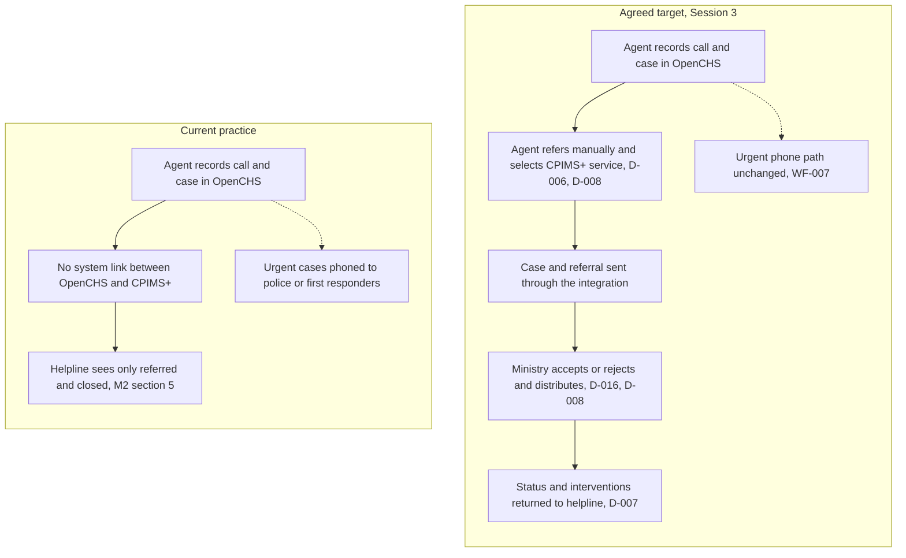

| Aspect | Current practice | Agreed target | Reference |
|---|---|---|---|
| Referral channel | No system link between OpenCHS and CPIMS+ | Integration through the Primero API | D-015, D-017 |
| Who initiates | Handling agent | Handling agent, manually | D-006 |
| Destination | — | Selected CPIMS+ service; Ministry distributes | D-008 |
| Acknowledgement | — | System receipt, then human accept or reject | D-016 |
| Status visibility at the helpline | Referred and closed only | Status and interventions returned | [M2 §5]; D-007 |
| Urgent cases | Direct phone call | Unchanged, plus system tracking | [M1 §8]; WF-007 |

### 2.2 Roles of the two systems

| System | Owner / operator | Role in the integration |
|---|---|---|
| **OpenCHS** | Child Helpline 116; maintained by BITZ under a continuing support TOR | Records calls, contacts and helpline cases; captures referral information including the optional ABR ID; initiates referrals; displays referral status and returned updates to helpline staff |
| **Primero CPIMS+** | Ministry; Primero technical coordination by Isaiah Amutavi Osotsi | Receives referred cases; Ministry users accept or reject, distribute and manage cases; records services and interventions; source of return updates |
| **OpenCHS integration service / API Gateway** | BITZ (Marlon Amunga, Peter Rogendo) | Proposed component that authenticates to Primero, sends referrals and follow-ups, handles retries and duplicates, receives or retrieves return updates, and keeps the audit trail |

Both systems sit within the same Ministry, so they connect directly rather than through X-Road (D-015). X-Road is relevant only to verifying child identifiers with the Ministry of Home Affairs, which is a separate coordinated workstream (A-019).

### 2.3 Justification and intended outcomes

The integration is intended to produce the following outcomes. They are **intended outcomes, not demonstrated benefits**; measurement would depend on baseline data not collected during inception.

| Area | Intended outcome |
|---|---|
| Referral coordination | Referrals reach the Ministry through a consistent, service-based channel aligned with the national referral pathways and SOPs |
| Case information exchange | The agreed information set (child details, narrative, category, reporter and perpetrator details, attachments) travels with the referral, reducing re-collection |
| Referral status visibility | Helpline staff can see whether a referral was received, accepted or rejected, and how the case progressed, closing the "referred to closed" gap identified in Session 2 |
| Continuity of case management | New information, including a later finding that a call was a prank, follows the referral as an update to the same case (Session 1 §7) |
| Follow-up and accountability | Return of status and interventions lets the helpline judge effectiveness, not only count referrals (Session 3 §11) |
| Reduced duplicate data entry | Ministry users receive referral data electronically rather than re-keying it |
| Auditability | Each transmission, acknowledgement and update is logged with identifiers, time, actor and outcome |

---

### 2.4 Overall objective

To strengthen the Lesotho Child Helpline 116 / OpenCHS environment through requirements definition, configuration, API integration with Primero CPIMS+, testing, user acceptance, capacity building and go-live support, within the continuing support-and-maintenance TOR (technical scope brief §1).

### 2.5 Specific objectives of the inception phase (D1)

1. Document and confirm the end-to-end referral lifecycle, including two-way feedback.
2. Confirm the information set for referral and establish the field-mapping baseline.
3. Define ABR ID ownership, format and validation rules.
4. Establish authentication, environment, connectivity and security requirements.
5. Define reliability, audit, retry, offline and error-handling expectations.
6. Agree UAT leadership, participants, acceptance and sign-off arrangements.
7. Produce an implementation plan, risk register and decision and action registers.

### 2.6 Expected results by deliverable

| Deliverable | Expected result                                                                                                                                                               |
| ----------- | ----------------------------------------------------------------------------------------------------------------------------------------------------------------------------- |
| D1          | Approved inception baseline: requirements, technical design, mapping baseline, environment-setup evidence, work plan and registers                                            |
| D2          | OpenCHS ABR ID field with validation, a referral control enforcing referral-time rules, and referral status display                                                           |
| D3          | Working, documented integration client with JWT authentication, retry, offline queue, idempotency and audit logging (contract scope is outbound; see section 4.2 for two-way) |
| D4          | Technical and regression testing, Ministry-led UAT, training, deployment and handover                                                                                         |

---

### 2.7 Contractual scope

The technical scope brief, prepared from Contract No. 43427866 Amendment 3 for the 24 September 2026 inception meeting, defines four workstreams. The contract document itself is not filed in the project workspace; the brief is the available summary.

| Deliverable | Contract scope (brief) | Target month (delivery plan) | Payment gate (delivery plan) |
|---|---|---|---|
| D1 Inception, Requirements & Environment Setup | Business and technical requirements, architecture, environments, access, integration workflow, implementation plan | August 2026 | Approved inception report, technical design, mapping baseline and environment-setup evidence |
| D2 ABR ID Field, Validation & Referral Checkbox UI | ABR field, validation rules, referral control, status display | October 2026 | Demonstrated field, validation, referral control and unit-test evidence |
| D3 Outbound REST API Client | JWT authentication, retries, offline queue, idempotency, audit logging | November 2026 | API client evidence against an approved contract or controlled mock |
| D4 Testing, UAT, Training & Go-Live | Technical and regression testing, UAT, training, deployment, handover | February 2027 | Signed UAT, training and handover evidence, go-live approval |

Existing support obligations continue alongside the integration: minor updates, bug fixing, dependency maintenance, quality assurance after changes, training of IT personnel and system stability (brief §7). Regression testing must show that existing OpenCHS functionality is not adversely affected.

### 2.8 Contractual discrepancies identified

| Ref | Discrepancy | Sources | Treatment |
|---|---|---|---|
| CD-01 | Contract describes an outbound client; Session 3 confirmed two-way updates | Brief §2, §9; D-007 | Section 9; R-010; governance decision required |
| CD-02 | Contract validity recorded as 10 March 2025 – 7 July 2027 in the brief; the delivery plan uses 1 July 2026 – 28 February 2027 | Brief cover; delivery plan header | Confirm which dates govern milestones, acceptance and payment |
| CD-03 | The delivery plan describes D2 as a referral checkbox with a "save-event trigger" and the D4 end-to-end test as "OpenCHS save → API call". Session 3 confirmed a manual referral action with narrative required at referral, not at first save | Delivery plan Items 20, 40; D-006, D-013 | Interpret "referral checkbox" as the explicit agent referral control; governance to confirm D2/D4 acceptance wording (Pending Confirmation) |
| CD-04 | D3 names `POST /api/v2/cases` only; Lesotho routing also needs the separate referral operation, follow-up updates and attachments | Delivery plan Item 30; Annex B | Include within D3 design subject to the CD-01 decision |
| CD-05 | Delivery plan expects ABR checksum validation "matching HMIS/EMIS patterns"; Session 3 recorded the NICR structural format and no checksum | Delivery plan Item 20; D-014 | Implement structural checks; checksum only if the authority supplies one (A-007) |
| CD-06 | Brief expects separate inception report, requirements specification, integration design/field-mapping document and action register | Brief §11 | This report combines requirements and design; the field-mapping document cannot be completed until configured definitions are received (Dependency) |
| CD-07 | Session 1 minutes refer to a "contracted 14-week window"; the delivery plan treats the 14-week plan as a historical technical reference | Session 1 §10; delivery plan header | Confirm that the contract-aligned months govern |

---

## 3 Inception activities and findings

### 3.1 Approach

| Method | What was done | Evidence |
|---|---|---|
| Document review | Technical scope brief; contract-aligned delivery plan; Session 1–3 minutes [M1–M3]; Primero technical response [TR1]; annotated requirements checklist [RC1]; earlier technical reference material | Annex I |
| Stakeholder consultations | Three facilitated sessions with Child Helpline, Ministry, Primero, UNICEF (Session 3) and BITZ participants | Session minutes (table 6.2) |
| Business workflow analysis | OpenCHS intake walkthrough (Session 1); referral lifecycle walk-through (Session 2); lifecycle presentation and confirmation (Session 3 §3) | Session 1 §1; Session 2 §3; D-006 |
| Technical requirements discussion | Environments, routing, duplicates, audit, status visibility (Session 2); acknowledgement, API, outage, sandbox (Session 3) | Session 2 §§4–11; Session 3 §§7–10 |
| Review of Primero API capability | Live CPIMS+ referral demonstration [M2 §4]; Primero technical response [TR1]; review of upstream v2.16.0 API documentation and source held locally (commit `622e0d2d6d`) | Annex B |
| Requirements validation | Session 3 recap and item-by-item confirmation, with decisions logged | D-005 – D-018 |
| Decision consolidation | Decision register continued from Sessions 1–2; superseded positions identified | Annex E |
| Dependency identification | Action tracker, completion inventory, risk register | Annexes F and G |

### 3.2 Consultations conducted

| Date | Event | Objective | Participants / stakeholder groups | Key outcomes | Evidence |
|---|---|---|---|---|---|
| 24 Sep 2026 | Inception meeting | Present technical scope, workstreams and decisions to close | Not recorded | Scope brief prepared; **no minutes or attendance record filed** | Technical scope brief |
| 2 Oct 2026 | Written questions to Primero | Obtain API, environment, authentication, test and UAT information | Nelson Adagi to Isaiah Amutavi Osotsi | API reference link; SSO preferred; 60-minute tokens; credentials set up by Primero; no rate limits; child-journey test data suggested | [TR1] (reply date not supplied) |
| 8 Oct 2026 | Session 1 — Business and workflow | Confirm workflow and referral data | BITZ (Nelson, Peter, Marlon); Primero (Isaiah); Ministry IT (Hopolang); Child Helpline social workers, supervisors and a research analyst; CPIMS focal person (Tiisetso Mohlabi); **UNICEF absent** | Manual trigger; perpetrator details included; ABR optional; prank and follow-up updates pushed to CPIMS+; emergency phone path retained | Session 1 minutes |
| 9 Oct 2026 | Session 2 — Technical architecture | Technical deep dive and CPIMS+ demonstration | BITZ; Primero; Ministry IT; Ministry focal person (Tiisetso Mohlabi) | Service-based routing revision; case plan not shared; status gap identified; audit modelled on CPIMS+ log; field-mapping started; D-001 – D-004 | Session 2 minutes |
| 14 Oct 2026 | Technical follow-up call | Review outstanding requirements checklist | Planned smaller technical group | **No minutes or outcome filed** | Nelson's circulated email |
| 26 Oct 2026 | Session 3 — Closing requirements | Close open business and technical items | Attendance export records Hopolang Mosena, Nelson Adagi, Isaiah Amutavi Osotsi, Marlon Amunga, Peter Rogendo, Rantsala Sanaha, Lucy Mosesane, James Kaminju, Ramoletane Lekhanya, Likeleli Ramolapong, Likeleli (Unverified) and Tiisetso Mohlabi. The 12 entries may include two entries for Likeleli; distinct-person count and roles require confirmation. Minutes refer to Daniel and Melusi; those identities are not established by this export. Frontline helpline representation requires confirmation | D-005 – D-018; actions A-013 – A-025 | Session 3 minutes; action tracker; [ATT3]; [TX3] |

**Figure 3 — Inception timeline.**

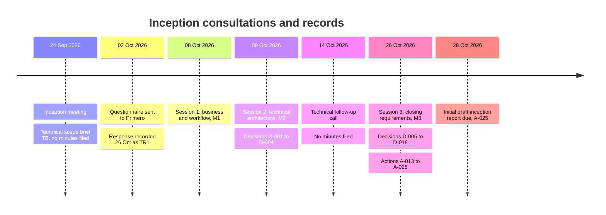

### 3.3 Evolution of positions during inception

Several positions changed. Session 3 governs where it expressly updates an earlier position.

| Topic | Earlier position | Current position |
|---|---|---|
| Routing | Session 1: helpline refers directly to the district supervisor | D-008: agent selects a CPIMS+ service; the Ministry distributes |
| Feedback | Session 1: one-way follow-up push; return of status not committed | D-007: two-way updates for referred cases |
| Anonymity | Session 2: anonymous reports cannot be referred | D-010 / D-011: anonymous reporter allowed; child identifying details required |
| ABR ID | Session 1: optional; validation deferred | D-005 / D-014: optional; NICR structural format for initial validation |
| Attachments | Session 3 facilitation deck: deferred unless approved | D-012: included in the field set |
| Narrative | Required; timing not stated | D-013: mandatory at referral, not at first save |
| UNICEF participation | Sessions 1–2: absent; escalation raised (A-012) | Session 3: UNICEF chaired and attended; approval route still to confirm |

### 3.4 Limitations of the inception evidence

- No minutes exist for the 24 September inception meeting or the 14 October technical call.
- Frontline Child Helpline representation requires confirmation against [ATT3]; the minutes describe a Child Protection Services representative. Attendance names alone do not establish roles.
- The September 2019 SOP is filed [SOP1]; its current applicability is pending. Separate pathways, privacy materials, Berea use cases and the configured service list remain outstanding.
- The unified national referral form, recorded as shared under A-004, is not filed in the workspace.
- The annotated requirements checklist has no recorded author or date; its remarks are treated as positions for confirmation.
- No OpenCHS application-code or live-deployment audit was performed for this report.

---

### 3.5 Findings from newly filed Session 3 evidence

The filed September 2019 *HIV-Sensitive Case Management Manual — Standard Operating Procedures for Ministry of Social Development* [SOP1] changes A-014 from awaiting receipt to **Received; current applicability and mapping review pending**. Hopolang / Ministry must confirm that this is the applicable edition and identify subsequent amendments; BITZ must document the resulting workflow and mapping review. Receipt does not establish formal approval of the integration requirements. The separate national referral pathways (A-013) and privacy materials (A-017) remain outstanding.

Form 4 contains the Child Protection Referral Form and a return receipt. It supplies candidate mapping inputs for child identity, file number, referral date, referring and receiving organisations, service needs, referral reason, accompanying documents, expected results, receiving person and response actions. These must be compared with the agreed D-012 field set and configured CPIMS+ definitions; they do not automatically add fields to the approved scope or establish CPIMS+ service codes. The receipt supports review of human acknowledgement and follow-up under D-016, separately from API delivery acknowledgement. It does not itself define technical acceptance/rejection states. The paper form is evidence available for A-004 review, not proof that it is the separately referenced unified national referral form.

The SOP guiding principles address informed consent/assent and confidentiality; its confidentiality guidance also describes exceptions including emergencies. This provides country procedural evidence for DATA-012 and R-011. Ministry, advised by UNICEF, must confirm the applicable disclosure basis, consent capture, authorised exceptions and return-data minimisation; Primero must confirm configured consent and override controls. This report does not treat the 2019 manual as verification of current law. Consent was not agreed as an integration implementation rule in the sessions.

UAT preparation must include a Form 4 mapping review, human receipt and response scenarios, and Ministry-approved consent/exception scenarios. Business response times in the SOP must be reviewed separately from technical retry and delivery targets; no API service-level target is inferred from the manual.

The transcript [TX3] corroborates manual referral, two-way updates, anonymous reporters, identifiable child details, optional ABR ID and narrative required at referral. At 34:30 Tiisetso supports reporter anonymity; at 29:44 Nelson distinguishes referral validation from saving. The transcript does not change D-005–D-018 or establish report approval. As a machine transcript it must be read alongside the minutes rather than used to silently resolve disputed names.

The attendance export [ATT3] confirms Tiisetso and names Ramoletane Lekhanya, Lucy Mosesane and Likeleli. It records 12 participant entries, including two potentially related Likeleli entries. Attendance does not establish job roles, signatory authority, distinct-person count or assignment acceptance. P-03 remains open: UNICEF should confirm ownership of A-017/A-019 and reconcile the minutes' Daniel reference with the named attendee Ramoletane Lekhanya. The minutes' Melusi reference also needs reconciliation. Frontline helpline representation cannot be conclusively excluded from attendance names alone.

| Reference | Source |
|---|---|
| [SOP1] | [September 2019 case-management SOP and tools](<../03_meetings/session_3/Lesotho Case Managment SOP  Tools (Final).docx>) |
| [TX3] | [Session 3 meeting transcript](<../03_meetings/session_3/Final Inception Meeting.docx>) |
| [ATT3] | [Session 3 attendance export](<../03_meetings/session_3/Final Inception Meeting - Attendance report 10-26-26 (1).csv>) |

### 3.6 Requirements baseline and remaining gaps

This section summarises the requirement baseline. The full matrix, with sources and acceptance criteria for every requirement, is in **Annex A**. Requirement IDs reuse the completion inventory (GOV, WF, RT, DATA, API, OPS, UAT). New identifiers introduced in v0.7 (FN, SEC, AUD and OPS-008 onward) are **proposed additions** to the inventory.

**Priority** values are BITZ proposals for governance confirmation. Where a requirement derives from the contract TOR or a Session 3 decision, "Must" reflects that source; it does not imply that priorities have been approved.

**Figure 4 — Requirement baseline by status.** Requirements are counted by the leading status in Annex J.1–J.8. For example, "Confirmed; mapping Pending Confirmation" is counted as Confirmed. Confirmed means the business decision is recorded in the minutes; its detailed design may still be open.

| Category | Confirmed | Contractual | Proposed | Pending Confirmation | Dependency | Total |
|---|---:|---:|---:|---:|---:|---:|
| Annex J.1 Business and workflow | 6 | 0 | 0 | 6 | 0 | 12 |
| Annex J.2 Functional | 10 | 2 | 0 | 0 | 0 | 12 |
| Annex J.3 Data and fields | 3 | 0 | 1 | 9 | 0 | 13 |
| Annex J.4 Integration | 2 | 0 | 0 | 6 | 0 | 8 |
| Annex J.5 Security and privacy | 1 | 0 | 4 | 2 | 1 | 8 |
| Annex J.6 Operational and reliability | 0 | 1 | 1 | 3 | 0 | 5 |
| Annex J.7 Audit and monitoring | 2 | 1 | 1 | 0 | 0 | 4 |
| Annex J.8 UAT and acceptance | 2 | 0 | 0 | 4 | 0 | 6 |
| **Total** | **26** | **4** | **7** | **30** | **1** | **68** |

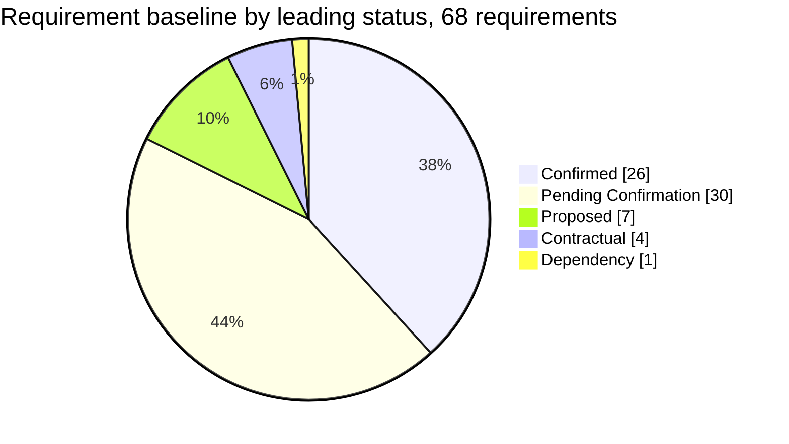

The functional requirements, which drive D2, are almost entirely confirmed. Most open items are in data mapping, integration and security, and they depend on the configured Primero environment and the country documents.

## 4 Scope and boundaries

### 4.1 Scope classification

| Category | Items | Status |
|---|---|---|
| **Original contractual scope** | Outbound referral client; ABR field and validation; referral control and status display; JWT, retry, queue, idempotency, audit; testing, UAT, training, go-live | Contractual |
| **Requirements confirmed during inception** | Manual agent trigger (D-006); service selection with Ministry distribution (D-008); anonymous reporter with identified child (D-010, D-011); field set incl. attachments, excl. case plan (D-012); narrative at referral (D-013); NICR ABR format (D-014); two acknowledgements (D-016); API spec basis (D-017); playground fallback (D-018); Ministry-led UAT (D-009) | Confirmed |
| **Requirements confirmed during inception that extend contract wording** | Two-way return updates (D-007); attachments transfer (D-012); referral and follow-up operations beyond case creation | Confirmed requirement; **contract treatment Pending Confirmation** (section 9) |
| **Proposed technical solutions** | Integration architecture, idempotency key, retry schedule, return-update options, audit design (sections 6 and 8) | Proposed |
| **Coordination outside BITZ build scope** | Participation in Primero/X-Road sessions on Home Affairs ABR verification (A-019, A-020) | Confirmed participation; implementation **Proposed exclusion** (DEF-009) |
| **Excluded** | Helpline case plan transfer (D-012) | Excluded (Confirmed) |
| **Proposed exclusions** | Call recordings and large media not expressly agreed (DEF-002); advanced Primero lookup administration (DEF-004); generic integration marketplace (DEF-005); major OpenCHS workflow redesign (DEF-006); non-essential analytics (DEF-007); automated production deployment pipeline (DEF-008) | Proposed exclusion |

**Figure 2 — Scope boundary.** Sources: [TB §2], [M3], completion inventory section H.

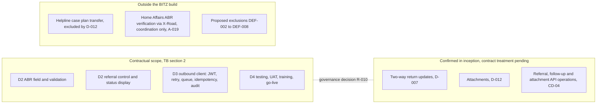

### 4.2 Two-way integration

| Aspect | Position |
|---|---|
| Original contractual position | Workstream 3 is an *outbound* REST API client (brief §2, §5). The brief asked inception to confirm whether status information must be written back, and said any bi-directional requirement must be explicitly confirmed (brief §9). |
| Updated business requirement | Session 3 D-007: the integration is two-way; updates to a referred case in CPIMS+ flow back to the helpline. Confirmed by the Child Helpline representative, the Ministry and UNICEF. |
| Technical implications | Inbound endpoint or polling component; authentication of inbound calls; status vocabulary; ordering, duplicate and conflict handling; reconciliation because upstream webhook delivery is not retried (Annex B.5); OpenCHS display of returned updates. |
| Security and data-sharing implications | New flow of Ministry case data into OpenCHS; minimisation of returned fields; access control on returned data; retention; lawful basis for the return direction (section 7). |
| Testing implications | Additional integration, security and UAT scenarios (Annex H RC-05, F-12, S-04). |
| Schedule and resource implications | Additional design, build and test effort not reflected in the D3 milestone. **No estimate has been prepared**; BITZ proposes to provide one after the mechanism is agreed (RT-007). |
| Related extensions | Attachments (D-012) and the referral, update and attachment operations beyond `POST /api/v2/cases` (CD-04). |
| Formal decision required | Whether return updates and attachments are (a) absorbed within D3 and D4, (b) handled by contract amendment or variation, or (c) phased; and what acceptance evidence applies. |
| Responsible governance authority | UNICEF as contracting party, with the Ministry as business owner. Named approver **Pending Confirmation** (GOV-003). |

**Agreement on a business requirement in Session 3 is not approval of a contractual variation.** Until governance decides, BITZ will design for two-way updates but will report return-update work separately from the contracted outbound D3 scope.

## 5 Business requirements and workflow

The agreed workflow begins with a helpline agent manually initiating a referral. Saving a case does not send it. The referral must include a narrative and identifying child details, with minimum fields and emergency exceptions still to be confirmed. Reporters may remain anonymous and missing ABR IDs must not block referral. Urgent cases retain the parallel emergency telephone route.

The agent selects an approved CPIMS+ service. Ministry users distribute the case; the helpline does not choose a caseworker. Technical receipt, human acceptance or rejection, and subsequent case progress must remain distinct. Two-way updates apply to referred cases, subject to the return-data contract and governance treatment of the scope change.

OpenCHS must show referral status and validation messages, prevent duplicate submission, and preserve links for follow-up updates. The helpline case plan is excluded. Supervisor escalation, partial referrals, correction, cancellation and re-referral rules remain pending.

Detailed business and functional records are retained in Annex A.1–A.2 and Annex J.1–J.2. Annex D contains the full referral lifecycle, native CPIMS+ workflow, proposed status vocabulary and reliability detail. Section 7 addresses the information being shared and its safeguards.

## 6 Proposed technical approach

> **All diagrams in this section are Proposed Architecture – Subject to Technical Validation.** They show Primero product capabilities documented upstream, not the deployed Lesotho configuration. OpenFN, webhooks and any X-Road arrangement are shown as options or separate workstreams, not as confirmed implementations.

### 6.1 Design principles

1. **Manual, explicit referral** — nothing is sent because a case was saved (D-006).
2. **Separate events** — system receipt, human acceptance/rejection, distribution and case progress are distinct states (D-016).
3. **No duplicates** — every retry reuses the same identifier (OPS-003).
4. **No silent loss** — failed transmissions are queued, visible and recoverable (OPS-001).
5. **Minimum necessary data** — only the agreed fields move in either direction (SEC-003, SEC-008).
6. **Evidence by design** — every transmission and update is auditable without logging sensitive content (OPS-004, SEC-006).

### 6.2 Diagram A — System context

*Proposed Architecture – Subject to Technical Validation*

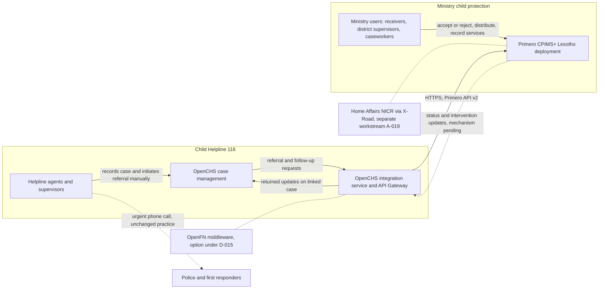

### 6.3 Diagram B — Referral sequence

*Proposed Architecture – Subject to Technical Validation.* Operation names are from the upstream API v2 documentation (Annex B); the Lesotho operation sequence is Pending Confirmation (API-003).

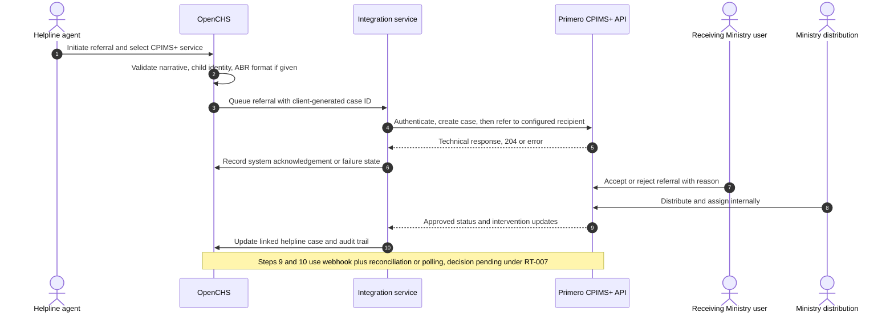

### 6.4 Diagram C — Technical integration

*Proposed Architecture – Subject to Technical Validation*

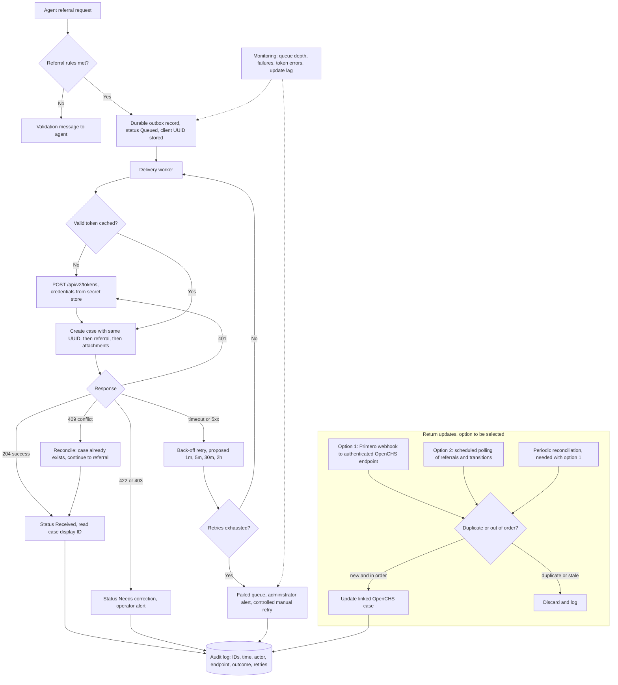

### 6.5 Component summary

| Layer | Proposed component | Evidence status |
|---|---|---|
| Intake | OpenCHS case form with ABR field and referral control | D2 build; form engine to verify |
| Outbound | Integration service via the API Gateway with durable queue, retry and idempotency | D3 build; framework and queue to verify |
| Authentication | Primero JWT bearer tokens; integration account | Upstream documented; Lesotho flow Pending Confirmation |
| Receiving system | Primero CPIMS+ API v2: case create, update, referral, attachments | Upstream documented; configuration Pending Confirmation |
| Return channel | Webhook with reconciliation, or polling | Options; decision Pending Confirmation (RT-007) |
| Controls | Audit log, monitoring, operator alerts | Design Proposed |

Before design sign-off, the BITZ developers must verify the actual OpenCHS case model, integration framework, queue, role permissions, audit facilities, deployment and secret management. The Primero technical coordinator must confirm receiving-system capabilities, service configuration and permissions. Earlier technical reference material describes referral being created automatically on case save; that conflicts with D-006 and must not be implemented.

### 6.6 Diagram D — Environment architecture

*Proposed Architecture – Subject to Technical Validation*

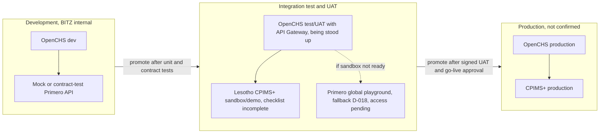

| Environment | Owner | Status (27 Oct 2026) | Notes |
|---|---|---|---|
| OpenCHS development | BITZ | Internal; not shared | Mock and contract tests only; must not be described as live integration |
| OpenCHS test/UAT with API Gateway | BITZ | Being stood up; access evidence pending (API-005) | Onboards and authenticates Primero as a connected system |
| Lesotho CPIMS+ sandbox/demo | Primero (Isaiah), Lesotho checklist (Rantsala) | Checklist incomplete; no progress since Session 2 (A-015) | Configured from country SOPs, forms and use cases |
| Primero global playground | Primero (Isaiah) | Agreed fallback (D-018); URL and access pending (A-016) | Not Lesotho-configured; tests needing country configuration must be repeated |
| Production (both systems) | Infrastructure owners | Not confirmed (API-008) | Endpoints, credentials, certificates and rollback to define |

---

### 6.7 Integration reliability and audit requirements

The supplied Primero API specification is the build basis. The deployed release, authentication, operation sequence, service-to-recipient mapping and return-update mechanism require technical confirmation. The design must address durable queuing, duplicate prevention, retries, escalation, monitoring and transaction audit without asserting that those controls have been implemented. Detailed requirements are retained in Annex J.4, J.6 and J.7; API evidence and configuration dependencies are in Annex B.

## 7 Data and safeguarding requirements
### 7.1 Data requirements and mapping approach

The agreed referral information set includes child details, case category and narrative, reporter contact where available, perpetrator details, attachments and follow-up updates. The ABR ID remains optional and the helpline case plan is excluded. Configured identifiers, minimum fields, code lists, attachment controls and the representation of consent remain pending. Annex C retains the mapping baseline and ABR rules; Annex J.3 retains detailed data requirements.

The received September 2019 SOP supplies Form 4 and confidentiality guidance for review. It does not establish current legal authority or the deployed CPIMS+ configuration. Ministry confirmation of applicability and approved disclosure/exception rules remains required. Section 3.5 records the evidence and its implications.

### 7.2 Legal and policy position

The sources differ on the applicable law. In Session 3, Rantsala said such laws are under development; the Session 3 action register refers to the Data Protection Act 2011; the annotated checklist refers to the Lesotho Data Protection Act 2012. **This report does not determine which legislation applies or whether it is in force.** UNICEF will supply earlier Ministry data-protection work, the data management policy and legal material (A-017); Nelson will complete desk research (A-022). The responsible Ministry and UNICEF advisers must confirm the instrument, year and commencement status.

### 7.3 Control framework

| Control area | Requirement | Status | Owner |
|---|---|---|---|
| Lawful basis | Authorised purposes for sharing child-protection data between the helpline and CPIMS+ | Dependency (A-017, A-022) | Ministry / UNICEF |
| Consent and disclosure | Upstream Primero checks consent for disclosure and services at referral unless overridden; no consent capture was discussed in the sessions. Decide how consent or another basis is captured and who may override it | Pending Confirmation (R-011, DATA-012) | Ministry; Primero to confirm configuration |
| Anonymous reporters | Reporter recorded as anonymous in CPIMS+; anonymity preserved in payloads, logs and return updates | Confirmed (D-010); mapping Pending | BITZ, Primero |
| Child-sensitive data | Only agreed fields sent; no fictitious names, dates or identifiers created to satisfy validation | Confirmed field set (D-012); rule Proposed | BITZ |
| Access control | Integration account permitted to set only approved fields; OpenCHS role controls for referral and returned data | Proposed (SEC-003) | Primero; BITZ |
| Authentication | Bearer JWT, 60-minute expiry; SSO preferred for users, username/password alternative; unattended backend flow undecided | Pending Confirmation (API-002) | Primero; BITZ |
| Secure transport | Proposed minimum HTTPS with TLS 1.2+ and certificate verification; Primero confirmed that network/security controls apply without specifying them | Proposed; controls Pending Confirmation | Primero; infrastructure |
| Credential management | Secret store; separate test and production credentials; rotation; custody | Pending Confirmation (API-008) | BITZ; Primero |
| Audit logs | Transaction metadata logged; tokens and full payloads not logged by default; retention and access approved | Pending Confirmation (OPS-004, OPS-005) | Security owner |
| Data minimisation | Case plan excluded; return updates limited to referred cases and approved fields | Confirmed (D-012); bound Proposed (SEC-008) | Ministry; BITZ |
| Retention | Retention of queued payloads, logs and attachments | Pending Confirmation | Data protection owner |
| Incident handling | Contacts, escalation and notification duties for data incidents and outages | Pending Confirmation (OPS-007) | Ministry; UNICEF |
| Secure test data | Approved synthetic child-journey dataset; no real child records copied into test environments | Proposed (SEC-007); approval Pending | UAT lead; privacy owner |
| Attachments | File types, size limits, malware scanning, field permissions, retention; no call recordings unless approved | Pending Confirmation (DATA-010) | Ministry; Primero; BITZ |
| Return updates | Authenticated channel; minimised fields; webhook role limits fields where used | Pending Confirmation (RT-007) | Primero; BITZ |

### 7.4 Data flow and classification

**Figure 9 — Data flow and classification.** Sources: D-007, D-010, D-012, OPS-004. Which fields are returned still needs approval (RT-007).

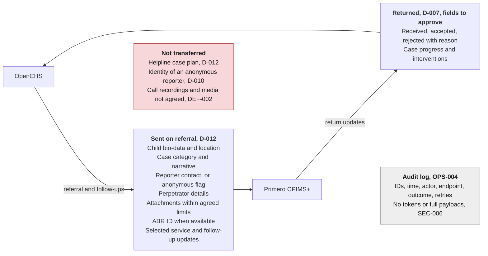

| Data | Direction | Sensitivity (proposed) | Control |
|---|---|---|---|
| Child identity, location, contact | OpenCHS → CPIMS+ | High (child-identifying) | Agreed fields only; TLS; least-privilege account |
| Narrative, case category, perpetrator details | OpenCHS → CPIMS+ | High (child-protection detail) | Not written to logs; role-based access |
| Reporter contact | OpenCHS → CPIMS+ when given | High | Anonymous flag respected (D-010) |
| Attachments | OpenCHS → CPIMS+ | High | Type, size and scanning rules (DATA-010) |
| ABR ID | OpenCHS → CPIMS+ when available | High (national identifier) | Structural validation; stored as text |
| Referral status and interventions | CPIMS+ → OpenCHS | High | Approved fields only; authenticated channel |
| Audit metadata | Both systems | Medium | Retention and access approval (OPS-004, OPS-005) |
| Helpline case plan | Not transferred | — | Excluded from payload (D-012) |

### 7.5 Matters requiring UNICEF or Ministry confirmation

1. Applicable data protection instrument and its status.
2. Lawful basis and authorised purposes for each direction of exchange.
3. Consent capture and override authority.
4. Retention periods for integration data, logs and attachments.
5. Incident notification obligations and contacts.
6. Approval of the synthetic test dataset and prohibition of real records in test.
7. Named data protection/security approver.

---

### 7.6 Safeguarding requirements

Reporter anonymity must be preserved in both directions. Integration permissions, transport security, secret management, log redaction, synthetic test data and restrictions on returned fields require agreed controls. Annex J.5 and Annex A.5 retain the detailed security requirements and their confirmation status.

## 8 Implementation plan
### 8.1 Delivery methodology

Each phase lists its contract mapping. **Supporting outputs** not named in the contract are marked *proposed supporting output*.

| # | Phase | Objective | Principal activities | Expected outputs | Responsible | Dependencies | Completion / acceptance criteria | Deliverable |
|---|---|---|---|---|---|---|---|---|
| 1 | Requirements confirmation | Close the inception baseline | Confirm received SOP applicability; receive pathways and privacy material; resolve minimum dataset, consent, outage rules; record approvals | Approved D1 report; updated inventory and registers | BITZ (R); Ministry, UNICEF (approval; named approvers Pending) | A-013, A-014, A-017, A-021; GOV-001 | Written D1 approval or conditional acceptance with bounded dependencies | D1 |
| 2 | Detailed solution design | Fix the technical contract | Operation sequence; idempotency; return-update mechanism; status vocabulary; error handling | Integration design specification and API contract capture (*proposed supporting output*) | BITZ, Primero | Configured environment; GOV-004; API-002 | Design reviewed by named technical authorities | D1 / D3 |
| 3 | Environment preparation | Usable test environments on both sides | OpenCHS test/UAT; Primero sandbox or playground; secure access package; secret storage | Access package; environment matrix | BITZ (OpenCHS); Primero (CPIMS+); Ministry/UNICEF (checklist) | A-015, A-016 | Successful authenticated test call recorded | D1 |
| 4 | Configuration and development (OpenCHS) | Build D2 features | ABR field and validation; referral control; narrative and identity rules; status display | Demonstrable features; unit tests | BITZ | Minimum dataset (WF-004); service list (A-018) | Demonstration and unit-test evidence against D2 criteria | D2 |
| 5 | API integration | Build the integration client and return path | Token handling; queue; retry; idempotency; create/refer/update/attachments; return updates; audit | Integration service; contract tests | BITZ | Phases 2–3; R-010 decision for return path | Contract tests pass; live calls against test environment evidenced | D3 |
| 6 | Security and functional testing | Verify controls | Authentication, permission, logging, redaction, TLS, data-minimisation tests | Test report (*proposed supporting output*) | BITZ; security owner (Pending) | SEC requirements approved | No open Critical/High security defects | D3 / D4 |
| 7 | Integration testing | Verify end-to-end behaviour | End-to-end referrals; failures; outages; duplicates; out-of-order updates; regression | Integration test evidence | BITZ, Primero | Configured environment | Annex H integration scenarios pass | D4 |
| 8 | UAT | Ministry-led acceptance | UAT plan; synthetic data; execution; defect triage; retest | Signed UAT report | Ministry (lead, D-009); BITZ (support, test data per checklist, Pending Confirmation); Child Helpline; Primero | UAT-002, UAT-003, UAT-007 | Section 10 proposed exit criteria met and signed | D4 |
| 9 | Training and knowledge transfer | Operational and technical capability | Operator/social-worker and IT training | Materials; attendance records | BITZ; Ministry (participants) | Stable UAT build | Training evidence filed | D4 |
| 10 | Deployment preparation | Production readiness | Production endpoints, credentials, rollback, monitoring, support rota | Readiness checklist; rollback plan | BITZ; infrastructure owners; Primero | API-008; OPS-006 | Go/no-go decision recorded | D4 |
| 11 | Go-live support | Stabilise in production | Hypercare, monitoring, incident handling | Hypercare log (*proposed supporting output*) | BITZ; Ministry support owners | Go-live approval | Agreed hypercare exit conditions met | D4 |
| 12 | Handover | Transfer to operations | Technical handover report, user manual, administrator guide | Handover pack | BITZ | Phases 9–11 | Handover accepted by named owner | D4 |

### 8.2 Implementation and dependency flow

**Figure 5** — *Proposed sequencing – not an approved schedule*

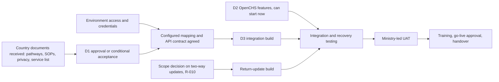

---

### 8.3 Original milestone baseline

**Figure 6.** The commercial planning reference runs from 1 July 2026 to 28 February 2027 [DP]. See CD-02 for the conflicting validity dates.

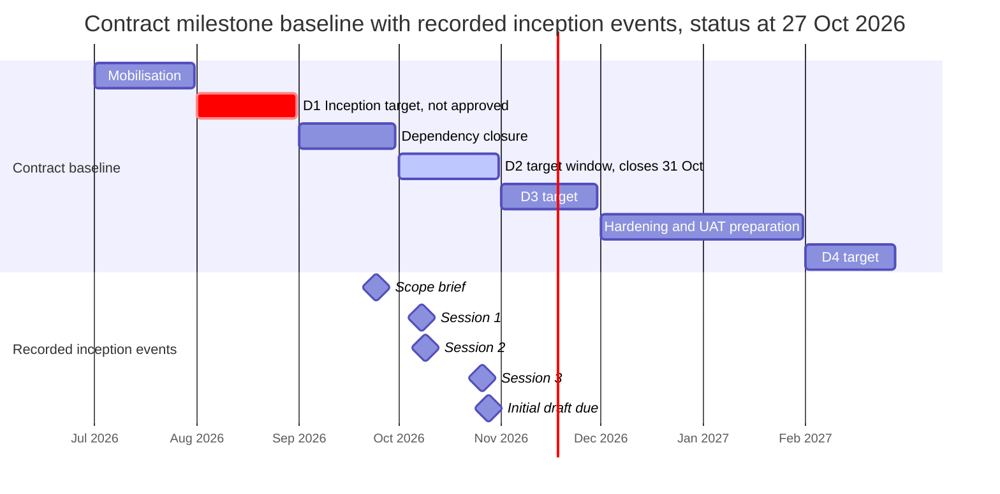

### 8.4 Current status against the baseline

| Deliverable | Target | Status as at 27 Oct 2026 | Evidence |
|---|---|---|---|
| D1 | Aug 2026 | Target month passed. Requirements substantially defined; report in draft; mapping, environment evidence and approval outstanding | This report; inventory |
| D2 | Oct 2026 | Design inputs largely available (ABR format, manual trigger, narrative rule). No build or test evidence filed in the workspace | — |
| D3 | Nov 2026 | Blocked on environment access, authentication, configured mapping and the scope decision on return updates | A-016, A-023, R-010 |
| D4 | Feb 2027 | Not started; UAT roles confirmed (D-009) | — |

The workspace does not record whether the D1 milestone has been invoiced, accepted or formally extended; this must be confirmed by governance (R-009).

### 8.5 Outstanding work and critical dependencies

| Outstanding work | Critical dependency | Owner of dependency |
|---|---|---|
| Field-mapping baseline | Configured field definitions and lookups after sandbox setup | Isaiah / Primero |
| Service routing design | CPIMS+ service list (A-018) and service-to-recipient configuration | Isaiah; Ministry |
| Referral rules and exceptions | SOPs (A-014), pathways (A-013), unified referral form | Hopolang; Rantsala |
| Authentication and test calls | Environment access (A-016) | Isaiah |
| Privacy and consent design | Privacy materials (A-017); desk research (A-022) | UNICEF; Nelson |
| Return-update build | Scope decision (R-010); mechanism agreement (RT-007) | UNICEF / governance; Primero |
| Outage handling | A-021 working session | Nelson, Peter, Isaiah |
| D1 approval | Named approvers (GOV-001, GOV-003) | UNICEF; Ministry |

### 8.6 Work that can proceed while sandbox access is pending

| Track | Work | Constraint |
|---|---|---|
| D2 build | ABR field and structural validation; referral control; narrative and identity checks at referral; status display framework | Minimum identity fields remain configurable until WF-004 is decided |
| D3 foundation | Durable queue, retry controller, idempotency store, audit log, token-handling module, against a mock based on the API v2 documentation | Mock results are not live-integration evidence |
| Test design | Annex H converted to test cases; synthetic child-journey dataset drafted | Dataset needs approval (UAT-003) |
| Governance | Scope, schedule and approver decisions | Governance meeting needed |
| Training design | Outline operator and IT training | Final content follows UAT build |

### 8.7 Proposed recovery sequencing

*Proposed – not approved.* Durations are not estimated until access and the scope decision are known; the sequence below is gate-driven. The earlier 14-week and two-week schedules are historical references only.

| Track | Now → G1 (D1 review) | G1 → G2 (access and mapping) | G2 → G3 (integration build) | G3 → G4 (integration test) | G4 → G5 (UAT) | G5 → go-live |
|---|---|---|---|---|---|---|
| Governance and approvals | ████ | ██ | | | | ██ |
| Country inputs and requirements closure | ████ | ██ | | | | |
| D2 OpenCHS features | ████ | ████ | ██ | | | |
| D3 foundation against mock | ████ | ████ | | | | |
| Mapping and API contract | | ████ | | | | |
| D3 live integration and return updates | | | ████ | | | |
| Integration and recovery testing | | | | ████ | | |
| UAT and defect resolution | | | | | ████ | |
| Training, deployment, handover | | | | | ██ | ████ |

**Gate definitions:** G1 — D1 approved or conditionally accepted; G2 — authenticated access to a configured environment and approved mapping; G3 — integration build complete against agreed contract; G4 — integration tests passed; G5 — UAT signed.

### 8.8 Decisions required to approve a revised schedule

1. Confirm the governing contract dates (CD-02).
2. Confirm D1 status: accepted, conditionally accepted or to be resubmitted.
3. Decide the treatment of two-way updates and attachments (section 9).
4. Confirm that the contract-aligned months, not the 14-week plan, govern (CD-07).
5. Note the coupling to Primero's own Lesotho go-live (R-012) and request Primero's plan.
6. Approve a dated rebaseline, which BITZ proposes to submit once A-016 access and the R-010 decision are known (Proposed).

---

## 9 Governance and coordination

### 9.1 Roles

| Party | Recorded responsibilities | Still to be confirmed |
|---|---|---|
| UNICEF Lesotho (Rantsala and Ramoletane Lekhanya recorded in [ATT3]; Daniel reference unresolved) | Contracting party; chaired Session 3; pathways (A-013); sandbox checklist with Primero (A-015); privacy materials (A-017); X-Road invitation (A-019) | Named approver and escalation route (GOV-003); whether Daniel and Lekhanya are the same or different owners (P-03) |
| Ministry (MGYSD / Ministry of Social Development) — IT (Hopolang Mosena; Melusi named in minutes, attendance identity unconfirmed) | Host and local coordination; SOPs (A-014); Berea use cases (A-020); helpline cover (A-024); permanent focal person (A-002); anonymity rule supported by Tiisetso in [TX3, 34:30], and accepted in Session 3 | Business owner and signatory |
| Ministry — child protection (Tiisetso Mohlabi, CPIMS focal person) | Ministry-level coordination with Primero (Sessions 1–2) | Role in approval; Session 3 attendance confirmed by [ATT3] |
| Child Helpline 116 | Workflow users; UAT participants (D-009); testing contact (Mary Damposi discussed, not confirmed) | Focal person and leave cover; named testers |
| Primero (Isaiah Amutavi Osotsi) | Technical coordination; sandbox/playground (A-016); service list (A-018); credentials set-up; field definitions after setup | Deployed release; authentication flow; return-update mechanism |
| BITZ IT Consulting (Nelson Adagi, Peter Rogendo, Marlon Amunga; James, Executive Director) | Project management and report (A-025); desk research (A-022); outage handling (A-021); helpline-side development and API Gateway; authentication and test calls (A-023) | Technical design approval route |

**Figure 7 — Proposed governance structure.** Approver roles are TBC (GOV-001, GOV-003). Only the Ministry-led UAT group rests on a recorded decision (D-009).

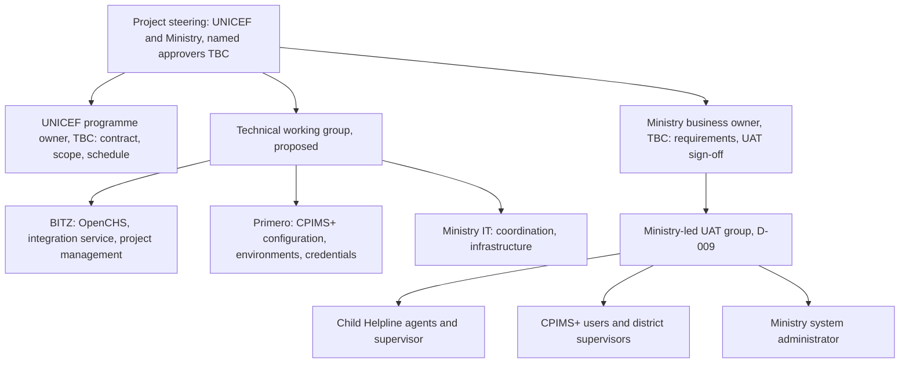

### 9.2 RACI matrix

R = Responsible, A = Accountable, C = Consulted, I = Informed. **TBC** = not supported by source evidence; Pending Confirmation. Entries marked † are BITZ proposals.

| Activity | UNICEF | Ministry | Child Helpline | Primero | BITZ | Evidence |
|---|---|---|---|---|---|---|
| Inception report preparation | C | C | C | C | R/A | A-025 |
| Requirements approval | TBC | A† | C | C | R | Approver unnamed (GOV-001) |
| Country documents (pathways, SOPs) | R (A-013) | R (A-014) | C | I | I | Session 3 actions |
| Privacy materials and legal basis | R (A-017) | A† | I | C | R (A-022) | Session 3 actions |
| Field mapping | I | A† (business) | C | R (definitions) | R (OpenCHS side) | [TR1]; [M2 §11] |
| Technical design approval | I | TBC | I | C/R† | R | No approver named |
| Primero environment and access | R (checklist, A-015) | C | I | R/A (A-016) | C | Session 3 actions |
| OpenCHS environments | I | I | I | I | R/A | S1 §9 |
| Service list and routing configuration | I | A† | C | R (A-018) | C | Session 3 actions |
| Integration build (D2, D3) | I | I | C | C | R/A | Contract |
| UAT leadership | C | R/A (D-009) | R | R | R (support) | D-009 |
| UAT test data and scenarios | I | C | C | C | R (checklist; Pending Confirmation) | Annotated checklist |
| UAT sign-off | TBC | A (checklist; Pending Confirmation) | C | C | I | Annotated checklist |
| Issue escalation | A† | R | R | R | R | Proposed |
| Scope and contract change | A (contracting party; approver TBC) | C | I | C | R (raise request) | Contract relationship |
| Deliverable review and sign-off | TBC | TBC | I | I | R (submit) | Delivery plan §4 |

### 9.3 Approval mechanisms

| Approval | Proposed approver | Evidence required | Status |
|---|---|---|---|
| Requirements baseline (this report) | Ministry business owner and UNICEF programme owner | Written approval or comments resolved | Pending Confirmation |
| Technical design and API contract | OpenCHS and Primero technical authorities | Signed-off design specification | Pending Confirmation |
| Data protection and security controls | Data protection/security authority | Written confirmation of lawful basis and controls | Pending Confirmation |
| UAT result | MGYSD (per annotated checklist) | Signed UAT report | Pending Confirmation |
| Contract variation or rebaseline | UNICEF | Written amendment or approval | Pending Confirmation |
| Go-live | Project steering authority | Go/no-go record | Pending Confirmation |

### 9.4 Communication and reporting framework

*All cadences are Proposed.*

| Mechanism | Frequency | Participants | Output |
|---|---|---|---|
| Technical working session | Weekly during design and build | BITZ, Primero, Ministry IT | Updated API contract capture; technical decisions |
| Progress and steering review | Fortnightly | UNICEF, Ministry, BITZ, Primero | Decision log; risk review; escalations |
| Action tracker update | Within two working days of each meeting | BITZ | Updated tracker and inventory |
| Written progress report | Monthly | BITZ to UNICEF and Ministry | Status against milestones, risks, decisions needed |
| Milestone submission | Per deliverable | BITZ to approvers | Deliverable package with evidence index |

Rantsala asked that at least one Ministry coordination representative attend every meeting (S3 §1). This is adopted as a meeting rule.

### 9.5 Escalation path

*Proposed.* Issue owner → BITZ project manager (two working days) → technical working session or steering review (next session) → UNICEF programme owner and Ministry business owner (for scope, schedule or approval blockers). Overdue dependency actions are escalated at the next steering review. The sandbox escalation email template (`04_templates/14_...`) is available.

---

**Figure 8 — Proposed escalation path.**

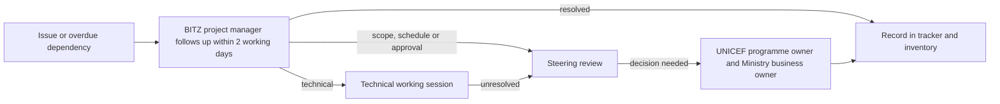

### 9.6 Change control procedure (Proposed)

1. Any party may raise a change: description, reason, source decision.
2. BITZ assesses impact on scope, schedule, effort, security and testing within an agreed period.
3. The change is reviewed at the steering review.
4. UNICEF (and the Ministry for business changes) decides in writing.
5. Approved changes update this report, the inventory and the delivery plan; rejected changes are recorded in the decision register.

**Figure 12 — Proposed change control flow.**

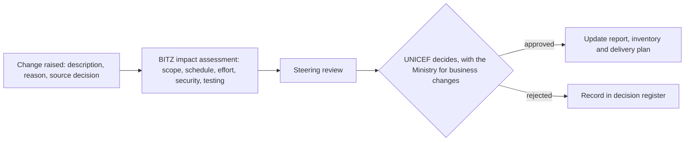

### 9.7 Change log

| Change ID | Change | Source | Status |
|---|---|---|---|
| CR-01 | Two-way return updates for referred cases | D-007 | Requirement Confirmed; contract treatment Pending Confirmation |
| CR-02 | Attachments in the referral information set | D-012 | Requirement Confirmed; contract treatment Pending Confirmation |
| CR-03 | Schedule rebaseline following missed D1 target | R-009 | Pending Confirmation |
| CR-04 | Clarify D2/D4 "save-event" wording to manual referral control | CD-03 | Proposed |

---

## 10 Testing and acceptance

### 10.1 Test levels

| Level | Purpose | Environment | Evidence |
|---|---|---|---|
| Unit | D2 validation and control logic; D3 components | Development | Automated test results |
| Contract / mock | Client behaviour against documented API v2 | Development | Contract test results; **not live integration** |
| Integration | End-to-end with Primero | Lesotho sandbox or playground | Test log, screenshots, audit records |
| Security | Authentication, permissions, logging, transport | Test/UAT | Security test record |
| Regression | Existing OpenCHS functions unaffected | Test/UAT | Regression results (OPS-008) |
| UAT | Business acceptance | Configured Lesotho environment | Signed UAT report |

### 10.2 UAT approach (Proposed)

| Element | Approach |
|---|---|
| Leadership | Ministry leads (D-009) |
| Participants | OpenCHS development team; Child Helpline agents; Ministry system administrator; CPIMS+ users; district supervisors; other Ministry users who receive, distribute, investigate or close referrals (D-009). Child Helpline supervisor per annotated checklist (Pending Confirmation) |
| Preparation | Named testers and accounts (UAT-002); test cases from Annex H; environment readiness check; UAT briefing |
| Test data | Approved synthetic child-journey dataset (SEC-007); BITZ prepares per checklist annotation (Pending Confirmation) |
| Functional scenarios | Annex H, F- and B-series |
| Security and privacy scenarios | Annex H, S-series |
| Failure and recovery | Annex H, RC-series |
| Defect classification | Table 13.3 |
| Retesting | Every fixed Critical/High defect retested by the reporting tester; regression subset rerun |
| Evidence capture | Per test: tester, date, environment, steps, expected vs actual, screenshots or log references, defect ID |
| Sign-off | MGYSD (Pending Confirmation); conditional acceptance requires written waivers |

**Figure 10 — Proposed UAT process.**

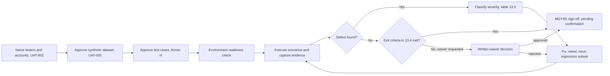

### 10.3 Defect classification (Proposed)

| Severity | Definition | Go-live rule (Proposed) |
|---|---|---|
| Critical | Data loss, duplicate case creation, disclosure of protected data, or referral cannot be sent | None open |
| High | Required function fails with no acceptable workaround (for example status not returned) | None open unless waived in writing |
| Medium | Function impaired with a workaround | Documented with fix plan |
| Low | Cosmetic or minor | Tracked |

### 10.4 Proposed acceptance criteria

*Proposed thresholds for governance approval — not formally approved.*

| Criterion | Proposed threshold |
|---|---|
| Scenario coverage | 100% of Annex H scenarios marked Must executed with evidence |
| Defects | 0 open Critical; 0 open High without written waiver |
| Duplicate prevention | 0 duplicate CPIMS+ cases across all retry, resubmission and lost-response tests |
| Outage recovery | 100% of referrals queued during a simulated outage are delivered or flagged for manual action after restoration; none lost |
| Audit completeness | 100% of transmissions and return updates in the test set have an audit record with all approved fields |
| Log hygiene | 0 tokens or full narratives found in sampled application logs |
| Validation rules | 100% of D-005, D-010, D-011, D-013, D-014 test cases behave as specified |
| Return-update timeliness | Threshold Pending Confirmation; depends on mechanism (RT-007) |
| Regression | No Critical or High regression defect in existing OpenCHS functions |

### 10.5 Training (D4)

Operators and social workers: ABR field, referral workflow, validation messages, referral status, returned updates, failure handling and escalation. IT staff: architecture, API configuration, authentication, monitoring, logging, queue management, retries, troubleshooting, environment configuration and support escalation (brief §6).

---

### 10.6 Acceptance requirements and evidence

Ministry-led UAT is agreed, but named testers, safe data, signatories, defect rules and checklist positions still require confirmation. Annex H contains the scenario matrix; Annex J.8 preserves the requirement-level status. Test results, signed acceptance and training evidence must be produced during delivery; their inclusion here does not mean those activities have been completed.

### 10.7 D1 deliverable completion and acceptance readiness

The three columns distinguish **document preparation** (written in a report), **implementation** (built, configured or evidenced) and **formal acceptance** (approved by an authorised person).

| D1 component | Required evidence | Document prepared | Implementation / evidence | Formal acceptance | Outstanding work | Owner |
|---|---|---|---|---|---|---|
| Inception consultations | Minutes of sessions with key stakeholders | Completed (Sessions 1–3 minutes) | — | Not approved | Minutes of 24 Sep and 14 Oct not filed; Session 3 minutes circulation for correction (S3-N01) | BITZ |
| Business requirements | Confirmed workflow, rules, field set | Completed (Annex J, Annex A) | — | Not approved | Minimum dataset, emergency exceptions, correction/cancellation rules; SOP review | Ministry; BITZ |
| Technical requirements | API, authentication, security, reliability | Prepared, partly Pending | — | Not approved | Authentication flow, operation sequence, return mechanism, outage rules | Primero; BITZ |
| Integration architecture | Technical design | Proposed (section 6) | Not verified against environments | Not approved | Technical validation and sign-off | BITZ; Primero |
| Field mapping | Approved mapping baseline | Business field set Confirmed; mapping Pending | Configured definitions not received | Not approved | Service list, configured field IDs, code lists | Primero; Ministry |
| Environment setup | Access and connectivity evidence | Environment matrix prepared | No access evidence; OpenCHS test/UAT being stood up | Not approved | A-015, A-016, API-005; authenticated test call | Primero; BITZ |
| Work plan | Schedule aligned to contract | Baseline and recovery sequencing prepared | — | Not approved | Rebaseline decision | Governance |
| Risk and issue register | Maintained register | Completed (Annex G) | — | Not approved | Proposed P/I to be validated | BITZ |
| Decision and action registers | Maintained registers | Completed (Annexes E, F; tracker) | — | — | Record receipts as they arrive | BITZ |
| Stakeholder approval | Signed approval or conditional acceptance | — | — | **Not started**; approvers unnamed | Name approvers; circulate; resolve comments | UNICEF; Ministry |

**Figure 13 — Position against delivery gates (27 October 2026).** Gates as defined in section 8.7.

```mermaid
flowchart LR
  S0["Requirements baseline recorded, Session 3"]:::done --> CD["A-013/A-017 outstanding; A-014 received, applicability pending"]:::open
  CD --> G1["G1 D1 approved: not achieved"]:::open
  G1 --> G2["G2 Access and approved mapping: not achieved"]:::open
  G2 --> G3["G3 Integration build"]:::future
  G3 --> G4["G4 Integration tests passed"]:::future
  G4 --> G5["G5 UAT signed"]:::future
  classDef done fill:#d4edda,stroke:#2e7d32,color:#1b1b1b
  classDef open fill:#fff3cd,stroke:#b8860b,color:#1b1b1b
  classDef future fill:#eeeeee,stroke:#888888,color:#1b1b1b
```

Completion inventory status [CI §1]: 19 Resolved, 44 Pending, 8 Deferred. The inventory includes later implementation, UAT and handover items, so these counts are not an inception completion percentage.

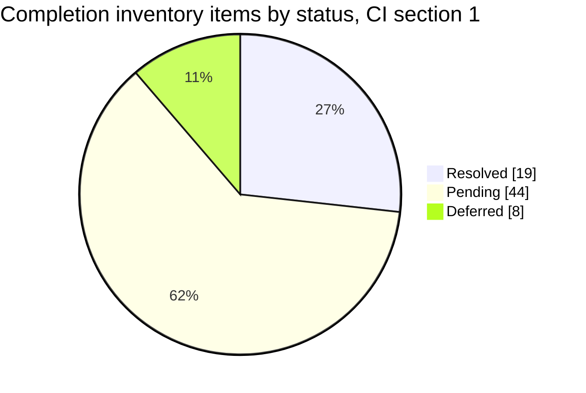

**Assessment:** D1 is **ready for draft circulation** and **not ready for formal acceptance**. The conditions for acceptance are in [D1 Acceptance Readiness](D1_ACCEPTANCE_READINESS.md).

---

## 11 Risks and outstanding decisions

### 11.1 Priority risks

Probability and impact are a **proposed BITZ assessment (H/M/L), not formally assessed**. The full register with effects and review notes is in **Annex G**.

| Risk ID | Description | P | I | Mitigation | Owner | Status |
|---|---|---|---|---|---|---|
| R-001 | Sandbox and API access delay | H | H | Close checklist (A-015); access or playground (A-016); escalate if not received by 28 Oct | Rantsala / Isaiah | Open |
| R-002 | Outstanding country documents and SOP applicability | H | H | Obtain A-013/A-017; confirm SOP applicability under A-014; file receipts | Rantsala / Hopolang / UNICEF | Open |
| R-003 | Field and service-routing configuration incomplete | H | H | Service list (A-018); service-to-recipient configuration; mapping approval | Isaiah / Ministry | Open |
| R-004 | Outage and duplicate recovery unresolved | M | H | Resolve A-021; adopt client UUID; test recovery | Nelson / Peter / Isaiah | Open |
| R-005 | ABR verification dependency | M | M | Keep missing ABR non-blocking; A-007, A-019, A-020 | Ministry / UNICEF / Isaiah | Open |
| R-006 | Two-way design: disclosure risk or lost updates | M | H | Bounded feedback; reconciliation; webhook role | BITZ / Primero | Open |
| R-007 | Privacy and authority gaps | H | H | A-017, A-022; named approvers | UNICEF / Ministry / Nelson | Open |
| R-008 | Focal-person or support gaps | H | M | A-024 cover; A-002 permanent focal; named support owners | Hopolang | Open |
| R-009 | Milestone slippage | H | H | Governance confirms D1 status; written rebaseline | Project governance | Open |
| R-010 | Contract scope change (two-way, attachments) | H | H | Governance decision (section 9) | UNICEF / governance | Open |
| R-011 | CPIMS+ consent requirement | M | H | Ministry defines consent capture and override; Isaiah confirms configured checks | Ministry / Isaiah | Open |
| R-012 | Primero country go-live dependency | M | H | Primero reports Lesotho go-live plan | Isaiah / governance | Open |
| R-013 *(new)* | Unattended authentication flow undecided (SSO vs service credentials) | M | H | Agree service-account flow and token renewal in A-023 working session | Isaiah / Peter / Marlon | Open |
| R-014 *(new)* | Stakeholder approval delays; approvers unnamed | H | H | Name approvers; set review window for this draft | UNICEF / Ministry | Open |
| R-015 *(new)* | Contract and plan wording on "save-event" trigger conflicts with D-006 | M | M | Governance confirms D2/D4 acceptance wording (CD-03) | Project governance | Open |

**Figure 11 — Risk heat map.** This is a proposed BITZ assessment and has not been formally assessed. No risk is currently rated Low on either axis.

| Probability ↓ / Impact → | **High** | **Medium** | **Low** |
|---|---|---|---|
| **High** | R-001 access · R-002 country documents · R-003 configuration · R-007 privacy · R-009 milestones · R-010 scope · R-014 approvals | R-008 focal person | — |
| **Medium** | R-004 outage and duplicates · R-006 two-way design · R-011 consent · R-012 Primero go-live · R-013 authentication | R-005 ABR verification · R-015 save-event wording | — |
| **Low** | — | — | — |

Seven risks sit in the High/High cell. Five of them (R-001, R-002, R-003, R-007, R-014) can be cleared only by inputs or decisions from UNICEF, the Ministry or Primero. They are the focus of the actions in section 11.

### 11.2 Risk review and escalation procedure (Proposed)

1. The risk register is reviewed at each steering review and updated in Annex G and the inventory.
2. A risk rated H/H, or any risk whose mitigation action passes its due date without evidence, is escalated to the UNICEF programme owner and Ministry business owner at the next steering review.
3. Risks close only on filed evidence; an action due date is not evidence of resolution.
4. New risks are added with the next free R-number and logged in the Improvement Log or tracker.

### 11.3 Issues

Current issues (risks already realised): the D1 target month has passed without approval (R-009); the sandbox checklist made no progress between Session 2 and Session 3 (R-001); Session 3 actions due 26 October have no completion evidence filed (R-002, R-007).

---

### 11.4 Decisions required before detailed design can be approved

1. Minimum child-identification dataset and emergency exceptions (WF-004, DATA-005).
2. Consent or lawful-basis approach and override authority (DATA-012, R-011).
3. Authentication flow for the unattended integration (API-002).
4. Operation sequence and service-to-recipient configuration (API-003, RT-003).
5. Idempotency key adoption (OPS-003).
6. Return-update mechanism and permitted fields (RT-007), and contract treatment (R-010).
7. Direct API or OpenFN (API-009).

### 11.5 Decisions required before integration testing can be approved

1. Configured Lesotho environment or explicit acceptance of playground limitations (D-018, API-007).
2. Outage handling (A-021, OPS-001) and retry policy (OPS-002).
3. Approved synthetic test dataset (UAT-003).
4. Defect severity and go-live rules (UAT-007).

## 12 Approval and next steps
Stakeholders are asked to review the business baseline and proposed delivery approach, identify required amendments and name authorised approvers. Approval must state whether unresolved design, access and configuration items are acceptance conditions or bounded dependencies, with owners and milestones. Business agreement does not substitute for technical validation, a contract variation or formal deliverable acceptance.

### 12.1 Review and approval record

| Approval role | Name | Decision | Date |
|---|---|---|---|
| Ministry business owner | To confirm | Pending | |
| UNICEF programme / governance owner | To confirm | Pending | |
| OpenCHS technical authority | To confirm | Pending | |
| Primero technical authority | To confirm | Pending | |
| Data protection / security authority | To confirm | Pending | |
| Ministry UAT signatory | To confirm (MGYSD per annotated checklist) | Pending | |
| Project coordination (BITZ) | Nelson Adagi | Circulation and review tracking pending | |

No approval is recorded. Attendance at a session is not approval of this report.

---

### 12.2 Immediate action table (27 October baseline with 28 October evidence corrections)

**Overdue** means the recorded due date has passed with no completion evidence filed in the workspace; it does not assert that the action was not done.

| Action | Responsible party | Dependency | Required by | Status |
|---|---|---|---|---|
| A-013 Share national referral pathways | Rantsala (UNICEF) | — | 26 Oct 2026 | **Overdue** — no receipt filed |
| A-015 Complete sandbox checklist; post-meeting call | Rantsala, Isaiah | — | 26 Oct 2026 | **Overdue** — outcome not recorded |
| A-017 Share privacy materials | Lekhanya (UNICEF); identity to confirm | — | 26 Oct 2026 | **Overdue** — no receipt filed |
| S3-N01 Circulate Session 3 minutes | BITZ | — | 26 Oct 2026 | **Overdue** — circulation evidence not filed |
| A-014 Resend case-management SOPs | Hopolang | — | 27 Oct 2026 | Received; applicability review pending [SOP1] |
| A-020 Share Berea workshop use cases | Melusi | — | 27 Oct 2026 | Due today — no receipt filed |
| A-024 Name helpline leave cover | Hopolang | — | 27 Oct 2026 | Due today — no confirmation filed |
| S3-N02 One-to-one follow-ups | BITZ | — | 27 Oct 2026 | Due today — outcome not recorded |
| A-016 Provide sandbox or playground access | Isaiah | A-015 | 28 Oct 2026 | Pending |
| A-018 Confirm CPIMS+ service list | Isaiah | — | 28 Oct 2026 | Pending |
| A-021 Agree outage handling | Nelson, Peter, Isaiah | — | 28 Oct 2026 or during testing | Pending; proposals in section 6 |
| A-022 Data protection desk research | Nelson | A-017 | 28 Oct 2026 | In progress |
| A-025 Deliver initial draft inception report | Nelson / BITZ | — | 28 Oct 2026, close of business | v0.7 prepared; circulation pending |
| A-023 Set up API authentication; start test calls | Peter, Marlon | A-016 | After A-016 | Awaiting dependency |
| A-019 Invite BITZ to Primero/X-Road sessions | Lekhanya (UNICEF), Isaiah | — | Next session; date not recorded | Pending |
| A-002 Confirm permanent Child Helpline focal person | Hopolang | — | Not restated | Carried over |
| A-007 Remaining ABR verification rules | Ministry / relevant authority | A-019, A-020 | Not restated | Carried over |
| P-01 Define two-way update contract | OpenCHS / Isaiah / Ministry | R-010 | To agree | Proposed |
| P-02 Complete configured field mapping | OpenCHS / Isaiah / Ministry | A-016, A-018 | To agree | Proposed |
| P-03 Confirm UNICEF contact (Daniel / Lekhanya) | UNICEF | — | To agree | Proposed |
| New — Name approvers for D1 | UNICEF, Ministry | — | Before formal review | Proposed |
| New — Governance decision on scope and schedule | UNICEF, Ministry | — | Before D3 design sign-off | Proposed |

---

## Annexes

| Annex | Content |
|---|---|
| A | Detailed requirements matrix |
| B | API operations and authentication |
| C | Field mapping and data dictionary status |
| D | Referral workflow, sequence detail and status vocabulary |
| E | Decision register |
| F | Action register |
| G | Detailed risk register |
| H | UAT scenario matrix |
| I | Source documents and references |
| J | Categorised requirement baseline and status |

---

## Annex A — Detailed requirements matrix

Priority values are BITZ proposals (see Annex J). Validation methods: **T** = test (Annex H reference), **R** = review/inspection, **D** = demonstration, **E** = evidence of receipt or approval.

### A.1 Business and workflow

| ID | Requirement | Source | Priority (proposed) | Status | Validation / acceptance |
|---|---|---|---|---|---|
| WF-001 | Lifecycle as presented in Session 3; aligned to national pathways and SOPs | D-006; S3 §§3–4 | Must | Confirmed; Dependency A-013/A-014 | R: lifecycle mapped against received SOPs; T: B-01 |
| WF-002 | Manual referral by handling agent; save never sends | D-006 | Must | Confirmed | T: F-01 |
| WF-003 | Optional supervisor escalation; mandatory-escalation rules defined | S1 §6 | Should | Pending Confirmation | E: approved rules; T: B-03 |
| WF-004 | Emergency minimum-information referral | D-003 | Must | Pending Confirmation | E: approved minimum dataset; T: F-05 |
| WF-005 | Partial referral and later information | S2 §3 | Should | Pending Confirmation | E: approved rule; T: F-13 |
| WF-006 | Correction, cancellation, withdrawal and re-referral with history | Brief §4 | Must | Pending Confirmation | E: approved rules; T: F-19 |
| WF-007 | Parallel emergency phone path | S1 §8 | Must | Confirmed | R: SOP and training content; T: B-02 |
| WF-008 | Case plan excluded | D-012 | Must | Confirmed | T: F-16 |
| WF-009 | Anonymous reporter; identified child | D-010; D-011 | Must | Confirmed | T: F-03, F-04 |
| WF-010 | Prank finding sent as follow-up update | S1 §7 | Must | Confirmed | T: F-13 |
| RT-001 | CPIMS+ service list | A-018 | Must | Dependency | E: list received and approved |
| RT-002 | Service selection; Ministry distribution | D-008 | Must | Confirmed | T: F-10, F-18 |
| RT-003 | Configured recipients, reasons, assignment permissions | D-008 | Must | Pending Confirmation | E: configuration record; T: F-10 |
| RT-004 | Non-Ministry stakeholders via CPIMS+ accounts | D-001; S2 §4 | Could | Pending Confirmation | E: configuration record |
| RT-005 | Technical receipt distinct from human acceptance | D-016 | Must | Confirmed | T: F-11 |
| RT-006 | Intermediate status vocabulary | S2 §5 | Must | Pending Confirmation | E: approved vocabulary (Annex D.3) |
| RT-007 | Follow-up and return-update contract | D-007 | Must | Pending Confirmation | E: approved contract; T: F-12, F-13, RC-05 |
| RT-008 | Two-way referred-case feedback | D-007 | Must | Confirmed | T: F-12 |

### A.2 Functional

| ID | Requirement | Source | Priority (proposed) | Status | Validation / acceptance |
|---|---|---|---|---|---|
| FN-001 | Optional ABR field; blank never blocks | D-005 | Must | Confirmed | T: F-07 |
| FN-002 | ABR structural validation | D-014 | Must | Confirmed | T: F-06, F-08, F-09 |
| FN-003 | Explicit referral control; double-submit prevention | D-006; brief §4 | Must | Confirmed; design Proposed | T: F-01, RC-02 |
| FN-004 | Narrative required at referral only | D-013 | Must | Confirmed | T: F-02 |
| FN-005 | Child identity required at referral | D-011 | Must | Confirmed; fields Pending | T: F-04 |
| FN-006 | Service selection from maintained list | D-008 | Must | Confirmed; Dependency | T: F-10 |
| FN-007 | Referral status display | Brief §4 | Must | Contractual | T: F-11, F-12 |
| FN-008 | Separate acknowledgement events displayed | D-016 | Must | Confirmed | T: F-11 |
| FN-009 | Follow-up updates to linked case | D-012; S1 §7 | Must | Confirmed | T: F-13 |
| FN-010 | Returned status and interventions on linked case | D-007 | Must | Confirmed | T: F-12 |
| FN-011 | Case plan never transmitted | D-012 | Must | Confirmed | T: F-16 |
| FN-012 | Clear validation messages | Brief §4 | Must | Contractual | T: F-02, F-04, F-08 |

### A.3 Data and fields

| ID | Requirement | Source | Priority (proposed) | Status | Validation / acceptance |
|---|---|---|---|---|---|
| DATA-001 | ABR issuer NICR | D-014 | Must | Confirmed | R: provenance retained |
| DATA-002 | ABR optional; caseworker obtains later | D-005 | Must | Confirmed | T: F-07 |
| DATA-003 | Remaining ABR verification contract | A-007 | Should | Pending Confirmation | E: authority response |
| DATA-004 | ABR correction and cross-system update | D-005 | Should | Pending Confirmation | T: F-17 |
| DATA-005 | Child identity mapping and minimum fields | D-011 | Must | Pending Confirmation | E: approved mapping |
| DATA-006 | Age, sex, nationality, location, contact | D-012 | Must | Pending Confirmation | E: approved mapping |
| DATA-007 | Protection-concern mapping (multi-select) | S2 §11 | Must | Pending Confirmation | E: standard list; T: F-10 |
| DATA-008 | Reporter contact and anonymity | D-010 | Must | Pending Confirmation | T: F-03 |
| DATA-009 | Perpetrator details | D-004; D-012 | Must | Pending Confirmation | T: F-14 |
| DATA-010 | Attachments controls | D-012 | Must | Pending Confirmation | T: F-15 |
| DATA-011 | Narrative at referral | D-013 | Must | Confirmed | T: F-02 |
| DATA-012 | Consent / disclosure representation | Annex B.6 | Must | Pending Confirmation | E: Ministry decision; T: S-06 |
| DATA-013 | Stable external case reference | OPS-003 | Must | Proposed | T: RC-01 |

### A.4 Integration

| ID | Requirement | Source | Priority (proposed) | Status | Validation / acceptance |
|---|---|---|---|---|---|
| API-001 | API v2 specification is build basis | D-017 | Must | Confirmed | R: version recorded |
| API-002 | Authentication contract | [TR1 §3] | Must | Pending Confirmation | T: S-01, RC-08 |
| API-003 | Operation sequence | Annex B | Must | Pending Confirmation | E: API contract capture; T: F-10 |
| API-004 | Errors, timeouts, performance | [TR1 §8] | Must | Pending Confirmation | T: RC-06 |
| API-005 | OpenCHS test/UAT environment | S1 §9 | Must | Pending Confirmation | E: access evidence |
| API-006 | Sandbox checklist closed | A-015 | Must | Dependency | E: completed checklist |
| API-007 | Sandbox or playground access | D-018; A-016 | Must | Dependency | E: authenticated test call |
| API-008 | Production environment and secrets | — | Must | Pending Confirmation | E: readiness checklist |
| API-009 | Direct connection, not X-Road | D-015 | Must | Confirmed | R: architecture |
| API-010 | Upstream API documentation received | D-017 | Must | Confirmed | R: reference retained |
| GOV-004 | Deployed release and URLs | — | Must | Pending Confirmation | E: recorded by Primero |
| OPS-003 | Idempotency key and reconciliation | Brief §5E | Must | Pending Confirmation | T: RC-01 |

### A.5 Security and privacy

| ID | Requirement | Source | Priority (proposed) | Status | Validation / acceptance |
|---|---|---|---|---|---|
| SEC-001 | Lawful basis and purposes | A-017; A-022 | Must | Dependency | E: written confirmation |
| SEC-002 | Reporter anonymity preserved | D-010 | Must | Confirmed | T: F-03, S-03 |
| SEC-003 | Least-privilege integration account | Annex B.2 | Must | Proposed | T: S-02 |
| SEC-004 | Secret storage and rotation | Brief §5B | Must | Pending Confirmation | R: secret-store configuration |
| SEC-005 | Transport security | Delivery plan | Must | Proposed | T: S-05 |
| SEC-006 | Log redaction and access | Brief §5F | Must | Pending Confirmation | T: S-03 |
| SEC-007 | Synthetic test data | [TR1 §9] | Must | Proposed | E: approved dataset; T: S-08 |
| SEC-008 | Bounded return updates | D-007 | Must | Proposed | T: S-04 |

### A.6 Operational and reliability

| ID | Requirement | Source | Priority (proposed) | Status | Validation / acceptance |
|---|---|---|---|---|---|
| OPS-001 | Durable queue; outage behaviour | Brief §5D; A-021 | Must | Pending Confirmation | T: RC-03 |
| OPS-002 | Retry and escalation policy | Delivery plan | Must | Proposed | T: RC-04 |
| OPS-005 | Masking and log access | — | Must | Pending Confirmation | T: S-03 |
| OPS-006 | Monitoring and support owners | — | Must | Pending Confirmation | E: named owners |
| OPS-007 | Incident and outage procedure | A-021 | Must | Pending Confirmation | E: approved procedure |
| OPS-008 | Regression of existing OpenCHS | Brief §6 | Must | Contractual | T: RG-01 |

### A.7 Audit and monitoring

| ID | Requirement | Source | Priority (proposed) | Status | Validation / acceptance |
|---|---|---|---|---|---|
| OPS-004 | Audit record fields | Brief §5F; S2 §9 | Must | Confirmed in principle | T: AU-01 |
| AUD-001 | Queue monitoring; controlled manual retry | Brief §5D | Must | Contractual | T: RC-04 |
| AUD-002 | Failure state and administrator alert | Delivery plan | Should | Proposed | T: RC-04 |
| AUD-003 | Returned status and interventions reviewable per case | S3 §11 | Must | Confirmed purpose | T: F-12 |

### A.8 UAT and acceptance

| ID | Requirement | Source | Priority (proposed) | Status | Validation / acceptance |
|---|---|---|---|---|---|
| UAT-001 | Ministry-led UAT; roles | D-009 | Must | Confirmed | E: UAT plan |
| UAT-002 | Named testers and signatories | — | Must | Pending Confirmation | E: nomination |
| UAT-003 | Safe test data and environment | — | Must | Pending Confirmation | E: approval |
| UAT-004 | Core scenarios → numbered test cases | S2; S3 §10 | Must | Confirmed; cases Proposed | R: Annex H approved |
| UAT-005 | Acceptance/rejection tested | S2 §4 | Must | Pending Confirmation | T: F-11 |
| UAT-006 | Anonymity and identification tested | D-010; D-011 | Must | Pending Confirmation | T: F-03, F-04 |
| UAT-007 | Defect severity and go-live rules | — | Must | Pending Confirmation | E: approved table 13.3 |
| UAT-008 | Training completed | Brief §6 | Must | Pending Confirmation | E: attendance |
| UAT-009 | Handover and go-live decision | — | Must | Pending Confirmation | E: go/no-go record |
| UAT-010 | Checklist positions on participants, test data, sign-off | Annotated checklist | Must | Pending Confirmation | E: confirmation |

---

## Annex B — API operations and authentication

### B.1 Specification and version

The API reference supplied in the Primero technical response [TR1 §2] describes Primero API v2 (`development_v2` branch README). D-017 accepts it as the build basis unless it changes. The `development_v2` branch moves over time. For this report the upstream Primero source and API documentation (`doc/api/`) were reviewed at release **v2.16.0** (commit `622e0d2d6d`). **Neither establishes the release or configuration deployed for Lesotho** (GOV-004).

### B.2 Operations relevant to the integration (upstream v2.16.0)

| Purpose | Operation | Documented behaviour |
|---|---|---|
| Obtain or renew token | `POST /api/v2/tokens` | Username/password, or an existing valid token; token returned in the `Authorization` header |
| Invalidate token | `DELETE /api/v2/tokens` | Expires the token presented |
| Create case | `POST /api/v2/cases` | `data` object; optional client-generated UUID in `data.id` |
| Update case | `PATCH /api/v2/cases/:id` | Merges submitted fields; subform arrays merged and appended |
| Refer case | `POST /api/v2/cases/:id/referrals` | Addressed to a receiving user (`transitioned_to`); accepts service, agency, notes and consent-override fields |
| Read referral outcomes | `GET /api/v2/cases/:id/referrals`; `GET /api/v2/cases/:id/transitions` | Lists referrals and other transitions |
| Attach file | `POST /api/v2/cases/:id/attachments` | Base64 file with field name, type and content type; requires permission on that field |
| Read history | `GET /api/v2/cases/:id/record_history` | Change history for a case |

Case creation and referral are separate operations. A referral grants another user access to the record; a transfer changes ownership through acceptance or rejection. Because an API referral is addressed to a user, service-based routing (D-008) needs a configured mapping from each service to a receiving user or agency (RT-003). The API accepts only fields the integration account's role permits it to set, so that role must cover the approved mapping and no more (SEC-003).

### B.3 Case creation and duplicate protection

When a client-generated UUID is supplied, case creation returns `204 No Content` on success and `409 Conflict` if a case with that identifier exists. Other documented errors are `403 Forbidden` and `422 Unprocessable Entity` (naming the invalid field). Errors share a code / resource / message structure.

**Proposed idempotency approach:** OpenCHS generates and stores the UUID before the first attempt and reuses it on every retry; a repeat after a lost response yields `409` rather than a second case. Trade-off: `204` returns no case content, so the case display identifier must be read separately. Adoption requires confirmation that the Lesotho deployment behaves as documented and agreement on `409` reconciliation (OPS-003).

### B.4 Authentication

The upstream documentation describes a bearer JWT returned in the response `Authorization` header, a 60-minute expiry, issuance by username/password, and reissue using a valid existing token; reissue does not invalidate other unexpired tokens. Isaiah prefers SSO where an identity provider exists, with username/password as the alternative, and confirms that Primero will set up credentials once implementation is ready. The unattended backend flow, expiry recovery, permissions and secret rotation remain **Pending Confirmation** (API-002, R-013). Choosing SSO for users does not by itself settle integration authentication.

Isaiah confirms network/security controls apply without naming them. Obtain the actual TLS/certificate, VPN, IP allowlisting and firewall prerequisites. Isaiah reports no API rate limits and proposes joint performance management; concurrency, payload limits, timeouts and performance acceptance remain to be agreed (API-004).

### B.5 Return-update options

Primero supports outbound webhooks that send a record's data to an external URL on create or update, authenticated by API key or basic authentication. Fields sent are limited to those permitted to a configured role; each delivery is logged in Primero's audit log; webhooks are enabled per module by configuration. In v2.16.0 the webhook job logs errors and **does not retry failed deliveries**.

| Option | Description | Strengths | Constraints |
|---|---|---|---|
| 1. Webhook + reconciliation | Primero posts updates to an authenticated OpenCHS endpoint; OpenCHS periodically reconciles via referral/transition endpoints | Near-real-time; role-based field minimisation | Needs inbound endpoint and network path; missed deliveries need reconciliation; Lesotho enablement and whether referral status changes trigger a webhook unconfirmed |
| 2. Polling | OpenCHS periodically reads referral and transition status for open referred cases | Outbound-only network path; simpler security | Update lag; API load; intervention details may need case reads |

Decision: **Pending Confirmation** (RT-007) with Primero and the Ministry.

### B.6 Consent check at referral

In the upstream child-protection module, a user referral checks that the case records consent for disclosure to other organisations and consent for services, unless consent is overridden. No consent capture for this purpose was discussed in the sessions, and the corresponding OpenCHS fields have not been verified (DATA-012, R-011).

### B.7 API contract still required for Lesotho

- Sandbox/UAT and production base URLs and the deployed release.
- Integration account, authentication flow and permissions.
- Token expiry and renewal handling for the unattended backend.
- Operation sequence for create, referral, follow-up and attachments.
- Configured request and response examples for the Lesotho forms.
- Confirmation of client-generated identifier support and conflict handling.
- Error classes, timeouts and retry/manual-correction rules.
- Service-to-recipient configuration and lookup/form endpoints if needed.
- Return-update mechanism, payload and delivery guarantees.
- TLS, certificate, VPN, IP allowlisting or firewall requirements.

### B.8 Configuration dependencies

Primero configures the Lesotho demo from SOPs, paper referral forms, approved child-journey use cases and referral pathways; Isaiah expects field definitions and lookup lists after setup. Isaiah reports no existing interface specification, so the teams must jointly capture one (template `04_templates/06_api_contract_capture.docx`).

---

## Annex C — Field mapping and data dictionary status

### C.1 Confirmed information set (D-012) and mapping status

The field set is a **business payload baseline**, not a deployed API schema.

| Information | Business requirement | Status | Technical mapping still needed |
|---|---|---|---|
| Child name and location | Identifying details required to trace the child (D-011) | Confirmed | Name parts, minimum identity, location hierarchy, exceptions |
| Age, sex, nationality, child contact | In agreed bio-data set | Confirmed | Types, codes, estimated age, unavailable contact |
| Case category | Maps to CPIMS+ protection concerns (multi-select) | Confirmed | Approved concern list, multi-value codes |
| Case narrative | Mandatory at referral, not first save (D-013) | Confirmed | Target field, length, permitted sensitive content |
| Reporter contact | Included when available; anonymous reporter allowed (D-010) | Confirmed | Anonymous flag/value, optional contact, privacy |
| Perpetrator details | Included | Confirmed | Fields, unknowns, access, conditional validation |
| Attachments | Included | Confirmed | File types, size, scanning, permissions, retention |
| Follow-up updates | Included; linked to the original case | Confirmed | Events, ownership, timestamps, permissions |
| ABR ID | Optional; NICR structural validation (D-005, D-014) | Confirmed | Target field, blank representation, correction |
| Selected service | Agent selects from CPIMS+ service list (D-008) | Confirmed; list is a Dependency | Service codes; receiving user or agency per service |
| Consent and disclosure | Not discussed in sessions | Pending Confirmation | Whether CPIMS+ consent fields must be set (B.6) |
| CPIMS+ feedback | Status and interventions returned (D-007) | Confirmed | Approved values, minimisation, delivery, reconciliation |
| Helpline case plan | Not transmitted | Excluded (Confirmed) | Exclude from payload |
| External case reference | Technical linkage | Proposed | Client-generated UUID or other key; returned case ID |

### C.2 ABR identifier rules (D-005, D-014)

| Attribute | Rule | Status |
|---|---|---|
| Meaning | Birth registration number issued at birth; persists through national ID, passport and school records (Session 1 §5) | Confirmed |
| Issuing authority | NICR, Ministry of Home Affairs | Confirmed (reported by Hopolang after contact with Home Affairs) |
| Length | 12 digits | Confirmed |
| Prefix | First digit 0 or 1 | Confirmed |
| Sex position | Seventh digit: 1 male, 2 female | Confirmed |
| Requiredness | Optional; referral proceeds when unavailable | Confirmed |
| Missing identifier | Receiving caseworker obtains it during follow-up | Confirmed |
| Storage | Text, preserving leading zeroes | Proposed |
| Sex mismatch handling | Warn, block or accept | Pending Confirmation |
| Checksum / uniqueness / live verification | Not supplied; A-007 open; Home Affairs route via A-019 sessions | Pending Confirmation |

**Figure 14 — ABR ID structure** (D-014; [M3 §9]; [RC1] item 6). The source defines only positions 1 and 7. The meaning of the other positions is not recorded.

| Position | 1 | 2 | 3 | 4 | 5 | 6 | 7 | 8 | 9 | 10 | 11 | 12 |
|---|---|---|---|---|---|---|---|---|---|---|---|---|
| Rule | 0 or 1 | digit | digit | digit | digit | digit | 1 = male, 2 = female | digit | digit | digit | digit | digit |

Validation outcomes: a blank value is accepted (D-005). A value that is not 12 digits, starts with 2–9, or has a seventh digit other than 1 or 2 is rejected with a message (F-08). A seventh digit that conflicts with the recorded sex follows the rule still to be agreed (F-09).

Structural checks do not prove that an identifier exists or belongs to the child.

### C.3 Mapping attributes required per field

Source and target field; direction; datatype; requiredness (including conditional); validation; transformation; lookup values; sensitivity classification; approving owner. Isaiah supplies configured definitions and lookups; Ministry and OpenCHS stakeholders approve the business mapping (Proposed approval route). Template: `04_templates/04_field_mapping_worksheet.docx`.

### C.4 Candidate field names

Earlier developer examples (`abr_id`, `openchs_reference_id`, `name_first`, `name_last`, `protection_concerns`, `location_current`, `referral_notes`) are **candidate names, not the confirmed Lesotho schema**. Date-of-birth, risk-level, module and referral-source examples require explicit mapping approval; their presence in earlier material does not expand the agreed field set. Primero will produce one standardised protection-concern list aligned across both systems (Session 2 §11). The OpenCHS "Services Offered" value sent on referral is a label such as "CPIMS+" or "Child Protection Service".

### C.5 Data dictionary status

| Item | Status |
|---|---|
| OpenCHS case/contact data object | Shared by Nelson in Session 2 |
| CPIMS+ required field list | Requested in Session 2; not received |
| Configured Lesotho field definitions and lookups | Dependency — after sandbox setup |
| Unified national referral form | Recorded as shared (A-004); not filed |
| Standardised protection-concern list | Dependency — Primero |
| CPIMS+ service list | Dependency — A-018 |

---

## Annex D — Referral workflow, sequence detail and status vocabulary

### D.1 Agreed referral lifecycle

1. The agent receives the call, records the contact and saves the helpline case. The narrative need not be complete at first save (D-013).
2. The handling agent decides to refer and selects an approved CPIMS+ service (D-006, D-008), optionally escalating to a supervisor first (S1 §6).
3. OpenCHS validates the narrative and required child-identifying information, allowing an anonymous reporter and absent ABR ID (D-010, D-011, D-005).
4. The integration submits the agreed data and records a system acknowledgement or a failure requiring recovery (D-016).
5. The receiving party accepts or rejects the referral through the CPIMS+ workflow. System receipt does not prove human acceptance (D-016).
6. Ministry users distribute and assign internally; the helpline does not select a caseworker (D-008).
7. OpenCHS sends follow-up information against the linked case; CPIMS+ returns approved status and intervention updates (D-007, D-012).
8. Closure, correction, cancellation and re-referral retain linkage and an auditable history; detailed rules pending (WF-006).

Urgent cases are phoned to police or first responders in parallel (WF-007).

### D.2 Native CPIMS+ referral mechanism (Session 2 demonstration)

A user opens the Services panel, chooses an Internal or External referral and a service (for example case management or medical service), and records the reason and expected outcome. The recipient sees the referral as pending and must accept it (which opens the case file) or reject it with a reason. Assignment to a caseworker by a district manager is a separate, later step. The helpline needs visibility of acceptance and later service completion or closure, not of internal assignment (S2 §4).

### D.3 Status vocabulary

Upstream Primero transition statuses (v2.16.0): `in_progress`, `accepted`, `rejected`, `done`, `revoked`, with successful/not-successful outcome and whether the service was implemented. The helpline-facing vocabulary should be derived from these rather than invented separately (RT-006).

**Figure 15 — Proposed helpline referral states (Pending Confirmation).**

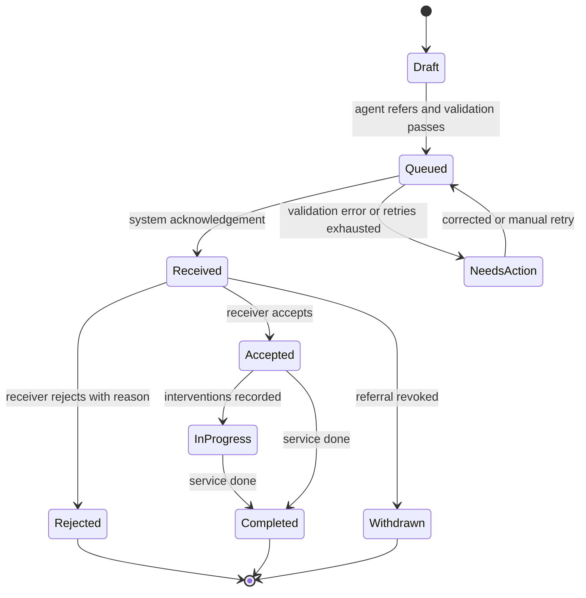

| Proposed helpline state | Upstream basis | Meaning |
|---|---|---|
| Draft | — | Case saved; not referred |
| Queued | — | Referral accepted by OpenCHS for delivery |
| Needs action | — | Validation error or delivery failure needing operator/administrator action |
| Received | API success | System acknowledgement (D-016) |
| Accepted | `accepted` | Human acceptance (D-016) |
| Rejected | `rejected` | Human rejection with reason |
| In progress | Intervention updates | Case being worked; interventions returned |
| Completed | `done` | Service completed, with outcome |
| Withdrawn | `revoked` | Referral revoked |

### D.4 Reliability design (Proposed)

Durable referral records; stable correlation reference; auditable attempts. Retries reuse the client UUID; uncertain timeouts reconciled; errors classified as retryable or needing correction; proposed back-off at 1 minute, 5 minutes, 30 minutes and 2 hours before marking failed and alerting an administrator (delivery plan; Proposal). Equivalent controls apply to repeated or out-of-order return updates; conflicting updates need explicit ownership rather than blind overwrites. An OpenCHS change must not automatically close or overwrite a CPIMS+ case without an agreed update contract.

---

## Annex E — Decision register

Identifiers continue the Session 1–2 register; where Session 3 updated an earlier decision it kept the earlier ID. Earlier v0.4 report-local numbering is not equivalent.

### E.1 Current decisions

| ID | Decision | Source | Status | Supersedes |
|---|---|---|---|---|
| D-001 | Support referrals to CPIMS+/MGYSD and other approved stakeholders | Session 2 | Confirmed (in principle) | — |
| D-002 | SOP covers the broader referral ecosystem and role-holders | Session 2 | Confirmed (in principle) | — |
| D-003 | Emergency referrals need not capture every detail first | Session 2 | Confirmed direction; minimum dataset Pending | — |
| D-004 | Perpetrator information is important | Session 2 | Confirmed; included by D-012 | — |
| D-005 | ABR optional; receiving caseworker obtains it if missing | Session 3 | Confirmed | Session 2 D-005 ("subject to approved Ministry process") |
| D-006 | Manual handling-agent referral; process as presented | Session 3 | Confirmed | Session 2 D-006 ("direction discussed") |
| D-007 | Two-way integration for referred-case updates | Session 3 | Confirmed | Session 2 D-007 (closed-loop "in principle"); Session 1 decision 5 one-way scope |
| D-008 | Ministry distribution; helpline selects CPIMS+ service | Session 3 | Confirmed; service list to confirm | Session 2 D-008; Session 1 decision 6 (direct to district supervisor) |
| D-009 | Ministry-led UAT with recorded participant roles | Session 3 | Confirmed | Session 2 D-009 ("agreed direction") |
| D-010 | Anonymous reporter allowed, recorded as such in CPIMS+ | Session 3 | Confirmed | Session 2 position that anonymous reports cannot be referred |
| D-011 | Child identifying details mandatory for referral | Session 3 | Confirmed | — |
| D-012 | Field set as presented; case plan not sent | Session 3 | Confirmed | Session 3 facilitation-deck proposal to defer attachments |
| D-013 | Narrative mandatory at referral, not first save | Session 3 | Confirmed | — |
| D-014 | NICR ABR format for initial validation | Session 3 | Confirmed | Session 1 "validation deferred" |
| D-015 | Direct API or OpenFN; X-Road only for Home Affairs checks | Session 3 | Confirmed; API vs OpenFN choice Pending (Ministry) | — |
| D-016 | Two acknowledgements: system and human | Session 3 | Confirmed | — |
| D-017 | Primero API documentation is the build basis unless it changes | Session 3 | Confirmed | — |
| D-018 | Global playground if Lesotho sandbox not ready by draft report | Session 3 | Confirmed | — |

"Confirmed" means agreed in the minutes; approval of this report remains pending.

### E.2 Session 1 numbered decisions

| Session 1 # | Decision | Current position |
|---|---|---|
| 1 | Manual trigger by handling agent | Retained (D-006) |
| 2 | Perpetrator details included | Retained (D-004, D-012) |
| 3 | Payload: bio-data, category, narrative, reporter contact, perpetrator | Extended by D-012 (attachments, follow-ups, ABR) |
| 4 | ABR field optional; validation deferred | Updated by D-005, D-014 |
| 5 | Post-referral updates pushed to CPIMS+; return not committed | Retained for outbound; return now in scope (D-007) |
| 6 | Helpline refers directly to district supervisor | **Superseded** by D-008 |
| 7 | Emergencies by direct phone in parallel | Retained (WF-007) |
| 8 | OpenCHS integrates directly with CPIMS+; X-Road separate | Retained (D-015) |

---

## Annex F — Action register

Status at 27 October 2026. "Completed" is used only where the minutes record completion.

### F.1 Session 3 actions

| ID | Action | Owner | Recorded due | Status |
|---|---|---|---|---|
| A-013 | Share national referral pathways | Rantsala | 26 Oct 2026 | Overdue — no receipt filed |
| A-014 | Resend case-management SOPs incl. referral section | Hopolang Mosena | 27 Oct 2026 | Received [SOP1]; Ministry to confirm current applicability; BITZ to complete mapping review |
| A-015 | Complete sandbox checklist; post-meeting call | Rantsala / Isaiah | 26 Oct 2026 | Overdue — outcome not recorded |
| A-016 | Provide Lesotho sandbox or global playground access | Isaiah | 28 Oct 2026 | Pending |
| A-017 | Share Ministry data-protection work, policy and legislation | Lekhanya (UNICEF), as recorded | 26 Oct 2026 | Overdue — no receipt filed; owner identity to confirm |
| A-018 | Confirm CPIMS+ service list | Isaiah | 28 Oct 2026 | Pending |
| A-019 | Invite BITZ to Primero/X-Road sessions | Lekhanya (UNICEF) / Isaiah | Next session | Pending |
| A-020 | Share Berea X-Road workshop use cases | Melusi | 27 Oct 2026 | Due today — no receipt filed |
| A-021 | Agree handling of referrals during outages | Nelson / Peter / Isaiah | 28 Oct 2026 or during testing | Pending |
| A-022 | Data protection desk research | Nelson | 28 Oct 2026 | In progress |
| A-023 | Configure API authentication; begin test calls | Peter / Marlon | After A-016 | Awaiting dependency |
| A-024 | Name helpline coordination leave cover | Hopolang | 27 Oct 2026 | Due today — no confirmation filed |
| A-025 | Deliver initial draft inception report | Nelson / BITZ | 28 Oct 2026, COB | v0.7 prepared; circulation pending |
| S3-N01 | Circulate Session 3 minutes | BITZ | 26 Oct 2026 | Circulation evidence not filed |
| S3-N02 | One-to-one follow-ups (outage, service list, cover) | BITZ | 26–27 Oct 2026 | Outcome not recorded |
| P-01 | Define two-way update contract | OpenCHS / Isaiah / Ministry | To agree | Proposed |
| P-02 | Complete configured field mapping | OpenCHS / Isaiah / Ministry | To agree | Proposed |
| P-03 | Confirm UNICEF contact (Daniel / Lekhanya) | UNICEF | To agree | Proposed |

### F.2 Earlier actions (Sessions 1–2)

| ID | Action | Owner | Status as last recorded | Current treatment |
|---|---|---|---|---|
| A-001 | Provide participant list | Hopolang | Completed (Session 2 minutes) | Closed |
| A-002 | Name Child Helpline focal person | Hopolang | Pending | Carried forward by Session 3 |
| A-003 | Share referral workflow/process | Tiisetso | Completed (Session 2 minutes) | Closed; document not filed |
| A-004 | Share referral form | Isaiah | Completed (Session 2 minutes) | Closed; **form not filed in workspace** |
| A-005 | Review referral form for field requirements | Project team | Pending | Not carried forward; field set settled by D-012 |
| A-006 | Identify ABR integration support | Hopolang | Pending | Not carried forward; addressed by D-014, A-019 |
| A-007 | Confirm ABR format, ownership, rules | Ministry / relevant authority | Pending | Carried forward for residual verification rules |
| A-008 | Agree CPIMS+ recipients and routing | Ministry / CPIMS+ | Pending | Not carried forward; D-008, A-018, RT-003 |
| A-009 | Define closed-loop feedback statuses and mechanism | Ministry / CPIMS+ / CHL | Pending | Not carried forward; D-007, P-01, RT-006/007 |
| A-010 | Set up sandbox and API access | UNICEF / technical teams | Pending | Not carried forward; A-015, A-016 |
| A-011 | Confirm UAT participants, data, scenarios, sign-off | Ministry / CHL / technical | Pending | Not carried forward; D-009, UAT-002/003 |
| A-012 | Confirm UNICEF participation or approval | UNICEF / governance | Pending | Participation addressed in Session 3; approval route GOV-003 |

---

## Annex G — Detailed risk register

P and I: proposed BITZ assessment, **not formally assessed**. All risks remain Open until closure evidence is filed.

| Risk ID | Description | Effect | P | I | Mitigation | Owner | Trigger for escalation | Status |
|---|---|---|---|---|---|---|---|---|
| R-001 | Sandbox / API access delay | Blocks configured mapping and integration tests | H | H | A-015 checklist; A-016 access or playground; escalation template 14 | Rantsala / Isaiah | No access by 28 Oct | Open |
| R-002 | Outstanding country documents and SOP applicability | Requirements cannot be checked against approved practice | H | H | Obtain A-013/A-017; confirm SOP applicability; reconcile Form 4 with the unified referral form; retain receipts | Rantsala / Hopolang / UNICEF | Any item overdue at next review | Open |
| R-003 | Field and service configuration incomplete | Invalid payloads or misrouting | H | H | A-018 service list; service-to-recipient configuration; approved mapping | Isaiah / Ministry | No list by 28 Oct | Open |
| R-004 | Outage and duplicate recovery unresolved | Lost, repeated or uncertain referrals | M | H | Resolve A-021; adopt client UUID; recovery tests RC-01–RC-04 | Nelson / Peter / Isaiah | Not agreed before design sign-off | Open |
| R-005 | ABR verification dependency | Format-valid IDs may remain unverified | M | M | Keep missing ABR non-blocking; A-007, A-019, A-020 | Ministry / UNICEF / Isaiah | Home Affairs route demands build scope | Open |
| R-006 | Two-way design | Disclosure risk or lost updates | M | H | Bounded feedback; reconciliation; webhook role | BITZ / Primero | Mechanism undecided at design review | Open |
| R-007 | Privacy and authority gaps | Unauthorised sharing or unclear approvals | H | H | A-017, A-022; named approvers | UNICEF / Ministry / Nelson | Materials not received by next review | Open |
| R-008 | Focal-person or support gaps | Delayed review, UAT and incident resolution | H | M | A-024 cover; A-002 focal; named support owners | Hopolang | No cover named by 27 Oct | Open |
| R-009 | Milestone slippage | D1 overdue; D2/D3 windows at risk | H | H | Governance confirms D1 status; written rebaseline | Project governance | Already realised (issue) | Open |
| R-010 | Contract scope change | Two-way updates and attachments exceed outbound D3 | H | H | Governance decision (section 9) | UNICEF / governance | No decision before D3 design sign-off | Open |
| R-011 | CPIMS+ consent requirement | Referrals blocked or made without agreed basis | M | H | Ministry defines consent capture and override; Isaiah confirms configured checks | Ministry / Isaiah | Consent check active in configured environment without decision | Open |
| R-012 | Primero go-live dependency | OpenCHS delivery pushed outside window | M | H | Primero reports Lesotho go-live plan | Isaiah / governance | No plan by next steering review | Open |
| R-013 | Unattended authentication flow undecided | Integration cannot run unattended or credentials handled insecurely | M | H | Agree service-account flow, renewal and storage | Isaiah / Peter / Marlon | Not agreed when access arrives | Open (new, proposed) |
| R-014 | Stakeholder approval delays | D1 cannot be accepted; payment and schedule affected | H | H | Name approvers; agreed review window | UNICEF / Ministry | No approvers named by draft circulation | Open (new, proposed) |
| R-015 | "Save-event" wording in plan conflicts with D-006 | Misbuild or acceptance dispute for D2/D4 | M | M | Confirm acceptance wording (CD-03) | Project governance | Not clarified before D2 demonstration | Open (new, proposed) |

---

## Annex H — UAT scenario matrix

Planned scenarios, **not executed tests**. Each needs expected result, tester, environment, evidence and defect outcome at execution. Priority values are proposed.

### H.1 Business process (B)

| ID | Scenario | Basis | Expected result | Priority |
|---|---|---|---|---|
| B-01 | End-to-end referral following SOP pathway | WF-001; D-006 | Steps D.1 1–7 complete with correct states | Must |
| B-02 | Emergency case: phone call plus system referral | WF-007; D-003 | Phone path unaffected; referral recorded and tracked | Must |
| B-03 | Agent escalates to supervisor before referral | WF-003 | Escalation recorded; referral by agent after review | Should |

### H.2 Functional (F)

| ID | Scenario | Basis | Expected result | Priority |
|---|---|---|---|---|
| F-01 | Save case without referring | D-006 | Nothing sent to CPIMS+ | Must |
| F-02 | Save without narrative; attempt referral without narrative | D-013 | Save succeeds; referral blocked with message | Must |
| F-03 | Anonymous reporter, identified child | D-010; D-011 | Referral succeeds; CPIMS+ shows reporter anonymous; no reporter identity sent | Must |
| F-04 | Missing child identifying details | D-011 | Referral blocked with message (unless approved emergency exception) | Must |
| F-05 | Emergency minimum-information referral | D-003; WF-004 | Behaves per approved minimum dataset | Must (rule pending) |
| F-06 | Valid ABR ID | D-014 | Accepted and transmitted | Must |
| F-07 | ABR absent | D-005 | Referral proceeds | Must |
| F-08 | ABR invalid: 11 or 13 digits; prefix 2–9; seventh digit not 1 or 2; non-numeric | D-014 | Clear validation message; leading zero preserved for valid IDs | Must |
| F-09 | ABR seventh digit inconsistent with recorded sex | D-014 | Behaves per agreed rule | Should (rule pending) |
| F-10 | Service selection routes to configured recipient | D-008 | Referral appears for the configured receiving user/agency | Must |
| F-11 | System acknowledgement, then accept; separately reject with reason | D-016 | Distinct Received, Accepted / Rejected states and reason shown | Must |
| F-12 | Status and intervention updates returned | D-007 | Linked OpenCHS case shows approved fields only | Must |
| F-13 | OpenCHS follow-up, including prank re-flag | D-012; S1 §7 | Update applied to linked CPIMS+ case, no new case | Must |
| F-14 | Perpetrator details | D-004; D-012 | Transmitted to agreed fields; unknowns handled | Must |
| F-15 | Attachment within and outside agreed limits | D-012 | Allowed files transmitted; disallowed rejected with message | Must |
| F-16 | Case plan present in OpenCHS | D-012 | Case plan not in payload | Must |
| F-17 | ABR added or corrected later | DATA-004 | Behaves per agreed update contract | Should |
| F-18 | Ministry distribution after acceptance | D-008 | Helpline sees acceptance and progress, not internal assignment | Must |
| F-19 | Correction, cancellation, re-referral | WF-006 | Behaves per approved rules; history preserved | Must (rules pending) |

### H.3 Security and privacy (S)

| ID | Scenario | Basis | Expected result | Priority |
|---|---|---|---|---|
| S-01 | Token issue, expiry after 60 minutes, renewal | API-002 | Uninterrupted delivery; no credential in logs | Must |
| S-02 | Integration account attempts unapproved field | SEC-003 | Field not set | Must |
| S-03 | Log inspection | SEC-006 | No tokens or full narratives; reporter anonymity intact | Must |
| S-04 | Return-update channel authentication and field limits | SEC-008; RT-007 | Unauthenticated calls refused; only approved fields stored | Must |
| S-05 | Transport security | SEC-005 | TLS enforced; invalid certificate rejected outside local | Must |
| S-06 | Consent fields and override | DATA-012 | Behaves per Ministry decision | Must |
| S-07 | OpenCHS role access to returned data | SEC-008 | Only authorised roles see returned updates | Must |
| S-08 | Test data check | SEC-007 | Only approved synthetic data in test environments | Must |

### H.4 Recovery and reliability (RC)

| ID | Scenario | Basis | Expected result | Priority |
|---|---|---|---|---|
| RC-01 | Lost response after case creation; retry with same UUID | OPS-003 | `409` reconciled; exactly one CPIMS+ case | Must |
| RC-02 | Agent double-clicks referral | FN-003 | One referral only | Must |
| RC-03 | Primero unavailable; referrals queued; service restored | OPS-001 | All queued referrals delivered or flagged; none lost | Must |
| RC-04 | Retries exhausted | OPS-002; AUD-001/002 | Failed state, administrator alert, controlled manual retry works | Must |
| RC-05 | Duplicate and out-of-order return updates | RT-007 | Duplicates ignored; stale updates do not overwrite newer state | Must |
| RC-06 | `422` validation error from Primero | API-004 | Needs-action state with field named; no blind retry | Must |
| RC-07 | Missed webhook delivery (if Option 1) | B.5 | Reconciliation recovers the update | Must (if Option 1) |
| RC-08 | Token expires while queue is draining | API-002 | Re-authentication; delivery continues | Must |

### H.5 Audit and regression

| ID | Scenario | Basis | Expected result | Priority |
|---|---|---|---|---|
| AU-01 | Audit record completeness | OPS-004 | Every transmission and return update has all approved fields | Must |
| RG-01 | Regression of existing OpenCHS functions | OPS-008 | No Critical/High regression | Must |

### H.6 Coverage of Session 3 decisions

| Decision | Scenarios |
|---|---|
| D-005 | F-07, F-17 |
| D-006 | F-01, B-01, RC-02 |
| D-007 | F-12, RC-05, S-04, RC-07 |
| D-008 | F-10, F-18 |
| D-009 | UAT organisation (section 10.2) |
| D-010 | F-03, S-03 |
| D-011 | F-03, F-04 |
| D-012 | F-13, F-14, F-15, F-16 |
| D-013 | F-02 |
| D-014 | F-06, F-08, F-09 |
| D-015 | Architecture review (section 6) |
| D-016 | F-11 |
| D-017 | S-01, RC-01, RC-06 (built to documented API) |
| D-018 | Environment record notes playground vs Lesotho configuration for each test |

---

## Annex I — Source documents and references

### I.1 Source register

The bracketed codes are used for citations throughout the report. Where a source has numbered sections, citations take the form [M3 §11].

| Ref. | Source | Location | Date | Use |
|---|---|---|---|---|
| [M3] | OpenCHS & Primero CPIMS+ Integration — Session 3 Minutes | `03_meetings/session_3/OpenCHS & Primero CPIMS+ Integration — Session 3 Minutes.pdf` | 26 Oct 2026 | Governing baseline: D-005–D-018; A-013–A-025 |
| [AT3] | Session 3 Action Tracker | `03_meetings/session_3/SESSION_3_ACTION_TRACKER_2026-10-26.xlsx` | 26 Oct 2026 | Actions, S3-N, P-01–P-03, contacts |
| [M2] | OpenCHS & Primero CPIMS+ Integration — Session 2 Minutes (Technical Architecture) | `03_meetings/session_2/SESSION_2_MINUTES.pdf` | 9 Oct 2026 | D-001–D-004; CPIMS+ demonstration; earlier actions |
| [M1] | OpenCHS & Primero CPIMS+ Integration — Session 1 Minutes (Business & Workflow) | `03_meetings/session_1/SESSION_1_MINUTES.pdf` | 8 Oct 2026 | Workflow, attendees, original decisions |
| [TR1] | Primero Technical Response to the BITZ inception questionnaire (request dated 2 Oct 2026); section numbers follow the questionnaire | `06_correspondence/ISAIAH_RESPONSE_SOURCE_2026-10-26.md` (transcription) | Recorded 26 Oct 2026; reply date not supplied | Environment, API, authentication, error handling, test data, UAT |
| [RQ1] | BITZ circulated requirements and ownership checklist (email) | `06_correspondence/NELSON_LAST_CIRCULATED_REQUIREMENTS_EMAIL_SOURCE_2026-10-26.md` | Sent date not supplied | Outstanding checklist; 14 Oct call reference |
| [RC1] | CHL Integration with Primero Requirement Checklist (annotated); item numbers follow the checklist | `03_meetings/CHL intergration with Primero Requirement Checklist.docx` | Author and date not recorded | NICR format (item 6); UAT participants and sign-off (item 10); data protection reference (item 11) |
| [TB] | Technical Scope / TOR Brief — Lesotho Child Helpline 116 / OpenCHS, Amendment 3 | `07_source_documents/Lesotho_OpenCHS_Technical_Scope_Inception_Brief.pdf` | 24 Sep 2026 | Contract scope; workstreams; inception questions |
| [DP] | Contract-Aligned Delivery Plan v0.2 | `02_project_management/CONTRACT_ALIGNED_DELIVERY_PLAN.md` | 14 Oct 2026; updated 26 Oct 2026 | Milestones; payment gates |
| [CI] | Inception Completion Inventory v0.3 | `01_inception/INCEPTION_COMPLETION_INVENTORY.md` | 26 Oct 2026 | Requirement IDs and status |
| [R06] | D1 Inception Report v0.6 | `01_inception/DRAFT_INCEPTION_REPORT_D1_OPENCHS_PRIMERO.md` | 27 Oct 2026 | Predecessor |
| [PA] | Primero source and API v2 documentation, release v2.16.0 | Local repository, commit `622e0d2d6d`; `doc/api/`; public reference <https://github.com/primeroIMS/primero/blob/development_v2/app/controllers/api/README.md> | Commit 19 Oct 2026; public reference reviewed 26 Oct 2026 | Annex B |
| — | Technical reference material | `05_technical_reference/` | Various | Prior design context only |
| — | Capture templates | `04_templates/` | 26 Oct 2026 | Working forms; pre-Session 3 content must be reconciled |

### I.2 Sources referenced but not available in the workspace

| Source | Status |
|---|---|
| Contract No. 43427866 Amendment 3 and TOR | Not filed; summarised only in the scope brief |
| Minutes of the 24 Sep 2026 inception meeting | Not filed |
| Minutes or outcome of the 14 Oct 2026 technical call | Not filed |
| National referral pathways (A-013) | Not received as at 27 Oct |
| Case-management SOPs (A-014) | Received and reviewed for report impact on 28 Oct [SOP1]; September 2019 edition; current applicability pending Ministry confirmation |
| Unified national referral form (A-004) | Recorded as shared; not filed |
| Privacy materials and legislation (A-017) | Not received as at 27 Oct |
| Berea X-Road workshop use cases (A-020) | Not received as at 27 Oct |
| Sandbox readiness checklist (A-015) | Not filed |
| CPIMS+ service list (A-018) | Not received as at 27 Oct |
| Configured Lesotho field definitions and lookups | Dependent on sandbox setup |
| Original Isaiah email | Transcription only; sent date not supplied |

### I.3 Acronyms retained from sources

ABR ID; API; CHL; CPIMS / CPIMS+; D1–D4; GBV; JWT; MGYSD; NICR; OpenCHS; OpenFN; SOP; SSO; TLS; TOR; UAT; UNICEF; VPN; X-Road. Expansions are given only where the sources state them (NICR: issued by the Ministry of Home Affairs).

## Annex J — Categorised requirement baseline and status

These detailed records preserve the 68-item baseline formerly in section 7 of v0.7. Annex A provides the wider requirements traceability and validation matrix. Neither table is evidence of implementation or approval.

### J.1 Business and workflow requirements

| ID | Requirement | Source | Priority (proposed) | Status |
|---|---|---|---|---|
| WF-001 | Referral follows the lifecycle presented in Session 3, aligned to existing national pathways and SOPs; BITZ does not draft a new national pathway | D-006; S3 §§3–4 | Must | Confirmed; SOP received, applicability pending; separate pathways outstanding (A-013, A-014) |
| WF-002 | Referral is initiated manually by the handling agent; saving a case does not send a referral | D-006; S1 §6 | Must | Confirmed |
| WF-003 | Agent may escalate to a supervisor before referring; rules for mandatory escalation to be defined | S1 §6 | Should | Pending Confirmation |
| WF-004 | Emergency referrals need not capture every detail first; minimum dataset to be defined | D-003 | Must | Pending Confirmation |
| WF-005 | Partial referrals and later information handled with a defined status and completion rule | S2 §3 | Should | Pending Confirmation |
| WF-006 | Correction, cancellation, withdrawal and re-referral rules with preserved history | Brief §4 Q6–Q7 | Must | Pending Confirmation |
| WF-007 | Urgent cases continue to be phoned to police or first responders in parallel | S1 §8 | Must | Confirmed |
| WF-009 | Reporter may be anonymous; child's identifying details are required for referral | D-010; D-011 | Must | Confirmed |
| RT-002 | Agent selects an approved CPIMS+ service; Ministry users distribute; helpline does not select a caseworker | D-008 | Must | Confirmed; service list is a Dependency (A-018) |
| RT-003 | Configured receiving users or agencies, accept/reject reasons and assignment permissions | D-008; S2 §4 | Must | Pending Confirmation |
| RT-004 | Routing to non-Ministry stakeholders (police, courts) via CPIMS+ accounts | D-001; S2 §4 | Could | Pending Confirmation |
| WF-010 *(new)* | A case later found to be a prank is reported to CPIMS+ as a follow-up update | S1 §7 | Must | Confirmed (Session 1, not superseded) |

### J.2 Functional requirements

| ID | Requirement | Source | Priority (proposed) | Status |
|---|---|---|---|---|
| FN-001 | Optional ABR ID field on the OpenCHS intake form; blank value never blocks saving or referral | D-005; brief §4 | Must | Confirmed |
| FN-002 | ABR structural validation: 12 digits; first digit 0 or 1; seventh digit 1 (male) or 2 (female); clear message when invalid | D-014 | Must | Confirmed (handling of sex mismatch Pending Confirmation) |
| FN-003 | Explicit referral control available to the handling agent; prevents accidental or double submission | D-006; brief §4 | Must | Confirmed (contract); design Proposed |
| FN-004 | Referral blocked until case narrative is present; case can be saved without it | D-013 | Must | Confirmed |
| FN-005 | Referral blocked until required child identifying details are present, subject to approved emergency exceptions | D-011; WF-004 | Must | Confirmed; minimum fields Pending Confirmation |
| FN-006 | Agent selects one approved CPIMS+ service from a maintained list | D-008 | Must | Confirmed; list is a Dependency |
| FN-007 | Referral status displayed clearly to operators | Brief §4 | Must | Contractual; vocabulary Pending Confirmation (RT-006) |
| FN-008 | System acknowledgement and human accept/reject recorded and displayed as separate events | D-016; RT-005 | Must | Confirmed |
| FN-009 | OpenCHS sends follow-up updates against the linked CPIMS+ case | D-012; S1 §7 | Must | Confirmed; update contract Pending Confirmation (RT-007) |
| FN-010 | CPIMS+ status and intervention updates for referred cases are shown on the linked OpenCHS case | D-007; RT-008 | Must | Confirmed; mechanism Pending Confirmation |
| FN-011 | Helpline case plan is never transmitted | D-012; WF-008 | Must | Confirmed |
| FN-012 | Validation messages explain missing or invalid data | Brief §4 | Must | Contractual |

### J.3 Data and field requirements

| ID | Requirement | Source | Priority (proposed) | Status |
|---|---|---|---|---|
| DATA-001 | ABR issuing authority: NICR, Ministry of Home Affairs | D-014 | Must | Confirmed |
| DATA-002 | ABR optional; receiving caseworker obtains it later if missing | D-005 | Must | Confirmed |
| DATA-003 | Remaining ABR verification contract: examples, checksum or uniqueness rules if any, invalid-value policy, live verification route | A-007 | Should | Pending Confirmation |
| DATA-004 | Subsequent ABR correction and cross-system update | D-005 | Should | Pending Confirmation |
| DATA-005 | Configured child identity mapping and minimum fields | D-011; D-012 | Must | Pending Confirmation (Dependency on configured definitions) |
| DATA-006 | Age, sex, nationality, location and contact mappings | D-012 | Must | Pending Confirmation |
| DATA-007 | Case category mapped to CPIMS+ multi-select protection concerns using one standardised list | S2 §11 | Must | Pending Confirmation (Primero to supply list) |
| DATA-008 | Reporter contact when available; anonymous representation | D-010; D-012 | Must | Pending Confirmation (mapping) |
| DATA-009 | Perpetrator details mapping | D-004; D-012 | Must | Pending Confirmation (mapping) |
| DATA-010 | Attachments: types, size, scanning, permissions, retention | D-012 | Must | Pending Confirmation |
| DATA-011 | Narrative mandatory at referral | D-013 | Must | Confirmed |
| DATA-012 *(new)* | Consent or other basis for disclosure represented in CPIMS+ referral data | Primero referral consent check (Annex B.6); R-011 | Must | Pending Confirmation |
| DATA-013 *(new)* | Stable external case reference linking the OpenCHS case and CPIMS+ case | OPS-003; brief §5E | Must | Proposed |

The confirmed information set and mapping status are detailed in **Annex C**.

### J.4 Integration and interoperability requirements

| ID | Requirement | Source | Priority (proposed) | Status |
|---|---|---|---|---|
| API-001 | Supplied Primero API specification (API v2) is the build basis unless it changes | D-017 | Must | Confirmed |
| API-009 | Direct connection (API-to-API or OpenFN); no X-Road between OpenCHS and CPIMS+ | D-015 | Must | Confirmed; API vs OpenFN choice Pending Confirmation (Ministry) |
| GOV-004 | Deployed Lesotho Primero release and base URLs recorded | — | Must | Pending Confirmation |
| API-002 | Authentication contract for the unattended integration account | [TR1 §3]; [TB §5B] | Must | Pending Confirmation |
| API-003 | Agreed operation sequence: create case, refer, follow-up update, attachments | Annex B | Must | Pending Confirmation |
| API-004 | Error classes, timeouts, concurrency and performance expectations | [TR1 §8] | Must | Pending Confirmation |
| RT-007 | Return-update contract: events, fields, mechanism, ordering and reconciliation | D-007 | Must | Pending Confirmation |
| OPS-003 | Idempotency key and duplicate reconciliation agreed with Primero | Brief §5E | Must | Pending Confirmation; candidate Proposed |

### J.5 Security and privacy requirements

| ID | Requirement | Source | Priority (proposed) | Status |
|---|---|---|---|---|
| SEC-001 | Lawful basis and authorised purposes for sharing confirmed | A-017; A-022 | Must | Dependency |
| SEC-002 | Reporter anonymity preserved through transfer and return updates | D-010 | Must | Confirmed |
| SEC-003 | Integration account limited to the approved mapping (least privilege) | Annex B.2 | Must | Proposed |
| SEC-004 | Credentials held in a secret store, separate per environment, with rotation | Brief §5B; API-008 | Must | Pending Confirmation |
| SEC-005 | Encrypted transport (proposed minimum HTTPS, TLS 1.2+, certificate verification outside local environments) and the network controls Primero specifies | [DP] Item 30; [TR1 §3] | Must | Proposed; Primero network controls Pending Confirmation |
| SEC-006 | Logs exclude tokens and full child payloads by default; redaction and access rules approved | Brief §5F; OPS-005 | Must | Pending Confirmation |
| SEC-007 | Approved synthetic child-journey dataset for testing; no real child records in test environments without authorisation | [TR1 §9]; UAT-003 | Must | Proposed |
| SEC-008 | Return updates limited to referred cases and approved fields | D-007; RT-008 | Must | Proposed (bound); direction Confirmed |

### J.6 Operational and reliability requirements

| ID | Requirement | Source | Priority (proposed) | Status |
|---|---|---|---|---|
| OPS-001 | Durable queue so referrals are not lost during outages; behaviour during outages agreed | Brief §5D; A-021 | Must | Pending Confirmation |
| OPS-002 | Retry and back-off policy with escalation after exhaustion | Brief §5D; delivery plan | Must | Proposed |
| OPS-006 | Named monitoring and support owners | — | Must | Pending Confirmation |
| OPS-007 | Incident and outage procedure | A-021; A-017 | Must | Pending Confirmation |
| OPS-008 *(new)* | Regression testing shows existing OpenCHS functionality is not adversely affected | Brief §6 | Must | Contractual |

### J.7 Reporting, audit and monitoring requirements

| ID | Requirement | Source | Priority (proposed) | Status |
|---|---|---|---|---|
| OPS-004 | Audit record per transaction: case/reference ID, ABR ID where available, transaction ID, timestamp, actor or system, endpoint/action, outcome, retry history; modelled on CPIMS+ log structure | Brief §5F; S2 §9 | Must | Confirmed in principle; final fields Pending Confirmation |
| AUD-001 *(new)* | Queue monitoring with controlled manual retry | Brief §5D | Must | Contractual |
| AUD-002 *(new)* | Operator-visible failure state and administrator alert on exhausted retries | Delivery plan Item 30 | Should | Proposed |
| AUD-003 *(new)* | Helpline can review returned status and interventions per referred case | S3 §11 | Must | Confirmed purpose; display design Proposed |

### J.8 UAT and acceptance requirements

| ID | Requirement | Source | Priority (proposed) | Status |
|---|---|---|---|---|
| UAT-001 | Ministry leads UAT; participant roles as recorded | D-009 | Must | Confirmed |
| UAT-002 | Named testers, accounts and authorised signatories | — | Must | Pending Confirmation |
| UAT-003 | Safe test data and environment approved | [TR1 §9] | Must | Pending Confirmation |
| UAT-004 | Core scenarios recorded and converted to numbered test cases | S2 UAT scope; S3 §10 | Must | Confirmed (scenarios); test cases Proposed (Annex H) |
| UAT-007 | Defect severity and conditional go-live rules | — | Must | Pending Confirmation |
| UAT-010 *(new)* | Checklist positions: Child Helpline supervisor participates; BITZ provides test data and scenarios; MGYSD signs off | Annotated checklist | Must | Pending Confirmation |

---

